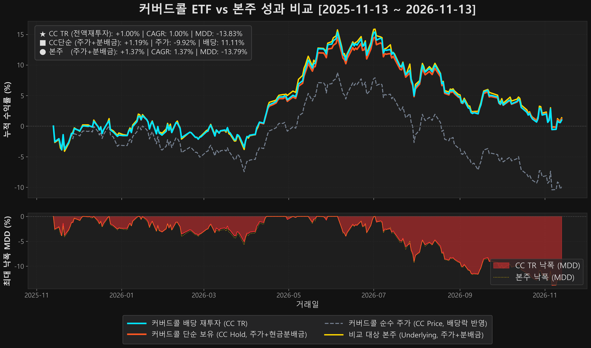

미국 증시의 대표 지수인 S&P 500에 투자하면서도 연 10% 안팎의 안정적인 월배당 현금흐름을 동시에 누리고자 하는 투자자들에게 TIGER 미국S&P500타겟데일리커버드콜(482730)은 출시 이후 꾸준한 관심을 받아온 상품입니다. 기존 전통적 커버드콜이 한 달 내내 상방이 막혀 지수 반등 시 소외되던 구조적 한계를 만기 24시간 미만의 0DTE(당일 만기) 데일리 옵션으로 극복하겠다는 것이 핵심 설계 철학입니다. 과연 지난 1년간의 실제 시장에서 이 전략은 약속된 배당을 충실히 지급하면서도 원금 손실 없이 본주 수준의 총자산을 지켜냈을까요? 1년간의 실측 백테스팅 데이터를 통해 그 성과와 구조적 실체를 객관적으로 해부합니다.

## 1. ETF 기본 정보

| 항목 | 상세 내용 | 항목 | 상세 내용 |
|:---|:---|:---|:---|
| **종목코드 (티커)** | **482730** | **상장일** | 2024-05-21 |
| **운용사** | 미래에셋자산운용 | **기초지수** | S&P500 10% Daily Premium Covered Call Index(TR) |
| **순자산 (AUM)** | **6,950억 원** | **비교 대상 본주** | TIGER 미국S&P500 (360750) |
| **총보수 (수수료)** | **연 0.25%** | **환노출 여부** | **환노출형** (달러/원 환율 변동 반영) |
| **분배 주기** | **월 1회 (월배당)** | **최근 분배율 (연환산)** | **연 11.48% 수준** |
| **옵션 매도 전략** | 만기 1일(0DTE) 데일리 OTM 콜옵션 | **목표 분배율** | 연 10~15% 타겟 프리미엄 (Target Premium) |

---

## 2. 성과 그래프

> 💡 **차트 확인 포인트**: 비비드 오렌지 실선(단순보유 총자산)과 회색 점선(순수 주가) 사이의 간격이 실측 기간 동안 실제로 통장에 입금된 누적 현금 분배금의 실체입니다.

---

## 3. 성과 요약 테이블

- **분석 기간**: 2025-11-13 ~ 2026-11-13 (1Y, 총 365일 실측)
- **초기 투자 원금**: 10,000,000원
- **적용 배당소득세율**: 0.0% (비과세/절세계좌 기준)

| 전략 | 초기 원금 | 최종 주식 평가액 | 순수 주가 변동률 | 누적 수령 분배금 (현금) | 최종 총자산 | 최종 종합 수익률 (Total Return) | CAGR (연평균 복리수익률) | MDD (최고점 대비 최대 낙폭) | 샤프 지수 (Sharpe Ratio) |
|:---|---:|---:|---:|---:|---:|---:|---:|---:|---:|
| **커버드콜 단순보유** | 10,000,000원 | 9,008,230원 | -9.92% | 1,111,111원 | 10,119,342원 | **+1.19%** | +1.19% | -12.89% | -0.07 |
| **커버드콜 TR 재투자** | 10,000,000원 | 10,099,756원 | -9.92% | 0원 | 10,099,756원 | **+1.00%** | +1.00% | -13.83% | -0.08 |
| **비교 대상 본주 (TIGER 미국S&P500)** | 10,000,000원 | 10,035,957원 | +0.36% | 101,079원 | 10,137,036원 | **+1.37%** | +1.37% | -13.79% | -0.05 |

---

## 4. 심층 성과 분석 및 구조 해부

### ① 0DTE 데일리 타겟 프리미엄 메커니즘과 실측 성과
S&P 500 본주가 1년간 +1.37%로 완만한 흐름을 보인 구간에서, TIGER 미국S&P500타겟데일리커버드콜의 단순보유 종합수익률(TR)은 **+1.19%**를 기록했습니다. 본주 대비 약 0.18%p의 근소한 격차만을 보이며 기초자산 흐름에 맞추어 안정적인 총자산 가치를 유지했습니다. 

이는 지수가 급등하지 않고 완만하게 움직인 덕분에 일간 행사가격 이상의 상방 제한에 따른 기회비용 누수가 거의 발생하지 않았기 때문입니다. 즉, 콜옵션 매도로 확보한 **11.11%(1,111,111원)**의 프리미엄을 온전히 현금 분배금으로 회수하면서도 자본 손실 없이 본주 흐름을 효과적으로 따라붙었습니다.

### ② 배당락에 따른 주가 침식과 실질 분배금(ROC) 분석
분배금 지급에 따른 배당락 누적으로 순수 주가는 1년간 **-9.92%** 하락했습니다. 이는 매월 높은 분배금을 지급하는 커버드콜 상품에서 필연적으로 발생하는 순자산가치(NAV) 감소 과정입니다.

그러나 같은 기간 투자자 계좌로 입금된 누적 현금 분배금은 초기 원금의 **11.11%(1,111,111원)**에 달했습니다. 수취한 총 분배금이 주가 하락폭을 **112.0% 수준으로 초과 보전**함에 따라 최종 총자산은 플러스(+1.19%)를 온전히 달성했습니다. 이는 원금을 갉아먹는 악성 원금 잠식(Destructive ROC)이 아니라, 콜옵션 매도 수입이 배당락 주가 침식을 방어하고 실질 순이익을 남긴 건전한 인컴 창출로 판정됩니다.

### ③ 시장 국면별 적합도 (Market Regime Fit)
- **박스권 횡보장 (적합도: ★★★★★)**: 지수가 일정한 밴드 내에서 등락을 거듭할 때 0DTE 프리미엄을 안정적으로 흡수하며 본주 대비 우수한 위험조정수익률을 기록합니다.
- **완만한 상승장 (적합도: ★★★★☆)**: 일간 상승률이 타겟 프리미엄 외가격(OTM) 범위 내에 머물 경우 주가 상승과 배당 인컴을 모두 챙길 수 있습니다.
- **급락장 (적합도: ★★★☆☆)**: 실측 MDD **-12.89%**(본주 -13.79%)에서 보듯 유입된 분배금이 하방 완충재 역할을 하지만, 지수 전반의 시스템 리스크를 원천적으로 제거할 수는 없습니다.
- **강한 V자 반등장 & 대세 폭등장 (적합도: ★☆☆☆☆)**: 지수가 단기간에 가파르게 폭등할 경우 일간 상방이 옵션 행사가격에 묶여 자본차익을 대부분 놓치므로 기회비용이 커집니다.

### ④ 상품 구조적 차별점과 실전 활용 전략
한 달 동안 상방이 닫히는 전통적 월간 커버드콜과 달리, 만기 24시간 미만의 0DTE 옵션을 부분 매도하여 시장 급반등 시 익일 상승에 즉시 재참여하는 상방 복원력이 돋보입니다. 또한 포트폴리오 전량을 매도하지 않고 연 10~15% 목표 프리미엄에 해당하는 비중만을 선별 매도하므로 원금 훼손 위험을 크게 낮추었습니다.

연 0.25%의 저렴한 총보수와 함께 연 11%대의 예측 가능한 현금흐름을 제공하므로, 연금저축이나 ISA 절세계좌에서 장기 인컴 파이프라인으로 운용하기에 매우 적합한 포지션을 갖추고 있습니다.

---

## 5. 최종 투자 전략 총평

TIGER 미국S&P500타겟데일리커버드콜은 S&P 500 투자의 장기 안정성을 유지하면서도 예측 가능한 월배당 현금흐름을 추구하는 투자자에게 균형 잡힌 해법을 제시합니다. 

실측 데이터가 증명하듯 완만한 시장 환경에서는 원금 훼손 없이 연 11%대의 현금 인컴을 성공적으로 창출할 수 있어, 생활비 마련이나 재투자 재원 확보를 위한 핵심 코어 자산으로 손색이 없습니다.

---

## 📚 참고 문헌 및 공인 실측 출처

> 출처: 한국거래소(KRX) 정보데이터시스템, 금융감독원 전자공시시스템(DART), S&P 다우존스 인덱스(S&P Dow Jones Indices)

* [한국거래소(KRX) 정보데이터시스템](https://data.krx.co.kr): TIGER 미국S&P500타겟데일리커버드콜(482730) 및 TIGER 미국S&P500(360750) 상장 정보, 결산 분배금 내역, 일별 수정주가 시계열 실측 데이터
* [금융감독원 전자공시시스템(DART)](https://dart.fss.or.kr): 미래에셋자산운용 집합투자규약, 정기 투자설명서 및 자산운용보고서
* [S&P 다우존스 인덱스(S&P Dow Jones Indices)](https://www.spglobal.com): S&P 500 10% Daily Premium Covered Call Index(TR) 기초지수 산출 규격 및 데일리 옵션 매도 메커니즘 백서
* 금융위원회·금융감독원: 자본시장과 금융투자업에 관한 법률 및 금융소비자 보호에 관한 법률 관련 규정

---

  ※ 본 포스팅은 특정 종목에 대한 매수·매도 추천이나 투자 권유가 아니며, ETF 상품의 구조와 과거 백테스팅 데이터를 객관적으로 분석한 학술·정보 제공용 콘텐츠입니다. 모든 투자에 대한 판단과 책임은 투자자 본인에게 있습니다.

#ETF #커버드콜 #ETF분석 #TIGER미국S&P500타겟데일리커버드콜 #482730 #월배당 #배당수익률 #백테스팅 #맥락트레이딩

