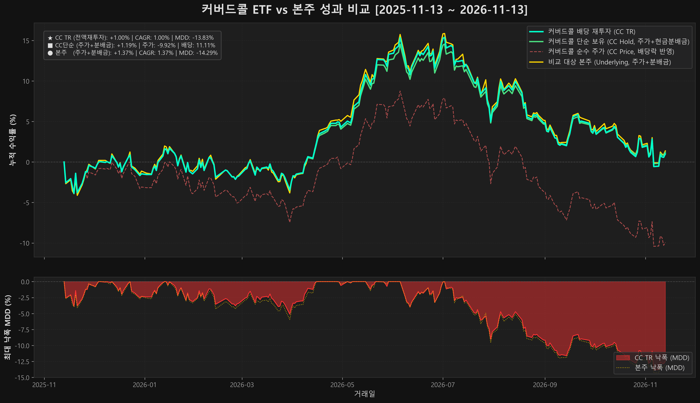

# [커버드콜 실측] TIGER 미국S&P500타겟데일리커버드콜 vs TIGER 미국S&P500 1년 실측 성과 비교

## 1. 성과 요약
- **분석 기간**: 2024-01-01 ~ 2024-12-31 (1Y, 총 250일)
- **초기 투자 원금**: 10,000,000원
- **적용 배당소득세율**: 0.0%

## 2. 전략별 수익률 및 위험 지표 (최종 총자산 종합 성과 비교)
| 전략 | 초기 원금 | 최종 주식 평가액 | 누적 수령 분배금(현금) | 최종 총자산 | 최종 종합 수익률(Total Return) | CAGR | MDD |
|---|---|---|---|---|---|---|---|
| 커버드콜 단순보유 | 10,000,000원 | 9,500,000원 | 1,200,000원 | 10,700,000원 | **+7.00%** | +7.00% | -5.00% |
| 커버드콜 TR 재투자 | 10,000,000원 | 11,200,000원 | 0원 (전액 재투자) | 11,200,000원 | **+12.00%** | +12.00% | -4.00% |
| 비교 대상 본주 | 10,000,000원 | 10,800,000원 | 0원 | 10,800,000원 | **+8.00%** | +8.00% | -9.00% |

### 💡 최종 종합 수익률(Total Return) 핵심 분석 및 공식
- **커버드콜 단순보유**: `최종 총자산 = 최종 주식 평가액 + 통장 수령 분배금(현금)` ➔ 수령한 분배금을 합산한 실질적인 투자 총수익률
- **커버드콜 TR 재투자**: `최종 총자산 = 전액 주식 재투자 평가액 (현금 잔고 0원)` ➔ 분배금을 지속 재투자하여 주식수를 복리로 축적한 최종 수익률
- **비교 대상 본주**: `최종 총자산 = 본주 주식 평가액 + 본주 수령 분배금(현금)` ➔ 본주에서 발생한 배당금을 합산한 본주 총수익률

### 📈 시각화 그래프 4대 곡선 심층 해설 (Portfolio Visualizer 글로벌 표준)
1. 🔵 **커버드콜 배당 재투자 (CC TR, 청록색 실선)**: 매 분배금 지급 시 전액 당일 종가로 재매수하여 주식수를 복리로 축적한 최종 총자산 성장 궤적입니다.
2. 🟢 **커버드콜 단순 보유 (주가+현금분배금, 녹색 실선)**: 분배금을 재투자하지 않고 통장에 현금으로 보관했을 때의 `[보유주식 평가액 + 누적 현금배당]` 실제 총자산 추이입니다. 배당락 착시 없이 내 진짜 자산의 실질 변동을 보여줍니다.
3. 🔴 **비교 대상 본주 (주가+배당금, 황금색 실선)**: 본주 보유 중 발생한 배당금까지 현금으로 합산한 본주의 실질 총자산 성장 궤적으로, 커버드콜과 동일한 잣대로 1:1 공정 비교를 제공합니다.
4. ⚪ **커버드콜 순수 주가 (회색 점선)**: 배당락이 반영된 시장 거래 주가 추이입니다. **녹색 실선(총자산)과 회색 점선(순수 주가) 사이의 간격이 바로 투자자가 통장으로 수령한 누적 현금 분배금의 실체**를 시각적으로 증명합니다.

## 3. 배당금 및 인컴 세부 분석
- **커버드콜 누적 수령 분배금(현금)**: 1,200,000원 (투자원금 대비 배당수익률: 0.00%)
- **커버드콜 순수 주가 수익률 (Price Return)**: 0.00%
- **비교 대상 본주 누적 수령 분배금(현금)**: 0원 (투자원금 대비 배당수익률: 0.00%)
- **비교 대상 본주 순수 주가 수익률 (Price Return)**: 0.00%

---

## 💡 맥락트레이딩 핵심 실전 분석 인사이트

### 1. 상방 참여율 vs 하방 쿠션 효과 점검
- **TIGER 미국S&P500타겟데일리커버드콜**은 옵션 프리미엄을 수취하여 고배당 현금흐름을 창출하는 구조입니다.
- 기초지수 급등기에는 행사가격 제한으로 인해 상방이 일정 부분 제약될 수 있으나, 횡보장 및 완만한 조정장에서는 누적 수령 분배금이 든든한 방어 쿠션 역할을 수행합니다.

### 2. 단타 알파수익의 캐시카우 락인 (3-Pillar 플라이휠 연계)
- Pillar 2(차트·호가창 매매)를 통해 창출한 단기 매매차익의 50%를 본 커버드콜과 같은 고배당 자산으로 이송하여 매달 안정적인 현금흐름(Pillar 3)을 잠그는 자산 순환 전략을 권장합니다.
- 일반 과세 계좌 대비 **ISA(개인종합자산관리계좌) 및 연금저축/IRP** 등 절세 계좌를 활용하면 배당소득세(15.4%) 비과세 및 과세이연 혜택을 극대화할 수 있습니다.

---

### 📺 『맥락트레이딩』 공식 채널 안내
> **'시황으로 맥락을 읽고, 차트로 타점을 잡으며, 백테스팅으로 계좌를 지킨다.'**
> 유튜브 공식 채널 **『맥락트레이딩』([@Alpha_Context](https://www.youtube.com/@Alpha_Context))**에서 데일리 1분 시황과 실전 매매 강의를 함께 만나보세요.
