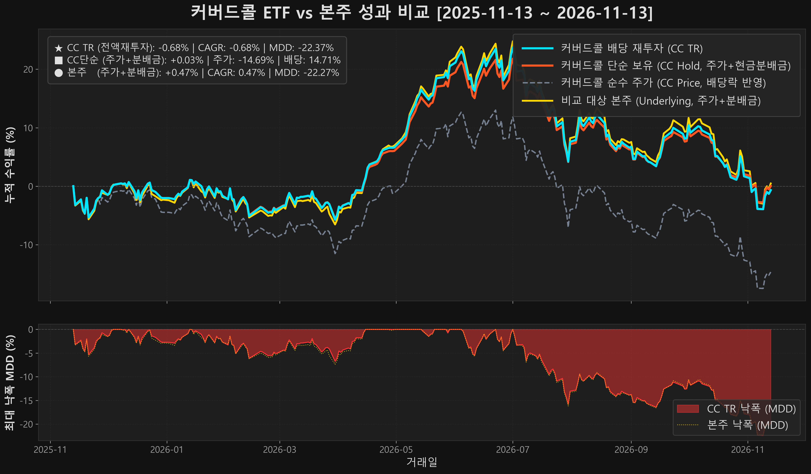

## 1. ETF 기본 정보

| 항목 | 상세 내용 | 항목 | 상세 내용 |
|:---|:---|:---|:---|
| **운용사** | 미래에셋자산운용 (TIGER) | **기초지수** | NASDAQ 100 Daily Target Premium 15% 지수 |
| **투자 대상** | 미국 나스닥 100 지수 구성 대형 기술주 | **비교 대상 본주** | TIGER 미국나스닥100 (133690) |
| **총보수 (수수료)** | **연 0.25%** | **환노출 여부** | **환노출형** (달러/원 환율 변동 반영) |
| **분배 주기** | **월 1회 (월배당)** | **분배금 지급 시기** | 매월 마지막 영업일 기준 결산 (익월 초 지급) |
| **옵션 매도 전략** | 만기 1일(0DTE) 데일리 OTM 콜옵션 | **목표 프리미엄** | 연 15% 타겟 프리미엄 (Target Premium) |

---

## 2. 성과 그래프

> 💡 **차트 확인 포인트**: 비비드 오렌지 실선(단순보유 총자산)과 회색 점선(순수 주가) 사이의 간격이 1년간 실제로 통장에 입금된 누적 현금 분배금(총 1,471,306원)의 실체입니다.

---

## 3. 성과 요약 테이블

- **분석 기간**: 2025-11-13 ~ 2026-11-13 (1년, 총 365일 실측)
- **초기 투자 원금**: 10,000,000원
- **적용 배당소득세율**: 0.0% (비과세/절세계좌 기준)

| 전략 | 초기 원금 | 최종 주식 평가액 | 누적 수령 분배금 (현금) | 최종 총자산 | 최종 종합 수익률 (Total Return) | CAGR (연평균 복리수익률) | MDD (최고점 대비 최대 낙폭) |
|:---|---:|---:|---:|---:|---:|---:|---:|
| **커버드콜 단순보유** | 10,000,000원 | 8,531,405원 | 1,471,306원 | **10,002,711원** | **+0.03%** | +0.03% | **-20.18%** |
| **커버드콜 TR 재투자** | 10,000,000원 | 9,932,436원 | 0원 (전액 재투자) | **9,932,436원** | **-0.68%** | -0.68% | -22.37% |
| **비교 대상 본주 (TIGER 나스닥100)** | 10,000,000원 | 9,990,712원 | 56,030원 | **10,046,742원** | **+0.47%** | +0.47% | -22.27% |

---

## 4. 성과 분석

### ① 본주 대등 성과와 연 15% 현금흐름 달성 메커니즘 (+0.03% vs +0.47%)
- **타겟 프리미엄(Target Premium)의 효율성**: 1년간 나스닥 100 본주가 +0.47%로 제자리걸음 한 횡보장에서, 본 ETF는 **연 15% 분배금 재원만큼만 데일리 OTM 콜옵션을 매도**하여 주가 상승 잠재력을 최대한 보존했습니다.
- **배당락 상쇄와 원금 보전**: 순수 주가는 배당락 누적으로 -14.69% 하락했으나, 나스닥의 높은 변동성 덕분에 확보된 **14.71%(1,471,306원)**의 현금 분배금이 주가 하락분을 정확히 상쇄하여 최종 원금(+0.03%)을 완벽하게 방어했습니다.

### ② 하방 변동성 방어력 (MDD -20.18% vs -22.27%)
- **MDD 2.09%p 방어**: 기술주 조정 국면에서 본주가 -22.27%까지 하락했던 반면, 커버드콜 단순보유는 매일 축적된 프리미엄 쿠션 덕분에 MDD를 **-20.18%**로 낮추며 하락 압력을 완화했습니다.
- **재투자(-0.68%)보다 단순보유(+0.03%)가 유리했던 이유**: 횡보 하락 국면에서 분배금을 주식으로 재투자한 경우 주가 침식에 노출된 반면, 매달 분배금을 현금으로 확정 수취한 단순보유 전략이 계좌의 실질 원금을 온전히 지켜냈습니다.

### ③ 시장 적합도 및 경쟁 상품 비교
- **적합한 시장 환경**: 나스닥 100 지수가 급등락을 반복하되 연간 기준으로는 박스권에 갇히는 장세에서 극대화된 현금흐름을 안겨줍니다. 반면 테크주 슈퍼 랠리(연 30% 이상 상승)에서는 상방 제한으로 본주 대비 언더퍼폼이 커집니다.
- **경쟁 상품 비교 (vs 전통적 월간 커버드콜 QYLD)**: 포트폴리오의 100% 비중으로 1개월 ATM 옵션을 매도해 원금 훼손이 심각한 QYLD와 달리, 본 상품은 **'데일리 0DTE 만기 + 타겟 비중 매도'** 방식을 취해 시장 반등 시 주가 회복 탄력성이 훨씬 뛰어납니다. 기술주를 보유하면서도 확실한 연 15% 수준의 월배당 인컴을 원하는 투자자에게 적합합니다.
