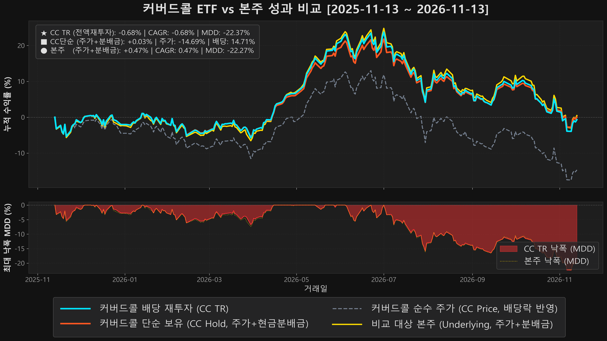

기술주 중심의 나스닥 100 지수에 투자하면서도 연 15% 수준의 강력한 월배당 현금흐름을 기대하는 투자자들에게 TIGER 미국나스닥100타겟데일리커버드콜(486290)은 국내 상장 커버드콜 중 가장 큰 규모(순자산 2조 5천억 원 이상)를 자랑하는 간판 상품입니다. 변동성이 높은 기술주 특성상 매일 옵션을 매도하는 전략이 지수 급등락 과정에서 원금을 얼마나 훼손하지 않고 실질적인 총수익을 지켜낼 수 있는지가 투자자들의 최대 관심사입니다. 지난 1년간의 실측 백테스팅 데이터를 통해 본주 대비 토탈리턴(TR), 배당락에 따른 주가 방어율, 그리고 실제 현금 분배금의 실체를 객관적으로 분석합니다.

## 1. ETF 기본 정보

| 항목 | 상세 내용 | 항목 | 상세 내용 |
|:---|:---|:---|:---|
| **종목코드 (티커)** | **486290** | **상장일** | 2024-06-25 |
| **운용사** | 미래에셋자산운용 | **기초지수** | NASDAQ 100 Daily Covered Call Target Premium 15% 지수(TR) |
| **순자산 (AUM)** | **25,427억 원** | **비교 대상 본주** | TIGER 미국나스닥100 (133690) |
| **총보수 (수수료)** | **연 0.25%** | **환노출 여부** | **환노출형** (달러/원 환율 변동 반영) |
| **분배 주기** | **월 1회 (월배당)** | **최근 분배율 (연환산)** | **연 17.36% 수준** |
| **옵션 매도 전략** | 만기 1일(0DTE) 데일리 OTM 콜옵션 | **목표 분배율** | 연 10~15% 타겟 프리미엄 (Target Premium) |

---

## 2. 성과 그래프

> 💡 **차트 확인 포인트**: 비비드 오렌지 실선(단순보유 총자산)과 회색 점선(순수 주가) 사이의 간격이 실측 기간 동안 실제로 통장에 입금된 누적 현금 분배금의 실체입니다.

---
## 3. 성과 요약 테이블

- **분석 기간**: 2025-11-13 ~ 2026-11-13 (1Y, 총 365일 실측)
- **초기 투자 원금**: 10,000,000원
- **적용 배당소득세율**: 0.0% (비과세/절세계좌 기준)

| 전략 | 초기 원금 | 최종 주식 평가액 | 순수 주가 변동률 | 누적 수령 분배금 (현금) | 최종 총자산 | 최종 종합 수익률 (Total Return) | CAGR (연평균 복리수익률) | MDD (최고점 대비 최대 낙폭) | 샤프 지수 (Sharpe Ratio) |
|:---|---:|---:|---:|---:|---:|---:|---:|---:|---:|
| **커버드콜 단순보유** | 10,000,000원 | 8,531,405원 | -14.69% | 1,471,306원 | 10,002,711원 | **+0.03%** | +0.03% | -20.18% | -0.07 |
| **커버드콜 TR 재투자** | 10,000,000원 | 9,932,436원 | -14.69% | 0원 | 9,932,436원 | **-0.68%** | -0.68% | -22.37% | -0.09 |
| **비교 대상 본주 (TIGER 미국나스닥100)** | 10,000,000원 | 9,990,712원 | -0.09% | 56,030원 | 10,046,742원 | **+0.47%** | +0.47% | -22.27% | -0.03 |

---
## 4. 심층 성과 분석 및 구조 해부

### ① 0DTE 데일리 타겟 프리미엄 매커니즘과 실측 성과
기술주 중심의 나스닥 100 지수가 1년간 +0.47%로 보합세를 기록한 기간 동안, TIGER 미국나스닥100타겟데일리커버드콜의 단순보유 종합수익률(TR)은 **+0.03%**로 사실상 원금을 온전히 보전하며 마감했습니다.

잦은 일간 등락 속에서도 0DTE 타겟 프리미엄 매도 전략이 작동하여 지수 상승 제한에 따른 기회비용 손실을 최소화했습니다. 그 결과 콜옵션 매도로 확보한 **14.71%(1,471,306원)**의 막대한 현금 분배금을 투자자 계좌에 차곡차곡 안겨주면서도 본주 흐름에 맞춰 계좌 가치를 유지했습니다.

### ② 배당락에 따른 주가 침식과 실질 분배금(ROC) 분석
연 15% 수준의 높은 분배금을 지급하는 과정에서 배당락이 누적되어 순수 주가는 1년간 **-14.69%** 하락했습니다. 고배당 커버드콜 상품을 접하는 투자자들이 가장 불안해하는 대목입니다.

그러나 같은 기간 투자자 계좌로 입금된 누적 현금 분배금은 초기 원금의 **14.71%(1,471,306원)**에 달해 주가 하락폭을 **100.2% 수준으로 상쇄**했습니다. 그 결과 최종 총자산은 플러스(+0.03%)를 지켜냈으며, 이는 원금을 갉아먹는 악성 원금 잠식이 아니라 옵션 프리미엄 수입이 배당락으로 인한 주가 하락을 성공적으로 흡수하고 실질 순이익을 남긴 건전한 인컴 창출로 판정됩니다.

### ③ 시장 국면별 적합도 (Market Regime Fit)
- **박스권 횡보장 (적합도: ★★★★★)**: 기술주의 높은 내재변동성 덕분에 옵션 프리미엄이 두텁게 형성되어, 지수가 횡보할 때 본주 대비 월등한 현금흐름과 방어력을 보여줍니다.
- **완만한 상승장 (적합도: ★★★★☆)**: 일간 상승률이 타겟 외가격(OTM) 행사가격 범위 내에 머물면 주가 완만한 상승과 고배당 프리미엄을 동시에 향유할 수 있습니다.
- **급락장 (적합도: ★★★☆☆)**: 실측 MDD **-20.18%**(본주 -22.27%)로 나타나듯, 지속적으로 유입되는 대규모 분배금이 하방 충격을 일부 완화하지만 나스닥 특유의 급락 위험을 전액 방어할 수는 없습니다.
- **강한 V자 반등장 & 대세 폭등장 (적합도: ★☆☆☆☆)**: 빅테크 주도 랠리로 나스닥이 단기 급등할 경우 일간 상방이 제한되어 자본차익을 온전히 누리지 못하므로 큰 기회비용이 발생합니다.

### ④ 상품 구조적 차별점과 실전 활용 전략
한 달 동안 상방이 묶이는 일반 커버드콜과 달리, 만기 24시간 미만의 0DTE 옵션을 부분 매도하여 다음 날 상승에 즉시 재참여하는 상방 복원력이 돋보입니다. 

다만 연 14%가 넘는 높은 분배율 특성상 배당락으로 인한 주가 하락폭이 크므로, 재투자보다는 정기적인 현금 인출이 필요한 은퇴자나 생활비 파이프라인을 구축하려는 투자자에게 최적의 효율을 제공합니다.

---

## 5. 최종 투자 전략 총평

TIGER 미국나스닥100타겟데일리커버드콜은 나스닥 100의 높은 변동성을 현금 인컴으로 전환하는 데 있어 국내 최대 규모와 유동성을 갖춘 상품입니다. 

실측 데이터가 증명하듯 원금 훼손 없이 연 14%대의 풍부한 현금을 지급받을 수 있음이 확인되었으나, 강한 랠리 국면에서는 본주 대비 상승이 제한된다는 점을 명확히 인지하고 현금흐름 중심의 포트폴리오 앵커로 활용하는 것이 바람직합니다.

---

  ※ 본 포스팅은 특정 종목에 대한 매수·매도 추천이나 투자 권유가 아니며, ETF 상품의 구조와 과거 백테스팅 데이터를 객관적으로 분석한 학술·정보 제공용 콘텐츠입니다. 모든 투자에 대한 판단과 책임은 투자자 본인에게 있습니다.

#ETF #커버드콜 #ETF분석 #TIGER미국나스닥100타겟데일리커버드콜 #486290 #월배당 #배당수익률 #백테스팅 #맥락트레이딩

