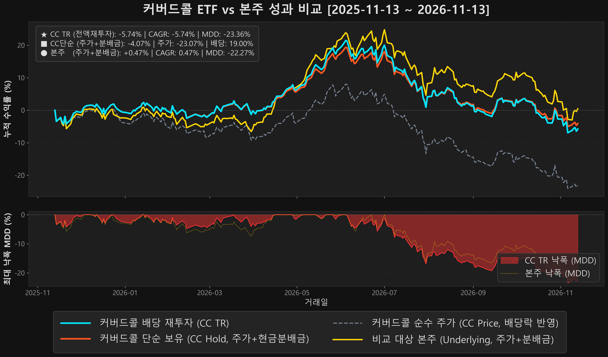

연 20%를 웃도는 파격적인 고배당 분배율을 앞세우며 투자자들의 큰 관심을 끈 KODEX 미국나스닥100데일리커버드콜OTM(494300)은 국내 초고배당 커버드콜 ETF의 대표주자입니다. 하지만 지나치게 높은 분배율 이면에는 매일 매도하는 콜옵션으로 인해 상방이 강하게 제한되고 배당락이 누적되어 원금이 훼손될 수 있다는 구조적 위험이 상존합니다. 과연 지난 1년간의 실제 운용에서 이 상품은 투자자에게 진정한 이익을 안겨주었을까요, 아니면 원금을 깎아 배당으로 돌려주는 착시에 그쳤을까요? 실측 백테스팅 데이터를 바탕으로 본주 대비 실질 토탈리턴과 원금 잠식 여부를 냉정하게 해부합니다.

## 1. ETF 기본 정보

| 항목 | 상세 내용 | 항목 | 상세 내용 |
|:---|:---|:---|:---|
| **종목코드 (티커)** | **494300** | **상장일** | 2024-10-22 |
| **운용사** | 삼성자산운용 | **기초지수** | NASDAQ-100 Daily Covered Call 101 Index(TR) |
| **순자산 (AUM)** | **9,816억 원** | **비교 대상 본주** | TIGER 미국나스닥100 (133690) |
| **총보수 (수수료)** | **연 0.25%** | **환노출 여부** | **환노출형** (달러/원 환율 변동 반영) |
| **분배 주기** | **월 1회 (월배당)** | **최근 분배율 (연환산)** | **연 24.89% 수준** |
| **옵션 매도 전략** | 만기 1일(0DTE) 데일리 OTM 콜옵션 | **목표 분배율** | 연 10~15% 타겟 프리미엄 (Target Premium) |

---

## 2. 성과 그래프

> 💡 **차트 확인 포인트**: 비비드 오렌지 실선(단순보유 총자산)과 회색 점선(순수 주가) 사이의 간격이 실측 기간 동안 실제로 통장에 입금된 누적 현금 분배금의 실체입니다.

---
## 3. 성과 요약 테이블

- **분석 기간**: 2025-11-13 ~ 2026-11-13 (1Y, 총 365일 실측)
- **초기 투자 원금**: 10,000,000원
- **적용 배당소득세율**: 0.0% (비과세/절세계좌 기준)

| 전략 | 초기 원금 | 최종 주식 평가액 | 순수 주가 변동률 | 누적 수령 분배금 (현금) | 최종 총자산 | 최종 종합 수익률 (Total Return) | CAGR (연평균 복리수익률) | MDD (최고점 대비 최대 낙폭) | 샤프 지수 (Sharpe Ratio) |
|:---|---:|---:|---:|---:|---:|---:|---:|---:|---:|
| **커버드콜 단순보유** | 10,000,000원 | 7,693,046원 | -23.07% | 1,900,240원 | 9,593,285원 | **-4.07%** | -4.07% | -20.45% | -0.36 |
| **커버드콜 TR 재투자** | 10,000,000원 | 9,426,331원 | -23.07% | 0원 | 9,426,331원 | **-5.74%** | -5.74% | -23.36% | -0.40 |
| **비교 대상 본주 (TIGER 미국나스닥100)** | 10,000,000원 | 9,990,712원 | -0.09% | 56,030원 | 10,046,742원 | **+0.47%** | +0.47% | -22.27% | -0.03 |

---
## 4. 심층 성과 분석 및 구조 해부

### ① 데일리 상방 캡(Cap) 누적과 본주 대비 언더퍼폼 실측
기초자산인 TIGER 미국나스닥100이 1년간 +0.47%로 강보합세를 유지한 구간에서, KODEX 미국나스닥100데일리커버드콜OTM의 단순보유 종합수익률(TR)은 **-4.07%**에 그치며 본주 대비 **-4.54%p 언더퍼폼**을 기록했습니다.

이는 나스닥 100 지수를 바탕으로 일간 외가격(101 지수) 콜옵션을 매일 매도하는 구조상, 나스닥 100이 하루 1% 이상 상승한 날의 초과 수익이 옵션 행사로 잘려나가면서 장기 누적 반등 탄력이 구조적으로 제한되었기 때문입니다. 일간 변동성이 큰 기술주 시장에서 매일 상방이 닫히는 데일리 캡의 누적 비용이 수치로 입증되었습니다.

### ② 제 살 깎아먹기(원금 잠식 ROC) 여부 추적
- **원금 잠식(ROC, Return of Capital) 발생 경고**: 1년간 분배금으로 초기 원금의 19.00%(1,900,240원)라는 막대한 현금을 지급받았으나, 순수 주가 하락폭(-23.07%)이 수취한 분배금 총액을 초과하여 최종 총자산은 -4.07% 손실로 마감했습니다.
- **실질적 자본 침식 판정**: 이는 투자자가 통장으로 수령한 분배금의 상당 부분이 순수 투자 수익이 아니라, **'내 원금을 깎아서 돌려받은 실질적 원금 반환'**에 불과했음을 실측 데이터로 명확히 보여줍니다. 표면적인 고배당률 숫자의 착시에 매몰되지 않고, 계좌의 실질 총자산 가치 훼손 여부를 냉정히 점검해야 합니다.

### ③ 시장 국면별 적합도 (Market Regime Fit)
- **박스권 횡보장 (적합도: ★★★★★)**: 나스닥 지수가 좁은 밴드에서 일간 1% 미만으로 오르내릴 때 데일리 프리미엄을 최대로 흡수할 수 있습니다.
- **완만한 상승장 (적합도: ★★★☆☆)**: 일간 상승률이 행사가격을 넘지 않는 선에서는 양호하나, 일간 변동성이 큰 날마다 상방이 잘려나가는 누수가 발생합니다.
- **급락장 (적합도: ★★★☆☆)**: 실측 MDD **-20.45%**(본주 -22.27%)에서 보듯 지속적인 분배금 유입이 하방 충격을 일부 흡수하지만, 기초자산의 하락 위험 자체를 막아주지는 못합니다.
- **강한 V자 반등장 & 대세 폭등장 (적합도: ★☆☆☆☆)**: 기술주가 강하게 치고 올라가는 국면에서는 매일 상방이 차단되어 본주와의 수익률 격차가 극단적으로 벌어집니다.

### ④ 상품 구조적 한계와 실전 투자 시사점
초고배당 데일리 옵션 매도는 매월 높은 현금을 안겨주는 대신, 배당락 누적으로 인한 기초 주가의 구조적 우하향을 수반하기 쉽습니다. 

따라서 원금 방어나 장기 복리 성장을 기대하기보다는, 단기간 내에 투자원금을 현금으로 빠르게 회수해야 하는 특수한 목적의 투자자에게 제한적으로 적합한 상품입니다.

---

## 5. 최종 투자 전략 총평

KODEX 미국나스닥100데일리커버드콜OTM은 연 19%대의 압도적인 현금 분배금을 지급하지만, 실측 결과 주가 하락이 분배금을 초과하여 실질 총자산이 마이너스를 기록하는 원금 잠식의 한계를 명확히 드러냈습니다. 

단순 분배율의 화려함보다는 배당락 이후 계좌의 총자산(Total Return)이 실질적으로 보전되는지 여부를 냉정히 계산하여, 단기 현금 흐름 목적의 제한된 위성(Satellite) 자산으로만 활용하는 방안이 타당합니다.

---

  ※ 본 포스팅은 특정 종목에 대한 매수·매도 추천이나 투자 권유가 아니며, ETF 상품의 구조와 과거 백테스팅 데이터를 객관적으로 분석한 학술·정보 제공용 콘텐츠입니다. 모든 투자에 대한 판단과 책임은 투자자 본인에게 있습니다.

#ETF #커버드콜 #ETF분석 #KODEX미국나스닥100데일리커버드콜OTM #494300 #월배당 #배당수익률 #백테스팅 #맥락트레이딩

