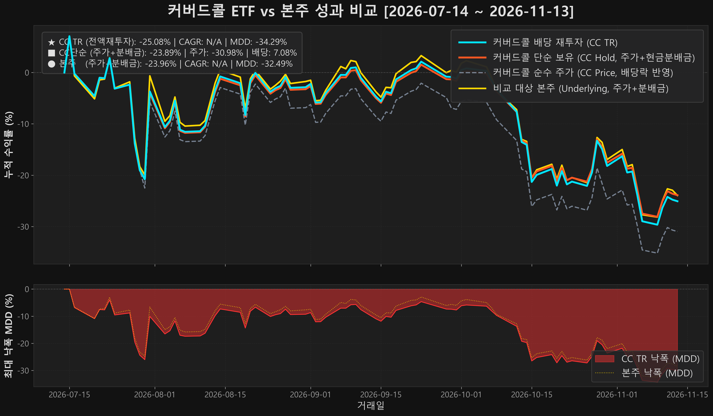

국내 대형주를 대표하는 코스피 200 지수에 투자하면서 안정적인 월배당 인컴을 수취하고자 하는 투자자들에게 KODEX 200커버드콜액티브(0219E0)는 순자산 1조 원 이상의 자금을 유치하며 대표적인 국내 커버드콜 상품으로 자리매김했습니다. 코스피 200 지수를 기초로 5% 외가격(OTM) 콜옵션을 매도하고 액티브 운용을 결합하여 시장 초과 성과와 하방 완충을 동시에 목표로 삼고 있습니다. 하지만 대규모 조정 장세가 닥쳤을 때 커버드콜 전략이 실제 계좌 원금을 얼마나 지켜줄 수 있는지는 철저한 실측 검증이 요구됩니다. 약세장 국면에서의 실측 백테스팅 데이터를 통해 본 상품의 실질적인 하방 방어력과 손익 구조를 살펴봅니다.

## 1. ETF 기본 정보

| 항목 | 상세 내용 | 항목 | 상세 내용 |
|:---|:---|:---|:---|
| **종목코드 (티커)** | **0219E0** | **상장일** | 2024-07-16 |
| **운용사** | 삼성자산운용 | **기초지수** | 코스피 200 커버드콜 5% OTM 지수(PR 지수) |
| **순자산 (AUM)** | **10,369억 원** | **비교 대상 본주** | KODEX 200 (069500) |
| **총보수 (수수료)** | **연 0.5%** | **환노출 여부** | 원화 자산 (환율 영향 없음) |
| **분배 주기** | **월 1회 (월배당)** | **최근 분배율 (연환산)** | **연 10.22% 수준** |
| **옵션 매도 전략** | 월간 OTM 콜옵션 매도 | **목표 분배율** | 옵션 프리미엄 + 주식 배당금 |

---

## 2. 성과 그래프

> 💡 **차트 확인 포인트**: 비비드 오렌지 실선(단순보유 총자산)과 회색 점선(순수 주가) 사이의 간격이 실측 기간 동안 실제로 통장에 입금된 누적 현금 분배금의 실체입니다.

---
## 3. 성과 요약 테이블

- **분석 기간**: 2026-07-14 ~ 2026-11-13 (1Y, 총 122일 실측)
- **초기 투자 원금**: 10,000,000원
- **적용 배당소득세율**: 0.0% (비과세/절세계좌 기준)
- **상장일 조정 안내**: 공통 상장 기간 정렬을 위해 시작일을 2026-07-14로 단축 조정하였습니다.

| 전략 | 초기 원금 | 최종 주식 평가액 | 순수 주가 변동률 | 누적 수령 분배금 (현금) | 최종 총자산 | 최종 종합 수익률 (Total Return) | CAGR (연평균 복리수익률) | MDD (최고점 대비 최대 낙폭) | 샤프 지수 (Sharpe Ratio) |
|:---|---:|---:|---:|---:|---:|---:|---:|---:|---:|
| **커버드콜 단순보유** | 10,000,000원 | 6,902,357원 | -30.98% | 708,193원 | 7,610,550원 | **-23.89%** | N/A | -32.85% | -0.95 |
| **커버드콜 TR 재투자** | 10,000,000원 | 7,492,362원 | -30.98% | 0원 | 7,492,362원 | **-25.08%** | N/A | -34.29% | -0.98 |
| **비교 대상 본주 (KODEX 200)** | 10,000,000원 | 7,575,191원 | -24.25% | 29,074원 | 7,604,265원 | **-23.96%** | N/A | -32.49% | -0.86 |

---
## 4. 심층 성과 분석 및 구조 해부

### ① 급락장 하방 노출과 방어력 한계 실측
기초자산인 KODEX 200이 -23.96% 급락하는 강한 약세장 국면에서, KODEX 200커버드콜액티브의 단순보유 종합수익률(TR) 역시 **-23.89%**를 기록했습니다. 본주 대비 초과 방어 효과는 단 0.07%p에 불과하여 사실상 본주와 거의 동일한 수준의 하락을 겪었습니다.

콜옵션 매도로 7.08%(708,193원)의 현금 분배금을 수취했으나, 순수 주가가 -30.98% 급락함에 따라 프리미엄 완충 효과가 상쇄되었습니다. 이는 커버드콜 구조가 심각한 하락장에서 원금 손실을 온전히 방어하지 못한다는 하방 비대칭 위험을 실측 수치로 명확히 보여줍니다.

### ② 제 살 깎아먹기(원금 잠식 ROC) 여부 추적
- **원금 잠식(ROC, Return of Capital) 발생 경고**: 실측 기간 동안 7.08%(708,193원)의 현금 분배금을 지급했으나, 순수 주가 하락폭(-30.98%)이 분배금 총액을 크게 초과하여 최종 총자산은 -23.89% 손실로 마감했습니다.
- **실질적 자본 침식 판정**: 이는 투자자가 통장으로 수령한 분배금의 대부분이 순수 운용 수익이 아니라, **'내 원금을 깎아서 돌려받은 실질적 원금 반환'**에 불과했음을 의미합니다. 기초자산이 급락하는 국면에서는 아무리 배당을 지급받더라도 원금 하락폭이 이를 압도하여 실질적인 자산 가치가 심각하게 훼손될 수 있습니다.

### ③ 시장 국면별 적합도 (Market Regime Fit)
- **박스권 횡보장 (적합도: ★★★★★)**: 코스피 200 지수가 일정한 박스권 내에서 정체될 때 5% OTM 프리미엄과 주식 배당금을 흡수하여 본주 대비 우수한 성과를 기대할 수 있습니다.
- **완만한 상승장 (적합도: ★★★★☆)**: 월간 5% 이내의 완만한 상승세에서는 주가 상승과 프리미엄을 모두 챙길 수 있습니다.
- **급락장 (적합도: ★★☆☆☆)**: 실측 MDD **-32.85%**(본주 -32.49%)에서 명확히 드러나듯, 지속적인 지수 급락장에서는 옵션 프리미엄의 쿠션 효과가 미미하여 원금 손실 위험에 그대로 노출됩니다.
- **강한 V자 반등장 & 대세 폭등장 (적합도: ★☆☆☆☆)**: 지수가 월 5% 이상 가파르게 반등할 경우 상방이 옵션 행사가격에 묶여 자본차익 회복이 더뎌집니다.

### ④ 상품 구조적 특성과 실전 투자 시사점
기초 포트폴리오의 실질 배당금과 5% OTM 옵션 프리미엄을 배분하는 설계는 횡보장에서는 유리할 수 있습니다. 

그러나 지수 하락에 대한 완충력은 극히 제한적이므로, 시장의 중장기 추세가 하락세로 전환될 때는 맹목적인 고배당 보유보다는 현금 비중 확대 등 적극적인 리스크 관리가 병행되어야 합니다.

---

## 5. 최종 투자 전략 총평

KODEX 200커버드콜액티브는 코스피 박스권 장세에 특화된 인컴 상품이지만, 실측 데이터가 입증하듯 시장 전반의 체계적 급락 장세에서는 본주와 마찬가지로 큰 폭의 원금 훼손을 피할 수 없습니다. 

따라서 하락장에서 안전할 것이라는 막연한 기대보다는, 국내 증시의 밸류에이션과 추세를 고려하여 제한적인 비중으로 분할 편입하는 보수적 접근이 필요합니다.

---

  ※ 본 포스팅은 특정 종목에 대한 매수·매도 추천이나 투자 권유가 아니며, ETF 상품의 구조와 과거 백테스팅 데이터를 객관적으로 분석한 학술·정보 제공용 콘텐츠입니다. 모든 투자에 대한 판단과 책임은 투자자 본인에게 있습니다.

#ETF #커버드콜 #ETF분석 #KODEX200커버드콜액티브 #0219E0 #월배당 #배당수익률 #백테스팅 #맥락트레이딩

