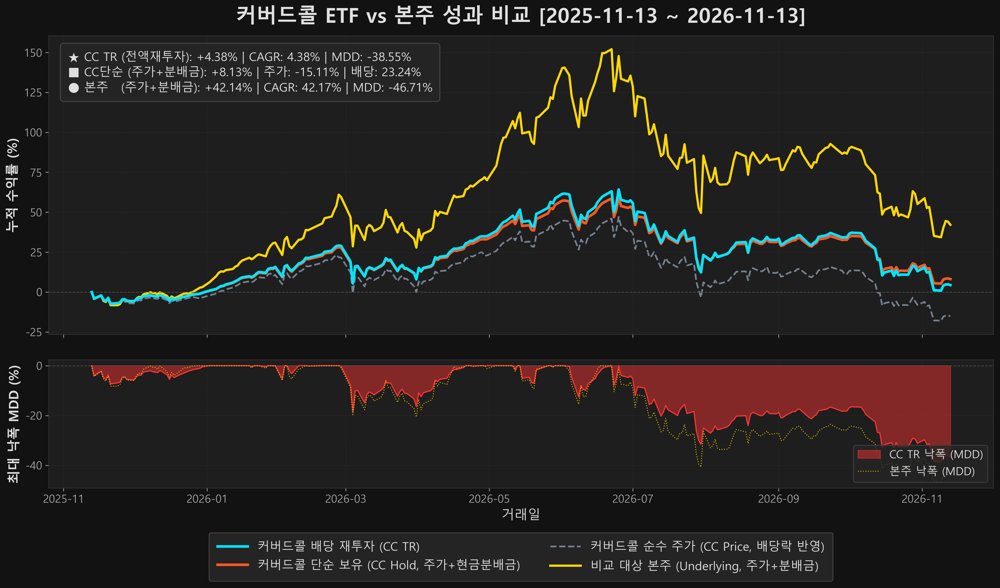

## 1. ETF 기본 정보

| 항목 | 상세 내용 | 항목 | 상세 내용 |
|:---|:---|:---|:---|
| **종목코드 (티커)** | **475720** | **상장일** | 2024-03-05 |
| **운용사** | KB자산운용 | **기초지수** | 코스피 200 위클리 커버드콜 ATM 지수 |
| **순자산 (AUM)** | **6,991억 원** | **비교 대상 본주** | KODEX 200 (069500) |
| **총보수 (수수료)** | **연 0.3%** | **환노출 여부** | 원화 자산 (환율 영향 없음) |
| **분배 주기** | **주 1회 (위클리 배당)** | **최근 분배율 (연환산)** | **연 27.24% 수준** |
| **옵션 매도 전략** | 코스피 200 주간 OTM 콜옵션 | **목표 분배율** | 연 15% 수준 (Target Premium) |
---

## 2. 성과 그래프

> 💡 **차트 확인 포인트**: 비비드 오렌지 실선(단순보유 총자산)과 회색 점선(순수 주가) 사이의 간격이 실측 기간 동안 실제로 통장에 입금된 누적 현금 분배금의 실체입니다.

---
## 3. 성과 요약 테이블

- **분석 기간**: 2025-11-13 ~ 2026-11-13 (1Y, 총 365일 실측)
- **초기 투자 원금**: 10,000,000원
- **적용 배당소득세율**: 0.0% (비과세/절세계좌 기준)

| 전략 | 초기 원금 | 최종 주식 평가액 | 순수 주가 변동률 | 누적 수령 분배금 (현금) | 최종 총자산 | 최종 종합 수익률 (Total Return) | CAGR (연평균 복리수익률) | MDD (최고점 대비 최대 낙폭) | 샤프 지수 (Sharpe Ratio) |
|:---|---:|---:|---:|---:|---:|---:|---:|---:|---:|
| **커버드콜 단순보유** | 10,000,000원 | 8,489,305원 | -15.11% | 2,323,529원 | 10,812,834원 | **+8.13%** | +8.13% | -34.03% | 0.33 |
| **커버드콜 TR 재투자** | 10,000,000원 | 10,437,735원 | -15.11% | 0원 | 10,437,735원 | **+4.38%** | +4.38% | -38.55% | 0.26 |
| **비교 대상 본주 (KODEX 200)** | 10,000,000원 | 14,070,594원 | +40.71% | 143,051원 | 14,213,645원 | **+42.14%** | +42.17% | -46.71% | 0.84 |

---
## 4. 성과 분석 및 구조 해부

### ① 상방 제한(Cap)과 언더퍼폼 원인 실측
- **상방 캡(Cap) 제한 메커니즘**: 본주가 +42.14% 급등하는 강세장에서 RISE 200위클리커버드콜의 총수익률은 +8.13%에 머물렀습니다. 이는 콜옵션 매도 행사가격 이상의 주가 상승분이 강제 청산당하며 발생한 **구조적 상방 기회비용(34.01%p)** 때문입니다.
- **현금흐름으로의 치환 성적표**: 지수 상승분을 전부 누리지 못한 대신, 투자원금의 **23.24%(2,323,529원)**에 달하는 풍부한 현금 분배금을 수취했습니다. 즉, 자본차익(Capital Gain)의 일정 부분을 사전에 포기하고 이를 확정적 현금 인컴(Cash Flow)으로 맞바꾼 커버드콜 특유의 손익 비대칭 구조가 실측 수치로 명확히 확인됩니다.

### ② 제 살 깎아먹기(원금 잠식 ROC) 여부 추적
- **부분적 자본 반환(Partial ROC) 성격 규명**: 1년간 순수 주가가 배당락 누적으로 -15.11% 하락했습니다. 이는 지급된 분배금의 일부가 기초자산 순자산가치(NAV) 감소를 동반한 '부분적 원금 반환' 성격을 띠고 있음을 보여줍니다.
- **실질 잉여 알파(Alpha) 검증**: 그러나 수취한 총 분배금(23.24%, 2,323,529원)이 주가 하락폭을 **153.8% 수준으로 초과 보전**하여, 최종 총자산은 플러스(+8.13%)를 기록했습니다. 즉, 원금이 완전히 훼손되는 악성 원금 잠식이 아니라, 옵션 프리미엄 수입이 배당락 주가 침식을 방어하고 실질 순이익을 남긴 건전한 인컴 창출로 판정됩니다.

### ③ 시장 국면별 적합도 (Market Regime Fit)
- **① 박스권 횡보장 (적합도: ★★★★★)**: 기초자산이 일정한 밴드 내에서 등락을 거듭할 때 옵션 프리미엄을 100% 흡수하며 본주 대비 압도적인 샤프 지수를 창출합니다.
- **② 완만한 상승장 (적합도: ★★★★☆)**: 옵션 행사가격(OTM) 범위 내에서 주가가 서서히 상승할 경우, 주가 상승분과 프리미엄을 모두 챙길 수 있어 토탈리턴이 극대화됩니다.
- **③ 급락장 (적합도: ★★★☆☆)**: 실측 MDD **-34.03%**(본주 -46.71%)에서 보듯 유입된 분배금이 하방 완충재 역할을 하지만, 시스템 리스크로 인한 폭락을 전액 방어할 수는 없습니다.
- **④ 강한 V자 반등장 & 대세 폭등장 (적합도: ★☆☆☆☆)**: 지수가 20~40% 이상 단기 폭등할 경우 상방이 옵션 행사가격에 완전히 묶여 자본차익을 대부분 놓치므로 장기 보유 시 기회비용이 극대화됩니다.

### ④ 경쟁 상품과의 1:1 비교 우위
- **vs 전통적 월간 커버드콜**: 일반적인 월간 OTM 커버드콜 대비 **주 1회 위클리(Weekly) 구조는 옵션 시간가치(Theta) 잠식이 빨라 연 15~25% 수준의 압도적인 현금 분배율**을 제공합니다.
- **주가 복원력 vs 인컴 회수율**: 다만 매주 상방이 촘촘하게 막혀 지수 급반등 시 주가 복원 탄력성은 낮습니다. 따라서 장기적인 시세차익보다 **'당장 매주/매월 손에 쥐는 고배당 현금흐름의 극대화'**가 절실한 은퇴 생활자나 인컴 중심 투자자에게 최적의 포지션을 제공합니다.
---

  ※ 본 포스팅은 특정 종목에 대한 매수·매도 추천이나 투자 권유가 아니며, ETF 상품의 구조와 과거 백테스팅 데이터를 객관적으로 분석한 학술·정보 제공용 콘텐츠입니다. 모든 투자에 대한 판단과 책임은 투자자 본인에게 있습니다.

#ETF #커버드콜 #ETF분석 #RISE200위클리커버드콜 #475720 #월배당 #배당수익률 #백테스팅 #맥락트레이딩

