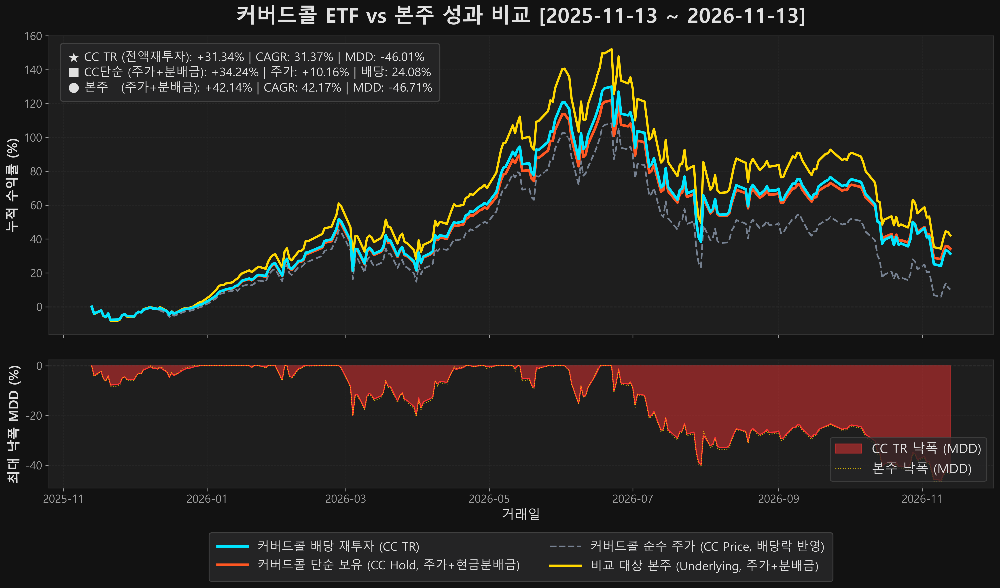

## 1. ETF 기본 정보

| 항목 | 상세 내용 | 항목 | 상세 내용 |
|:---|:---|:---|:---|
| **운용사** | 삼성자산운용 (KODEX) | **기초지수** | 코스피 200 타겟 15% 위클리 커버드콜 지수 |
| **투자 대상** | 코스피 200 구성 종목 현물 주식 | **비교 대상 본주** | KODEX 200 (069500) |
| **총보수 (수수료)** | **연 0.39%** | **환노출 여부** | 원화 자산 (환율 영향 없음) |
| **분배 주기** | **주 1회 (위클리 배당)** | **분배금 지급 시기** | 매주 화요일 결산 및 지급 |
| **옵션 매도 전략** | 코스피 200 주간 OTM 콜옵션 | **목표 분배율** | 연 15% 수준 (Target Premium) |

---

## 2. 성과 그래프

> 💡 **차트 확인 포인트**: 비비드 오렌지 실선(단순보유 총자산)과 회색 점선(순수 주가) 사이의 간격이 1년간 실제로 통장에 입금된 누적 현금 분배금(총 2,408,015원)의 실체입니다.

---

## 3. 성과 요약 테이블

- **분석 기간**: 2025-11-13 ~ 2026-11-13 (1년, 총 365일 실측)
- **초기 투자 원금**: 10,000,000원
- **적용 배당소득세율**: 0.0% (비과세/절세계좌 기준)

| 전략 | 초기 원금 | 최종 주식 평가액 | 누적 수령 분배금 (현금) | 최종 총자산 | 최종 종합 수익률 (Total Return) | CAGR (연평균 복리수익률) | MDD (최고점 대비 최대 낙폭) |
|:---|---:|---:|---:|---:|---:|---:|---:|
| **커버드콜 단순보유** | 10,000,000원 | 11,016,393원 | 2,408,015원 | **13,424,408원** | **+34.24%** | +34.27% | **-42.27%** |
| **커버드콜 TR 재투자** | 10,000,000원 | 13,134,260원 | 0원 (전액 재투자) | **13,134,260원** | **+31.34%** | +31.37% | -46.01% |
| **비교 대상 본주 (KODEX 200)** | 10,000,000원 | 14,070,594원 | 143,051원 | **14,213,645원** | **+42.14%** | +42.17% | -46.71% |

---

## 4. 성과 분석

### ① 본주 상승 추종과 고배당을 동시에 달성한 구조적 원인 (+34.24% vs +42.14%)
- **타겟 프리미엄 OTM 설계의 위력**: 본주가 +42.14% 폭등하는 강세장에서, 전량 ATM 매도형 커버드콜(RISE 475720)이 +8.13%에 그친 반면, 본 ETF는 무려 **+34.24%**를 기록하며 본주 상승분의 81%를 성공적으로 따라잡았습니다.
- **주가 상승과 현금 인컴의 결합**: 연 15% 목표 달성에 필요한 만큼만 주간 OTM 옵션을 매도한 덕분에 순수 주가가 **+10.16%** 상승했고, 여기에 **24.08%(2,408,015원)**의 막대한 현금 분배금이 가산되며 자본차익과 배당소득을 동시에 극대화했습니다.

### ② 하방 방어력 및 TR 재투자 분석
- **MDD 4.44%p 방어**: 본주가 -46.71% 급락할 때 커버드콜 단순보유는 **-42.27%**로 하방 충격을 일부 흡수했습니다.
- **단순보유(+34.24%) vs TR 재투자(+31.34%)**: 지수의 롤러코스터 장세 속에서 매주 수취한 분배금을 현금으로 인출·보관한 단순보유 전략이 재투자 전략 대비 약 2.90%p 더 안정적인 최종 총자산을 달성했습니다.

### ③ 시장 적합도 및 경쟁 상품 비교
- **적합한 시장 환경**: 지수가 완만한 우상향 궤적을 그리거나 등락을 거듭하며 완만하게 상승할 때 이상적인 토탈리턴(TR)을 만듭니다.
- **경쟁 상품 비교 (vs RISE 200위클리커버드콜 475720)**: RISE가 주가 하락(-15.11%)을 겪으며 +8.13%에 그친 반면, KODEX 타겟위클리는 주가 상승(+10.16%)과 24% 배당을 합쳐 +34.24%를 달성했습니다. **'ATM 전량 매도' vs '타겟 프리미엄 OTM 매도'의 구조적 차이가 1년간 무려 26.11%p의 수익률 격차**를 만들어낸 가장 결정적인 사례입니다.
