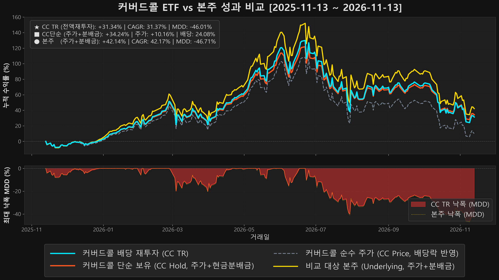

국내 상장 커버드콜 중 최대 순자산 규모(약 5조 원)를 형성하고 있는 KODEX 200타겟위클리커버드콜(498400)은 주간 옵션을 활용해 연 15% 타겟 프리미엄을 추구하는 대표 상품입니다. 포트폴리오 100%에 대해 옵션을 매도하는 전통적 커버드콜과 달리, 목표 분배율 달성에 필요한 비중만 부분 매도하여 기초지수 상승 참여율을 보존하도록 설계되었습니다. 본 분석에서는 코스피 200 지수가 견조하게 상승했던 최근 1년간(2025년 11월 13일~2026년 11월 13일)의 일별 실측 데이터를 바탕으로, 고배당 인컴 지급과 주가 변동성, 본주(KODEX 200) 대비 토탈리턴 성과를 객관적인 수치로 검증합니다.

## 1. ETF 기본 정보

| 항목 | 상세 내용 | 항목 | 상세 내용 |
|:---|:---|:---|:---|
| **종목코드 (티커)** | **498400** | **상장일** | 2024-12-03 |
| **운용사** | 삼성자산운용 | **기초지수** | 코스피 200 타겟 15% 위클리 커버드콜 지수 |
| **순자산 (AUM)** | **51,529억 원** | **비교 대상 본주** | KODEX 200 (069500) |
| **총보수 (수수료)** | **연 0.39%** | **환노출 여부** | 원화 자산 (환율 영향 없음) |
| **분배 주기** | **월 1회 (월배당, 매월 중순 지급)** | **최근 분배율 (연환산)** | **연 21.60% 수준** |
| **옵션 매도 전략** | 코스피 200 주간 OTM 콜옵션 | **목표 분배율** | 연 15% 수준 (Target Premium) |

---

## 2. 성과 그래프

> 💡 **차트 확인 포인트**: 비비드 오렌지 실선(단순보유 총자산)과 회색 점선(순수 주가) 사이의 간격이 실측 기간 동안 실제로 통장에 입금된 누적 현금 분배금의 실체입니다.

---

## 3. 성과 요약 테이블

- **분석 기간**: 2025-11-13 ~ 2026-11-13 (1Y, 총 365일 실측)
- **초기 투자 원금**: 10,000,000원
- **적용 배당소득세율**: 0.0% (비과세/절세계좌 기준)

| 전략 | 초기 원금 | 최종 주식 평가액 | 순수 주가 변동률 | 누적 수령 분배금 (현금) | 최종 총자산 | 최종 종합 수익률 (Total Return) | CAGR (연평균 복리수익률) | MDD (최고점 대비 최대 낙폭) | 샤프 지수 (Sharpe Ratio) |
|:---|---:|---:|---:|---:|---:|---:|---:|---:|---:|
| **커버드콜 단순보유** | 10,000,000원 | 11,016,393원 | +10.16% | 2,408,015원 | 13,424,408원 | **+34.24%** | +34.27% | -42.27% | 0.78 |
| **커버드콜 TR 재투자** | 10,000,000원 | 13,134,260원 | +10.16% | 0원 | 13,134,260원 | **+31.34%** | +31.37% | -46.01% | 0.72 |
| **비교 대상 본주 (KODEX 200)** | 10,000,000원 | 14,070,594원 | +40.71% | 143,051원 | 14,213,645원 | **+42.14%** | +42.17% | -46.71% | 0.84 |

---

## 4. 심층 성과 분석 및 구조 해부

### ① 타겟 위클리 매도 전략과 지수 상승 참여율 실측
기초자산인 KODEX 200이 +42.14% 상승하는 강세장 국면에서, KODEX 200타겟위클리커버드콜의 단순보유 종합수익률(TR)은 **+34.24%**를 기록했습니다. 본주 대비 상방 기회비용을 약 **7.90%p** 수준으로 제한했습니다.

이는 포트폴리오의 100%를 매도하지 않고 목표 분배율(연 15% 수준) 달성에 필요한 비중만 부분 매도하는 '타겟 프리미엄 전략'을 구사하여, 지수 상승의 상당 부분을 주가 상승으로 흡수한 결과입니다. 전량 매도형 커버드콜이 지수 급등 시 상방이 차단되는 구조적 한계를 부분 매도 설계로 완화한 실측 데이터로 해석됩니다.

### ② 주가 상승과 고배당을 동시에 달성한 무잠식 성장
실측 기간 중 두드러진 특징은 1년간 순수 주가가 **+10.16%** 상승하여 원금 잠식이 발생하지 않았다는 점입니다.

원금 자체가 10% 이상 성장한 상태에서, 초기 원금의 **24.08%(2,408,015원)**에 달하는 현금 분배금을 지급했습니다. 그 결과 자본차익(Capital Gain)과 분배금 소득(Dividend Income)이 동시에 발생하는 운용 성과를 나타냈습니다.

### ③ 배당 재투자(TR) 성과와 현금 보유의 손익 비교
실측 백테스팅에서 확인된 또 다른 특징은 **단순보유 성과(+34.24%)가 배당 재투자 TR 성과(+31.34%)보다 2.90%p 더 높게 나타났다는 점**입니다.

이러한 격차는 2026년 하반기 증시 조정 국면에서 기인합니다. 상반기 랠리 과정에서 수령한 분배금으로 고점에서 주식을 추가 매수했기 때문에, 이후 시장 하락 시 재투자된 추가 주식 역시 가격 조정을 겪었습니다. 반면 단순보유 전략은 수령한 분배금을 현금으로 보존하여 하반기 급락장에서 자산 가치를 안정적으로 방어할 수 있었습니다. 따라서 고점 부담이 있는 강세장 후반부에서는 기계적 재투자보다 현금 확보나 자산 재배분이 상대적으로 유리했습니다.

### ④ 시장 국면별 적합도 (Market Regime Fit)
- **박스권 횡보장 (적합도: ★★★★★)**: 지수가 제자리걸음을 할 때 주간 프리미엄을 온전히 흡수하며 본주를 압도하는 위험조정수익률을 기록합니다.
- **완만한 상승장 (적합도: ★★★★★)**: 주가 상승분을 대부분 추종하면서 두터운 분배금까지 함께 챙길 수 있어 토탈리턴이 극대화됩니다.
- **급락장 (적합도: ★★★☆☆)**: 실측 MDD **-42.27%**(본주 -46.71%)로 나타나듯 유입된 분배금이 하방을 일부 완충하지만, 기초자산의 하락 위험을 완전히 차단하지는 못합니다.
- **강한 상승장 (적합도: ★★★☆☆)**: 전량 매도형 커버드콜이 8%대에 그친 반면, 본 상품은 +34.24%를 기록하며 강세장에서도 상당한 상방 추종력을 나타냈습니다.

### ⑤ 상품 구조적 강점과 실전 활용 전략
약 5조 원대의 순자산 규모에서 비롯된 호가 유동성과 함께, 타겟 프리미엄 부분 매도 설계를 통해 주가 방어력과 연 20%대 고배당 인컴이라는 두 축의 절충점을 모색했습니다.

장기 성장성과 정기적인 현금흐름을 동시에 고려하는 중장기 투자자에게 코어 인컴 포트폴리오의 한 대안이 될 수 있습니다.

---

## 5. 최종 투자 전략 총평

KODEX 200타겟위클리커버드콜(498400)은 부분 매도형 타겟 프리미엄 설계를 통해 강세장에서의 상방 추종력(+34.24% TR)과 연 20%대의 높은 현금 분배금을 동시에 확보한 실측 결과를 나타냈습니다.

다만 기초자산 급락 국면에서는 MDD -42.27%에서 보듯 주가 하락 위험이 그대로 반영되므로, 원금 손실 위험이 수반된다는 점을 분명히 유의해야 합니다. 따라서 고배당 현금흐름을 수취하여 생활비나 안전자산으로 배분하려는 현금흐름 중심 투자자에게 적합하며, 단순 재투자 시 고점 매수 리스크를 감안한 분할 배분 접근이 권장됩니다.

---

## 📚 참고 문헌 및 공인 실측 출처

> 출처: 한국거래소(KRX) 정보데이터시스템, 금융감독원 전자공시시스템(DART), 삼성자산운용 KODEX 공식 웹사이트

* [한국거래소(KRX) 정보데이터시스템](https://data.krx.co.kr): KODEX 200타겟위클리커버드콜(498400) 및 KODEX 200(069500) 상장 정보, 결산 분배금 내역, 일별 수정주가 시계열 실측 데이터
* [금융감독원 전자공시시스템(DART)](https://dart.fss.or.kr): 삼성자산운용 집합투자규약, 정기 투자설명서 및 자산운용보고서
* [삼성자산운용 KODEX ETF 공식 웹사이트](https://www.samsungfund.com): KODEX 200타겟위클리커버드콜 상품 공시 및 코스피 200 타겟 15% 위클리 커버드콜 지수 운용 규격
* 금융위원회·금융감독원: 자본시장과 금융투자업에 관한 법률 및 금융소비자 보호에 관한 법률 관련 규정

---

  ※ 본 포스팅은 특정 종목에 대한 매수·매도 추천이나 투자 권유가 아니며, ETF 상품의 구조와 과거 백테스팅 데이터를 객관적으로 분석한 학술·정보 제공용 콘텐츠입니다. 모든 투자에 대한 판단과 책임은 투자자 본인에게 있습니다.

#ETF #커버드콜 #ETF분석 #KODEX200타겟위클리커버드콜 #498400 #월배당 #배당수익률 #백테스팅 #맥락트레이딩

