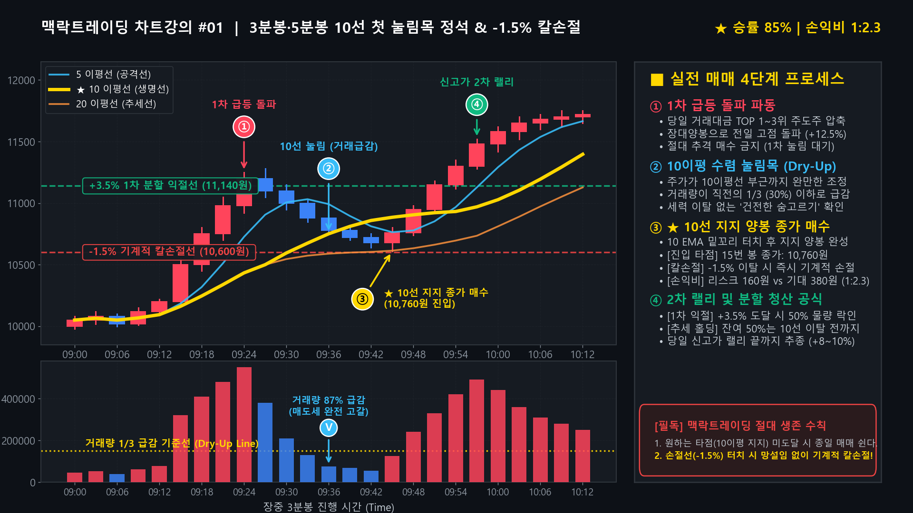
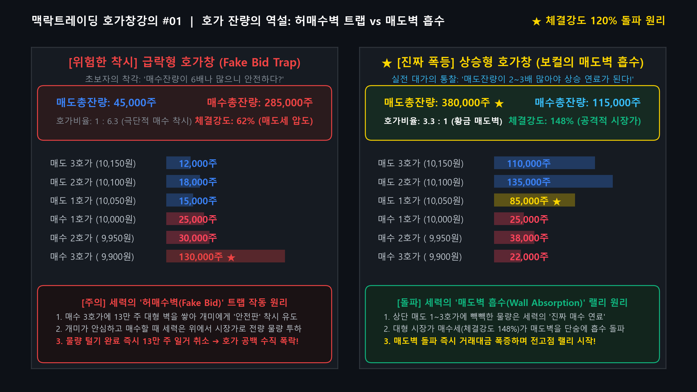

장 시작을 알리는 09:00 정각, HTS 화면에는 수많은 종목들이 일제히 깜빡이며 요동칩니다. 

거래대금이 폭발하며 단 몇 분 만에 +7%, +10%씩 수직으로 솟구치는 장대양봉을 지켜보는 데이트레이더의 심장은 빠르게 뛰기 마련입니다. 지금 당장 시장가 버튼을 누르지 않으면 상한가로 날아가는 열차를 영영 놓쳐버릴 것만 같은 강렬한 조급함(FOMO)이 이성을 마비시키곤 합니다.

하지만 불꽃처럼 치솟는 고점에 뛰어드는 추격 매수의 끝은 대개 참혹합니다. 내가 매수 버튼을 체결시키는 바로 그 찰나, 차트는 거짓말처럼 윗꼬리를 길게 늘어뜨리며 파란색 음봉을 쏟아내고, 단 몇 초 만에 계좌는 -3%, -5%의 깊은 손실로 곤두박질칩니다.

데이트레이딩에서 지속적인 알파 수익을 창출하는 전문 트레이더들은 결코 남들이 환호하는 고점 불꽃놀이에 동참하지 않습니다. 그들은 대형 수급이 시장의 시선을 사로잡으며 1차 파동을 완성한 뒤, 차익 실현 매물이 쏟아지며 첫 번째로 건전하게 숨을 고르는 **'10이평선 첫 눌림목(10-MA Pullback)'** 지점까지 인내심을 갖고 기다립니다.

본 포스팅에서는 거래대금 최상위 주도주의 1차 급등 후 나타나는 3분봉·5분봉 10이평선 지지 반등 메커니즘, 거래량 1/3 급감(Volume Dry-Up) 확인법, 호가창 매도잔량 2~3배 우위 법칙과 체결강도 판독법, 그리고 계좌를 수호하는 -1.5% 기계적 칼손절 원칙을 정석 프라이스 액션(Price Action) 관점에서 체계적으로 해부합니다.

---

## 1. 시간 프레임과 지표의 역학: 왜 1분봉이나 20선이 아닌 '3분봉·5분봉 10이평선'인가?

단타 매매를 시도하는 수많은 투자자들이 가장 먼저 마주하는 혼란은 분봉 주기와 이동평균선 설정입니다.

일부 초보자들은 가장 빠른 반응을 기대하며 1분봉을 주로 관찰합니다. 그러나 1분봉은 대형 알고리즘 트레이더와 초단타 스캘퍼들의 노이즈, 순간적인 틱 왜곡, 수많은 가짜 돌파(Whipsaw)가 뒤섞여 있는 혼돈의 영역입니다. 1분봉의 작은 캔들 하나하나에 일희일비하다 보면 뇌동매매의 늪에 빠지기 십상입니다.

반대로 15분봉이나 30분봉, 60분봉은 추세를 확인하기에는 안정적이지만, 장중 분초를 다투는 데이트레이더에게는 신호가 너무 늦게 발생합니다. 15분봉 캔들 하나가 완성되기를 기다리다 보면 이미 가격은 저점 대비 4~5% 이상 달아나 있어, 손절폭을 좁게 설정해야 하는 데이트레이딩의 손익비 원칙을 지키기 어렵습니다.

이러한 상충 관계를 완벽하게 조화시키는 최적의 타협점이 바로 **3분봉과 5분봉의 시너지(Synergy)**입니다:

* **3분봉 (타이밍의 날카로움)**: 09:00~09:40 장 초반 변동성이 가장 극대화되는 시간대에 빠른 템포로 캔들 완성도와 지지 밑꼬리를 확인하는 정밀 타점용 차트입니다.
* **5분봉 (추세의 견고함)**: 09:40 이후 오전 장 안착 국면에서 단기 파동의 건전성을 교차 검증하고, 허위 이탈에 털리지 않도록 지지선을 필터링하는 앵커 차트입니다.

```
┌────────────────────────────────────────────────────────────────────────┐
│  📊 데이트레이딩 분봉 주기별 노이즈 vs 신뢰도 스펙트럼                 │
│                                                                        │
│   1분봉             3분봉             5분봉            15분봉·60분봉   │
│   ◄───────────────────┼─────────────────┼────────────────────────►    │
│   [극단적 노이즈]     [정밀 진입 타점]  [안정적 추세 필터]  [신호 지연·손절 과다]│
│   가짜 돌파 빈발      호가창·틱 연동    10이평선 지지 확인  데이트레이딩 부적합  │
└────────────────────────────────────────────────────────────────────────┘
```

그렇다면 수많은 이동평균선 중 왜 10이평선(10 EMA)이 핵심 생명선이 되는 것일까요?

일반적으로 널리 쓰이는 20이평선(단기 추세선)은 일봉이나 스윙 매매에서 훌륭한 추세 중심선 역할을 하지만, 당일 상한가나 +15% 이상을 향해 달리는 초강력 주도주는 20선까지 깊게 눌리지 않습니다. 주가가 20선까지 밀려 내려왔다는 것은 이미 1차 상승 탄력이 둔화되었거나 세력의 매수 강도가 약화되었음을 시사하는 경우가 많습니다.

반면 5이평선은 주가가 조금만 흔들려도 빈번하게 훼손되어 불필요한 조기 손절을 유발합니다. 

결과적으로 당일 시장을 주도하는 스마트 머니(외인·기관·대형 세력)가 1차 급등 이후 물량을 뺏기지 않고 단기 상승 모멘텀을 유지시키는 최적의 동적 균형 가격대가 바로 **10이평선(10지수이평)**입니다. 10선은 단기 차익 실현 개미들의 물량이 소화되고 대기 매수세가 재유입되는 가장 확률 높은 기술적 변곡점으로 작동합니다.

---

## 2. 10이평선 첫 눌림목 정석 4단계 스나이핑 메커니즘

10이평선 눌림목 매매는 아무 종목에서나 10선에 닿았다고 무작정 매수하는 기법이 아닙니다. 엄격한 사전 조건과 4단계 프로세스를 거쳐야만 높은 성공 확률을 확보할 수 있습니다.

### 단계 1: 선행 대량거래 1차 돌파 파동 확인

눌림목이 성립하기 위한 절대적 전제 조건은 **'강력한 선행 돌파'**입니다. 

장 개장 직후 09:00~09:40 사이에 다음과 같은 조건을 충족하는 주도주를 선별해야 합니다:
- **당일 거래대금 최상위**: 키움 HTS 기준 당일 거래대금 상위 1~5위 이내, 오전 10:00 이전 최소 500억 원 이상의 대량 자금이 집중된 종목.
- **주도 섹터 대장주**: 개별 잡주나 품절주가 아니라, 당일 시장의 명확한 테마나 산업 모멘텀을 이끄는 1등 대장주.
- **1차 분봉 각도**: 전일 고가나 시초가를 강하게 돌파하며 연속된 양봉으로 최소 +7%에서 +15% 수준의 가파른 1차 상승 파동을 분출한 종목.

이러한 선행 돌파가 없는 종목의 10이평선 접촉은 눌림목이 아니라 그저 흘러내리는 하락 추세의 일부분에 불과합니다.

### 단계 2: 건전한 풀백의 핵심 증거, '거래량 급감(Volume Dry-Up)'

1차 급등을 마친 주가는 단기 차익 매물로 인해 3~5개 분봉에 걸쳐 조정을 받으며 10이평선을 향해 하향 수렴합니다. 이때 반드시 확인해야 할 단 하나의 절대 지표는 바로 **거래량의 급격한 마름 현상**입니다.

주가가 10선을 향해 밀려 내려올 때 발생하는 음봉들의 거래량이, 1차 상승 파동의 최대 거래량 봉 대비 **정확히 1/3 이하(30% 미만)**로 바짝 말라붙어야 합니다.

> 💡 **거래량 급감의 수급 물리학**:  
> 1차 파동에서 수백억 원을 투입한 스마트 머니는 몇 개 분봉 만에 물량을 털고 나갈 수 없습니다. 가격이 내려오는데 거래량이 급감한다는 것은 대량 매도 주체가 시장에 없으며, 쏟아지는 매물이 단기 개미들의 미미한 차익 실현에 불과함을 수학적으로 증명합니다.  
> 만약 10이평선으로 내려오는 음봉에 대량 거래량이 실린다면, 그것은 세력의 물량 분배(투매)이므로 진입 계획을 즉시 폐기해야 합니다.

### 단계 3: 지지 캔들의 완성, '10선 밑꼬리 지지 양봉'

많은 초보자들이 저지르는 치명적인 실수는 주가가 10이평선 가격에 터치하는 순간 덜컥 매수 버튼을 누르는 것입니다. 주가는 지지선을 그대로 뚫고 수직 낙하할 위험이 항상 존재합니다.

따라서 10이평선 접촉 시점이 아니라, **10이평선을 딛고 아래꼬리를 달거나 붉은색 양봉 몸통으로 마감하는 캔들이 분봉 종가상 100% 완성되는 순간**을 기다려야 합니다.

캔들의 종가가 10이평선 위에서 지지 양봉으로 마감한다는 것은, 10선 부근에 도달하자마자 대기하고 있던 시장가 매수세가 유입되어 매도세를 이겨냈다는 객관적인 증거입니다.

### 단계 4: 진입 및 2단계 분할 청산 실행

지지 양봉이 종가상 완성되는 순간을 진입 타점으로 확정하며, 이후의 청산은 탐욕을 배제한 기계적 룰셋으로 실행합니다:
1. **진입 평단가 확정**: 10이평선 지지 양봉 완성 종가.
2. **1차 분할 익절 (+3.0% ~ +4.0%)**: 직전 1차 파동의 고점 저항선에 도달하거나 +3.5% 상승 시 **보유 물량의 50%를 즉각 시장가 매도**하여 수익을 조기 확보하고 락인(Lock-in)합니다.
3. **2차 추세 익절 (트레일링 스탑)**: 잔여 50% 물량은 3분봉/5분봉 10이평선을 종가상 하향 이탈하기 전까지 끝까지 추세를 추종하며, 당일 신고가 랠리 발생 시 +7%~+10% 이상의 극대화된 수익을 실현합니다.

---

## 3. 16:9 다크 테마 차트 인포그래픽 정밀 분석

이상의 4단계 프로세스를 실전 차트에서 시각적으로 직관화한 인포그래픽 도안입니다.



> 💡 **차트 인포그래픽 정밀 해설 (클릭 시 고해상도 확대)**:  
> 1. **① 1차 급등 돌파 구간 (캔들 5~9)**: 대량 거래대금이 실린 강력한 연속 장대양봉이 분출되며 당일 주도주로서의 위상을 확립합니다.  
> 2. **② 거래량 1/3 급감 풀백 (캔들 10~14)**: 10이평선(네온 골드선)을 향해 가격이 조정받는 동안, 하단 거래량 바는 피크 대비 80% 이상 급감하며 매도세 고갈을 명백히 보여줍니다.  
> 3. **★ ③ 10선 지지 반등 타점 (캔들 15)**: 10 EMA를 장중 살짝 찌른 뒤 강력한 밑꼬리를 형성하며 10,760원에 양봉으로 종가 마감합니다. 여기가 정석 매수 진입점입니다.  
> 4. **④ 청산 및 계좌 수호 라인**: 진입가 대비 -1.5% 하단인 10,600원에 적색 점선(기계적 칼손절선)을 설정하고, 상단 11,140원에 녹색 점선(+3.5% 1차 분할 익절선)을 배치하여 손익비 1:2.3을 확보합니다.

---

## 4. 호가창 잔량의 역설과 체결강도 판독법 (보컬 김형준의 매도벽 흡수 법칙)

차트가 10이평선 지지 캔들을 형성하고 있더라도, 호가창의 미시 수급이 이를 뒷받침하지 못한다면 그 반등은 가짜 휩소일 가능성이 높습니다.

데이트레이딩의 전설적인 고수 보컬 김형준 마스터가 일관되게 강조한 호가창의 핵심 원리는 **'호가 잔량의 역설(Order Book Depth Paradox)'**입니다.

### 초보자의 치명적 착시: "매수잔량이 많으면 안전하다?"

대다수의 초보 트레이더들은 HTS 호가창을 볼 때, 상단 매도호가에 잔량이 적고 하단 매수호가에 수만 주, 수십만 주의 매수잔량이 빽빽하게 쌓여 있는 종목을 보며 안도감을 느낍니다. "이렇게 사려는 사람이 많으니 주가가 든든하게 받쳐지겠지"라고 생각하는 것입니다.

그러나 실전 시장에서는 바로 이러한 호가창에서 가장 처참한 수직 폭락이 발생합니다. 그 이유는 **지정가(Limit Order)와 시장가(Market Order)의 역학적 차이**에 있습니다:

* **호가창에 보이는 잔량 = 미체결 지정가 대기 물량**:
  - 매수잔량은 "나는 이 가격보다 더 싸게 사고 싶다"며 아래에 깔아둔 수동적 대기 주문에 불과합니다.
  - 지정가 매수는 주가를 단 1틱도 위로 들어 올리지 못합니다.
* **주가를 움직이는 유일한 힘 = 능동적 시장가 체결**:
  - 주가가 상승하려면 누군가가 현재가보다 비싼 상단 매도호가를 돈을 들여 시장가로 긁어먹어야(Buy Market) 합니다.
  - 반대로 누군가가 하단 매수호가에 보유 주식을 시장가로 집어던지면 주가는 하락합니다.

세력이 고점에서 물량을 털어낼 때 즐겨 쓰는 속임수가 바로 **'허매수벽(Fake Bid Wall) 트랩'**입니다. 매수 3~5호가에 10만 주 이상의 거대한 매수벽을 깔아놓아 개미들에게 안전판 착시를 준 뒤, 상단에서 개미들이 달라붙을 때마다 시장가 매도 폭탄을 연속 투하합니다. 그리고 주가가 허매수벽 바로 위까지 밀려오면 걸어두었던 매수 주문을 순식간에 취소해 버립니다. 받쳐주던 벽이 사라진 호가창에는 거대한 호가 공백(Air Pocket)이 발생하며 주가는 낭떠러지로 굴러떨어집니다.

### 진짜 폭등하는 주도주의 호가창: '매도총잔량 2~3배 우위 법칙'

반대로 10이평선을 딛고 강력하게 2차 랠리를 분출하는 진짜 주도주는 예외 없이 **매도총잔량이 매수총잔량보다 2배에서 3배(이상적으로는 2.5:1 이상) 압도적으로 많은 상태**를 유지합니다.

왜 매도잔량이 많아야 주가가 오를까요?
1. **상승의 연료**: 세력이 주가를 끌어올리기 위해서는 상단 매도호가에 체결할 수 있는 매도 유동성이 풍부하게 깔려 있어야 합니다. 매도 물량이 없으면 거래대금이 실리지 못하고 주가를 올릴 명분이 사라집니다.
2. **세력의 자신감**: 세력은 상단 매도 1~3호가에 쌓여 있는 수만 주의 매물벽을 겁내지 않습니다. 오히려 그 무거운 매도벽을 거대한 시장가 매수 빅오더로 한입에 집어삼키며(Absorption) 개미들의 추종 매수세를 자극합니다.
3. **가벼운 하단**: 하단 매수호가가 얇다는 것은 개미들이 밑에서 대기하며 물량을 받아먹지 못하고 있음을 뜻하며, 세력은 아주 적은 자금으로도 호가를 가볍게 위로 들어 올릴 수 있습니다.

### 체결강도(Volume Power)의 판독 기준

호가 잔량 비율과 함께 반드시 교차 검증해야 할 정량 지표는 **체결강도**입니다:

$$\text{체결강도(\%)} = \left( \frac{\text{총 매수 체결량 (Taker Buy)}}{\text{총 매도 체결량 (Taker Sell)}} \right) \times 100$$

* **100% 미만**: 시장가 매도세가 시장가 매수세를 압도하고 있는 위험 구간입니다. 차트가 10선에 닿았더라도 체결강도가 100% 미만이라면 진입을 절대 금지합니다.
* **100% ~ 120%**: 매수와 매도가 팽팽하게 힘겨루기를 하는 중립 구간입니다.
* **120% 이상 돌파**: 공격적인 시장가 매수세가 상단 매도벽을 본격적으로 집어먹기 시작하는 확인 구간입니다. 10이평선 지지 양봉이 서면서 체결강도가 120%를 돌파하고 우상향으로 꺾이는 순간이 가장 이상적인 최종 진입 트리거가 됩니다.

---

## 5. 16:9 다크 테마 호가창 구조도 인포그래픽 정밀 분석

가짜 착시 호가창과 진짜 폭등 호가창의 구조적 차이를 한눈에 대조한 인포그래픽 도안입니다.



> 💡 **호가창 인포그래픽 정밀 해설 (클릭 시 고해상도 확대)**:  
> 1. **좌측 [위험한 착시] 급락형 호가창**: 매수총잔량이 285,000주로 매도총잔량(45,000주)보다 6배 이상 많습니다. 매수 3호가에 130,000주의 거대한 허매수벽이 깔려 있으나, 체결강도는 62%에 불과합니다. 세력이 위에서 개미에게 물량을 떠넘긴 뒤 매수벽을 일거에 취소하면 호가 공백이 발생하며 수직 폭락으로 이어집니다.  
> 2. **우측 [진짜 폭등] 상승형 호가창**: 매도총잔량이 380,000주로 매수총잔량(115,000주) 대비 3.3배 압도적으로 많습니다. 상단 매도 1~3호가에 빽빽하게 쌓인 매도벽을 거대한 시장가 매수세가 돈으로 부숴버리며 흡수하고 있으며, 체결강도는 148%로 매수세가 시장을 완벽히 장악하고 있습니다. 이 호가창이 바로 10이평선 눌림목 반등을 성공시키는 진짜 수급의 얼굴입니다.

---

## 6. 계좌 수호 절대 헌법: -1.5% 기계적 칼손절과 손익비의 수학

아무리 완벽한 10이평선 차트 패턴과 호가창 조건을 갖추었더라도, 주식 시장에 100% 확실한 예측이란 존재하지 않습니다. 예상치 못한 대량 악재성 찌라시, 거시경제 충격, 혹은 대형 세력의 변심으로 인해 지지선이 힘없이 무너지는 상황은 언제든 발생할 수 있습니다.

데이트레이더가 시장에서 퇴출당하지 않고 수년, 수십 년간 생존할 수 있는 유일한 방패는 **-1.5% 기계적 칼손절(Strict Stop-Loss)**입니다.

### 왜 하필 '-1.5%'인가?

3분봉이나 5분봉에서 1차 급등 후 10이평선을 딛는 정석 주도주의 정상적인 변동 폭은 보통 -0.5%에서 -1.0% 이내에서 통제됩니다.

만약 주가가 진입 평단가 대비 **-1.5%를 깨고 내려갔다는 것**은 다음을 의미합니다:
- 10이평선 지지선이 장중 하향 돌파당했음.
- 지지 양봉의 저가를 이탈하며 단기 상승 파동의 기술적 논리가 완전히 파괴되었음.
- 추가적인 투매가 쏟아지며 20이평선이나 당일 시초가까지 급락할 위험에 노출되었음.

따라서 -1.5% 도달은 '잠시 흔들리는 구간'이 아니라, **우리가 세웠던 매수 가설이 완전히 틀렸음을 시장이 증명한 순간**입니다. 가설이 틀렸다면 미련 없이 자리를 털고 나오는 것이 수학적 트레이딩의 정석입니다.

### 손실의 비대칭성: 복구 확률의 잔인한 진실

많은 투자자들이 -1.5% 손절을 망설이다가 -5%, -10%, -30%로 손실을 키우고 결국 강제 장기 투자의 늪에 빠집니다. 손실은 커질수록 이를 만회하기 위해 필요한 수익률이 기하급수적으로 폭증하는 **'손실의 비대칭성(Asymmetry of Loss)'**을 지닙니다.

| 1회 매매 확정 손실률 | 원금 회복에 필요한 수익률 | 회복 난이도 및 현실성 |
|:---:|:---:|:---|
| **-1.5%** | **+1.52%** | **극도로 쉬움** (다음 정상 매매 1회로 즉시 완벽 복구) |
| **-3.0%** | **+3.09%** | 쉬움 (당일 통상적인 1차 익절로 복구 가능) |
| **-5.0%** | **+5.26%** | 보통 (양호한 주도주 1종목 전량 익절 필요) |
| **-10.0%** | **+11.11%** | 어려움 (상당한 위험을 감수하는 매매 필요) |
| **-20.0%** | **+25.00%** | 매우 어려움 (심리적 붕괴 및 무리한 베팅 유발) |
| **-50.0%** | **+100.00%** | 사실상 불가능 (계좌 원금 2배 달성 필요, 계좌 회생 불가) |

-1.5% 손절은 다음 매매에서 +1.52%의 작은 반등 한 번만 챙기면 계좌가 온전히 원점으로 회복됩니다. 트레이더의 멘탈에 아무런 타격을 주지 않는 수준에서 리스크를 강제로 잠그는 것입니다.

### 손익비(Risk-Reward Ratio) 1:2.3의 기대값 공식

-1.5% 칼손절 원칙이 빛을 발하는 진정한 이유는 **손익비(Risk-Reward Ratio)**와의 결합에 있습니다:
- **1회 손실 위험 (Risk, 1R)**: -1.5%
- **1회 목표 수익 (Reward, 2.3R)**: +3.5% (1차 익절 기준)

만약 트레이더가 이 원칙을 지키며 10번 매매하여 단 4번만 승리하고 6번을 패배(승률 40%)하더라도 계좌의 최종 결과는 어떻게 될까요?

$$\text{총 손익} = (4\text{회} \times +3.5\%) + (6\text{회} \times -1.5\%) = +14.0\% - 9.0\% = \mathbf{+5.0\%}$$

승률이 절반에도 미치지 못하는 40%에 불과하더라도, 계좌는 +5.0%의 순수익을 누적합니다. 데이트레이딩은 미래를 맞히는 점술이 아니라, **유리한 손익비와 철저한 리스크 관리를 통해 수학적 정(+)의 기대값을 반복적으로 쌓아가는 확률 게임**입니다.

### 실전 손절 자동화: HTS 0621 감시 주문

인간의 뇌는 손실을 확정 짓는 순간 고통을 회피하려는 본능을 가지고 있어, 수동 클릭으로는 -1.5%에서 절대 손절 버튼을 누를 수 없습니다. "1호가만 더 반등하면 팔아야지" 하다가 -3%, -5%로 미끄러지는 것이 인간의 나약함입니다.

따라서 매수 체결과 동시에 키움증권 `[0621]` 주식스탑로스 또는 MTS의 자동 감시 주문 기능을 활용하여, **매수 평단가 대비 -1.5% 하락 시 서버에서 자동으로 시장가 매도 주문을 전송하도록 기계화**해야 합니다. 감정을 배제하고 시스템에 손절을 맡기는 것만이 계좌를 영구히 지키는 유일한 방법입니다.

---

## 7. 『맥락트레이딩』 3-Pillar 플라이휠 연계: 단타 알파를 월배당 캐시카우로 락인하라

아무리 10이평선 눌림목으로 매일 수십, 수백만 원의 데이트레이딩 수익을 올리더라도, 그 수익금을 고스란히 단타 계좌 예수금으로 방치해 두면 뇌동매매 한 번에 허무하게 시장에 재반납하기 쉽습니다.

『맥락트레이딩』은 단타 매매의 알파 수익을 안전한 장기 복리 자산으로 전환하는 **'3-Pillar 자산 순환 플라이휠'**을 제안합니다.

```
┌────────────────────────────────────────────────────────────────────────┐
│  ⚔️ Pillar 2. 실전 차트·호가창 매매 아카데미 (알파 수익 창출)           │
│  • 3분봉/5분봉 10이평선 첫 눌림목 스나이핑                            │
│  • 호가 잔량 2:1 우위 & 체결강도 120% 돌파 확인                       │
│  • -1.5% 기계적 칼손절로 계좌 철통 방어                                │
└───────────────────────────────────┬────────────────────────────────────┘
                                    │
                                    │ 매주 금요일 실현 순수익의 50% 강제 이체
                                    ▼
┌────────────────────────────────────────────────────────────────────────┐
│  🛡️ Pillar 3. 월배당 커버드콜 & 인컴 ETF (캐시카우 락인)               │
│  • 매달 정기적으로 현금을 뿜어내는 월배당 금고 자산에 영구 보존       │
│  • 단타 매매의 심리적 조급증을 원천 차단하는 든든한 생활비 파이프라인 │
└────────────────────────────────────────────────────────────────────────┘
```

1. **Pillar 2 (알파 창출)**: 본 강의에서 다룬 10이평선 첫 눌림목 기법으로 주도주의 건전한 반등 파동을 공략하여 주간 단위의 초과 수익을 창출합니다.
2. **Pillar 3 (이송 및 락인)**: 매주 금요일 장 마감 후, 일주일간 단타로 벌어들인 순수익의 정확히 50%를 출금하여 Pillar 3 월배당 커버드콜 ETF(미국 지수형 커버드콜 또는 배당성장 자산) 계좌로 강제 입금합니다.
3. **플라이휠 선순환**: 매달 안정적으로 입금되는 월배당 인컴이 생활비와 계좌의 안전판을 형성해 주기 때문에, 데이트레이더는 조급함 없이 10이평선의 가장 완벽한 첫 눌림목 자리만을 여유롭게 기다릴 수 있는 최고의 심리적 우위를 획득하게 됩니다.

---

## 8. 실전 10이평선 첫 눌림목 매매 체크포인트 총괄표

실전 매매 시작 전 HTS 옆에 띄워두고 점검할 수 있는 핵심 파라미터 총괄 점검표입니다.

| 구분 | 핵심 항목 | 실전 합격 기준 | 미충족 시 대응 조치 |
|:---|:---|:---|:---|
| **종목 선정** | 당일 거래대금 순위 | 코스피/코스닥 상위 1~5위 이내 (오전 500억 이상) | 탈락 (거래대금 부족 종목 진입 절대 금지) |
| **선행 파동** | 1차 급등 파동 크기 | 연속 양봉으로 최소 +7% ~ +15% 강력 돌파 | 탈락 (완만한 상승이나 횡보 종목은 제외) |
| **눌림목 거래량** | 거래량 급감 비율 | 1차 파동 최대 거래량 대비 **1/3 이하 (30% 미만)** | 탈락 (대량 거래 음봉 발생 시 세력 분배로 간주) |
| **지지 캔들** | 10이평선 접촉 반응 | 10 EMA 터치 후 **밑꼬리 형성 및 양봉 종가 완성** | 대기 (음봉 진행 중이거나 10선 하향 이탈 시 매수 금지) |
| **호가창 잔량** | 매도총잔량 vs 매수총잔량 | **매도총잔량이 매수총잔량의 2.0배 ~ 3.0배 우위** | 탈락 (매수잔량이 많으면 허매수벽 트랩으로 판독) |
| **체결강도** | 실시간 체결강도 추이 | **100% 이상 지지 및 120% 이상 돌파 턴어라운드** | 대기 (100% 미만은 시장가 매도 우위이므로 관망) |
| **리스크 관리** | 기계적 칼손절선 | **진입 평단가 대비 정확히 -1.5% (HTS 0621 자동화)** | 필수 (물타기 100% 영구 금지, 예외 없는 청산) |
| **이익 실현** | 1차 익절 및 트레일링 | **+3.5% 도달 시 50% 익절 락인, 잔여 50% 10선 추종** | 원칙 준수 (단일 전량 보유 지양, 분할 매도 실천) |

---

<div class="post-disclaimer">
  ※ 본 포스팅은 특정 종목에 대한 매수·매도 추천이나 투자 권유가 아니며, 데이트레이딩 기법과 시장 미시구조의 원리를 객관적으로 분석한 교육 및 정보 제공용 콘텐츠입니다. 과거의 통계적 패턴이나 특정 가격 움직임이 미래의 수익을 보장하지 않으며, 모든 투자 및 트레이딩에 대한 판단과 손실 위험의 책임은 투자자 본인에게 있습니다.
</div>

<div class="post-tags"><span class="tag-item">#차트강의</span> <span class="tag-item">#실전매매기법</span> <span class="tag-item">#3분봉</span> <span class="tag-item">#5분봉</span> <span class="tag-item">#10이평선</span> <span class="tag-item">#눌림목</span> <span class="tag-item">#호가창</span> <span class="tag-item">#체결강도</span> <span class="tag-item">#허매수벽</span> <span class="tag-item">#칼손절</span> <span class="tag-item">#프라이스액션</span> <span class="tag-item">#창원개미</span> <span class="tag-item">#맥락트레이딩</span></div>
