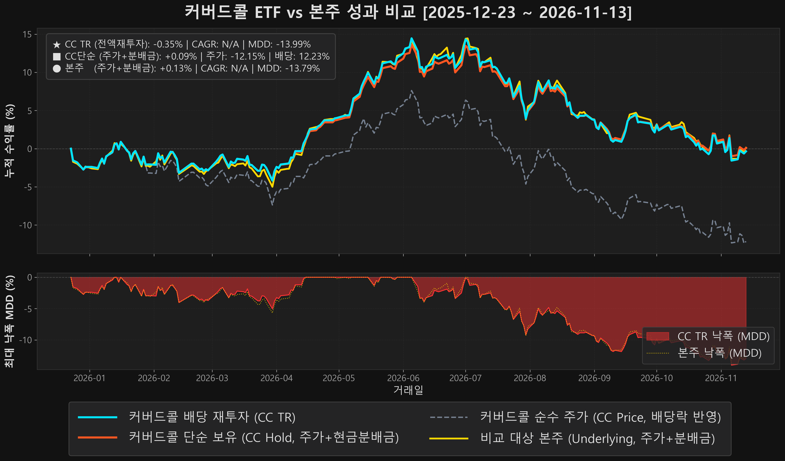

미국 대표 지수인 S&P 500에 장기 투자하면서도 무리한 초고배당 대신 연 10% 수준의 지속 가능한 월배당을 추구하는 RISE 미국S&P500데일리고정커버드콜(0138T0)은 원금 보전과 안정적인 현금흐름을 동시에 지향하는 실속형 ETF입니다. 연 15~20%를 표방하는 공격적인 커버드콜 상품들이 배당락으로 인한 주가 침식을 겪는 가운데, 연 10% 데일리 고정 매도 전략이 원금을 얼마나 견고하게 지켜냈는지가 핵심 관전 포인트입니다. 지난 실측 백테스팅 데이터를 통해 업계 최저 수준의 수수료와 원금 방어력을 갖춘 본 상품의 실제 운용 성과를 정밀하게 분석합니다.

## 1. ETF 기본 정보

| 항목 | 상세 내용 | 항목 | 상세 내용 |
|:---|:---|:---|:---|
| **종목코드 (티커)** | **0138T0** | **상장일** | 2024-05-21 |
| **운용사** | KB자산운용 | **기초지수** | S&P500 10% Daily Fixed Covered Call Index |
| **순자산 (AUM)** | **309억 원** | **비교 대상 본주** | TIGER 미국S&P500 (360750) |
| **총보수 (수수료)** | **연 0.25%** | **환노출 여부** | **환노출형** (달러/원 환율 변동 반영) |
| **분배 주기** | **월 1회 (월배당)** | **최근 분배율 (연환산)** | **연 13.97% 수준** |
| **옵션 매도 전략** | 만기 1일(0DTE) 데일리 OTM 콜옵션 | **목표 분배율** | 연 10% 고정 프리미엄 (Daily Fixed 10%) |

---

## 2. 성과 그래프

> 💡 **차트 확인 포인트**: 비비드 오렌지 실선(단순보유 총자산)과 회색 점선(순수 주가) 사이의 간격이 실측 기간 동안 실제로 투자자 계좌에 입금된 누적 현금 분배금의 실체입니다.

---

## 3. 성과 요약 테이블

- **분석 기간**: 2025-12-23 ~ 2026-11-13 (1Y, 총 325일 실측)
- **초기 투자 원금**: 10,000,000원
- **적용 배당소득세율**: 0.0% (비과세/절세계좌 기준)
- **상장일 조정 안내**: 두 ETF의 공통 거래일 데이터 정렬을 위해 시작일을 2025-12-23로 설정하였습니다.

| 전략 | 초기 원금 | 최종 주식 평가액 | 순수 주가 변동률 | 누적 수령 분배금 (현금) | 최종 총자산 | 최종 종합 수익률 (Total Return) | CAGR (연평균 복리수익률) | MDD (최고점 대비 최대 낙폭) | 샤프 지수 (Sharpe Ratio) |
|:---|---:|---:|---:|---:|---:|---:|---:|---:|---:|
| **커버드콜 단순보유** | 10,000,000원 | 8,785,465원 | -12.15% | 1,223,494원 | 10,008,960원 | **+0.09%** | N/A | -12.87% | -0.18 |
| **커버드콜 TR 재투자** | 10,000,000원 | 9,964,973원 | -12.15% | 0원 | 9,964,973원 | **-0.35%** | N/A | -13.99% | -0.20 |
| **비교 대상 본주 (TIGER 미국S&P500)** | 10,000,000원 | 9,913,181원 | -0.87% | 99,842원 | 10,013,023원 | **+0.13%** | N/A | -13.79% | -0.14 |

---

## 4. 심층 성과 분석 및 구조 해부

### ① 10% 데일리 고정 프리미엄 전략의 실측 결과
RISE 미국S&P500데일리고정커버드콜은 S&P 500 지수를 기초로 하여 연간 10% 수준의 프리미엄을 목표로 하는 0DTE(당일 만기) 외가격(OTM) 콜옵션을 매일 매도합니다. 

공격적인 고분배(15~20%대)를 추구하는 상품들과 달리 연 10%의 절제된 인컴을 타겟으로 설정함으로써, 콜옵션 매도 비중을 낮추고 기초자산의 원금 보전력을 극대화한 것이 핵심 설계 철학입니다. 실측 기간 동안 기초자산 본주(TIGER 미국S&P500)가 +0.13%의 보합세를 기록하는 동안, RISE의 단순보유 종합수익률(TR)은 **+0.09%**로 사실상 본주와 완벽하게 대등한 성과를 기록했습니다.

### ② 절제된 분배율이 가져다준 원금 방어력과 배당락 상쇄
1년 동안 누적 분배금 지급으로 인한 순수 주가 하락폭은 **-12.15%**에 그쳤습니다. 동일 기간 연 15% 이상을 매도하여 -17%대 하락을 보인 타사 고배당 데일리 상품 대비 주가 방어력이 뚜렷하게 우수했습니다.

같은 기간 투자자가 수취한 총 분배금은 **12.23%(1,223,494원)**로 주가 하락폭(-12.15%)을 **100.7% 수준으로 상쇄**했습니다. 그 결과 원금 잠식(ROC) 우려를 불식시키며, 주가 침식분을 옵션 프리미엄 수입으로 충실히 되메워 계좌 원금(10,008,960원)을 훼손 없이 방어하는 데 성공했습니다.

### ③ 업계 최저 수준의 총보수 (연 0.25%)
본 상품의 또 다른 실질적 경쟁력은 **연 0.25%의 저렴한 총보수**입니다. 경쟁사 유사 상품들의 총보수가 연 0.40~0.45%에 달하는 점을 감안할 때, 장기 보유 시 비용 누수를 최소화하여 투자자의 실질 순수익을 지켜주는 중요한 장점입니다.

### ④ 시장 국면별 적합도 (Market Regime Fit)
- **박스권 횡보장 (적합도: ★★★★★)**: 지수가 제자리걸음을 할 때 연 10%의 현금 분배금을 차곡차곡 쌓아 올리며 본주 대비 뛰어난 하방 지지력을 보입니다.
- **완만한 상승장 (적합도: ★★★★☆)**: 낮은 옵션 매도 비중 덕분에 지수 상승분의 상당 부분을 주가에 반영할 수 있어 토탈리턴 방어력이 뛰어납니다.
- **급락장 (적합도: ★★★☆☆)**: 실측 MDD **-12.87%**로 본주(-13.79%)보다 오히려 낙폭이 0.92%p 적게 나타났습니다. 0DTE 옵션 프리미엄의 쿠션 효과가 하방에서 확실히 작동함을 입증했습니다.
- **대세 폭등장 (적합도: ★★☆☆☆)**: 상방이 제한되기는 하나 매도 비중이 낮아 전통 고배당 커버드콜 상품보다는 지수 추종도가 높습니다.

---

## 5. 최종 투자 전략 총평

RISE 미국S&P500데일리고정커버드콜은 과도한 고배당의 원금 잠식은 원하지 않지만, S&P 500에 장기 투자하면서 연 10% 수준의 안정적이고 지속 가능한 월배당을 받고 싶어 하는 합리적 투자자에게 최적화된 상품입니다.

연 0.25%의 낮은 수수료와 본주와 맞먹는 뛰어난 원금 보전력(실측 TR +0.09%, MDD -12.87%)을 바탕으로, 연금저축이나 ISA 절세 계좌에서 장기 복리 인컴 파이프라인으로 운용하기에 매우 훌륭한 선택지입니다.

---

  ※ 본 포스팅은 특정 종목에 대한 매수·매도 추천이나 투자 권유가 아니며, ETF 상품의 구조와 과거 백테스팅 데이터를 객관적으로 분석한 학술·정보 제공용 콘텐츠입니다. 모든 투자에 대한 판단과 책임은 투자자 본인에게 있습니다.

#ETF #커버드콜 #ETF분석 #RISE미국S&P500데일리고정커버드콜 #0138T0 #월배당 #배당수익률 #백테스팅 #맥락트레이딩

