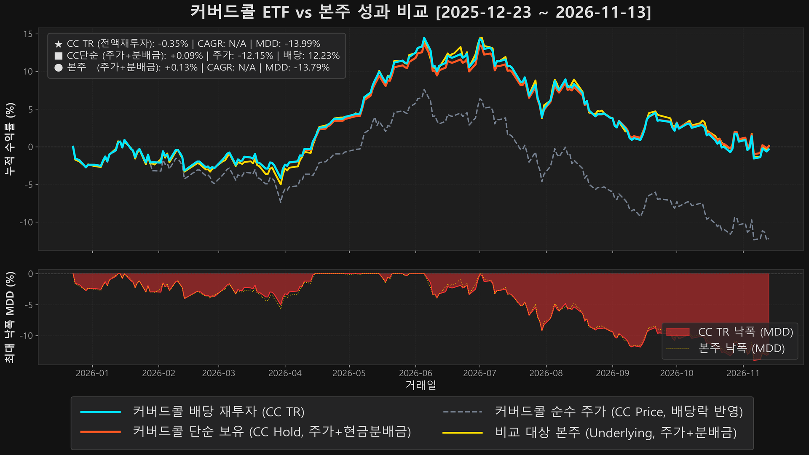

미국 대표 지수인 S&P 500에 장기 투자하면서 연 10% 수준의 월배당 인컴을 목표로 운용되는 RISE 미국S&P500데일리고정커버드콜(0138T0)은 주가 방어와 현금흐름의 균형을 모색하도록 설계된 ETF입니다. 연 15~20%를 표방하는 고배당 커버드콜 상품들이 지속적인 배당락으로 인한 기초자산 가치 침식을 겪는 반면, 연 10% 수준의 데일리 옵션 매도 전략이 원금 보전에 미친 영향을 규명하는 것이 핵심 분석 지점입니다. 최근 1년간(2025년 12월 23일~2026년 11월 13일)의 실측 데이터를 바탕으로, 본 상품의 총수익률(Total Return), 배당락 상쇄율, 그리고 본주(TIGER 미국S&P500) 대비 방어력을 객관적 수치로 비교 분석합니다.

## 1. ETF 기본 정보

| 항목 | 상세 내용 | 항목 | 상세 내용 |
|:---|:---|:---|:---|
| **종목코드 (티커)** | **0138T0** | **상장일** | 2024-05-21 |
| **운용사** | KB자산운용 | **기초지수** | S&P500 10% Daily Fixed Covered Call Index |
| **순자산 (AUM)** | **309억 원** | **비교 대상 본주** | TIGER 미국S&P500 (360750) |
| **총보수 (수수료)** | **연 0.25%** | **환노출 여부** | **환노출형** (달러/원 환율 변동 반영) |
| **분배 주기** | **월 1회 (월배당)** | **최근 분배율 (연환산)** | **연 13.97% 수준** |
| **옵션 매도 전략** | 만기 1일(0DTE) 데일리 OTM 콜옵션 | **목표 분배율** | 연 10% 고정 프리미엄 (Daily Fixed 10%) |

---

## 2. 성과 그래프

> 💡 **차트 확인 포인트**: 비비드 오렌지 실선(단순보유 총자산)과 회색 점선(순수 주가) 사이의 간격이 실측 기간 동안 실제로 투자자 계좌에 입금된 누적 현금 분배금의 실체입니다.

---

## 3. 성과 요약 테이블

- **분석 기간**: 2025-12-23 ~ 2026-11-13 (1Y, 총 325일 실측)
- **초기 투자 원금**: 10,000,000원
- **적용 배당소득세율**: 0.0% (비과세/절세계좌 기준)
- **상장일 조정 안내**: 두 ETF의 공통 거래일 데이터 정렬을 위해 시작일을 2025-12-23로 설정하였습니다.

| 전략 | 초기 원금 | 최종 주식 평가액 | 순수 주가 변동률 | 누적 수령 분배금 (현금) | 최종 총자산 | 최종 종합 수익률 (Total Return) | CAGR (연평균 복리수익률) | MDD (최고점 대비 최대 낙폭) | 샤프 지수 (Sharpe Ratio) |
|:---|---:|---:|---:|---:|---:|---:|---:|---:|---:|
| **커버드콜 단순보유** | 10,000,000원 | 8,785,465원 | -12.15% | 1,223,494원 | 10,008,960원 | **+0.09%** | N/A | -12.87% | -0.18 |
| **커버드콜 TR 재투자** | 10,000,000원 | 9,964,973원 | -12.15% | 0원 | 9,964,973원 | **-0.35%** | N/A | -13.99% | -0.20 |
| **비교 대상 본주 (TIGER 미국S&P500)** | 10,000,000원 | 9,913,181원 | -0.87% | 99,842원 | 10,013,023원 | **+0.13%** | N/A | -13.79% | -0.14 |

---

## 4. 심층 성과 분석 및 구조 해부

### ① 10% 데일리 고정 프리미엄 전략의 실측 결과
RISE 미국S&P500데일리고정커버드콜은 S&P 500 지수를 기초자산으로 하여 연간 10% 수준의 프리미엄을 목표로 하는 당일 만기(0DTE) 외가격(OTM) 콜옵션을 매일 매도합니다.

공격적인 고분배(연 15~20%대)를 추구하는 상품들과 달리 연 10%의 절제된 인컴을 타깃으로 설정함으로써, 콜옵션 매도 비중을 제한하고 기초자산의 원금 보전력을 확보한 것이 핵심 설계 구조입니다. 실측 기간 동안 비교 대상 본주(TIGER 미국S&P500)가 +0.13%의 보합세를 기록하는 동안, RISE의 단순보유 종합수익률(TR)은 **+0.09%**를 기록하며 본주와 대등한 토탈리턴 성과를 나타냈습니다.

### ② 절제된 분배율이 가져다준 원금 방어력과 배당락 상쇄
1년 동안 누적 분배금 지급에 따른 순수 주가 변동률은 **-12.15%**를 기록했습니다. 동일 기간 연 15% 이상을 매도하여 -17%대 하락을 보인 타사 고배당 데일리 상품 대비 주가 방어력이 안정적이었습니다.

같은 기간 수취한 총 분배금은 **12.23%(1,223,494원)**로 주가 하락폭(-12.15%)을 **100.7% 수준으로 상쇄**했습니다. 그 결과 주가 침식분을 수취 분배금으로 보전하여 계좌 최종 총자산(10,008,960원)을 원금 수준으로 방어한 실측 데이터가 확인되었습니다.

### ③ 배당 재투자(TR) 성과와 단순보유(현금 수취)의 손익 메커니즘 비교
실측 백테스팅 데이터에서 확인되는 또 다른 핵심 포인트는 **단순보유 종합수익률(+0.09%)이 배당 재투자 TR 수익률(-0.35%)보다 0.44%p 더 우수한 성과를 기록했다는 점**입니다.

이러한 성과 역전 현상은 실측 기간 동안 ETF 순수 주가가 배당락으로 인해 -12.15% 하락한 구조적 환경에서 기인합니다. 수령한 분배금(1,223,494원)을 현금으로 계좌에 유보한 단순보유의 경우 분배금 전액이 자산 가치 하락 위험에서 격리되어 원금을 방어한 반면, 분배금을 주식으로 전액 재투자한 TR 포트폴리오는 하락 추세 구간에서 주식을 추가 매수함으로써 추가 매수분에 대한 주가 침식 위험에 고스란히 노출되었습니다. 이로 인해 최대 낙폭(MDD) 역시 단순보유가 -12.87%로 재투자 TR(-13.99%) 대비 1.12%p 더 안정적인 방어력을 기록했습니다.

### ④ 보수 구조 및 운용 특성 (연 0.25%)
본 상품의 특징 중 하나는 **연 0.25%의 총보수**입니다. 동종 유사 상품들의 총보수가 연 0.40~0.45% 수준을 형성하고 있는 것과 비교할 때, 장기 보유에 따른 고정 비용 부담을 낮춘 구조입니다.

### ⑤ 시장 국면별 적합도 (Market Regime Fit)
- **박스권 횡보장 (적합도: ★★★★★)**: 지수가 횡보세를 보일 때 연 10%의 현금 분배금을 수취하며 본주 대비 안정적인 위험조정수익을 확보합니다.
- **완만한 상승장 (적합도: ★★★★☆)**: 부분 매도 설계를 통해 지수 완만 상승 시 주가 반영도를 보존하면서 인컴을 동시에 수취합니다.
- **급락장 (적합도: ★★★☆☆)**: 실측 MDD **-12.87%**로 본주(-13.79%) 대비 낙폭이 0.92%p 완만했습니다. 0DTE 옵션 프리미엄의 쿠션 효과가 하방에서 일부 완충 작용을 수행함을 보여줍니다.
- **대세 폭등장 (적합도: ★★☆☆☆)**: 콜옵션 매도로 인해 상방 참여율이 제한되나, 매도 비중이 제한되어 전통적인 전량 매도형 커버드콜 상품보다는 기초지수 참여율이 높습니다.

---

## 5. 최종 투자 전략 총평

RISE 미국S&P500데일리고정커버드콜은 극단적인 초고배당 대신 S&P 500에 장기 투자하면서 연 10% 수준의 지속 가능한 월배당을 목표로 하는 투자자에게 부합하는 특성을 보여줍니다.

연 0.25%의 보수 체계와 실측 기간 동안 확인된 원금 보전력(실측 TR +0.09%, MDD -12.87%)을 고려할 때, 연금저축이나 ISA 절세계좌에서 장기적인 인컴 파이프라인으로 구성하기에 유의미한 대안 중 하나로 평가됩니다.

---

## 📚 참고 문헌 및 공인 실측 출처

> 출처: 한국거래소(KRX) 정보데이터시스템, 금융감독원 전자공시시스템(DART), KB자산운용 RISE 공식 웹사이트

* [한국거래소(KRX) 정보데이터시스템](https://data.krx.co.kr): RISE 미국S&P500데일리고정커버드콜(0138T0) 및 TIGER 미국S&P500(360750) 상장 정보, 결산 분배금 내역, 일별 수정주가 시계열 실측 데이터
* [금융감독원 전자공시시스템(DART)](https://dart.fss.or.kr): KB자산운용 집합투자규약, 정기 투자설명서 및 자산운용보고서
* [KB자산운용 RISE ETF 공식 웹사이트](https://www.riseetf.co.kr): RISE 미국S&P500데일리고정커버드콜 상품 공시 및 S&P500 10% Daily Fixed Covered Call Index 운용 규격
* 금융위원회·금융감독원: 자본시장과 금융투자업에 관한 법률 및 금융소비자 보호에 관한 법률 관련 규정

---

  ※ 본 포스팅은 특정 종목에 대한 매수·매도 추천이나 투자 권유가 아니며, ETF 상품의 구조와 과거 백테스팅 데이터를 객관적으로 분석한 학술·정보 제공용 콘텐츠입니다. 모든 투자에 대한 판단과 책임은 투자자 본인에게 있습니다.

#ETF #커버드콜 #ETF분석 #RISE미국S&P500데일리고정커버드콜 #0138T0 #월배당 #배당수익률 #백테스팅 #맥락트레이딩

