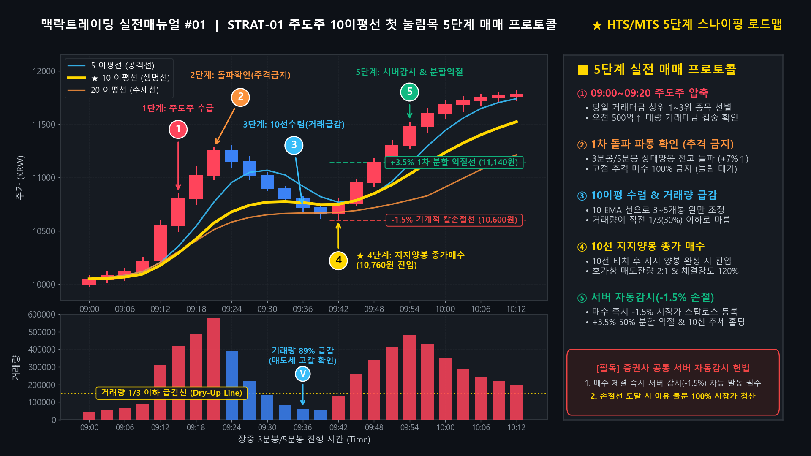
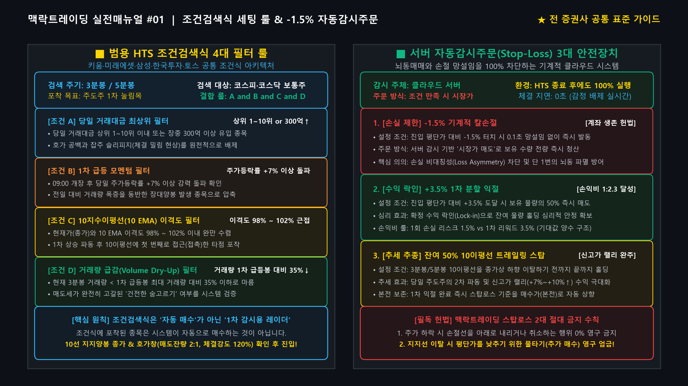

차트의 이론을 이해하는 것과, 매일 아침 요동치는 장중 실전에서 내 손으로 직접 HTS 주문 버튼을 누르는 것은 완전히 다른 차원의 영역입니다.

수많은 초보 투자자들이 유튜브나 책에서 눌림목 기법을 공부하고도 실전 매매에서 번번이 손실을 기록하는 이유는 명확합니다. 머리로는 지지선과 거래량의 원리를 알고 있지만, 장이 시작되면 솟구치는 장대양봉에 휩쓸려 조급하게 고점에 추격 매수하고, 주가가 밀려 내려올 때 두려움에 손절 타이밍을 놓치거나, 손실을 피하려다 무리하게 물타기를 감행하기 때문입니다.

진정한 실전 트레이딩은 주관적인 감정이나 직관에 의존하는 도박이 아닙니다. 사전에 정의된 데이터와 규칙에 따라 HTS/MTS 작업 환경을 완벽히 구축하고, 기계처럼 차분하게 타점을 기다리며, 진입과 동시에 시스템으로 손절을 자동화하는 '규율의 체계'입니다.

본 실전 매뉴얼은 앞선 1편에서 다루었던 프라이스 액션(Price Action) 이론과 호가창 물리학의 기초 위에서, 초보자가 국내 대형 증권사(키움증권, 미래에셋증권, 삼성증권, 한국투자증권, 토스증권 등)의 HTS 및 MTS를 켜고 그대로 따라 설정하여 매매할 수 있는 **'STRAT-01 5단계 실전 실행 프로토콜'**을 단계별로 안내합니다.

### STRAT-01 실전 매매 프로토콜 핵심 스펙 요약

| 전략 공식 ID | 핵심 타점 (Trigger) | 손익비 / 손절선 (R:R) | 권장 시간대 및 대상 |
|:---:|:---:|:---:|:---:|
| **STRAT-01 실전** | 10지수이평(EMA) 지지 양봉 & 거래량 30%↓ | 1:2.3 (손절 -1.5% / 익절 +3.5%) | 09:40 ~ 11:30 (오전 주도주) |

---

## 1. 전 증권사 공통 HTS/MTS 표준 작업대(Desk) 구축

국내 증권사들은 저마다 고유한 HTS 화면 번호와 인터페이스 구조를 가지고 있습니다. 그러나 데이트레이더가 장중 실전 매매를 성공시키기 위해 반드시 배치해야 하는 핵심 기능의 본질은 전 증권사가 100% 동일합니다. 특정 증권사의 화면 번호에 얽매이지 않고, 국내 전 증권사에서 공통으로 제공하는 **5대 표준 작업 도구**를 화면에 정돈하는 것부터 출발해야 합니다.

```
┌────────────────────────────────────────────────────────────────────────┐
│  🖥️ 맥락트레이딩 표준 HTS 작업대 (전 증권사 공통 배치 레이아웃)        │
├──────────────────────────┬──────────────────────────┬──────────────────┤
│ [도구 1] 당일 거래대금   │ [도구 2] 멀티 분봉 차트  │ [도구 4] 10단계  │
│         상위 순위 화면   │ (3분봉 타점 & 5분봉 추세)│         호가창   │
│ • 09:00~09:20 주도주 압축│ • 10지수이평선(EMA, 골드)│ • 매도잔량 2:1   │
│ • 오전 500억↑ 최상위 선별│ • 거래량 지표 (Dry-Up선) │ • 체결강도 120%  │
├──────────────────────────┴──────────────────────────┼──────────────────┤
│ [도구 3] 실시간 조건검색 / 종목포착 화면            │ [도구 5] 서버    │
│ • 거래대금 + 1차 급등 + 10선 근접 + 거래량 급감 필터│   자동감시주문   │
│ • A and B and C and D 실시간 감시 (자동매수 X)      │ • -1.5% 칼손절   │
└─────────────────────────────────────────────────────┴──────────────────┘
```

### 전 증권사 5대 표준 기능 명칭 및 역할

1. **당일 거래대금 상위 순위 화면 (Market Turnover Ranking)**:
   - 키움증권, 미래에셋증권, 한국투자증권, 삼성증권 등 모든 HTS의 주식 순위 메뉴에서 '거래대금 상위' 또는 '당일 누적 거래대금' 화면을 찾을 수 있습니다.
   - 장 초반 09:00부터 09:20 사이에 시장 전체 자금의 80%가 집중되는 1~3위 주도주를 선별하는 나침반 역할을 담당합니다.

2. **멀티 분봉 차트 (3분봉 & 5분봉 듀얼 배치)**:
   - 1분봉은 순간적인 노이즈와 속임수(Whipsaw)가 심하므로 화면에서 과감히 치우고, 정밀 타점용 **3분봉 차트**와 단기 추세 필터용 **5분봉 차트**를 좌우 또는 상하로 나란히 배치합니다.

3. **실시간 조건검색 / 종목포착 화면 (Real-time Condition Search)**:
   - 증권사별로 '조건검색', '종목검색', '파워종목발굴' 등으로 불리는 표준 기능입니다.
   - 장중 수천 개 종목을 일일이 돌려볼 수 없으므로, 1차 급등 후 10이평선으로 첫 풀백(Pullback)하는 종목을 실시간으로 포착하여 시각적 알림을 받는 레이더 역할을 합니다.

4. **10단계 호가창 및 체결강도 추이선 (Order Book & Volume Power)**:
   - 상단 매도 5~10호가와 하단 매수 5~10호가의 총잔량 비율, 그리고 실시간 체결강도(100%~120%) 추이선을 동시에 한눈에 볼 수 있도록 세팅합니다.

5. **서버 자동감시주문 화면 (Cloud Stop-Loss / 스탑로스)**:
   - '서버자동감시주문', '주식 스탑로스', '자동매매 주문' 등으로 명명되는 핵심 안전장치입니다.
   - 내 PC나 스마트폰의 통신이 끊기더라도 증권사 메인 클라우드 서버에서 24시간 실시간으로 감시하여, 매수가 대비 -1.5% 도달 시 즉시 시장가 매도를 강제 집행하도록 설정하는 생존 도구입니다.

---

## 2. 차트 및 지표 파라미터 세팅 가이드

HTS 작업대를 열었다면 가장 먼저 3분봉 및 5분봉 차트의 기술적 지표 파라미터를 정확하게 입력해야 합니다.

### 이동평균선(MA) 파라미터 및 색상 통일

차트 설정 메뉴에서 '가격 이동평균' 지표를 더블클릭하여 아래와 같이 파라미터와 라인 스타일을 지정합니다:

| 이동평균선 명칭 | 종류 (Method) | 기간 (Period) | 권장 라인 색상 | 라인 두께 | 실전 기능 및 해석 |
|:---|:---:|:---:|:---:|:---:|:---|
| **5이평선** | 단순 (SMA) | 5 | 청록색 (Cyan) | 2pt | **단기 공격선**: 1차 급등 시 주가가 타고 올라가는 모멘텀 선 |
| **★ 10이평선** | **지수 (EMA)** | **10** | **황금색 (Gold)** | **3pt ~ 4pt** | **★ 핵심 생명선**: 스마트 머니의 1차 눌림 지지선 및 스나이핑 타점 |
| **20이평선** | 단순 (SMA) | 20 | 주황색 (Orange) | 2pt | **추세 중심선**: 10선 이탈 시 최후 보루선이자 추세 분기점 |
| **60이평선** | 단순 (SMA) | 60 | 보라색 (Purple) | 1pt | **장중 수급선**: 당일 장중 대세 상승 흐름 판별선 |

> ⚠️ **10이평선 설정 시 필수 주의사항**:  
> 일반 단순이동평균(SMA)이 아니라 반드시 **'지수이동평균(EMA)'**으로 설정해야 합니다. 단순이평은 10개 봉에 동일한 가중치를 부여하므로 급등주의 빠른 속도 변화를 제때 반영하지 못합니다. 최근 캔들에 높은 가중치를 두는 지수이평(EMA)을 사용해야만 세력의 첫 번째 기술적 반등 타점을 오차 없이 포착할 수 있습니다.

### 거래량 차트 및 기준선 세팅

메인 차트 하단의 거래량(Volume) 보조지표에는 수평 기준선 하나를 반드시 추가해야 합니다:
- **거래량 기준선**: 1차 상승 파동에서 터진 최대 거래량의 약 30%(1/3 수준) 높이에 수평선(Dry-Up Line)을 표시합니다.
- 주가가 10이평선으로 밀려 내려오는 동안 거래량 막대가 이 기준선 아래로 내려앉는지를 눈으로 즉시 식별하기 위함입니다.

---

## 3. 초보자도 5분 만에 세팅하는 '10이평선 첫 눌림목 조건검색식' 표준 4대 로직

장중 수많은 종목 중에서 1차 급등 후 10이평선으로 다가오는 종목을 일일이 차트로 찾는 것은 불가능에 가깝습니다. 국내 모든 증권사 HTS의 조건검색 화면에서 아래 **4대 핵심 조건**을 입력하면 손쉽게 후보 종목을 실시간 압축할 수 있습니다.

```
┌────────────────────────────────────────────────────────────────────────┐
│  📋 범용 HTS 조건검색식 표준 구성 룰 (A and B and C and D)             │
├────────────────────────────────────────────────────────────────────────┤
│ [조건 A] 거래대금 필터: 당일 거래대금 상위 1~10위 이내 또는 300억 이상 │
│ [조건 B] 1차 급등 필터: 당일 09:00 이후 최고 주가등락률 +7% 이상 돌파  │
│ [조건 C] 10 EMA 이격도 필터: 현재가(종가) 대비 10지수이평 이격도 98~102%│
│ [조건 D] 거래량 급감 필터: 현재 3분봉 거래량 < 1차 급등봉 대비 35% 이하 │
└────────────────────────────────────────────────────────────────────────┘
```

### 4대 조건식 상세 파라미터 입력법

1. **[조건 A] 당일 거래대금 최상위 필터**:
   - 메뉴 검색어: `거래대금 순위` 또는 `당일 거래대금`
   - 조건 설정: `[당일 누적 거래대금 상위 10위 이내]` 또는 `[당일 누적 거래대금 300억 원 이상]`
   - 목적: 자금이 몰리지 않는 개별 품절주나 소외 잡주를 100% 원천 배제하여 호가 슬리피지(체결 밀림 현상)를 방어합니다.

2. **[조건 B] 1차 급등 모멘텀 필터**:
   - 메뉴 검색어: `주가등락률` 또는 `당일 고가 대비 등락률`
   - 조건 설정: `[당일 09:00 시가 대비 고가 등락률 +7.0% 이상]`
   - 목적: 장 초반 강력한 스마트 머니의 매수세가 유입되어 시장을 주도하는 1등 대장주만을 선별합니다.

3. **[조건 C] 10지수이평선(10 EMA) 이격도 필터**:
   - 메뉴 검색어: `이동평균 이격도` 또는 `주가 이평 이격도`
   - 조건 설정: `[3분봉] 종가 10 지수이동평균 대비 주가 이격도 98.0% 이상 102.0% 이하`
   - 목적: 1차 급등 후 가격 조정을 받으며 현재 주가가 10이평선 접촉 범위(±2%)에 근접한 종목을 실시간 포착합니다.

4. **[조건 D] 거래량 급감(Volume Dry-Up) 필터**:
   - 메뉴 검색어: `거래량 비율` 또는 `전봉 대비 거래량`
   - 조건 설정: `[3분봉] 현재봉 거래량이 당일 최대 거래량 봉 대비 35.0% 이하`
   - 목적: 대량 거래 음봉(세력 투매)을 자동으로 걸러내고, 매도세가 완전히 마른 '건전한 숨고르기' 종목만을 걸러냅니다.

> 🚨 **조건검색식 활용 절대 원칙**:  
> 조건검색식에 종목이 포착되었다고 해서 **절대로 시장가로 즉시 매수해서는 안 됩니다**. 조건식은 수많은 종목 중에서 타점 후보를 찾아주는 '1차 알림 레이더'일 뿐입니다. 종목이 포착되면 해당 종목의 3분봉 차트와 10단계 호가창을 직접 열고, 4단계와 5단계 프로토콜에 따라 지지 캔들과 체결강도를 눈으로 최종 검증한 뒤 진입해야 합니다.

---

## 4. 호가창 매도잔량의 역설과 체결강도 실전 판독

조건식에 포착된 종목이 10이평선에 도달했을 때, 진입 여부를 최종 결정짓는 마지막 관문은 **10단계 호가창의 미시구조**입니다.

### 초보자의 치명적 착시: 허매수벽(Fake Bid Wall) 트랩

초보 투자자들은 호가창을 볼 때 흔히 반대로 행동합니다:
- **초보자의 착각**: "하단 매수잔량이 20만 주나 쌓여 있고 상단 매도잔량이 5만 주밖에 없으니, 아래에서 받쳐주는 사람이 많아서 안전하겠지?"
- **실전 시장의 진실**: 하단 매수 2~3호가에 비정상적으로 걸려 있는 수만, 수십만 주의 거대한 물량은 세력의 **'허매수벽(Fake Bid)'**인 경우가 많습니다. 세력은 아래에 두터운 매수벽을 깔아두어 개미들에게 안전하다는 착각을 유도한 뒤, 위에서 시장가로 보유 물량을 투하(분배)합니다. 물량을 다 털어낸 순간 세력은 밑에 받쳐두었던 허매수를 단 1초 만에 전량 취소하고, 호가 공백이 발생하며 주가는 수직 급락합니다.

### 실전 대가의 법칙: 매도잔량이 2배 이상 많아야 폭등한다

반대로 주가가 10이평선에서 지지를 받고 강하게 튀어 오르는 진짜 주도주는 정반대의 호가 형태를 나타냅니다:
- **매도총잔량 우위**: **매도총잔량이 매수총잔량 대비 최소 1.5배에서 2.5배 이상 두텁게 쌓여 있는 상태**여야 합니다.
- **상승의 연료**: 상단 매도 호가에 빽빽하게 쌓인 매물대는 세력이 가격을 들어 올리며 흡수할 수 있는 '진짜 유동성 연료' 역할을 합니다.
- **체결강도(Volume Power)**: 주가가 10선에 닿았을 때 체결강도가 100% 선을 단단히 지지하고, 반등 캔들이 형성되는 순간 **110%에서 120% 이상으로 가파르게 우상향 돌파**하는지 확인해야 합니다.
- **순간체결 틱 확인**: 매도 1~2호가의 대형 물량을 수천 주, 수만 주 단위의 붉은색 시장가 매수가 연속적으로 갉아먹으며 체결창이 빠르게 회전하는 찰나를 포착합니다.

---

## 5. 뇌동매매를 원천 차단하는 '서버 자동감시주문(-1.5% 칼손절)' 완벽 세팅

아무리 차트와 호가창을 완벽히 분석하더라도, 손절을 수동 클릭에 맡겨두면 트레이딩 계좌는 결코 우상향할 수 없습니다. 인간의 뇌는 본능적으로 손실 확정의 고통을 회피하려 하므로, -1.5% 가격에 도달했을 때 "조금만 더 기다리면 본전은 오겠지"라는 희망 회로를 돌리다가 결국 -5%, -10%의 깊은 수렁에 빠집니다.

데이트레이딩에서 지속 가능한 생존을 담보하는 유일한 길은 **'서버 자동감시주문(Stop-Loss)'**을 통해 손절을 기계에 외주화하는 것입니다.

```
┌────────────────────────────────────────────────────────────────────────┐
│  🛡️ 증권사 공통 서버 자동감시주문(Stop-Loss) 3단계 안전장치           │
├────────────────────────────────────────────────────────────────────────┤
│ 1. [손실 제한] 매수 체결가 대비 -1.5% 도달 시 -> 시장가 즉시 전량 매도 │
│ 2. [1차 익절]  매수 체결가 대비 +3.5% 도달 시 -> 보유 수량 50% 분할 익절 │
│ 3. [추세 추종] 잔여 50% 물량은 10이평선 종가 이탈 전까지 신고가 완주   │
└────────────────────────────────────────────────────────────────────────┘
```

### 서버 자동감시주문 설정 4단계 실전 절차

1. **메뉴 실행**:
   - HTS/MTS 검색창에 `서버자동감시주문`, `스탑로스` 또는 `주식조건부주문`을 검색하여 실행합니다.

2. **조건 추가 및 종목 연결**:
   - 매수한 종목을 선택하고 '보유종목 매도조건 추가'를 누릅니다.

3. **손실제한(Stop-Loss) 조건 입력**:
   - 조건 유형: **기준가 대비 손실제한**
   - 설정 수치: **기준가(평균단가) 대비 -1.5% 하락 시**
   - 주문 유형: **시장가(Market Order)**, 수량: **100% (전량)**
   - ⚠️ 보통가(지정가)로 설정하면 급락 시 내 주문을 건너뛰고 체결되지 않을 위험이 있으므로, 반드시 '시장가'로 설정해야 합니다.

4. **이익실현(Take-Profit) 분할 익절 연동**:
   - 조건 유형: **기준가 대비 이익실현**
   - 설정 수치: **기준가 대비 +3.5% 상승 시**
   - 주문 유형: **시장가**, 수량: **50% (절반 매도)**
   - 1차 목표가 도달 시 자동으로 절반을 매도하여 수익을 확정 락인(Lock-in)하고, 남은 50% 물량은 10이평선을 종가상 하향 이탈할 때까지 끝까지 추세를 추종합니다.

### 손익비(Risk-Reward Ratio) 1:2.3의 수학적 승리 공식

이와 같은 자동감시주문 세팅이 계좌를 살리는 이유는 **손익비(Risk-Reward Ratio)**의 수학적 원리에 기반합니다:
- **1회 손실 리스크 (1R)**: -1.5%
- **1회 1차 목표 수익 (2.3R)**: +3.5%

만약 10번 매매를 진행하여 승률이 절반에도 미치지 못하는 40%(4승 6패)에 불과하다고 가정해 보겠습니다:

$$\text{총 손익} = (4\text{회} \times +3.5\%) + (6\text{회} \times -1.5\%) = +14.0\% - 9.0\% = \mathbf{+5.0\%}$$

단 40%의 승률로도 계좌는 명확하게 +5.0%의 순수익을 누적합니다. 손절을 -1.5%로 철저히 틀어막고 익절을 손절폭의 2배 이상으로 가져가는 한, 트레이더는 시장의 일시적 변동성에 휘둘리지 않고 수학적 확률의 힘으로 자산을 불려 나갈 수 있습니다.

> 🚫 **스탑로스 운용 시 2대 절대 금지 수칙**:  
> 1. 주가가 하락한다고 해서 기 설정된 손절선을 아래로 슬그머니 내리거나 취소하는 행위는 100% 영구 금지합니다.  
> 2. 손절선 부근에서 평단가를 낮추기 위해 자금을 추가 투입하는 물타기는 계좌를 파멸로 이끄는 주범이므로 단 1원도 허용하지 않습니다.

---

## 6. 16:9 다크 테마 인포그래픽 정밀 가이드

아래의 두 가지 16:9 프리미엄 인포그래픽 도안은 실전 매매 중 HTS 보조 모니터에 띄워두고 직관적으로 참조할 수 있도록 설계된 시각화 자산입니다.

### 도안 1: STRAT-01 주도주 10이평선 첫 눌림목 5단계 매매 프로토콜



위 인포그래픽의 좌측 차트는 3분봉/5분봉 캔들과 거래량의 유기적 흐름을 보여줍니다:
- **뱃지 1 (1단계: 주도주 수급)**: 09:00~09:20 장 초반, 대량 거래대금을 동반하며 전일 고점을 돌파하는 1차 급등 파동을 확인합니다.
- **뱃지 2 (2단계: 돌파확인·추격금지)**: 고점을 형성한 뒤 나타나는 단기 조정 구간입니다. 이때 뇌동 매수를 철저히 자제합니다.
- **뱃지 3 (3단계: 10선수렴·거래급감)**: 주가가 10이평선(골드선)으로 다가올 때 거래량 차트의 V 뱃지 지점처럼 거래량이 직전 대비 89% 급감하며 매도세가 완전히 말라붙는 현상을 확인합니다.
- **뱃지 4 (4단계: 지지양봉 종가매수)**: 10이평선을 밑꼬리로 터치하고 반등하는 지지 양봉이 완성되는 순간(10,760원) 스나이핑 진입합니다.
- **뱃지 5 (5단계: 서버감시 & 분할익절)**: 진입 즉시 가동된 서버 자동감시를 통해 +3.5%(11,140원)에서 50%를 1차 익절하고, -1.5%(10,600원) 손절선을 철통 방어하며 신고가 랠리를 완주합니다.

---

### 도안 2: 범용 HTS 조건검색식 세팅 룰 & 서버 자동감시주문(-1.5% 칼손절)



위 인포그래픽은 실전 트레이딩의 기계적 실행 시스템을 총괄 정리한 구조도입니다:
- **좌측 패널 (조건검색식 4대 필터 룰)**: 키움, 미래에셋, 삼성, 한투, 토스 등 국내 전 증권사에서 공통으로 적용 가능한 거래대금 최상위, 1차 급등, 10 EMA 이격도(98~102%), 거래량 급감 필터의 파라미터를 직관적으로 보여줍니다.
- **우측 패널 (서버 자동감시주문 3대 안전장치)**: 클라우드 서버 기반의 -1.5% 기계적 칼손절, +3.5% 1차 분할 익절, 그리고 잔여 50% 물량의 10이평선 트레일링 스탑 시스템을 명료하게 구조화하였습니다.

---

## 7. 09:00부터 11:30까지: 5단계 실전 매매 프로토콜 워크플로우

성공적인 실전 데이트레이딩은 장이 열리기 전부터 오전 장이 마무리될 때까지 정해진 시간표에 따라 일사불란하게 움직이는 규율에서 나옵니다.

```
08:50 ~ 09:00  [사전 준비]  HTS 표준 작업대 정렬, 조건검색식 감시 시작, 스탑로스 사전 점검
09:00 ~ 09:20  [1단계: 수급 압축] 당일 거래대금 상위 1~3위 주도 테마 대장주 3~5종목 압축
09:20 ~ 09:40  [2단계: 돌파 확인] 3분봉/5분봉 1차 급등 파동(+7%↑) 확인, 고점 추격 매수 100% 금지
09:40 ~ 10:10  [3단계: 건전한 풀백] 10 EMA 수렴 및 거래량 1/3 이하 급감(Volume Dry-Up) 확인
10:10 ~ 10:40  [4단계: 스나이핑] 호가 매도잔량 2:1 & 체결강도 120% 확인 후 10선 지지양봉 종가 매수
10:40 ~ 11:30  [5단계: 자동 청산] 서버 자동감시 가동 (-1.5% 손절 vs +3.5% 1차 익절 & 10선 홀딩)
11:30 이후     [매매 종료]  오전 장 목표 달성 후 HTS 종료 (오후 장 뇌동매매 원천 차단)
```

### 실전 매매 단계별 합격 판정 점검표

| 단계 | 점검 대상 | 합격 기준 | 미충족 시 행동 지침 |
|:---:|:---|:---|:---|
| **1단계** | 당일 거래대금 순위 | 코스피/코스닥 1~3위 이내, 오전 누적 500억 원 이상 | **즉시 탈락** (거래대금 부족 종목 절대 매매 금지) |
| **2단계** | 1차 급등 파동 각도 | 09:00 이후 전일 고가 돌파하며 연속 양봉 +7% 이상 분출 | **대기** (완만한 상승이나 횡보 종목은 제외) |
| **3단계** | 10이평선 수렴 거래량 | 10선 도달 캔들의 거래량이 직전 상승봉 대비 **30% 이하로 급감** | **즉시 탈락** (대량 거래 음봉 발생 시 세력 투매 간주) |
| **4단계** | 지지 캔들 및 호가창 | **10선 밑꼬리 지지 양봉 종가 완성** & **매도잔량 2배 우위, 체결강도 120%** | **대기** (음봉 진행 중이거나 매수잔량이 많으면 진입 금지) |
| **5단계** | 리스크 관리 자동화 | **매수 체결 즉시 서버 스탑로스(-1.5% 시장가) 등록 완료** | **필수 집행** (수동 손절 불허, 물타기 100% 영구 금지) |

---

## 8. 『맥락트레이딩』 3-Pillar 플라이휠 연계: 단타 알파를 월배당 캐시카우로 락인하라

데이트레이딩으로 아무리 뛰어난 수익을 거두더라도, 그 수익금을 고스란히 단타 계좌에 남겨두면 단 한 번의 원칙 위반이나 뇌동매매로 허무하게 시장에 반납하게 됩니다.

『맥락트레이딩』이 추구하는 궁극의 지향점은 단타 매매의 알파 수익을 안전한 배당 금고로 영구 이송하는 **'3-Pillar 자산 순환 플라이휠'**의 완성입니다:

```
┌────────────────────────────────────────────────────────────────────────┐
│  ⚔️ Pillar 2. 실전 차트·호가창 매매 아카데미 (알파 수익 창출)           │
│  • 당일 거래대금 주도주 10이평선 첫 눌림목 스나이핑                    │
│  • -1.5% 서버 자동감시 손절로 계좌 철통 방어                           │
│  • 손익비 1:2.3 기반 수학적 플러스(+) 알파 수익 누적                   │
└───────────────────────────────────┬────────────────────────────────────┘
                                    │
                                    │ 매주 금요일 확정 순수익의 50% 강제 출금
                                    ▼
┌────────────────────────────────────────────────────────────────────────┐
│  🛡️ Pillar 3. 월배당 커버드콜 & 인컴 ETF (캐시카우 락인)               │
│  • 매달 정기적으로 현금을 뿜어내는 월배당 금고 자산에 영구 보존       │
│  • 단타 매매의 심리적 조급증을 원천 차단하는 든든한 생활비 파이프라인 │
└────────────────────────────────────────────────────────────────────────┘
```

1. **Pillar 2 (알파 창출)**: 본 매뉴얼의 10이평선 첫 눌림목 스나이핑 프로토콜을 철저히 준수하여 주간 단위의 초과 수익(Alpha)을 달성합니다.
2. **Pillar 3 (강제 락인)**: 매주 금요일 장이 마감되면 일주일간 누적된 순수익의 정확히 50%를 즉시 출금하여 Pillar 3 월배당 커버드콜 ETF(미국 지수형 커버드콜 또는 배당성장 자산) 계좌로 강제 입금합니다.
3. **심리적 선순환**: 매달 안정적인 현금 흐름을 만들어내는 월배당 캐시카우가 생활비와 계좌의 안전판을 구축해 주기 때문에, 트레이더는 생활비 조급증에서 완전히 해방되어 10이평선의 가장 완벽한 타점만을 느긋하게 기다릴 수 있는 절대적인 심리적 우위를 점하게 됩니다.

---

<div class="post-disclaimer">
  ※ 본 포스팅은 특정 종목에 대한 매수·매도 추천이나 투자 권유가 아니며, 데이트레이딩 기법과 시장 미시구조의 원리를 객관적으로 분석한 교육 및 정보 제공용 콘텐츠입니다. 과거의 통계적 패턴이나 특정 가격 움직임이 미래의 수익을 보장하지 않으며, 모든 투자 및 트레이딩에 대한 판단과 손실 위험의 책임은 투자자 본인에게 있습니다.
</div>

<div class="post-tags"><span class="tag-item">#차트강의</span> <span class="tag-item">#실전매뉴얼</span> <span class="tag-item">#STRAT01</span> <span class="tag-item">#10이평선</span> <span class="tag-item">#눌림목매매</span> <span class="tag-item">#조건검색</span> <span class="tag-item">#자동감시주문</span> <span class="tag-item">#스탑로스</span> <span class="tag-item">#칼손절</span> <span class="tag-item">#맥락트레이딩</span></div>
