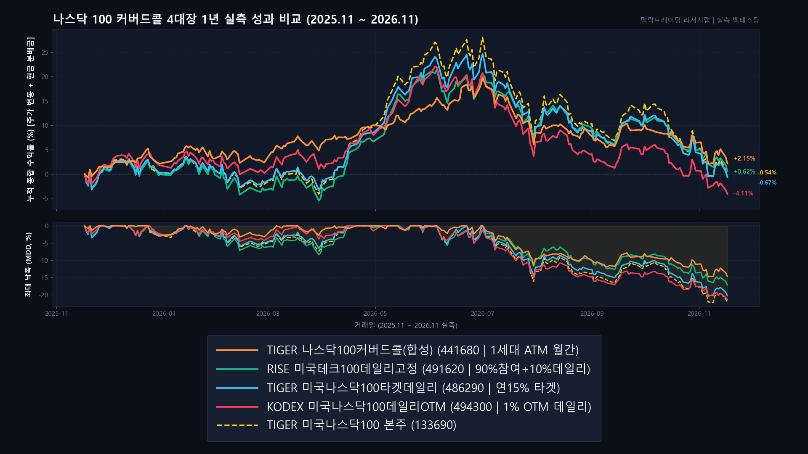
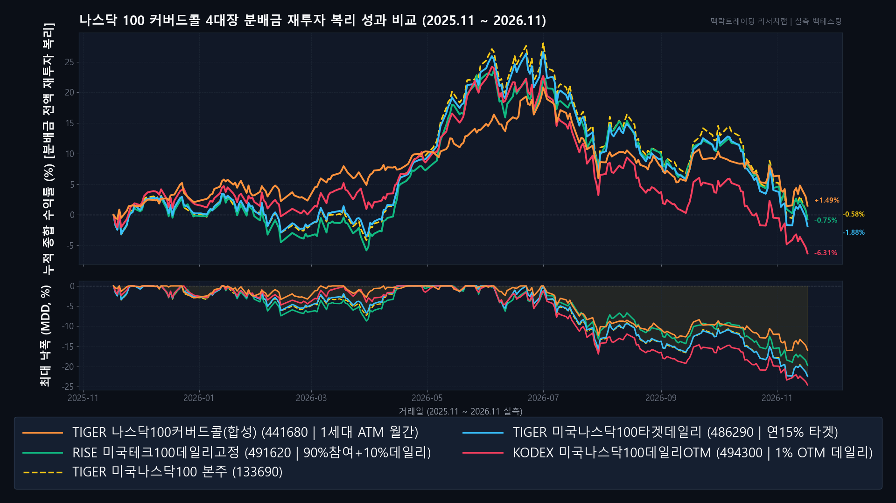

미국 나스닥 100 지수를 기초자산으로 삼으면서 연 12%에서 최대 19%에 달하는 초고배당을 지급하는 커버드콜 ETF들은 국내 개인 투자자들의 월배당 포트폴리오에서 가장 큰 비중(순자산 합산 약 4조 3천억 원)을 차지하고 있습니다. 하지만 데일리 타겟 15%, 1% 외가격(OTM) 데일리, 90% 참여형 데일리고정, 전통 월간 ATM(등가격) 매도 등 상품마다 내부 옵션 설계 구조가 완전히 다릅니다. 최근 1년간의 실측 백테스팅 데이터를 통해 상승장 참여율 격차와 원금 잠식 실체, 그리고 **현금 수령(단순 보유) vs 분배금 전액 재투자(복리 롤링)**의 결정적 차이를 객관적으로 대조해 보았습니다.

## 1. ETF 기본 정보

| ETF 종목명 (티커) | 운용사 및 기초지수 | 순자산 (AUM) 및 총보수 | 콜옵션 매도 전략 및 분배주기 |
|:---|:---|:---|:---|
| **TIGER 미국나스닥100타겟데일리커버드콜** (486290) | 미래에셋자산운용 NASDAQ 100 Daily Target 15% (TR) | **2조 5,427억 원** 연 0.25% (환노출) | **0DTE 변동 OTM (연 15% 타겟 프리미엄)** 월배당 (매월 말, 최근 연환산 15.05%) |
| **KODEX 미국나스닥100데일리커버드콜OTM** (494300) | 삼성자산운용 NASDAQ 100 Daily 1% OTM (TR) | **9,816억 원** 연 0.25% (환노출) | **0DTE 1% 외가격(OTM) 고정 매도** 월배당 (매월 말, 최근 연환산 19.43%) |
| **RISE 미국테크100데일리고정커버드콜** (491620) | KB자산운용 미국테크100 데일리고정 커버드콜 (TR) | **5,571억 원** 연 0.25% (환노출) | **본주 90% 참여 + 10% 0DTE ATM 매도** 월배당 (매월 15일, 최근 연환산 19.09%) |
| **TIGER 미국나스닥100커버드콜(합성)** (441680) | 미래에셋자산운용 미국나스닥100 커버드콜 ATM (TR) | **2,653억 원** 연 0.37% (합성, 환노출) | **전체 자산 100% ATM 월간 매도 (QYLD형)** 월배당 (매월 말, 최근 연환산 12.26%) |

 

| 비교 세부 항목 | TIGER 타겟데일리 (486290) | KODEX 데일리OTM (494300) | RISE 데일리고정 (491620) | TIGER 합성 ATM (441680) |
|:---|:---|:---|:---|:---|
| **상장일** | 2024-06-25 | 2024-10-22 | 2024-10-02 | 2022-09-22 |
| **비교 대상 본주** | TIGER 미국나스닥100 (133690) | TIGER 미국나스닥100 (133690) | TIGER 미국나스닥100 (133690) | TIGER 미국나스닥100 (133690) |
| **콜옵션 만기 구조** | 0DTE (만기 24시간 미만) | 0DTE (만기 24시간 미만) | 0DTE (만기 24시간 미만) | 월간 (1개월 만기 옵션) |
| **행사가격 (Moneyness)** | 변동 OTM (연 15% 프리미엄 추종) | 1% 고정 OTM (외가격 101%) | ATM 매도 (자산의 10% 비중만) | 100% ATM (전체 자산 100% 등가격) |
| **주가 상승 참여율** | 타겟 외 잔여 상승분 전액 참여 | 일일 최대 +1%까지 주가 참여 | 본주 90% 참여 + 옵션 10% | 상방 0% 제한 (상승 자본이득 배제) |

---

## 2. 1년 실측 성과 비교 분석 (그래프 & 요약 테이블)

투자자가 월배당 커버드콜을 운용할 때 마주하는 가장 근본적인 두 가지 방식—**① 분배금을 현금으로 인출하여 보유하는 경우(Hold)**와 **② 분배금을 단 1원도 인출하지 않고 지급 당일 전액 주식으로 재매수하는 경우(Reinvest)**—를 1:1 맞대결로 실측하였습니다.

- **분석 기간**: 2025-11-17 ~ 2026-11-17 (1Y, 245거래일 동기화 실측)
- **초기 투자 원금**: 10,000,000원
- **적용 배당소득세율**: 0.0% (비과세/절세계좌 기준)

### ① [세트 1] 단순 보유(Hold) 실측 성과: 주가 변동 + 현금 분배금 수령

첫 번째 세트는 투자자가 매월 통장에 입금된 분배금을 현금으로 수취하여 보관하고, 주가 평가액과 현금 누적액을 합산하여 최종 총자산을 측정한 실측 결과입니다.

> 💡 **단순 보유 차트 포인트**: 상단 그래프의 실선들은 순수 주가에 실제로 계좌로 입금된 현금 분배금을 모두 합산한 '총자산(Hold Total Return)' 추이입니다. 나스닥 본주가 연간 -0.54%로 횡보한 진폭 장세에서 두터운 외재가치 프리미엄을 현금으로 챙긴 상품들이 원금 방어력을 발휘했습니다.

| 전략 / 종목명 | 초기 원금 | 최종 주식 평가액 | 순수 주가 변동률 | 누적 수령 분배금 (현금) | 최종 총자산 (Hold 기준) | 최종 종합 수익률 (Total Return) | CAGR (연평균 복리) | MDD (최대 낙폭) | 샤프 지수 (Sharpe) |
|:---|---:|---:|---:|---:|---:|---:|---:|---:|---:|
| **TIGER 미국나스닥100커버드콜(합성) (441680)** | 10,000,000원 | 8,989,021원 | -10.11% | 1,225,984원 | 10,215,005원 | **+2.15%** | +2.15% | -14.74% | 0.00 |
| **RISE 미국테크100데일리고정 (491620)** | 10,000,000원 | 8,152,753원 | -18.47% | 1,909,414원 | 10,062,167원 | **+0.62%** | +0.62% | -17.15% | -0.05 |
| **TIGER 미국나스닥100타겟데일리 (486290)** | 10,000,000원 | 8,428,109원 | -15.72% | 1,505,317원 | 9,933,426원 | **-0.67%** | -0.67% | -20.29% | -0.12 |
| **KODEX 미국나스닥100데일리OTM (494300)** | 10,000,000원 | 7,645,905원 | -23.54% | 1,943,109원 | 9,589,014원 | **-4.11%** | -4.11% | -21.46% | -0.37 |
| <strong style="color: #F59E0B;">비교 대상 본주 (TIGER 미국나스닥100, 133690)</strong> | 10,000,000원 | 9,888,141원 | -1.12% | 57,466원 | 9,945,607원 | **-0.54%** | -0.54% | -22.29% | -0.08 |

---

### ② [세트 2] 분배금 재투자(Reinvest) 실측 성과: 전액 재투자 복리 롤링

두 번째 세트는 수령한 모든 분배금을 인출하지 않고, 분배금 지급 당일 종가로 해당 커버드콜 주식을 즉시 추가 매수하여 보유 주식 수량을 늘려나가는 복리 재투자(Total Return) 시뮬레이션 결과입니다.

> 💡 **재투자 차트 포인트**: 분배금을 해당 ETF에 기계적으로 재투자했을 때의 실측 누적 자산 곡선입니다. 주가가 횡보·하락하는 국면에서는 배당락 침식이 누적된 주식을 재매수하게 되면서 '물타기 자금'마저 추가 하락에 노출되어, 단순 현금 보유보다 종합 수익률이 하락하는 **역복리 드래그(Reverse Compounding Drag)** 현상이 발생합니다.

| 전략 / 종목명 | 초기 원금 | 최종 총자산 (재투자 기준) | 최종 종합 수익률 (Total Return) | CAGR (연평균 복리) | MDD (최대 낙폭) | 샤프 지수 (Sharpe) | 단순 보유 대비 수익률 격차 |
|:---|---:|---:|---:|---:|---:|---:|:---:|
| **TIGER 미국나스닥100커버드콜(합성) (441680)** | 10,000,000원 | 10,148,896원 | **+1.49%** | +1.49% | -16.05% | -0.04 | -0.66%p |
| **RISE 미국테크100데일리고정 (491620)** | 10,000,000원 | 9,924,858원 | **-0.75%** | -0.75% | -19.72% | -0.10 | -1.37%p |
| **TIGER 미국나스닥100타겟데일리 (486290)** | 10,000,000원 | 9,812,176원 | **-1.88%** | -1.88% | -22.49% | -0.16 | -1.21%p |
| **KODEX 미국나스닥100데일리OTM (494300)** | 10,000,000원 | 9,368,569원 | **-6.31%** | -6.32% | -24.57% | -0.45 | **-2.20%p** |
| <strong style="color: #F59E0B;">비교 대상 본주 (TIGER 미국나스닥100, 133690)</strong> | 10,000,000원 | 9,941,789원 | **-0.58%** | -0.58% | -22.36% | -0.09 | -0.04%p |

---

## 3. 심층 성과 분석 및 옵션 구조 해부

### ① 1세대 ATM 월간 커버드콜(441680)의 횡보장 완충력과 장기 랠리 페널티
지난 1년간 실측 결과에서 가장 돋보이는 대목은 순수 100% ATM(등가격) 매도 방식을 취하는 1세대 TIGER 미국나스닥100커버드콜(합성)이 단순 보유 기준 **+2.15%**, 재투자 기준에서도 **+1.49%**로 4개 종목 중 유일하게 두 방식 모두에서 플러스 수익률을 사수했다는 사실입니다. 

나스닥 100 본주가 -0.54%로 소폭 하락하며 방향성 없이 출렁인 횡보 국면에서, 등가격 옵션의 두터운 외재가치 프리미엄이 주가 하락 시 완충재 역할을 충실히 수행했습니다. 배당락에 따른 순수 주가 하락폭도 **-10.11%**에 그쳐 다른 데일리 커버드콜 상품들(-15%~-23%)보다 주가 방어력이 우수했으며, 최대 낙폭(MDD) 역시 **-14.74%**(재투자 시 -16.05%)로 본주(-22.29%) 대비 현저히 낮은 변동성을 나타냈습니다.

하지만 이 결과를 두고 1세대 ATM 커버드콜이 모든 국면에서 우월하다고 해석하는 것은 구조적 착시입니다. 공통 상장일(2024년 10월 22일)부터 2026년 11월 17일까지 약 2년간의 누적 성과를 넓혀보면, 나스닥 100 본주가 **+30.58%** 급등하는 랠리 국면에서 441680의 누적 수익률은 **+16.41%**에 그쳤습니다. 매월 초 상방이 0%로 잠기는 구조 탓에 지수 폭등 시 자본 차익을 흡수하지 못하는 '상방 캡(Cap) 페널티'가 장기 계좌 수익률을 절반 가까이 깎아내린 셈입니다.

### ② 90% 참여형 데일리고정(491620)의 균형 잡힌 주가 복원력과 랠리 적응력
RISE 미국테크100데일리고정커버드콜은 자산의 90%를 나스닥 100 지수에 노출하고 나머지 10% 비중으로만 데일리 콜옵션을 매도하는 차별화된 설계를 취하고 있습니다.

1년 단순 보유 실측 데이터에서 이 상품은 **1,909,414원(19.09%)**이라는 최상위권의 현금 분배금을 투자자 통장에 안겨주면서도 종합 수익률 **+0.62%**를 달성하여 본주(-0.54%)를 앞질렀습니다. 90%의 주가 참여율 덕분에 지수 반등 국면에서 상방 캡에 덜 묶였으며, 배당락 주가 하락(-18.47%)을 풍부한 분배금(19.09%)이 온전히 방어했습니다.

이 설계의 진가는 2년 장기 랠리 실측에서 입증됩니다. 본주가 +30.58% 상승하는 동안 RISE는 **+26.45%**의 누적 수익률을 기록했습니다. 본주 상승분의 86.5%를 추종하면서도 2년간 무려 **4,016,917원(40.17%)**의 현금을 지급해, 자본 보존과 인컴 수취를 동시에 잡았습니다.

### ③ 타겟 15% 데일리(486290)의 동적 행사가격 조절과 원금 수성 능력
순자산 2조 5천억 원의 간판 상품인 TIGER 미국나스닥100타겟데일리커버드콜은 목표 분배율(연 15%)에 맞춰 매일 외가격 행사가격을 탄력적으로 조정합니다.

1년간 순수 주가는 배당락 누적으로 **-15.72%** 하락했으나, 통장으로 입금된 현금 분배금 **1,505,317원(15.05%)**이 주가 하락분의 95.7%를 상쇄했습니다. 최종 종합 수익률은 **-0.67%**(최종 총자산 9,933,426원)로 비교 본주(-0.54%)와 사실상 대등한 수준을 유지하며 원금을 지켜냈습니다.

2년 누적 성과에서도 **+24.80%**를 기록하여 RISE(26.45%)와 함께 최상위권 자본 성장률을 나타냈습니다. 변동성에 따라 매일 콜옵션 매도 비중을 동적으로 조절하여 불필요한 옵션 비용을 억제한 알고리즘의 안정성이 확인됩니다.

### ④ 1% OTM 데일리(494300)의 상방 비대칭 침식 원인 해부
반면 매일 1% 외가격 콜옵션을 기계적으로 매도하는 KODEX 미국나스닥100데일리커버드콜OTM은 1년 실측에서 4개 종목 중 가장 큰 마이너스 종합 수익률(단순 보유 **-4.11%**, 재투자 **-6.31%**)을 기록했습니다.

투자자에게 지급된 현금 분배금은 **1,943,109원(19.43%)**으로 가장 많았으나, 순수 주가가 **-23.54%**나 깎여나가며 원금 손실을 발생시켰습니다. 분배금으로 주가 하락분을 메운 비율이 82.5%에 그쳐 실질적인 원금 잠식(ROC) 현상이 나타났습니다. 2년 누적 성과 역시 **+14.34%**로 4개 종목 중 최하위에 머물렀습니다.

이러한 언더퍼폼의 원인은 나스닥 100 지수의 일간 급등락 특성과 1% 고정 OTM의 비대칭 구조에서 비롯됩니다. 미국 기술주 시장에서는 CPI 지표나 빅테크 실적 발표 당일 지수가 하루에 +2%~+3% 이상 단기 폭등하는 날이 자주 발생합니다. 이 경우 1%를 초과하는 일간 상승분이 모두 잘려나가 상방 회복이 제한됩니다. 반대로 지수가 -2%~-3% 급락하는 날에는 하락폭을 100% 그대로 반영하기 때문에, 계단식 주가 침식이 누적되어 배당금을 합산하더라도 총자산이 깎여나가는 결과를 낳았습니다.

### ⑤ 단순 보유 vs 분배금 재투자: 왜 재투자가 오히려 성과를 갉아먹었는가? (역복리 드래그 현상)
공정한 1:1 비교를 위해 비교 기준인 본주(TIGER 미국나스닥100) 역시 분기별로 지급된 4회의 분배금(총 57,466원)을 해당 지급일 종가로 전액 본주 주식에 재투자한 TR(Total Return) 시계열로 계산하였습니다.

이번 백테스팅의 가장 중요한 학술적 발견은 **모든 종목에서 분배금을 재투자했을 때의 최종 성과가 단순 현금 보유보다 0.04%p ~ 2.20%p 더 낮아졌다**는 점입니다. 본주 역시 재투자 시 최종 총자산이 9,945,607원에서 9,941,789원으로 소폭 감소하여 수익률이 -0.54%에서 -0.58%로 낮아졌습니다(-0.04%p 격차). 하반기 나스닥 지수가 고점 대비 조정을 받으면서 재투자된 주식 수량에도 추가 하락이 반영되었기 때문입니다. 하지만 본주는 연 배당수익률이 0.57%에 불과하여 재투자 영향이 미미했던 반면, 연 15~19%에 달하는 초고배당 커버드콜들은 -1.2%p ~ -2.2%p에 달하는 심각한 역복리 드래그를 겪었습니다.

일반적인 주식이나 성장형 ETF에서는 배당금을 재투자할 때 '복리(Compounding)의 마법'이 발생하여 장기 총자산이 비약적으로 증가합니다. 하지만 지난 1년처럼 지수가 횡보(-0.58%)하거나 진폭을 겪는 국면에서 초고배당 커버드콜을 재투자하면 정반대의 **'역복리 드래그(Reverse Compounding Drag)'**가 작동합니다:

1. **배당락 침식 주식의 지속 매수**: 커버드콜 주가는 매월 고배당(연 12~19%) 지급으로 인해 필연적으로 순자산가치(NAV)가 계단식으로 낮아집니다. 분배금을 재투자한다는 것은 이처럼 주가가 우하향 곡선을 그리는 자산을 지속해서 추가 매수(물타기)하는 행위가 됩니다.
2. **현금의 변동성 완충 기능 소멸**: 단순 보유 시에는 수령한 분배금이 '현금(변동성 0%)'으로 확정되어 계좌 전체의 하락을 방어해 주는 쿠션 역할을 했습니다. 그러나 재투자를 하는 순간 이 안전 자산이 다시 위험 자산(주식)으로 전환되어 시장 하락 파동과 추가 배당락에 고스란히 노출되었습니다.
3. **상방 캡으로 인한 복리 회복력 거세**: 주가가 빠진 상태에서 수량을 늘렸다면 이후 폭등장에서 큰 복리 이익을 거두어야 하지만, 커버드콜은 콜옵션 매도로 인해 상방이 닫혀 있습니다. 주가 반등 시 자본 차익을 누리지 못하므로 수량이 늘어난 효과를 제대로 회수하지 못했습니다.

특히 1% 고정 OTM(494300)의 경우, 배당락 침식이 가장 심했던 탓에 재투자 시 최종 손실률이 -4.11%에서 **-6.31%**로 무려 2.20%p나 확대되었습니다. 반면 변동성 방어력이 높았던 TIGER 합성(441680)은 재투자 시에도 **+1.49%**를 기록하여, 옵션 구조의 방어력이 역복리 드래그 환경에서도 핵심 승부처임을 증명했습니다.

### ⑥ 시장 국면별 적합도 비교 (Market Regime Fit)

| 시장 국면 | TIGER 타겟데일리 (486290) | KODEX 데일리OTM (494300) | RISE 데일리고정 (491620) | TIGER 합성 ATM (441680) |
|:---|:---:|:---:|:---:|:---:|
| **박스권 횡보장** | ★★★★☆ | ★★★☆☆ | ★★★★☆ | **★★★★★** |
| **완만한 상승장** | ★★★★☆ | ★★★★☆ | ★★★★☆ | ★★★☆☆ |
| **급락장** | ★★★☆☆ | ★★☆☆☆ | ★★★☆☆ | ★★★★☆ |
| **대세 폭등장** | ★★★☆☆ | ★★☆☆☆ | **★★★★☆** | ★☆☆☆☆ |

- **횡보/진폭 장세**: 옵션 외재가치 프리미엄이 가장 두터운 **TIGER 합성 ATM(441680)**이 가장 유리합니다.
- **상승 추세장 및 장기 보유**: 지수 상승 참여율을 90% 확보한 **RISE 데일리고정(491620)**과 동적 OTM으로 상방을 열어두는 **TIGER 타겟데일리(486290)**가 장기 자산 가치를 지켜내기에 적합합니다.
- **변동성 급등락 장세**: 1% 고정 OTM 구조는 일간 비대칭 손익 구조로 인해 계좌 복원력이 떨어지므로 시장 변동성 지표(VIX) 추이를 면밀히 주시해야 합니다.

---

## 4. 최종 투자 전략 총평: 인컴 인출 vs 재투자 복리의 올바른 선택

동일하게 '나스닥 100 커버드콜'이라는 간판을 달고 있더라도, 세부 옵션 구조와 분배금 운용 방식에 따라 1년간의 계좌 성적표는 +2%의 실질 이익부터 -6%의 원금 손실까지 뚜렷한 격차를 보였습니다.

실측 데이터가 증명하는 핵심 결론은 **"월배당 초고배당 커버드콜은 무조건 같은 상품에 기계적으로 재투자하는 것이 최선이 아니다"**라는 사실입니다.

1. **생활비·인컴 인출이 목적인 은퇴자 (단순 보유 전략)**: 
   - 매월 지급되는 분배금을 현금으로 인출하여 생활비로 사용하거나 단기 파킹통장(MMF)에 보관하는 투자자에게는 15% 수준의 타겟 프리미엄으로 원금을 보전하는 **TIGER 타겟데일리(486290)**나 횡보장 방어력이 검증된 **TIGER 합성(441680)**이 가장 안정적인 현금 파이프라인이 됩니다.
2. **연금저축/IRP/ISA 계좌에서 자산을 불려가는 투자자 (재투자 전략)**: 
   - 장기 복리 효과를 노린다면 배당락 침식이 큰 고배당 커버드콜에 재투자하기보다는, 지수 상승 참여율을 90% 열어둔 **RISE 데일리고정(491620)**을 매수하거나, **수령한 인컴으로 기초자산 본주(TIGER 미국나스닥100, 133690)를 교차 매수**하는 전략이 상방 복리 회복력을 극대화하는 현명한 대안이 됩니다.
3. **상품 구조 점검의 중요성**:
   - 표면적인 연환산 분배율(19%)의 착시에 현혹되지 않고, 일간 상방 제한(1% OTM 고정)이 초래하는 비대칭 손익 구조를 사전에 파악하여 포트폴리오의 영구적 원금 훼손을 방지해야 합니다.

---

  ※ 본 포스팅은 특정 금융상품에 대한 매수·매도 추천이나 투자 권유가 아니며, ETF 상품의 구조와 과거 실측 백테스팅 데이터를 객관적으로 분석한 학술·정보 제공용 콘텐츠입니다. 과거의 운용 성과가 미래의 수익을 보장하지 않으며, 모든 투자에 대한 최종 판단과 손실 위험의 책임은 투자자 본인에게 있습니다.

#ETF #커버드콜 #나스닥100 #TIGER미국나스닥100타겟데일리 #KODEX미국나스닥100데일리OTM #RISE미국테크100데일리고정 #TIGER미국나스닥100커버드콜 #월배당 #배당재투자 #실측백테스팅 #맥락트레이딩

