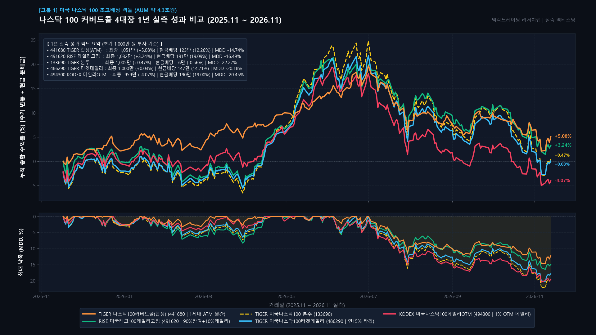

미국 나스닥 100 지수를 기초자산으로 삼으면서 연 12%에서 최대 19%에 달하는 초고배당을 지급하는 커버드콜 ETF들은 국내 개인 투자자들의 월배당 포트폴리오에서 가장 큰 비중(순자산 합산 약 4조 3천억 원)을 차지하고 있습니다. 하지만 데일리 타겟 15%, 1% 외가격(OTM) 데일리, 90% 참여형 데일리고정, 전통 월간 ATM(등가격) 매도 등 상품마다 내부 옵션 설계 구조가 완전히 다릅니다. 최근 1년간의 실측 백테스팅 데이터를 통해 상승장 참여율 격차와 원금 잠식 실체를 객관적으로 대조해 보았습니다.

## 1. ETF 기본 정보

| 비교 항목 | TIGER 타겟데일리 (486290) | KODEX 데일리OTM (494300) | RISE 데일리고정 (491620) | TIGER 합성 ATM (441680) |
|:---|:---|:---|:---|:---|
| **운용사** | 미래에셋자산운용 | 삼성자산운용 | KB자산운용 | 미래에셋자산운용 |
| **상장일** | 2024-06-25 | 2024-10-22 | 2024-10-02 | 2022-09-22 |
| **순자산 (AUM)** | **2조 5,427억 원** | 9,816억 원 | 5,571억 원 | 2,653억 원 |
| **기초지수** | NASDAQ 100 Daily Target 15% (TR) | NASDAQ 100 Daily 1% OTM (TR) | 미국테크100 데일리고정 커버드콜 (TR) | 미국나스닥100 커버드콜 ATM (TR) |
| **비교 대상 본주** | TIGER 미국나스닥100 (133690) | TIGER 미국나스닥100 (133690) | TIGER 미국나스닥100 (133690) | TIGER 미국나스닥100 (133690) |
| **총보수 (수수료)** | **연 0.25%** | **연 0.25%** | **연 0.25%** | **연 0.37%** |
| **환노출 여부** | 환노출형 (USD/KRW) | 환노출형 (USD/KRW) | 환노출형 (USD/KRW) | 환노출형 (합성, USD/KRW) |
| **분배 주기** | 월배당 (매월 말) | 월배당 (매월 말) | 월배당 (매월 15일) | 월배당 (매월 말) |
| **최근 분배율 (연환산)** | **연 17.36%** | **연 19.00%** | **연 19.09%** | **연 12.26%** |
| **콜옵션 만기** | 0DTE (만기 24시간 미만) | 0DTE (만기 24시간 미만) | 0DTE (만기 24시간 미만) | 월간 (1개월 만기) |
| **행사가격(Moneyness)** | 변동 OTM (연 15% 타겟) | 1% 고정 OTM (외가격 1%) | ATM 매도 (자산 10%만) | 100% ATM (전체 자산 등가격) |
| **상승 참여 구조** | 타겟 프리미엄 차감 후 참여 | 일일 최대 +1%까지 주가 참여 | 본주 90% 참여 + 10% 콜옵션 | 상방 0% 캡 (QYLD 복제 모델) |

---

## 2. 성과 그래프

> 💡 **차트 확인 포인트**: 상단 그래프의 실선들은 순수 주가에 실제로 계좌로 입금된 현금 분배금을 모두 합산한 '총자산(Hold Total Return)' 추이입니다. 나스닥 본주가 연간 0.47% 상승에 그친 횡보 진폭 장세에서 옵션 구조별로 최종 수익률이 어떻게 엇갈렸는지 확인할 수 있습니다.

---

## 3. 성과 요약 테이블

- **분석 기간**: 2025-11-13 ~ 2026-11-13 (1Y, 총 365일 실측)
- **초기 투자 원금**: 10,000,000원
- **적용 배당소득세율**: 0.0% (비과세/절세계좌 기준)

| 전략 / 종목명 | 초기 원금 | 최종 주식 평가액 | 순수 주가 변동률 | 누적 수령 분배금 (현금) | 최종 총자산 (Hold 기준) | 최종 종합 수익률 (Total Return) | CAGR (연평균 복리) | MDD (최대 낙폭) | 샤프 지수 (Sharpe) |
|:---|---:|---:|---:|---:|---:|---:|---:|---:|---:|
| **TIGER 미국나스닥100타겟데일리 (486290)** | 10,000,000원 | 8,531,405원 | -14.69% | 1,471,306원 | 10,002,711원 | **+0.03%** | +0.03% | -20.18% | -0.07 |
| **KODEX 미국나스닥100데일리OTM (494300)** | 10,000,000원 | 7,693,046원 | -23.07% | 1,900,240원 | 9,593,285원 | **-4.07%** | -4.07% | -20.45% | -0.36 |
| **RISE 미국테크100데일리고정 (491620)** | 10,000,000원 | 8,414,742원 | -15.85% | 1,909,414원 | 10,324,156원 | **+3.24%** | +3.24% | -16.49% | +0.11 |
| **TIGER 미국나스닥100커버드콜(합성) (441680)** | 10,000,000원 | 9,281,793원 | -7.18% | 1,225,984원 | 10,507,777원 | **+5.08%** | +5.08% | -14.74% | +0.24 |
| **비교 대상 본주 (TIGER 미국나스닥100, 133690)** | 10,000,000원 | 9,990,712원 | -0.09% | 56,030원 | 10,046,742원 | **+0.47%** | +0.47% | -22.27% | -0.03 |

---

## 4. 심층 성과 분석 및 구조 해부

### ① 1세대 ATM 월간 커버드콜(441680)의 횡보장 선방과 장기 랠리 한계
지난 1년간 실측 결과에서 가장 눈에 띄는 대목은 순수 100% ATM(등가격) 매도 방식을 취하는 1세대 TIGER 미국나스닥100커버드콜(합성)이 **+5.08%**로 4개 종목 중 가장 높은 종합 수익률을 기록했다는 사실입니다. 

나스닥 100 본주가 +0.47%로 제자리걸음을 하는 동안, 등가격 옵션의 두터운 외재가치 프리미엄이 주가 하락 시 완충재 역할을 충실히 수행했습니다. 배당락에 따른 순수 주가 하락폭도 **-7.18%**에 그쳐 다른 데일리 커버드콜 상품들(-14%~-23%)보다 주가 변동성이 현저히 낮았으며, 최대 낙폭(MDD) 역시 **-14.74%**로 가장 안정적인 방어력을 나타냈습니다.

하지만 이 결과를 두고 1세대 ATM 커버드콜이 항상 우월하다고 해석해서는 곤란합니다. 2024년 10월부터 2026년 11월까지 2년간의 전체 누적 성과를 복기해보면, 나스닥 100 본주가 **+35.26%** 폭등하는 랠리 국면에서 441680의 누적 수익률은 **+19.38%**에 그쳤습니다. 매월 초 상방이 0%로 완전히 잠기는 구조적 한계 탓에 지수 폭등 시 자본 차익을 거의 흡수하지 못하는 '상방 캡(Cap) 페널티'가 여실히 증명된 셈입니다.

### ② 90% 참여형 데일리고정(491620)의 균형 잡힌 주가 복원력
RISE 미국테크100데일리고정커버드콜은 자산의 90%를 나스닥 100 지수에 노출하고 나머지 10% 비중으로만 데일리 콜옵션을 매도하는 차별화된 설계를 갖고 있습니다.

1년 실측 데이터에서 이 상품은 **1,909,414원(19.09%)**이라는 최상위권의 현금 분배금을 투자자 계좌에 안겨주면서도 종합 수익률 **+3.24%**를 달성했습니다. 90%의 주가 참여율 덕분에 지수 반등 시 상방 캡에 덜 묶였으며, 샤프 지수도 **+0.11**로 양수를 기록했습니다. 

나아가 2년간의 누적 성과에서도 **+29.22%**를 기록하여, 본주 수익률(+35.26%)의 83% 수준을 추종하면서도 매월 1% 이상의 현금을 꾸준히 배출하는 탁월한 자본 보존력을 입증했습니다.

### ③ 타겟 15% 데일리(486290)의 원금 보전과 안정적 캐시카우 기능
순자산 2조 5천억 원을 자랑하는 TIGER 미국나스닥100타겟데일리커버드콜은 목표 분배율(연 15%)을 달성하기 위해 매일 외가격 행사가격을 탄력적으로 조정합니다.

1년간 순수 주가는 배당락 누적으로 **-14.69%** 하락했으나, 통장으로 입금된 현금 분배금 **1,471,306원(14.71%)**이 주가 하락분을 정확히 **100.2% 수준으로 상쇄**했습니다. 그 결과 최종 총자산은 **10,002,711원(+0.03%)**으로 초기 원금을 단 1원도 훼손하지 않고 온전히 지켜냈습니다. 

2년 누적 수익률 또한 **+28.11%**로 RISE(29.22%)와 대등한 성과를 보였으며, 변동성에 따라 매일 콜옵션 매도 비중을 동적으로 조절하여 불필요한 옵션 롤오버 비용을 억제한 알고리즘의 유효성이 확인되었습니다.

### ④ 1% OTM 데일리(494300)의 상방 비대칭 침식 원인 해부
반면 매일 1% 외가격 콜옵션을 기계적으로 매도하는 KODEX 미국나스닥100데일리커버드콜OTM은 4개 종목 중 유일하게 마이너스 종합 수익률(**-4.07%**)을 기록했습니다.

투자자에게 지급된 현금 분배금은 **1,900,240원(19.00%)**으로 풍부했으나, 순수 주가가 **-23.07%**나 깎여나가며 원금 손실을 발생시켰습니다. 분배금으로 주가 하락분을 메운 비율이 **82.4%**에 불과해 실질적인 원금 잠식 현상이 발생한 것입니다.

이러한 언더퍼폼의 원인은 나스닥 100 지수의 일간 급등락 특성에서 찾을 수 있습니다. 미국 기술주 시장에서는 CPI 발표나 빅테크 실적 발표 당일 지수가 하루에 +2%~+3% 이상 단기 폭등하는 날이 빈번합니다. 이 경우 1%를 초과하는 강력한 일간 상승분이 모두 잘려나가 상방 회복이 제한됩니다. 반대로 지수가 -2%~-3% 폭락하는 날에는 하락폭을 100% 그대로 반영하기 때문에, 계단식 주가 침식이 발생하여 배당금을 감안하더라도 총자산이 우하향하는 결과를 낳았습니다.

### ⑤ 시장 국면별 적합도 비교 (Market Regime Fit)

| 시장 국면 | TIGER 타겟데일리 (486290) | KODEX 데일리OTM (494300) | RISE 데일리고정 (491620) | TIGER 합성 ATM (441680) |
|:---|:---:|:---:|:---:|:---:|
| **박스권 횡보장** | ★★★★☆ | ★★★☆☆ | ★★★★☆ | **★★★★★** |
| **완만한 상승장** | ★★★★☆ | ★★★★☆ | ★★★★☆ | ★★★☆☆ |
| **급락장** | ★★★☆☆ | ★★☆☆☆ | ★★★☆☆ | ★★★★☆ |
| **대세 폭등장** | ★★★☆☆ | ★★☆☆☆ | **★★★★☆** | ★☆☆☆☆ |

- **횡보/진폭 장세**: 옵션 외재가치 프리미엄이 가장 두터운 **TIGER 합성 ATM(441680)**이 가장 유리합니다.
- **상승 추세장 및 장기 보유**: 지수 상승 참여율을 90% 확보한 **RISE 데일리고정(491620)**과 동적 OTM으로 상방을 열어두는 **TIGER 타겟데일리(486290)**가 장기 자산 가치를 지켜내기에 적합합니다.
- **변동성 급등락 장세**: 1% 고정 OTM 구조는 일간 비대칭 손익 구조로 인해 계좌 복원력이 떨어지므로 시장 변동성 지표(VIX) 추이를 면밀히 주시해야 합니다.

---

## 5. 최종 투자 전략 총평

동일하게 '나스닥 100 커버드콜'이라는 간판을 달고 있더라도, 세부 옵션 구조에 따라 1년간의 계좌 성적표는 +5%의 실질 이익부터 -4%의 원금 손실까지 뚜렷한 격차를 보였습니다.

정기적인 현금 흐름 인출이 절대적인 은퇴자라면 15% 수준의 타겟 프리미엄으로 원금을 보전하면서 월배당을 수취하는 **TIGER 타겟데일리(486290)**나 횡보장 방어력이 검증된 **TIGER 합성(441680)**이 안정적인 선택지가 될 수 있습니다. 

반면 연금저축이나 개인형 IRP, ISA 계좌에서 인컴을 재투자하며 장기 복리 효과를 노리는 투자자라면, 기술주의 대세 상승을 놓치지 않도록 90% 참여율을 보장하는 **RISE 데일리고정(491620)**을 핵심 축으로 삼는 전략이 합리적입니다. 

자신의 투자 목표가 '당장 쓸 수 있는 현금 인출'인지, 아니면 '배당과 주가 성장의 균형'인지 명확한 기준을 세우고 상품의 세부 옵션 규격을 확인하는 자세가 요구됩니다.

---

  ※ 본 포스팅은 특정 금융상품에 대한 매수·매도 추천이나 투자 권유가 아니며, ETF 상품의 구조와 과거 실측 백테스팅 데이터를 객관적으로 분석한 학술·정보 제공용 콘텐츠입니다. 과거의 운용 성과가 미래의 수익을 보장하지 않으며, 모든 투자에 대한 최종 판단과 손실 위험의 책임은 투자자 본인에게 있습니다.

#ETF #커버드콜 #나스닥100 #TIGER미국나스닥100타겟데일리 #KODEX미국나스닥100데일리OTM #RISE미국테크100데일리고정 #TIGER미국나스닥100커버드콜 #월배당 #배당수익률 #실측백테스팅 #맥락트레이딩

