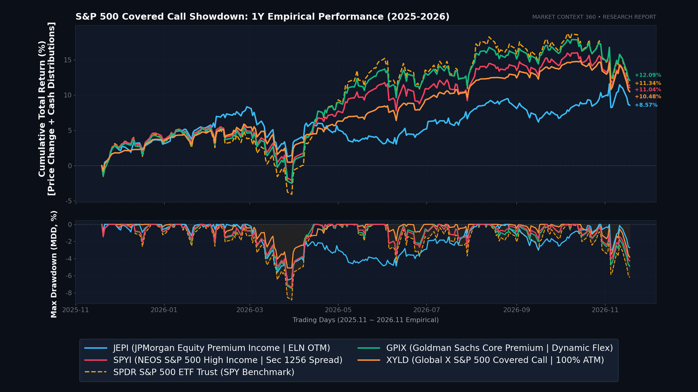
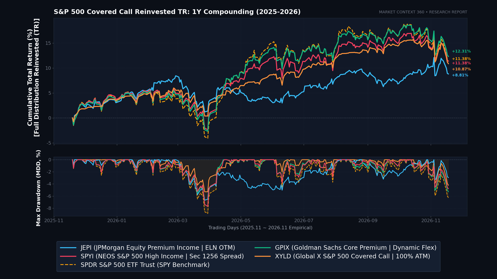

월스트리트의 파생 결합형 인컴 ETF 시장은 최근 3년간 가파른 양적 성장을 기록했습니다. 미국 ETF 생태계 내에서 S&P 500 지수를 기반으로 콜옵션을 매도하는 커버드콜 전략의 총 순자산(AUM) 규모만 이미 **680억 달러(한화 약 95조 원)**를 돌파했습니다. 국내 개인 투자자(서학개미)들에게도 월배당 현금흐름을 창출하는 핵심 코어 자산으로 확고히 자리 잡았습니다.

하지만 많은 투자자가 흔히 빠지는 분석적 함정이 있습니다. 바로 **연 8%~13%에 달하는 표면 분배율(Headline Yield)의 착시**입니다. 두 자릿수 분배율은 매달 안정적인 현금처럼 보이지만, 강한 상승장에서 본주의 자본 차익을 놓치는 기회비용을 초래하거나, 반대로 하락장에서는 배당락 침식과 원금 잠식이 결합하여 계좌 손실을 가속하는 **역복리 드래그(Reverse Compounding Drag)**를 유발할 수 있습니다.

이번 심층 리포트에서는 미국 증시를 대표하는 4대 메이저 S&P 500 커버드콜 ETF—**JEPI, SPYI, GPIX, XYLD**—를 대상으로 최근 1년간(2025년 11월 19일부터 2026년 11월 18일까지, 총 251거래일)의 시계열 실측 백테스팅을 정밀하게 수행했습니다. 비교 기준인 미국 시장 대표 벤치마크 **SPDR S&P 500 ETF Trust (SPY)**와 동일한 거래일 캘린더, 현금 배당 분배, 재투자 복리 산출을 1:1 대칭 적용하여 그 실체를 검증했습니다.

---

## 1. ETF 기본 정보 및 구조적 아키텍처

실측 성과를 확인하기에 앞서, 이 4개 ETF는 동일한 S&P 500 인컴 상품이라도 내부 옵션 설계와 포트폴리오 구성이 완전히 다르다는 점을 이해해야 합니다:

| ETF 종목명 (티커) | 운용사 및 기초자산 | 순자산 (AUM) 및 총보수 | 콜옵션 매도 전략 및 분배율 (실측 1Y) |
|:---|:---|:---|:---|
| **JEPI** JPMorgan Equity Premium Income ETF | JPMorgan Chase & Co. 저변동 대형 가치주 + ELN | **약 468억 달러** 연 0.35% (월배당) | **액티브 방어주 + ELN 외가격(OTM) 매도** 실측 1Y 분배율: **8.10%** (주당 $4.564) |
| **SPYI** NEOS S&P 500 High Income ETF | NEOS Investments S&P 500 현물 바스켓 | **약 124억 달러** 연 0.68% (월배당) | **인덱스 복제 + Section 1256 콜스프레드** 실측 1Y 분배율: **13.24%** (주당 $6.839) |
| **GPIX** Goldman Sachs S&P 500 Core Premium Income | Goldman Sachs Asset Mgmt S&P 500 현물 바스켓 | **약 65억 달러** 연 0.35% (월배당) | **현물 100% + 동적 플렉스(25~75%) 매도** 실측 1Y 분배율: **8.94%** (주당 $4.600) |
| **XYLD** Global X S&P 500 Covered Call ETF | Global X (미래에셋) Cboe S&P 500 BuyWrite (BXM) | **약 28억 달러** 연 0.60% (월배당) | **100% 기계적 등가격(ATM) 월간 매도** 실측 1Y 분배율: **10.61%** (주당 $4.240) |
| <strong style="color: #F59E0B;">SPY</strong> <strong style="color: #F59E0B;">SPDR S&P 500 ETF Trust (벤치마크)</strong> | State Street Global Advisors S&P 500 Index (시가총액식) | **약 6,200억 달러** 연 0.09% (분기배당) | **무헤지 순수 패시브 인덱스 코어** 실측 1Y 배당수익률: **1.14%** (주당 $7.583) |

 

| 세부 비교 항목 | JEPI (JP모건) | SPYI (네오스) | GPIX (골드만삭스) | XYLD (글로벌X) |
|:---|:---|:---|:---|:---|
| **기초 주식 포트폴리오** | 100~140개 저변동 가치주 선별 | S&P 500 전 종목 직접 보유 | S&P 500 전 종목 직접 보유 | S&P 500 전 종목 완전 복제 |
| **옵션 매도 수단** | 주식연계채권(ELN) 장외계약 | SPX 지수옵션 (Section 1256) | SPX 지수옵션 장내계약 | SPX 지수옵션 (매월 3번째 금요일) |
| **옵션 행사가격 (Moneyness)** | 약 1~2% 외가격(OTM) 매도 | 외가격 매도 + 더 높은 외가격 매수 | 시장 변동성 연동 탄력 행사가 | 100% 등가격(ATM) 매도 |
| **옵션 커버리지 비율** | 약 15~20% (ELN 익스포저) | 100% (콜스프레드로 상방 2~3% 확보) | **25% ~ 75% 동적 탄력 조절** | 100% 명목금액 전액 매도 |
| **주가 상승 참여율** | 저베타 주식 + OTM 여유분 | 스프레드 구간(2~3%) 주가 참여 | **상승장에서 미헤지 25~75% 주가 참여** | **상방 0% 완전 차단 (자본이득 배제)** |

이처럼 4개 ETF는 **옵션 커버리지 비율(Option Coverage Ratio)**과 **주가 상승 참여율(Upside Participation)** 사이에서 서로 다른 절충점(Trade-off)을 선택하고 있습니다:
- **XYLD**는 전통적인 100% 등가격 매도로 10.61%의 두터운 인컴을 창출하지만, 행사가를 넘어서는 주가 상승 이익을 완전히 포기합니다.
- **GPIX**는 시장 국면(변동성, 모멘텀)에 따라 옵션 매도 비중을 25%에서 75%까지 동적으로 조절하여 상승장에서는 25%~75%의 주가 상승분을 그대로 순자산가치(NAV)에 반영합니다.
- **SPYI**는 수령한 프리미엄의 일부를 떼어내 더 높은 외가격 콜옵션을 매수하는 콜스프레드(Call Spread Collar) 구조를 취해 연 13.24%의 초고배당을 지급하면서도 2~3%의 상방 참여 여력을 열어둡니다.
- **JEPI**는 기초자산 자체를 고베타 성장주가 아닌 저변동 방어주 위주로 재구성하여 하방 변동성을 억제하는 액티브 구조를 채택했습니다.

---

## 2. 1년 실측 성과 비교 분석 (그래프 & 요약 테이블)

초기 투자 시점(Day 0)의 왜곡을 없애기 위해 2025년 11월 19일부터 2026년 11월 18일까지 251거래일 동안의 일간 데이터를 바탕으로 두 가지 표준 방식으로 1:1 성과를 산출했습니다:
1. **[세트 1] 단순 보유(Hold): 주가 변동 + 현금 분배금 누적 수취**
2. **[세트 2] 분배금 전액 재투자(Reinvest TR): 지급일 종가 기준 100% 복리 롤링**

### ① [세트 1] 단순 보유(Hold) 실측 성과: 주가 변동 + 현금 분배금 수령

첫 번째 세트는 투자자가 매월 입금된 분배금을 현금 계좌에 그대로 보관하고, 주가 평가손익과 수령한 현금 분배금을 합산하여 총자산 수익률을 계산한 결과입니다.

*차트 1: S&P 500 커버드콜 4대장 1년 실측 성과 비교 (단순 보유 전략: 주가 변동 + 현금 분배금 수령). 상단 패널은 누적 종합 수익률, 하단 패널은 최대 낙폭(MDD) 추이를 나타냅니다. 이미지를 클릭하시면 100%~500% 초정밀 Pan & Zoom 라이트박스로 상세 캔들과 지표를 확대 열람하실 수 있습니다.*

지난 1년간 비교 대상인 무헤지 벤치마크 **SPY**는 순수 주가가 **+10.20%** 상승하고 분기 배당 **1.14%**가 더해져 단순 보유 기준 **+11.34%**의 총수익률을 기록했습니다.

커버드콜 4개 종목의 단순 보유 실측 성적표는 확연한 전략적 차이를 보여줍니다:
- **GPIX가 단순 보유 수익률 +12.09%로 1위를 기록하며 벤치마크 SPY(+11.34%)를 +0.75%p 앞질렀습니다.** 순수 주가도 **+3.15%** 상승했으며 주당 $4.600(8.94%)의 현금 분배금을 지급했습니다. 25~75% 동적 플렉스 오버라이트 덕분에 상승장 참여율을 유지하면서 탄탄한 인컴을 확보했습니다.
- **SPYI는 단순 보유 수익률 +11.04%를 달성했습니다.** 주당 $6.839에 달하는 **13.24%의 높은 현금 분배금**을 지급했으나, 고배당 지급에 따른 배당락 영향으로 순수 주가는 **-2.20% 하락**하여 일부 자본 침식이 발생했습니다.
- **XYLD는 단순 보유 수익률 +10.48%를 기록했습니다.** 주가는 **-0.13%**로 사실상 초기 투자 주가를 견고하게 방어했고, 연 **10.61%**($4.240)의 분배금을 전액 현금으로 안겨주었습니다. 상승장 주가 상승은 누리지 못했으나 두터운 ATM 프리미엄이 주가를 떠받쳤습니다.
- **JEPI는 단순 보유 수익률 +8.57%로 최하위를 기록했습니다.** 주가는 **+0.46%**로 플러스 방어에 성공하고 8.10%($4.564)의 분배금을 지급했으나, 대형 기술주 중심의 시장 랠리에서 저변동 방어주 바스켓이 시장 지수(+10.20%)를 크게 밑돌며 언더퍼폼했습니다.

---

### ② [세트 2] 분배금 재투자(Reinvest) 실측 성과: 전액 재투자 복리 롤링

두 번째 세트는 지급된 모든 분배금을 인출하지 않고 해당 ETF의 배당락일 종가로 즉시 전액 재매수하여 보유 주식 수량을 늘려나가는 총수익률(Total Return) 시뮬레이션입니다. **벤치마크 SPY 역시 동일하게 분기 배당금을 전액 재투자한 TR 시계열로 1:1 대칭 산출**했습니다.

*차트 2: S&P 500 커버드콜 4대장 1년 분배금 재투자 복리 성과 비교 (100% Reinvested Total Return). 모든 분배금이 당일 종가로 복리 롤링된 누적 자산 곡선입니다. 이미지를 클릭하시면 100%~500% 초정밀 Pan & Zoom 라이트박스로 세부 곡선을 확대 열람하실 수 있습니다.*

분배금을 전액 재투자했을 때 주식 수량 증가(Share Compounding)가 발휘한 결과는 다음과 같습니다:
- **GPIX가 분배금 재투자 종합 수익률 +12.31%를 달성하여 벤치마크 SPY(+11.38%)를 +0.93%p (+93bp) 상회했습니다.** 주가 상승 자본차익과 복리 재투자가 완벽한 시너지를 내며 이번 조사의 핵심 화두인 **"동적 커버드콜은 지수를 이겼는가?"에 대해 명확한 'YES'를 증명**했습니다.
- **SPYI는 재투자 시 +11.38%를 기록하며 벤치마크 SPY(+11.38%)와 소수점 둘째 자리까지 정확히 일치했습니다.** 연 13.24%의 풍부한 분배금으로 조정받은 주식을 대량 추가 매수한 결과, 보유 주식 수가 1년간 약 13.5% 증가하며 초기 주가 하락(-2.20%)을 완전히 상쇄하고 지수와 동등한 성과를 복원했습니다.
- **XYLD는 재투자 수익률 +10.87%를 기록했습니다.** 월간 단위의 꾸준한 재투자를 통해 단순 보유(+10.48%) 대비 +0.39%p의 복리 보너스를 얻었으며, 그룹 내에서 가장 매끄러운 우상향 자산 곡선을 나타냈습니다.
- **JEPI는 재투자 수익률 +8.81%에 머물렀습니다.** 단순 보유(+8.57%)보다 +0.24%p 개선되었으나 지수(+11.38%) 대비 -2.57%p 뒤처지며, 상승장 국면에서의 상방 캡과 저베타 포트폴리오의 한계를 확인했습니다.

---

### ③ 1년 실측 정량 종합 요약 테이블

251거래일 동안의 실측 데이터를 총결산한 마스터 테이블입니다:

| 종목명 (티커) | 시작 가격 | 최종 가격 | 순수 주가 변동률 | 누적 주당 분배금 | 실측 1Y 분배율 | [세트 1] 단순보유 수익률 | [세트 2] 재투자 TR 수익률 | 순수 주가 MDD | 재투자 TR MDD |
|:---:|---:|---:|---:|---:|---:|---:|---:|---:|---:|
| **JEPI** | $56.32 | $56.58 | **+0.46%** | $4.564 | 8.10% | **+8.57%** | **+8.81%** | -7.67% | **-6.68%** |
| **SPYI** | $51.67 | $50.53 | **-2.20%** | $6.839 | **13.24%** | **+11.04%** | **+11.38%** | -10.11% | **-7.71%** |
| **GPIX** | $51.46 | $53.08 | **+3.15%** | $4.600 | 8.94% | **+12.09%** | **+12.31%** | -8.86% | **-7.71%** |
| **XYLD** | $39.98 | $39.93 | **-0.13%** | $4.240 | 10.61% | **+10.48%** | **+10.87%** | -6.58% | **-5.29%** |
| <strong style="color: #F59E0B;">SPY (벤치마크)</strong> | $662.63 | $730.20 | **+10.20%** | $7.583 | 1.14% | **+11.34%** | **+11.38%** | -9.13% | **-8.88%** |

*(분석 기간: 2025-11-19 ~ 2026-11-18, 251거래일. 배당 재투자 계산은 세금 마찰이 없는 절세계좌 또는 총수익 표준을 기준으로 작성되었습니다.)*

---

## 3. 구조적 메커니즘 심층 해부

### 1. GPIX의 동적 플렉스 오버라이트(Dynamic Flex Overwrite) 승리 요인
골드만삭스의 GPIX는 고정된 100% 옵션 매도를 강제하지 않습니다. 시장 내재변동성(VIX)이 낮거나 강력한 모멘텀이 포착될 때 옵션 커버리지를 하한선인 25% 수준까지 기계적으로 축소합니다. 2026년 여름철 S&P 500 지수가 급등세를 나타낼 때, GPIX는 비헤지 주식 비중(50~75%)을 통해 자본 차익을 온전히 흡수하여 순수 주가를 +3.15% 끌어올렸습니다. 여기에 8.94%의 분배금이 결합하며 유일하게 인덱스를 초과 달성(+93bp)했습니다.

### 2. SPYI의 고분배율(13.24%)과 주가 침식의 상쇄 구조
NEOS의 SPYI는 콜옵션을 매도함과 동시에 더 높은 외가격 콜옵션을 매수하는 콜스프레드를 구사합니다. 급등장에서 상방이 완전히 막히는 사고를 막아내지만, 연 13.24%에 달하는 고율의 분배금을 매월 지급하다 보니 순수 주가는 -2.20% 침식되었습니다. 인컴 인출 목적의 단순 보유자에게는 원금 침식이 체감되지만, 재투자자에게는 낮아진 단가에서 수량을 대량 확보하는 기회가 되어 최종적으로 SPY와 동등한 +11.38%를 달성했습니다.

### 3. JEPI의 저변동성 방어주 선택이 낳은 상승장 소외
JEPI는 단순한 S&P 500 커버드콜이 아닙니다. 기초자산이 약 100~140개의 저변동 대형 가치주로 구성되어 있습니다. 지난 1년간 빅테크와 반도체 중심의 모멘텀 장세에서 JEPI의 주식 바스켓은 +0.46% 상승에 그쳤습니다. 옵션 프리미엄(8.10%)을 합산하더라도 총수익률이 +8.81%에 머문 이유입니다. 하방 방어력은 돋보였으나 강세장 추종력에서는 뚜렷한 한계를 드러냈습니다.

### 4. 하방 위험 방어력(MDD) 검증
- **XYLD가 가장 뛰어난 하방 방어력(TR MDD -5.29%)을 입증했습니다.** 매월 수취하는 100% 등가격 프리미엄(월 0.8~0.9%)이 즉각적인 충격 완충재로 작용하여 시장 조정 시 낙폭을 크게 줄였습니다.
- **JEPI 역시 저베타 포트폴리오의 특성을 발휘하며 TR MDD -6.68%로 견고한 방어력을 보였습니다.**
- **GPIX와 SPYI의 TR MDD는 -7.71%로 동일했으며, 벤치마크 SPY(-8.88%) 대비 약 +1.17%p 우수한 하방 완충력을 보였습니다.**

---

## 4. 서학개미 필독 ① — 원화 환율 변동 영향 심층 분석 (Currency FX Impact)

미국 상장 커버드콜 ETF에 직접 투자하는 대한민국 서학개미에게 **원화 환율 변동(USD/KRW)**은 달러 표시 주가 등락 못지않게 계좌의 최종 원화 수익률을 좌우하는 결정적 요인입니다. 이번에 분석한 JEPI, SPYI, GPIX, XYLD 4종은 모두 달러화 가치에 100% 노출된 무헤지(환노출) 상품이므로, 환율 상승과 하락에 따른 원화 환산 메커니즘을 정확히 파악해야 합니다. 환율이 계좌에 미치는 영향은 단순한 환차익이나 환차손에 그치지 않고, 시장 위기 국면에서의 방어력과 평상시 현금 구매력 전반에 걸쳐 광범위하게 작용합니다.

가장 먼저 주목해야 할 구조적 특성은 하락장에서 강력한 방어막이 되어 주는 **환쿠션(Currency Cushion) 효과**입니다. 역사적으로 글로벌 금융 시장에 충격이 발생하여 미국 뉴욕 증시가 급락할 때마다 안전 자산인 미국 달러화에 대한 수요가 급증하여 원/달러 환율이 가파르게 치솟는 경향이 있습니다. 예를 들어 미국 S&P 500 지수가 급락하며 ETF의 달러 표시 순자산가치가 -5% 하락하더라도, 동시에 원/달러 환율이 달러당 1,350원에서 1,420원으로 +5.2% 급등해 준다면 원화 환산 계좌 잔고는 하락하지 않고 본전을 방어해 냅니다. 이처럼 달러 100% 환노출 구조에서 발생하는 환쿠션 효과는 약세장과 패닉장에서 국내 투자자의 원화 기준 최대 낙폭(MDD)을 극적으로 완화해 주는 든든한 안전판 역할을 수행합니다.

반대로 강세장에서는 원화 가치가 강세를 보이며 발생하는 **환차손(Currency Drag) 리스크**를 경계해야 합니다. 미국 증시가 장기적인 랠리를 펼치고 위험 선호 심리가 살아나면 원/달러 환율은 하향 안정화되어 달러당 1,400원에서 1,300원 초반대로 하락할 수 있습니다. 이 경우 달러 표시 자산 평가액이 +10% 성장하더라도 환율 하락으로 인해 원화 기준 실질 자산 성장률은 +2%~+3% 수준으로 크게 희석될 수 있습니다. 특히 매월 수령하는 달러 분배금을 원화로 즉시 환전하여 생활비로 지출하는 은퇴자의 경우, 환율 하락기에는 동일한 달러 분배금을 받더라도 통장에 찍히는 원화 현금 입금액이 축소되는 실질적 소득 감소를 체감하게 됩니다.

따라서 현명한 서학개미라면 매월 지급되는 달러 분배금을 무조건 당일 원화로 즉시 기계적 환전하는 습관을 지양해야 합니다. 원/달러 환율이 1,400원 이상의 역사적 고점 구간에 진입했을 때 선별적으로 분배금을 환전하여 원화 현금흐름을 확보하고, 반대로 환율이 1,300원 초반이나 그 이하로 내려간 저환율 국면에서는 달러 분배금을 원화로 바꾸지 않고 미국 단기 국채 ETF(SGOV 등)나 달러 발행어음에 파킹하여 추가적인 달러 이자를 취득하는 탄력적인 외환 운용 전략을 구사하는 것이 바람직합니다.

---

## 5. 서학개미 필독 ② — 한국 세금 1:1 실전 비교: 해외 직투 vs 국내 상장 커버드콜 (Tax Strategy)

커버드콜 투자의 최종 성패는 세전 수익률이 아니라 내 주머니에 실제로 남는 **세후 실수령액(After-Tax Return)**에서 결정됩니다. 미국 상장 ETF 직투와 국내 상장 미국 커버드콜 ETF의 세법상 차이를 명확히 비교하고, 중개형 ISA와 연금저축/IRP 등 절세계좌를 활용한 최적의 절세 포트폴리오를 설계해야 합니다.

첫째, 미국 현지 직투(JEPI, SPYI 등)의 세무 구조는 매매차익에 대한 양도소득세와 분배금에 대한 배당소득세로 엄격히 이원화되어 있습니다. 미국 상장 ETF를 매매하여 얻은 자본 차익(매매차익)에 대해서는 **연간 250만 원의 기본공제**가 주어지며, 이를 초과한 순수익에 대해 **22%(지방소득세 포함)의 양도소득세**가 단일 세율로 분리과세됩니다. 이 양도세는 다른 해외주식 간 손익 통산이 가능하며, 아무리 큰 차익이 발생하더라도 금융소득종합과세(연 2,000만 원 초과 시 종합소득세 최고 49.5% 합산)에 절대 합산되지 않는다는 결정적 장점이 있습니다. 반면 매달 지급되는 월 분배금은 미국 현지에서 15%의 배당소득세가 원천징수되며, 이 분배금은 국내 이자 및 배당소득과 합산되어 연간 2,000만 원을 초과할 경우 금융소득종합과세 대상자로 지정되어 건강보험료 피부양자 자격 박탈 및 소득세율 누진 적용의 타격을 입을 수 있습니다.

둘째, 국내 상장 미국 커버드콜 ETF를 중개형 ISA 및 연금계좌에서 운용할 때의 절세 혜택은 직투 대비 상당한 비교우위를 제공합니다. 일반 위탁계좌에서 국내 상장 ETF를 매수하면 매매차익과 분배금 모두에 15.4% 배당소득세가 부과되지만, **중개형 ISA 계좌**를 활용하면 계좌 내에서 발생한 손익을 통산하여 **순이익 200만 원(서민형은 최대 400만 원)까지 전액 비과세** 혜택을 받습니다. 또한 비과세 한도를 초과하는 잔여 수익에 대해서도 일반 세율(15.4%)이 아닌 **9.9% 저율 분리과세**가 적용되어 금융소득종합과세에 전혀 합산되지 않고 깔끔하게 세무가 종결됩니다.

셋째, 장기 복리 투자를 지향하는 투자자에게 **연금저축펀드 및 개인형 퇴직연금(IRP) 계좌**는 최고의 절세 요람입니다. 연금계좌에서는 매월 고율의 커버드콜 분배금이 지급되더라도 세금을 단 1원도 원천징수하지 않는 **100% 과세이연(Tax Deferral)** 혜택이 적용됩니다. 세금으로 깎여나갈 금액까지 원금에 온전히 남아 세전 100% 금액으로 재투자되므로, 시간의 경과에 따라 복리 눈덩이 효과가 극대화됩니다. 이에 더해 연간 최대 900만 원 한도로 납입액의 13.2%~16.5%(연 최대 148.5만 원)를 연말정산에서 환급받는 세액공제 혜택이 주어지며, 55세 이후 연금 수령 시에도 일반 배당소득세(15.4%) 대신 **3.3%~5.5%의 극히 낮은 연금소득세**만 부담하므로 실질적인 세후 자산 형성 규모에서 미국 직투를 압도하게 됩니다.

결과적으로 연간 금융소득이 2,000만 원에 육박하여 종합과세 위험에 노출된 고액 자산가나 자산을 10년 이상 장기 굴려야 하는 3050 직장인 투자자라면, 해외 직투보다는 **중개형 ISA(연 2,000만 원 한도)와 연금저축/IRP(연 1,800만 원 한도) 절세계좌를 최우선으로 채운 뒤 국내 상장 미국 커버드콜 ETF를 분배금 재투자 방식으로 운용하는 절세 전략**이 가장 현명한 실전 투자 해법입니다.

| 세무 및 계좌 항목 | 미국 직투 (JEPI / SPYI / GPIX) | 국내 상장 커버드콜 (중개형 ISA) | 국내 상장 커버드콜 (연금저축 / IRP) |
|:---|:---|:---|:---|
| **매매차익 과세** | 양도소득세 22% (연 250만 원 기본공제) | 비과세 (순이익 200만~400만 원 한도) | 과세이연 (운용 기간 중 세금 0원) |
| **분배금 과세** | 미국 현지 15% 원천징수 | 한도 초과분 9.9% 저율 분리과세 | 과세이연 (세전 100% 즉시 재투자) |
| **금융소득종합과세** | 매매차익: 미합산 분배금: 2,000만 원 초과 시 합산 | **전액 분리과세 (종합과세 미합산)** | **전액 분리과세 (종합과세 미합산)** |
| **세액공제 혜택** | 없음 | 없음 | **연 최대 900만 원 (최대 148.5만 원 환급)** |
| **최종 인출 세율** | 없음 (원천징수로 종결) | 해지 시 9.9% 분리과세 종결 | 연금 수령 시 **3.3% ~ 5.5% 연금소득세** |
| **자금 유동성** | 언제든 자유롭게 환전 및 인출 가능 | 의무 가입기간 3년 (원금 인출 가능) | 만 55세 이후 인출 권장 (중도해지 시 기타소득세 16.5%) |

---

## 6. 최종 투자 총평 및 맞춤형 포트폴리오 가이드

동일하게 S&P 500 지수를 기반으로 설계된 월배당 커버드콜 상품일지라도 내부 옵션 구조에 따라 1년간의 계좌 성적표는 지수를 초과 달성한 +12.3%부터 지수에 크게 뒤처진 +8.8%까지 확연히 갈렸습니다.

투자자의 목적에 맞춘 4대 ETF 선택 기준을 다음과 같이 명쾌하게 정리해 드립니다:
1. **시장 상승 참여와 인컴을 모두 잡고 싶은 스마트 투자자 ➔ `GPIX` 선택**:
   - 25~75% 동적 플렉스 오버라이트의 위력이 실측 데이터로 검증되었습니다. 연 8.9%의 분배금과 함께 지수 초과 수익(+93bp)을 동시에 달성한 가장 진화된 올라운더 상품입니다.
2. **높은 당장의 월 현금 인출이 최우선인 은퇴자 ➔ `SPYI` 선택**:
   - 연 13.24%의 강력한 현금 흐름을 창출하며, 콜스프레드 덕분에 재투자 시 지수와 대등한 성과를 지켜냈습니다. 단, 현금 수령 시 원금 가치가 소폭 침식(-2.2%)될 수 있음을 감안해야 합니다.
3. **변동성을 극도로 기피하는 보수적 방어형 투자자 ➔ `JEPI` 선택**:
   - 강세장에서는 지수를 따라가지 못하지만, 저베타 방어주와 ELN의 결합으로 시장 조정 시 뛰어난 방어력(MDD -6.68%)을 발휘합니다.
4. **횡보 박스권에서 안정적인 현금흐름을 원하는 투자자 ➔ `XYLD` 선택**:
   - 가장 낮은 드로다운(-5.29%)과 10.6%의 꾸준한 분배금을 제공하므로, 지수가 뚜렷한 방향성 없이 갇혀 있는 박스권 장세에 가장 적합합니다.

월배당 커버드콜의 성패는 표면적인 두 자릿수 분배율에 현혹되지 않고 자신의 투자 기간, 현금 인출 여부, 그리고 환율과 절세 계좌의 특성을 정교하게 조합하는 데 달려 있습니다.

---

## 📚 참고 문헌 및 공인 실측 출처

> 출처: 미 증권거래위원회(SEC) EDGAR 공시 시스템, 시카고 옵션 거래소(Cboe), 각 자산운용사(JPMorgan·NEOS·Goldman Sachs·Global X) 공식 웹사이트

* [미국 증권거래위원회(SEC) EDGAR](https://www.sec.gov/edgar): JEPI, SPYI, GPIX, XYLD, SPY 공식 Form N-CSR 결산 보고서, 정기 투자설명서(Prospectus) 및 세무 분류 내역
* [Cboe Options Exchange](https://www.cboe.com): Cboe S&P 500 BuyWrite Index(BXM) 지수 산출 규격, SPX 지수 옵션 만기 결제 체계 및 Section 1256 계약 명세
* [JPMorgan Asset Management](https://www.jpmorgan.com): JEPI 펀드 운용 명세서, 저변동 가치주 바스켓 구성 및 주식연계채권(ELN) 계약 공시
* [NEOS Investments](https://neosfunds.com): SPYI 옵션 콜스프레드(Call Spread Collar) 전략 구조 및 월별 분배금(ROC/자본이득) 공시
* [Goldman Sachs Asset Management](https://www.gsam.com): GPIX 팩트시트 및 동적 플렉스 오버라이트(Dynamic Flex Overwrite) 운용 규격
* [Global X ETFs](https://www.globalxetfs.com): XYLD Cboe BXM 인덱스 복제 포트폴리오 및 월간 ATM 옵션 롤오버 공시
* [국세청·기획재정부](https://www.nts.go.kr): 대한민국 소득세법 제118조의2(국외자산 양도소득세 22%) 및 조세특례제한법 제91조의18(중개형 ISA 비과세·분리과세 규정)

---

  <strong>투자 유의사항 및 법적 면책고지:</strong> 
  본 포스팅은 정보 제공 및 학술적 연구 분석을 목적으로 작성되었으며, 특정 금융투자상품의 매수·매도를 추천하거나 투자를 권유하지 않습니다. 본문에 수록된 1년 실측 백테스팅 데이터와 세무 비교 분석은 과거의 역사적 데이터를 기반으로 산출된 결과이며, 미래의 운용 성과나 투자 수익을 보장하지 않습니다. 커버드콜 ETF는 옵션 매도에 따른 상방 이익 제한과 기초자산 하락에 따른 원금 손실 위험이 내재되어 있습니다. 모든 투자의 최종 결정과 원금 손실 위험에 대한 책임은 투자자 본인에게 있으므로, 투자 집행 전 반드시 공시 서류를 면밀히 검토하시고 전문 세무·금융 전문가와 상의하시기 바랍니다.

#미국커버드콜 #JEPI #SPYI #GPIX #XYLD #SPY #월배당ETF #백테스팅 #서학개미 #원화환율영향 #해외직투세금 #ISA절세계좌 #맥락트레이딩

