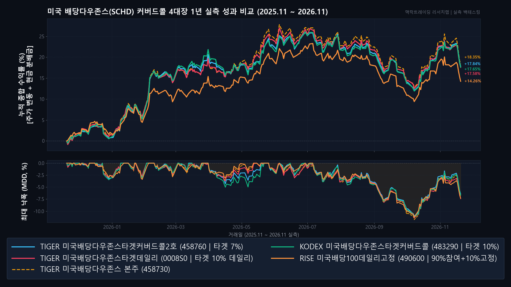
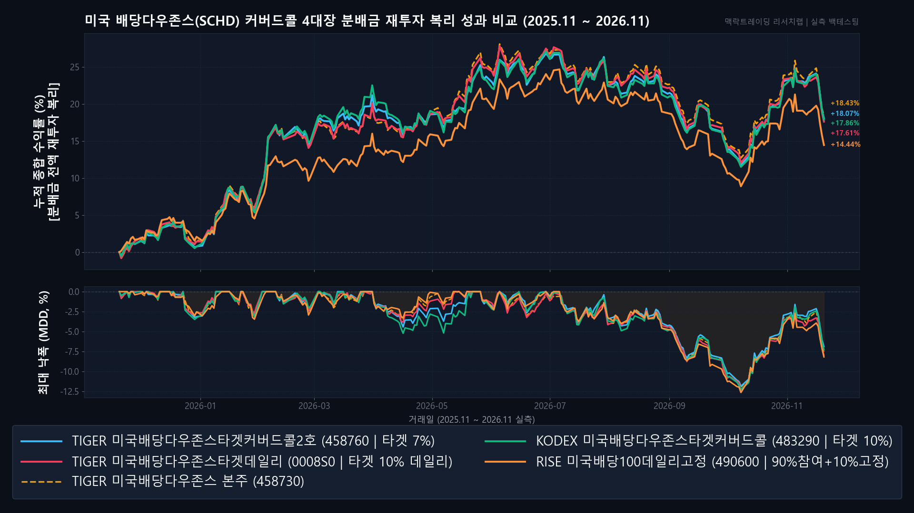

미국 대표 배당성장 지수인 Dow Jones U.S. Dividend 100(SCHD)을 기초자산으로 삼으며 연 7%에서 15% 수준의 월분배금을 지급하는 커버드콜 ETF들은 은퇴 준비자와 연금 생활자의 월배당 포트폴리오에서 핵심 축(합산 순자산 약 1조 4천억 원)을 담당하고 있습니다. 하지만 상품명에 같은 '미국배당다우존스'가 들어가 있더라도, 타겟 7% 월간 매도, 타겟 10% 데일리 0DTE 매도, 타겟 10% 월간 매도, 90% 참여형 데일리고정 매도 등 내부 콜옵션 오버레이 설계는 완전히 상이합니다.

지난 1년간 기초자산인 TIGER 미국배당다우존스 본주가 **+15.02%** 상승하는 우상향 배당성장 랠리 국면에서, 각 커버드콜 ETF들이 상승장 자본 차익을 얼마나 방어해냈는지 실측 데이터를 통해 검증하였습니다. 특히 **현금 수령(단순 보유, Hold) vs 분배금 전액 재투자(복리 롤링, Reinvest TR)**의 1:1 대칭 시뮬레이션을 통해 인컴 투자자가 면밀히 점검해야 할 실질 총자산 형성 경로를 분석합니다.

## 1. ETF 기본 정보

| ETF 종목명 (티커) | 운용사 및 기초지수 | 순자산 (AUM) 및 총보수 | 콜옵션 매도 전략 및 분배주기 |
|:---|:---|:---|:---|
| **TIGER 미국배당다우존스타겟커버드콜2호** (458760) | 미래에셋자산운용 DowJones U.S. Dividend 100 7% Premium Covered Call 지수 (TR) | **7,007억 원** 연 0.39% (환노출) | **타겟 7% 프리미엄 월간 콜매도** 월배당 (매월 말, 최근 연환산 9.91%) |
| **TIGER 미국배당다우존스타겟데일리커버드콜** (0008S0) | 미래에셋자산운용 Dow Jones U.S. Dividend 100 10% Daily Premium Covered Call 지수 | **3,255억 원** 연 0.25% (환노출) | **0DTE 데일리 콜매도 (연 10% 타겟 프리미엄)** 월배당 (매월 말, 최근 연환산 12.11%) |
| **KODEX 미국배당다우존스타겟커버드콜** (483290) | 삼성자산운용 Dow Jones U.S. Dividend 100 10% Premium Covered Call Index(TR) | **1,832억 원** 연 0.39% (환노출) | **타겟 10% 프리미엄 월간 콜매도** 월배당 (매월 말, 최근 연환산 12.21%) |
| **RISE 미국배당100데일리고정커버드콜** (490600) | KB자산운용 KEDI 미국 배당100 90%참여+데일리옵션 프리미엄 지수(TR) | **1,638억 원** 연 0.25% (환노출) | **본주 90% 참여 + 10% 0DTE ATM 매도** 월배당 (매월 말, 최근 연환산 15.91%) |
| <strong style="color: #F59E0B;">TIGER 미국배당다우존스 (기초 본주)</strong> <strong style="color: #F59E0B;">(458730)</strong> | 미래에셋자산운용 Dow Jones U.S. Dividend 100 Index (PR/TR) | **4조 2,000억 원** 연 0.01% (환노출) | **순수 패시브 인덱스 코어 (콜옵션 매도 없음)** 월배당 (매월 말, 배당수익률 약 3.8%) |

 

| 비교 세부 항목 | TIGER 타겟2호 (458760) | TIGER 타겟데일리 (0008S0) | KODEX 타겟커버드콜 (483290) | RISE 데일리고정 (490600) |
|:---|:---|:---|:---|:---|
| **상장일** | 2023-06-20 | 2025-01-21 | 2024-05-28 | 2024-09-24 |
| **비교 대상 본주** | TIGER 미국배당다우존스 (458730) | TIGER 미국배당다우존스 (458730) | TIGER 미국배당다우존스 (458730) | TIGER 미국배당다우존스 (458730) |
| **콜옵션 만기 구조** | 월간 (1개월 만기 외가격 옵션) | 0DTE (만기 24시간 미만 초단기 옵션) | 월간 (1개월 만기 외가격 옵션) | 0DTE (만기 24시간 미만 초단기 옵션) |
| **행사가격 및 매도 비중** | 변동 OTM (연 7% 목표 프리미엄) | 변동 OTM (연 10% 데일리 목표 프리미엄) | 변동 OTM (연 10% 목표 프리미엄) | ATM 매도 (포트폴리오 10% 비중 고정) |
| **주가 상승 참여율** | 타겟 7% 외 잔여 주가 상승분 전액 참여 | 일간 10% 타겟 외 잔여 상승분 참여 | 타겟 10% 외 잔여 주가 상승분 전액 참여 | 본주 90% 무제한 참여 + 옵션 10% |

---

## 2. 1년 실측 성과 비교 분석 (그래프 & 요약 테이블)

투자자가 월배당 커버드콜 상품을 운용할 때 마주하는 가장 근본적인 두 가지 방식—**① 분배금을 계좌로 인출하여 현금으로 보유하는 경우(Hold)**와 **② 분배금을 단 1원도 인출하지 않고 지급 당일 해당 ETF 주식으로 전액 재매수하는 경우(Reinvest)**—를 1:1 맞대결로 실측하였습니다.

- **분석 기간**: 2025-11-20 ~ 2026-11-20 (1Y, 245거래일 동기화 실측)
- **초기 투자 원금**: 10,000,000원
- **적용 배당소득세율**: 0.0% (비과세/절세계좌 기준)

### ① [세트 1] 단순 보유(Hold) 실측 성과: 주가 변동 + 현금 분배금 수령

첫 번째 세트는 투자자가 매월 통장에 입금된 분배금을 현금으로 수취하여 보관하고, 주가 평가액과 현금 누적액을 합산하여 최종 총자산을 측정한 실측 결과입니다.

> 💡 **단순 보유 차트 포인트**: 상단 그래프의 실선들은 순수 주가 평가액에 통장에 실제로 입금된 누적 현금 분배금을 합산한 '총자산(Hold Total Return)' 추이입니다. 기초자산인 SCHD 본주가 1년간 +15.02% 상승하는 우상향 장세에서, 타겟 프리미엄을 낮추어 상방 참여율을 넉넉히 확보한 TIGER 타겟 7% 상품이 가장 우수한 자본 성장력을 기록했습니다.

| 전략 / 종목명 | 초기 원금 | 최종 주식 평가액 | 순수 주가 변동률 | 누적 수령 분배금 (현금) | 최종 총자산 (Hold 기준) | 최종 종합 수익률 (Total Return) | CAGR (연평균 복리) | MDD (최대 낙폭) | 샤프 지수 (Sharpe) |
|:---|---:|---:|---:|---:|---:|---:|---:|---:|---:|
| **TIGER 미국배당다우존스타겟커버드콜2호 (458760)** | 10,000,000원 | 10,699,442원 | +6.99% | 1,084,642원 | 11,784,085원 | **+17.84%** | +17.85% | -11.03% | 1.16 |
| **KODEX 미국배당다우존스타겟커버드콜 (483290)** | 10,000,000원 | 10,461,049원 | +4.61% | 1,303,656원 | 11,764,705원 | **+17.65%** | +17.66% | -11.22% | 1.10 |
| **TIGER 미국배당다우존스타겟데일리 (0008S0)** | 10,000,000원 | 10,456,316원 | +4.56% | 1,302,170원 | 11,758,486원 | **+17.58%** | +17.60% | -11.39% | 1.16 |
| **RISE 미국배당100데일리고정 (490600)** | 10,000,000원 | 9,714,774원 | -2.85% | 1,711,351원 | 11,426,126원 | **+14.26%** | +14.27% | -11.24% | 0.99 |
| <strong style="color: #F59E0B;">비교 대상 본주 (TIGER 미국배당다우존스, 458730)</strong> | 10,000,000원 | 11,502,179원 | +15.02% | 332,936원 | 11,835,116원 | **+18.35%** | +18.36% | -11.76% | 1.17 |

---

### ② [세트 2] 분배금 재투자(Reinvest) 실측 성과: 전액 재투자 복리 롤링

두 번째 세트는 수령한 모든 분배금을 인출하지 않고, 분배금 지급 당일 종가로 해당 ETF 주식을 즉시 전액 추가 매수하여 보유 수량을 늘려나가는 복리 재투자(Total Return) 시뮬레이션 결과입니다.

> 💡 **재투자 차트 포인트**: 분배금을 해당 ETF에 전액 재투자했을 때의 실측 누적 자산 곡선입니다. 기초자산이 우상향하는 배당성장 랠리 국면에서는 재투자를 통한 보유 지분 확대가 추가 주가 상승 및 추가 배당 증가로 연결되면서 전 종목에서 **양의 복리 스프레드(+0.02%p ~ +0.23%p)**가 확인되었습니다.

| 전략 / 종목명 | 초기 원금 | 최종 총자산 (재투자 기준) | 최종 종합 수익률 (Total Return) | CAGR (연평균 복리) | MDD (최대 낙폭) | 샤프 지수 (Sharpe) | 단순 보유 대비 수익률 격차 |
|:---|---:|---:|---:|---:|---:|---:|:---:|
| **TIGER 미국배당다우존스타겟커버드콜2호 (458760)** | 10,000,000원 | 11,807,312원 | **+18.07%** | +18.09% | -11.86% | 1.12 | **+0.23%p** |
| **KODEX 미국배당다우존스타겟커버드콜 (483290)** | 10,000,000원 | 11,785,688원 | **+17.86%** | +17.87% | -12.27% | 1.06 | **+0.21%p** |
| **TIGER 미국배당다우존스타겟데일리 (0008S0)** | 10,000,000원 | 11,760,604원 | **+17.61%** | +17.62% | -12.34% | 1.11 | **+0.02%p** |
| **RISE 미국배당100데일리고정 (490600)** | 10,000,000원 | 11,444,481원 | **+14.44%** | +14.46% | -12.66% | 0.93 | **+0.18%p** |
| <strong style="color: #F59E0B;">비교 대상 본주 (TIGER 미국배당다우존스, 458730)</strong> | 10,000,000원 | 11,842,662원 | **+18.43%** | +18.44% | -12.01% | 1.16 | **+0.08%p** |

> ※ TIGER 타겟데일리(0008S0)의 단순 보유 대비 재투자 성과 격차는 원자료 실측치(+0.02118%p)를 소수점 둘째 자리로 반올림하여 +0.02%p로 표기되었습니다.

---

## 3. 심층 성과 분석 및 옵션 구조 해부

### ① TIGER 타겟 7% 월간(458760): 낮은 타겟 프리미엄을 통한 상승장 참여율 확보
지난 1년간의 실측 결과에서 가장 높은 성과를 보인 상품은 미래에셋의 **TIGER 미국배당다우존스타겟커버드콜2호(458760)**였습니다. 단순 보유 기준 **+17.84%**(최종 총자산 11,784,085원), 재투자 복리 기준 **+18.07%**(최종 총자산 11,807,312원)를 달성하여 비교 대상 커버드콜 4종 중 가장 높은 종합 수익률을 기록했습니다.

특히 본주인 TIGER 미국배당다우존스(458730)의 종합 수익률(단순 보유 +18.35%, TR +18.43%)과 비교했을 때, 격차가 **0.36%p ~ 0.51%p** 수준에 그쳤습니다. 연 10% 수준의 월분배금(1년간 1,084,642원 수령)을 지급하면서도 본주 종합 수익률(+18.35%)의 약 97.2%에 달하는 +17.84%를 실현하며 우수한 성과를 보였습니다.

이러한 성과의 핵심은 **'타겟 7%의 보수적 옵션 설계'**에 있습니다. 목표 프리미엄이 7%로 상대적으로 낮기 때문에 콜옵션을 매도할 때 행사가격을 현재 주가보다 먼 외가격(OTM)에 설정할 수 있습니다. 그 결과 기초지수인 SCHD가 연간 +15.02% 상승하는 동안에도 콜옵션 행사에 따른 상방 제약(Cap) 영향을 최소화하며 주가 상승분을 대부분 반영했습니다. 순수 주가 변동률 역시 **+6.99%**로 커버드콜 중 유일하게 7%에 육박하는 플러스 주가 상승을 기록했습니다.

### ② 타겟 10% 프리미엄 맞대결: KODEX 월간(483290) vs TIGER 데일리(0008S0)
목표 프리미엄을 연 10%로 설정한 두 라이벌 상품의 대결에서는 미세한 구조적 차이가 결과로 이어졌습니다:
- **KODEX 타겟 10% 월간(483290)**: 단순 보유 **+17.65%**, 재투자 TR **+17.86%**
- **TIGER 타겟 10% 데일리(0008S0)**: 단순 보유 **+17.58%**, 재투자 TR **+17.61%**

두 상품 모두 연간 수령 분배금(KODEX 1,303,656원 vs TIGER 데일리 1,302,170원)과 순수 주가 상승률(+4.61% vs +4.56%)에서 유사한 성과 궤적을 보였습니다.

차이점은 콜옵션 만기 주기에 있었습니다. 월간 옵션을 활용하는 KODEX는 월중 지수 변동성이 완만할 때 OTM 행사가격의 여유 폭을 확보하여 재투자 기준에서 +0.25%p 앞섰습니다. 반면 매일 0DTE 옵션을 롤오버하는 TIGER 데일리는 일간 변동성 충격을 매일 리셋하며 샤프 지수 1.16(KODEX 1.10)을 기록, 위험 대비 수익률 측면에서 높은 안정성을 보였습니다.

### ③ RISE 데일리고정(490600): 고분배금 지급과 상방 제약(Cap)의 구조적 트레이드오프
KB자산운용의 **RISE 미국배당100데일리고정커버드콜(490600)**은 1년간 **1,711,351원(연환산 17.11%)**에 달하는 현금 분배금을 지급했습니다. 4개 비교 대상 종목 중 분배금 지급 규모 측면에서 가장 높은 수치를 기록했습니다.

하지만 최종 종합 수익률은 단순 보유 **+14.26%**, 재투자 TR **+14.44%**로 비교 대상 종목 중 가장 큰 폭으로 본주 대비 하회(본주 대비 -3.99%p ~ -4.09%p 격차)했습니다. 순수 주가 변동률 또한 **-2.85%**로 4종목 중 유일하게 마이너스를 기록했습니다.

이러한 괴리의 원인은 **'자산 10% 비중의 데일리 ATM(등가격) 매도'** 구조에 있습니다. 본주에 90%를 직접 노출하더라도 매일 잔여 10% 비중으로 등가격 콜옵션을 매도하기 때문에, 지수가 일간 큰 폭으로 상승하는 날마다 옵션 매도 포지션에서 손실이 발생하여 포트폴리오 10% 비중의 상방 자본 차익이 제한됩니다. 배당성장 우상향 랠리 국면에서는 이러한 일간 상방 제약이 245거래일 동안 누적되면서 순자산가치(NAV) 상승 탄력을 둔화시키는 요인으로 작용했습니다.

### ④ 배당성장 랠리 장세에서의 복리 재투자: '양의 복리 스프레드'의 작동 메커니즘
공정한 1:1 비교를 위해 벤치마크인 TIGER 미국배당다우존스 본주(458730) 역시 월별로 지급된 12회의 분배금(총 332,936원)을 해당 지급일 종가로 전액 재투자한 TR 시계열로 계산하였습니다.

앞서 분석한 나스닥 100 횡보장에서는 전 종목에서 재투자 시 수익률이 깎이는 '역복리 드래그(-0.66%p ~ -2.20%p)'가 관찰되었던 반면, 이번 SCHD 1년 실측에서는 정반대의 궤적이 관찰되었습니다:
- **TIGER 타겟 2호 (458760)**: 단순 보유 +17.84% → 재투자 **+18.07%** (**+0.23%p** 개선)
- **KODEX 타겟 (483290)**: 단순 보유 +17.65% → 재투자 **+17.86%** (**+0.21%p** 개선)
- **RISE 데일리고정 (490600)**: 단순 보유 +14.26% → 재투자 **+14.44%** (**+0.18%p** 개선)
- **TIGER 타겟데일리 (0008S0)**: 단순 보유 +17.58% → 재투자 **+17.61%** (**+0.02%p** 개선, 실측치 기준)
- **본주 (458730)**: 단순 보유 +18.35% → 재투자 **+18.43%** (**+0.08%p** 개선)

전 종목에서 재투자 수익률이 단순 현금 보유보다 높아지는 **'양의 복리 스프레드'**가 확인되었습니다. 기초자산 본주가 +15.02% 상승하는 추세장에서는 재투자된 주식 수량이 배당락 이후 추가 자본 차익을 견인하면서, 분배금 재투자가 총수익률 개선 요인으로 작용했습니다.

### ⑤ 시장 국면별 적합도 비교 (Market Regime Fit)

| 시장 국면 | TIGER 타겟 7% (458760) | TIGER 타겟 10% (0008S0) | KODEX 타겟 10% (483290) | RISE 데일리고정 (490600) |
|:---|:---:|:---:|:---:|:---:|
| **배당성장 완만한 상승장** | **★★★★★** | ★★★★☆ | ★★★★☆ | ★★★☆☆ |
| **박스권 횡보장** | ★★★☆☆ | ★★★★☆ | ★★★★☆ | **★★★★★** |
| **급락 및 변동성 장세** | ★★★☆☆ | ★★★★☆ | ★★★☆☆ | ★★★★☆ |
| **강한 상승장** | ★★★★☆ | ★★★☆☆ | ★★★☆☆ | ★★☆☆☆ |

- **우상향 추세장**: 상방 참여 폭을 상대적으로 넓게 확보한 **TIGER 타겟 7%(458760)**가 본주에 근접한 자본 차익과 분배금을 동시에 확보하는 데 유리한 구조를 보였습니다.
- **횡보 및 박스권 장세**: 분배율이 가장 높은 **RISE 데일리고정(490600)**이 상대적으로 높은 옵션 프리미엄을 통해 포트폴리오를 방어합니다.
- **균형적 인컴 관리**: **KODEX 타겟 10%(483290)**와 **TIGER 타겟데일리(0008S0)**가 연 10%대 목표 배당과 자본 방어력 사이에서 균형 있는 대안을 제공합니다.

---

## 4. 최종 투자 전략 총평: 은퇴자 현금 흐름 vs 절세계좌 복리 적립

국내 상장 미국 배당다우존스 커버드콜 4종의 1년 실측 백테스팅 데이터는 투자자의 계좌 목적에 따른 명확한 선택 기준을 제시합니다.

1. **생활비 현금 인출이 1순위인 은퇴 생활자 (단순 보유 전략)**:
   - 매월 지급되는 분배금을 인출하여 생활비로 소진하는 투자자에게는 연간 171만 원(17.11%)의 높은 현금 분배금을 지급한 **RISE 데일리고정(490600)**이 유효한 현금 흐름 대안이 될 수 있습니다. 단, 기초자산 상승장에서 원금 성장이 제한될 수 있음을 사전에 감안해야 합니다.
2. **연금저축·IRP·ISA 계좌에서 장기 자산을 키워가는 적립식 투자자 (재투자 복리 전략)**:
   - 복리 롤링을 통해 원금 크기 자체를 키워야 하는 장기 투자자에게는 상방 캡을 상대적으로 넓게 확보하여 종합 수익률 +18.07%를 기록한 **TIGER 타겟 7% 커버드콜(458760)**이 종합 수익률 측면에서 가장 유리한 대안이 되었습니다. 본주(458730) 대비 불과 0.36%p 차이로 뒤따르면서 연 10%에 달하는 분배금을 재투자 엔진으로 활용할 수 있습니다.
3. **표면 분배율과 실질 총자산 수익률의 괴리 점검**:
   - 표면 분배율이 15%~17%로 높다고 해서 최종 총자산 수익률까지 비례하여 높은 것은 아닙니다. 기초자산이 우상향하는 구간에서는 잦은 콜옵션 매도가 주가 상승 참여를 제한할 수 있으므로, 투자 목적과 시장 국면에 부합하는 옵션 구조를 면밀히 점검하는 전략이 요구됩니다.

---

## 📚 참고 문헌 및 공인 실측 출처

> 출처: 한국거래소(KRX) 정보데이터시스템, 금융감독원 전자공시시스템(DART), 각 자산운용사(미래에셋·삼성·KB) 공식 웹사이트, S&P Dow Jones Indices, Cboe

* [한국거래소(KRX) 정보데이터시스템](https://data.krx.co.kr): 458760, 0008S0, 483290, 490600 및 458730 상장 종목 기본정보, 결산 분배금 내역, 일별 수정주가 시계열 실측 데이터
* [금융감독원 전자공시시스템(DART)](https://dart.fss.or.kr): 미래에셋자산운용, 삼성자산운용, KB자산운용 집합투자규약, 정기 투자설명서 및 자산운용보고서
* [S&P Dow Jones Indices](https://www.spglobal.com/spdji): Dow Jones U.S. Dividend 100 지수 구성 종목, 배당성장 산출 기준 및 팩터 가중치 방법론
* [Cboe Options Exchange](https://www.cboe.com): 미국 지수 옵션(FLX/0DTE) 결제 주기 및 커버드콜 옵션 오버레이 메커니즘
* 금융위원회·금융감독원: 자본시장과 금융투자업에 관한 법률 및 금융소비자 보호에 관한 법률 관련 규정

---

  ※ 본 포스팅은 특정 금융투자상품에 대한 매수·매도 추천이나 투자 권유가 아니며, ETF 상품의 내부 구조와 과거 실측 백테스팅 데이터를 객관적으로 분석한 학술·정보 제공용 콘텐츠입니다. 금융투자상품은 시장 상황에 따라 원금 손실 위험이 수반되며, 과거의 운용 실적이 미래의 수익을 보장하지 않습니다. 모든 투자의 최종 판단과 책임은 투자자 본인에게 있습니다.

#ETF #커버드콜 #미국배당다우존스 #SCHD #TIGER미국배당다우존스타겟커버드콜2호 #TIGER미국배당다우존스타겟데일리 #KODEX미국배당다우존스타겟커버드콜 #RISE미국배당100데일리고정 #월배당 #배당재투자 #실측백테스팅 #맥락트레이딩

