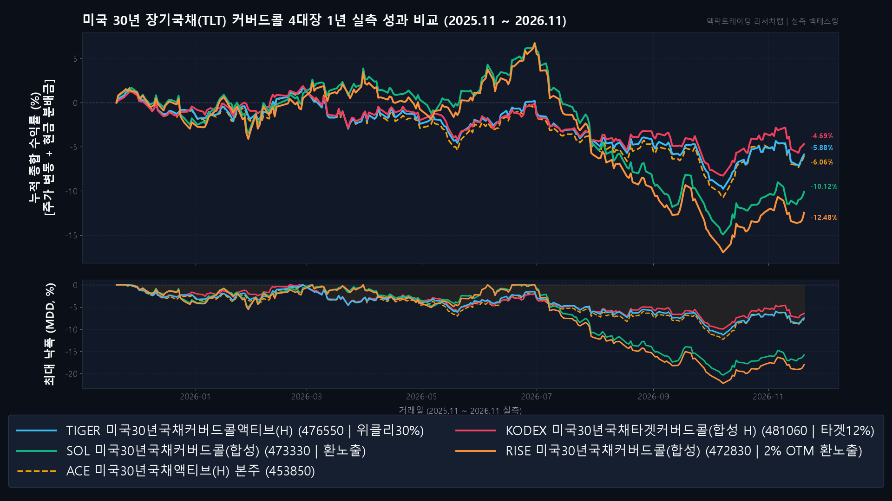
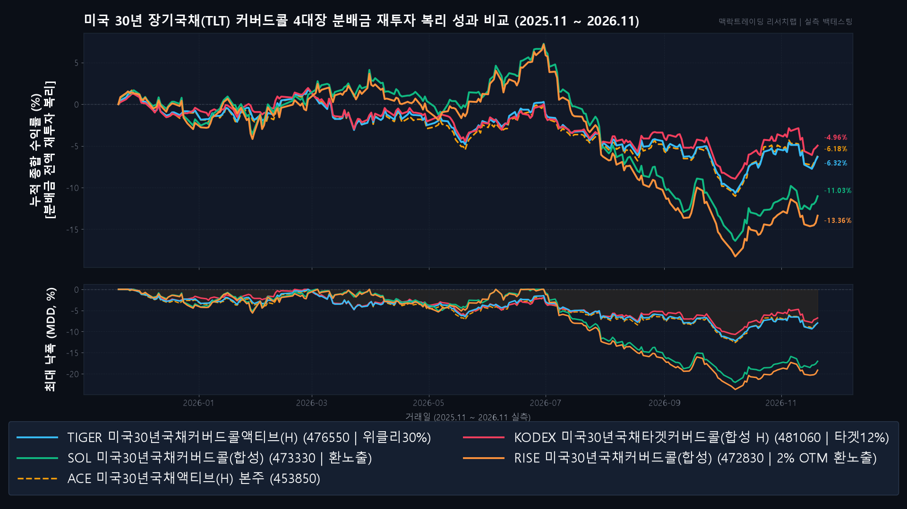

미국 연방준비제도(Fed)의 기준금리 인하 속도 조절과 고금리 장기화(Higher for Longer) 기조가 이어지면서, 미국 30년 장기국채(TLT)를 기초자산으로 삼는 월배당 커버드콜 ETF들이 연 10~13% 수준의 높은 목표 분배율을 앞세워 개인 투자자들의 자금을 대거 흡수했습니다. 장기채의 가격 변동성을 옵션 매도 프리미엄으로 완충하면서 매월 안정적인 현금흐름을 확보하겠다는 전략입니다.

하지만 2025년 11월부터 2026년 11월까지 최근 1년간 국채 금리가 등락을 거듭하며 하향 안정화되지 못한 국면에서, 각 운용사 상품들의 실제 총자산 방어력과 토탈리턴(Total Return) 성적표는 현저한 격차를 드러냈습니다. 특히 환헤지(H) 여부와 콜옵션 매도 방식(타겟 프리미엄 vs 위클리 OTM vs 고정 외가격)에 따라 실질 자본 보존율에서 큰 차이가 발생했습니다. 국내 상장된 미국 30년 국채 커버드콜 대표 4종목과 기초자산 본주의 1년 실측 데이터를 1:1로 정밀 비교 분석합니다.

---

## 1. ETF 기본 정보 (스펙 비교)

국내 증시에 상장된 미국 30년 국채 커버드콜 4대 ETF의 핵심 운용 구조와 상품 스펙은 다음과 같습니다.

| 항목 | TIGER 미국30년국채커버드콜액티브(H) | KODEX 미국30년국채타겟커버드콜(합성 H) | SOL 미국30년국채커버드콜(합성) | RISE 미국30년국채커버드콜(합성) |
| :--- | :--- | :--- | :--- | :--- |
| **종목코드(티커)** | `476550` | `481060` | `473330` | `472830` |
| **운용사** | 미래에셋자산운용 | 삼성자산운용 | 신한자산운용 | KB자산운용 |
| **순자산총액(AUM)** | 약 7,317억 원 | 약 6,910억 원 | 약 2,743억 원 | 약 410억 원 |
| **총보수(연)** | 연 0.39% | 연 0.25% | 연 0.25% | 연 0.25% |
| **기초지수** | KEDI 미국채30년 위클리 커버드콜30 지수(TR) | Bloomberg U.S. Treasury 20+ Year + 12% Premium Index(TR) | KEDI 미국 국채 20년+ 커버드콜 지수(NTR) | Bloomberg U.S. Treasury 20+ Year 2% OTM Index(TR) |
| **콜옵션 매도 전략** | 위클리 콜옵션 30% 매도 (액티브) | 연 12% 타겟 프리미엄 옵션 매도 | 월간 OTM 콜옵션 매도 | 2% OTM 외가격 콜옵션 매도 |
| **분배 주기 / 정책** | 월 1회 (월말) / 연 11~12% 수준 | 월 1회 (월말) / 연 12% 목표 타겟 | 월 1회 (월말) / 연 11~13% 수준 | 월 1회 (월말) / 2% OTM 프리미엄 |
| **환헤지 여부** | 환헤지형 (H, 원/달러 변동 배제) | 환헤지형 (H, 원/달러 변동 배제) | **환노출형** (달러/원 환율 반영) | **환노출형** (달러/원 환율 반영) |

---

## 2. 1년 실측 성과 비교 분석 (그래프 & 요약 테이블)

2025년 11월 20일부터 2026년 11월 20일까지 1년간 1,000만 원의 초기 자본을 투자했을 때의 실제 성과를 두 가지 조건으로 나누어 실측 검증했습니다.

### ① [세트 1] 단순 보유(Hold) 실측 성과: 주가 변동 + 현금 분배금 수령

매월 지급되는 분배금을 인출하여 생활비나 현금으로 소비하고, 계좌에 남은 원금 주식 가치와 누적 수령 분배금을 합산하여 최종 총자산을 측정한 결과입니다.

> 💡 **단순 보유 차트 포인트**: 원/달러 환율이 1,400원선 전후의 고환율 구간을 유지했음에도 불구하고, 환헤지형 상품인 KODEX(-4.69%)와 TIGER(-5.88%)가 환노출형인 SOL(-10.12%)과 RISE(-12.48%)에 비해 종합 수익률과 최대 낙폭(MDD) 방어력 양면에서 명확한 우위를 기록했습니다.

| 전략/종목 | 초기 원금 (원) | 최종 주식평가액 (원) | 순수 주가변동률 (%) | 누적 분배금 (원) | 최종 총자산 (원) | 종합 수익률 (Total Return) | CAGR (연복리) | MDD (최대낙폭) | 샤프 지수 (Sharpe) |
| :--- | :---: | :---: | :---: | :---: | :---: | :---: | :---: | :---: | :---: |
| KODEX 미국30년국채타겟(합성 H) | 10,000,000 | 8,422,918 | -15.77% | 1,108,092 | 9,531,010 | **-4.69%** | -4.69% | **-9.97%** | -0.90 |
| TIGER 미국30년국채액티브(H) | 10,000,000 | 8,299,492 | -17.01% | 1,112,944 | 9,412,437 | **-5.88%** | -5.88% | **-11.30%** | -1.00 |
| SOL 미국30년국채커버드콜(합성) | 10,000,000 | 7,908,190 | -20.92% | 1,079,812 | 8,988,002 | **-10.12%** | -10.13% | **-20.33%** | -1.18 |
| RISE 미국30년국채커버드콜(합성) | 10,000,000 | 7,903,907 | -20.96% | 847,941 | 8,751,848 | **-12.48%** | -12.49% | **-22.21%** | -1.37 |
| <strong style="color: #F59E0B;">비교 대상 본주 (ACE 미국30년국채액티브(H), 453850)</strong> | 10,000,000 | 9,018,602 | -9.81% | 375,882 | 9,394,484 | **-6.06%** | -6.06% | **-12.31%** | -0.89 |

---

### ② [세트 2] 분배금 재투자(Reinvest) 실측 성과: 전액 재투자 복리 롤링

지급받은 모든 분배금을 인출하지 않고 당일 종가 기준으로 해당 종목에 전액 재매수하여 복리 효과를 유도한 시뮬레이션 결과입니다. 비교 기준인 기초자산 본주(ACE 미국30년국채액티브) 역시 지급된 분배금을 당일 종가로 전액 재투자한 Total Return(TR) 시계열을 동일하게 산출하여 대칭 비교했습니다.

> 💡 **재투자 차트 포인트**: 하락 국면에서 분배금을 재투자한 결과, 4개 커버드콜 ETF와 본주 모두 단순 보유 대비 최종 수익률이 오히려 악화되는 역복리 드래그 현상이 실측 데이터로 확인되었습니다.

| 전략/종목 | 초기 원금 (원) | 최종 총자산 (원) | 종합 수익률 (Total Return) | CAGR (연복리) | MDD (최대낙폭) | 샤프 지수 (Sharpe) | 단순보유 대비 격차(%p) |
| :--- | :---: | :---: | :---: | :---: | :---: | :---: | :---: |
| KODEX 미국30년국채타겟(합성 H) | 10,000,000 | 9,503,723 | **-4.96%** | -4.97% | -10.68% | -0.86 | -0.27%p |
| TIGER 미국30년국채액티브(H) | 10,000,000 | 9,368,167 | **-6.32%** | -6.32% | -12.24% | -0.97 | -0.44%p |
| SOL 미국30년국채커버드콜(합성) | 10,000,000 | 8,897,054 | **-11.03%** | -11.04% | -22.04% | -1.18 | -0.91%p |
| RISE 미국30년국채커버드콜(합성) | 10,000,000 | 8,663,537 | **-13.36%** | -13.37% | -23.73% | -1.37 | -0.88%p |
| <strong style="color: #F59E0B;">비교 대상 본주 (ACE 미국30년국채액티브(H), 453850)</strong> | 10,000,000 | 9,381,723 | **-6.18%** | -6.18% | -12.62% | -0.59 | -0.12%p |

---

## 3. 환헤지(H) vs 환노출: 원/달러 1,400원 국면에서 갈린 성패

많은 채권 투자자들은 고환율 시기에 달러 가치 상승에 따른 환차익을 기대하며 환노출형 ETF(SOL, RISE)를 선호하는 경향이 있습니다. 그러나 1년 실측 데이터는 환헤지형(KODEX -4.69%, TIGER -5.88%)이 환노출형(SOL -10.12%, RISE -12.48%)보다 5.4~7.8%p 높은 성과를 거두었음을 보여줍니다.

이러한 결과가 발생한 핵심 요인은 다음과 같습니다.

1. **환율 상단 제한과 박스권 정체**: 원/달러 환율이 이미 1,380~1,420원의 역사적 상단 부근에 진입한 이후 추가적인 급등세가 제한되었습니다. 환차익 버퍼가 크게 작동하지 못하는 사이, 미국 30년물 국채 금리 반등에 따른 본주 채권 가격 하락 충격을 그대로 흡수했습니다.
2. **환헤지 비용을 상회한 옵션 프리미엄 방어**: 한미 기준금리 역전으로 인한 환헤지 비용(연 1.5~2.0% 수준)이 발생했으나, KODEX와 TIGER가 공급한 연 11%대의 옵션 프리미엄 수익이 환헤지 비용을 충분히 메워주며 실질 하방 방어선 역할을 수행했습니다.
3. **변동성 익스포저 차이**: 환노출형 커버드콜은 미국 장기채 금리 변동성에 원/달러 환율 변동성이 곱해지며 이중 변동성 국면에 놓였고, 그 결과 최대 낙폭(MDD)이 -20%를 상회하는 불안정한 궤적을 보였습니다.

---

## 4. 옵션 매도 구조 차이: 타겟 12% vs 위클리 30% vs 2% OTM

동일한 장기국채 자산을 기반으로 하면서도 운용사별 세부 옵션 매도 기법에 따라 성과와 리스크 프로파일이 분화되었습니다.

- **KODEX (타겟 12% 프리미엄)**: 연 12% 수준의 목표 프리미엄 수취에 필요한 옵션 매도 수량만 탄력적으로 매도하는 전략을 취합니다. 채권 금리가 급변할 때 콜옵션 과매도를 억제하여 기초 주가 훼손을 최소화했고, 그 결과 커버드콜 4종 중 가장 낮은 MDD(-9.97%)와 최고 종합 수익률(-4.69%)을 달성했습니다.
- **TIGER (위클리 30% 매도 액티브)**: 매주 만기가 돌아오는 위클리 콜옵션을 포트폴리오의 30% 비중으로 매도하며 잔여 70%는 채권 듀레이션 상승에 참여시키는 구조입니다. 연 11.13%의 풍부한 현금 배당을 공급하면서 본주(-6.06%)를 소폭 앞서는 종합 수익률(-5.88%)로 방어력을 입증했습니다.
- **SOL (월간 OTM 커버드콜)**: 전통적인 1개월 만기 외가격 옵션을 매도하는 방식으로, 환노출에 따른 통화 변동성과 맞물려 주가 하락폭(-20.92%)이 확대되었습니다.
- **RISE (2% OTM 외가격 고정 매도)**: 행사가격을 2% OTM으로 고정 매도하여 상방 탄력을 열어두었으나, 채권 약세장에서 유입된 분배금(연 8.48%)이 상대적으로 적어 하락 방어 버퍼가 취약했습니다.

---

## 5. 단순 보유 vs 분배금 재투자: 왜 재투자가 오히려 성과를 갉아먹었는가? (역복리 드래그 현상)

실측 성과 요약 테이블에서 주목해야 할 가장 중요한 구조적 발견은, **단 하나의 예외도 없이 전 종목에서 분배금을 재투자했을 때의 성과가 단순 보유보다 뒤처졌다**는 점입니다.

- **KODEX**: 단순 보유 -4.69% ➔ 재투자 -4.96% (**-0.27%p 악화**)
- **TIGER**: 단순 보유 -5.88% ➔ 재투자 -6.32% (**-0.44%p 악화**)
- **SOL**: 단순 보유 -10.12% ➔ 재투자 -11.03% (**-0.91%p 악화**)
- **RISE**: 단순 보유 -12.48% ➔ 재투자 -13.36% (**-0.88%p 악화**)
- **비교 본주(ACE)**: 단순 보유 -6.06% ➔ 재투자 -6.18% (**-0.12%p 악화**)

이러한 현상이 발생하는 원리는 **역복리 드래그(Reverse Compounding Drag)** 메커니즘으로 설명됩니다.

1. **현금 완충재(Cash Buffer) 소멸**: 기초자산이 완만한 하락세나 박스권 조정을 겪는 구간에서, 투자자가 매월 수취한 현금 분배금은 명목 가치가 100% 보존되는 방어용 현금 완충재 역할을 합니다. 그러나 이 분배금을 즉시 해당 종목에 재투자하면, 매수한 신규 주식 역시 다음 달의 가격 하락에 노출되어 연쇄적인 평가손실을 입게 됩니다.
2. **커버드콜 고유의 비대칭 상방 제한(Asymmetric Cap)**: 일반 주식이나 채권 본주는 가격이 하락했을 때 주식을 추가 매수하면 평균 단가가 낮아져 향후 강한 반등 시 복리 레버리지 효과를 누릴 수 있습니다. 반면 커버드콜은 콜옵션 매도로 인해 상방이 차단되어 있으므로, 하락장에서 추가 매수한 주식이 향후 반등하더라도 원금 손실을 온전히 회복할 기회가 구조적으로 제한됩니다.

### 실전 투자자를 위한 포트폴리오 가이드

- **은퇴자 및 월 현금흐름 실수요자**: 생활비 충당이나 현금 확보가 목적인 투자자라면 분배금을 재투자하지 않고 현금으로 수취하여 소비하거나 단기 안전자산에 예치하는 **[단순 보유(Hold)]** 전략이 총자산 가치 방어 측면에서 명확히 유리합니다.
- **장기 적립식 연금 투자자**: 아직 자산 형성기에 있는 투자자가 복리 성장을 목적으로 미국 30년 국채 커버드콜을 운용한다면, 지급받은 분배금을 동일 커버드콜에 재투자하기보다는 상방 잠재력이 온전히 열려 있는 기초자산 본주(ACE 미국30년국채액티브)나 지수형 주식 ETF로 교차 매수하는 리밸런싱 전략이 합리적입니다.

---

  <strong>투자 유의사항:</strong> 본 분석 포스팅은 과거 실측 시장 데이터를 바탕으로 작성된 객관적인 학술·연구 목적의 분석 자료이며, 특정 금융투자상품의 매수 또는 매도를 권유하거나 추천하지 않습니다. 미국 국채 금리 및 환율 변동에 따라 원금 손실 위험이 존재하며, 모든 투자의 최종 결정과 손익 책임은 투자자 본인에게 귀속됩니다.

