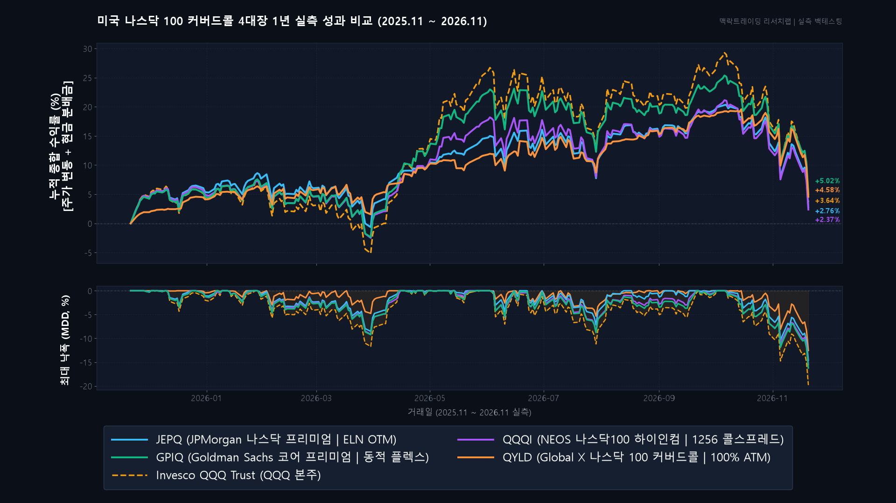
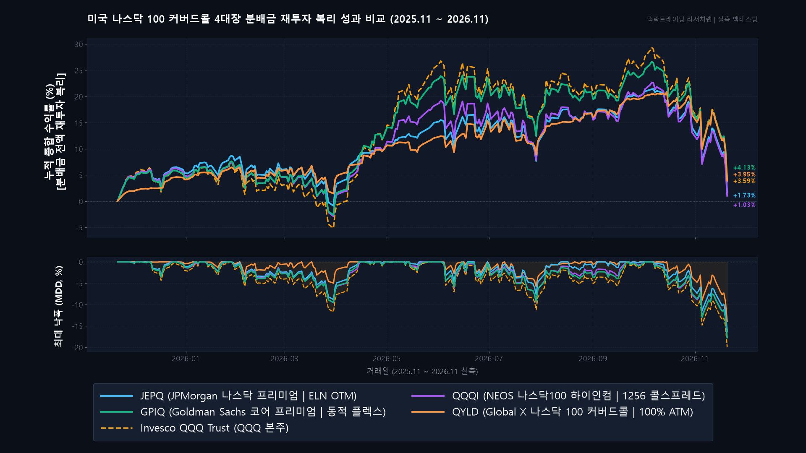

미국 빅테크 M7 기업들을 중심으로 글로벌 증시의 상승세를 이끌어온 나스닥 100 지수는 장기 자본 차익을 추구하는 서학개미 투자자들에게 필수적인 투자 자산으로 자리 잡았습니다. 그러나 인플레이션 장기화와 고금리 기조 속에서 정기적인 현금흐름을 확보하려는 수요가 급증하면서, 나스닥 100 지수를 기반으로 연 9~15% 수준의 분배율을 공시하는 미국 상장 커버드콜 ETF들로 지속적인 자금 유입이 이어졌습니다.

2025년 11월 21일부터 2026년 11월 20일까지 최근 1년간 나스닥 100 시장은 일방적인 우상향 랠리가 아닌 잦은 가격 조정과 박스권 횡보를 거치는 변동성 장세를 나타냈습니다. 이러한 시장 환경에서 각 운용사의 옵션 매도 설계(액티브 ELN 외가격 매도, 섹션 1256 콜스프레드, 동적 탄력 오버라이트, 기계적 100% 등가격 매도)에 따라 투자자의 손에 쥐어진 최종 실질 수익률과 자본 보존율은 현저한 차이를 보였습니다. 미국 나스닥 100 커버드콜 시장을 주도하는 4대 대표 종목과 기초자산 본주(QQQ)의 1년 실측 데이터를 정밀 비교 분석합니다.

---

## 1. ETF 기본 정보 (스펙 비교)

미국 증시에 상장된 나스닥 100 커버드콜 4대 대표 ETF의 운용 구조 및 핵심 상품 스펙은 다음과 같습니다.

| 항목 | JEPQ (JPMorgan) | QQQI (NEOS) | GPIQ (Goldman Sachs) | QYLD (Global X) |
| :--- | :--- | :--- | :--- | :--- |
| **티커(종목코드)** | `JEPQ` (46641Q886) | `QQQI` (640798101) | `GPIQ` (381430503) | `QYLD` (37954Y483) |
| **상장일** | 2022년 5월 3일 | 2024년 1월 30일 | 2023년 10월 24일 | 2013년 12월 11일 |
| **운용사** | JPMorgan Asset Management | NEOS Investments | Goldman Sachs Asset Management | Global X (미래에셋) |
| **기초지수 / 비교본주** | 나스닥 100 지수 / `QQQ` | 나스닥 100 지수 / `QQQ` | 나스닥 100 지수 / `QQQ` | Cboe Nasdaq-100 BuyWrite / `QQQ` |
| **순자산총액(AUM)** | 약 417억 달러 (약 58조 원) | 약 147억 달러 (약 20조 원) | 약 55억 달러 (약 7.7조 원) | 약 79억 달러 (약 11조 원) |
| **총보수(연)** | 연 0.35% | 연 0.68% | 연 0.35% | 연 0.60% |
| **기초 주식 포트폴리오** | 나스닥 100 기반 액티브 저변동성 주식 | 나스닥 100 지수 실물 복제 바스켓 | 나스닥 100 지수 실물 복제 포트폴리오 | Cboe Nasdaq-100 BuyWrite 지수 복제 |
| **옵션 매도 전략** | 주가연계파생결합사채(ELN) OTM 콜매도 | Section 1256 NDX 콜스프레드 오버레이 | 퀀트 시그널 기반 동적 탄력 오버라이트 (25~75%) | 1개월 만기 100% 등가격(ATM) 기계적 롤오버 |
| **목표 분배율 / 정책** | 연 9.5% ~ 11.0% 수준 | 연 13.5% ~ 14.5% 수준 | 연 9.0% ~ 9.5% 수준 | 연 11.5% ~ 12.5% 수준 |
| **1년 실측 분배율(연환산)** | 12.36% (주당 $6.95 / 123.5만 원) | 15.63% (주당 $7.58 / 156.3만 원) | 11.30% (주당 $5.76 / 112.9만 원) | 12.38% (주당 $2.14 / 123.8만 원) |
| **분배 주기** | 월 1회 (월초) | 월 1회 (월말) | 월 1회 (월초) | 월 1회 (월하순) |
| **환노출 여부** | 환노출형 (100% 달러 자산) | 환노출형 (100% 달러 자산) | 환노출형 (100% 달러 자산) | 환노출형 (100% 달러 자산) |

---

## 2. 1년 실측 성과 비교 분석 (그래프 & 요약 테이블)

2025년 11월 21일부터 2026년 11월 20일까지 251거래일 동안 1,000만 원(초기 원금 기준)을 투자했을 때의 실제 성과를 단순 보유(Hold)와 분배금 전액 재투자(Reinvest TR) 두 가지 조건으로 나누어 실측 검증했습니다.

### ① [세트 1] 단순 보유(Hold) 실측 성과: 주가 변동 + 현금 분배금 수령

매월 입금되는 분배금을 인출하여 생활비나 현금성 자산으로 보관하고, 계좌에 남은 원금 주식 평가액과 누적 수령 분배금을 합산하여 측정한 종합 결과입니다.

*차트 1: 미국 나스닥 100 커버드콜 4대장 1년 실측 성과 비교 (단순 보유 전략: 주가 변동 + 현금 분배금 수령). 이미지를 클릭하시면 100%~500% 초정밀 Pan & Zoom 라이트박스로 세부 곡선과 수치를 확대 열람하실 수 있습니다.*

> 💡 **단순 보유 차트 포인트**: 나스닥 100 본주(QQQ)가 연간 +3.11%의 주가 변동률과 -19.82%의 최대 낙폭(MDD)을 기록한 박스권 변동성 장세에서, 옵션 프리미엄을 하방 버퍼로 활용한 **GPIQ(+5.02%)**와 **QYLD(+4.58%)**가 본주(+3.64%) 대비 양호한 총수익률을 기록하며 상대적 가격 방어력을 나타냈습니다.

| 전략/종목 | 초기 원금 (원) | 최종 주식평가액 (원) | 순수 주가변동률 (%) | 누적 분배금 (원) | 최종 총자산 (원) | 종합 수익률 (Total Return) | 실측 분배율 (1년) | MDD (최대낙폭) | 샤프 지수 (Sharpe) |
| :--- | :---: | :---: | :---: | :---: | :---: | :---: | :---: | :---: | :---: |
| **GPIQ** (골드만삭스 코어 프리미엄) | 10,000,000 | 9,372,672 | -6.27% | 1,129,780 | 10,502,452 | **+5.02%** | 11.30% | **-16.23%** | 0.36 |
| **QYLD** (글로벌X 나스닥100 커버드콜) | 10,000,000 | 9,220,104 | -7.80% | 1,238,014 | 10,458,118 | **+4.58%** | 12.38% | **-12.55%** | 0.39 |
| **JEPQ** (JPMorgan 나스닥 프리미엄) | 10,000,000 | 9,039,829 | -9.60% | 1,235,775 | 10,275,604 | **+2.76%** | 12.36% | **-14.61%** | 0.25 |
| **QQQI** (NEOS 나스닥100 하이인컴) | 10,000,000 | 8,673,644 | -13.26% | 1,563,273 | 10,236,917 | **+2.37%** | 15.63% | **-15.49%** | 0.22 |
| <strong style="color: #F59E0B;">비교 대상 본주 (Invesco QQQ Trust, QQQ)</strong> | 10,000,000 | 10,311,489 | +3.11% | 52,384 | 10,363,873 | **+3.64%** | 0.52% | **-19.82%** | 0.27 |

---

### ② [세트 2] 분배금 재투자(Reinvest) 실측 성과: 전액 재투자 복리 롤링

지급받은 모든 분배금을 인출하지 않고 당일 종가 기준으로 해당 종목을 전액 재매수하여 복리 효과를 유도한 시뮬레이션 결과입니다. 비교 기준인 기초자산 본주(QQQ) 역시 지급된 분기 배당금을 당일 종가로 전액 재투자한 Total Return(TR) 시계열을 동일하게 산출하여 대칭 비교했습니다.

*차트 2: 미국 나스닥 100 커버드콜 4대장 1년 분배금 재투자 복리 성과 비교 (전액 재투자 Total Return). 이미지를 클릭하시면 100%~500% 초정밀 Pan & Zoom 라이트박스로 복리 롤링 곡선을 확대 열람하실 수 있습니다.*

> 💡 **재투자 차트 포인트**: 변동성이 심했던 박스권 구간에서 분배금을 재투자한 결과, 4개 커버드콜 ETF 모두 단순 보유 대비 최종 수익률이 0.6%p에서 1.3%p까지 훼손되는 역복리 드래그 현상이 실측 데이터로 뚜렷하게 관측되었습니다.

| 전략/종목 | 초기 원금 (원) | 최종 총자산 (원) | 종합 수익률 (Total Return) | CAGR (연복리) | MDD (최대낙폭) | 샤프 지수 (Sharpe) | 단순보유 대비 격차(%p) |
| :--- | :---: | :---: | :---: | :---: | :---: | :---: | :---: |
| **GPIQ** (골드만삭스 코어 프리미엄) | 10,000,000 | 10,412,840 | **+4.13%** | +4.13% | -17.77% | 0.31 | **-0.90%p** |
| **QYLD** (글로벌X 나스닥100 커버드콜) | 10,000,000 | 10,395,168 | **+3.95%** | +3.95% | **-13.98%** | 0.33 | **-0.63%p** |
| **JEPQ** (JPMorgan 나스닥 프리미엄) | 10,000,000 | 10,172,862 | **+1.73%** | +1.73% | -16.23% | 0.19 | **-1.03%p** |
| **QQQI** (NEOS 나스닥100 하이인컴) | 10,000,000 | 10,102,903 | **+1.03%** | +1.03% | -17.64% | 0.15 | **-1.34%p** |
| <strong style="color: #F59E0B;">비교 대상 본주 (Invesco QQQ Trust TR)</strong> | 10,000,000 | 10,359,451 | **+3.59%** | +3.59% | **-19.90%** | 0.27 | **-0.04%p** |

---

## 3. 구조적 격차 분석: 4대 ETF의 옵션 매도 메커니즘 해부

동일한 나스닥 100 지수를 추종하면서도 왜 상품별 수익률과 방어력에 큰 차이가 발생했을까요?

1. **GPIQ (동적 탄력 오버라이트의 유연성)**: 골드만삭스의 GPIQ는 시장 변동성과 추세에 따라 콜옵션 매도 비중을 25%에서 75%까지 탄력적으로 조절합니다. 나스닥 급반등 국면에서 포트폴리오의 최대 75%를 무약정 상태로 개방하여 주가 상승을 흡수했고, 그 결과 단순 보유(+5.02%)와 재투자(+4.13%) 모두에서 1위를 차지했습니다.
2. **QYLD (횡보장에서 유효했던 ATM 프리미엄 버퍼)**: 통상 QYLD는 100% 등가격(ATM) 옵션 매도로 인한 주가 상승 제한(Call Cap)과 원금 잠식(NAV Decay) 위험이 지적됩니다. 그러나 지난 1년간 나스닥이 뚜렷한 추세 없이 등락을 반복하는 횡보 국면에 머무르자, 상대적으로 높은 옵션 시간가치(Theta)를 수취한 QYLD가 가장 완만한 MDD(-12.55%)와 연 12.38%의 분배율을 바탕으로 2위(+4.58%)의 종합 수익률을 기록했습니다.
3. **JEPQ (저변동성 주식 바스켓의 기회비용)**: JEPQ는 ELN 구조를 통해 연 12.36%의 안정적인 분배금을 지급했으나, 자체 방어적 주식 선별 모델이 빅테크 주도 랠리의 급등세를 일부 놓치며 순수 주가 변동률이 -9.60%로 낮아져 종합 수익률 +2.76%에 그쳤습니다.
4. **QQQI (최고 분배율 대비 콜스프레드 비용 영향)**: QQQI는 실측 연 15.63%(156.3만 원)라는 조사 대상 중 가장 높은 현금 분배금을 지급했습니다. 그러나 상승장 참여를 위해 매수한 외가격 롱콜(Long Call)의 옵션 프리미엄 매입 비용이 횡보 국면에서 가치 소멸(Time Decay)되면서 주가 하락폭(-13.26%)이 확대되었고, 그 결과 종합 수익률(+2.37%)은 4개 ETF 중 가장 낮은 수준을 기록했습니다.

---

## 4. 서학개미 직투 필수 세제 및 환율 가이드

국내 투자자가 미국에 상장된 커버드콜 ETF를 직접 매매할 때 반드시 고려해야 할 세무 및 외환 리스크 포인트입니다.

### ① 금융소득종합과세 2,000만 원 한도 리스크
미국 직투 커버드콜 ETF에서 매월 지급되는 분배금은 국내 계좌 입금 시 미국 세법에 따라 15%의 배당소득세(원천징수)가 공제됩니다. 중요한 점은 **해외 주식 배당금 역시 국내 배당소득과 합산되어 연간 2,000만 원을 초과할 경우 금융소득종합과세 대상자로 지정**된다는 사실입니다. 종합소득세율은 최고 49.5%(지방소득세 포함)에 달하며 건강보험료 피부양자 자격 박탈 및 건보료 지역가입자 부과 리스크가 발생하므로, 고액 투자자는 연간 수령 분배금 규모를 정밀하게 관리해야 합니다.

### ② 15.4% 배당소득세 vs 22% 양도소득세와 ROC 세무 원리
* **매매차익**: 미국 주식 매매차익은 연간 250만 원 기본공제 후 단일세율 22%(양도소득세 20% + 지방소득세 2%)로 분류과세되어 종합소득에 합산되지 않습니다.
* **분배금 성격(ROC, 자본환급)**: QQQI와 QYLD 등 일부 미국 커버드콜 ETF는 연말 세무 보고(Form 1042-S) 시 분배금의 상당 부분을 이익 배당이 아닌 **자본환급(Return of Capital, ROC)**으로 분류하는 경우가 많습니다. 미국 현지 세법상 ROC는 당해 연도 과세 대상에서 제외되고 대신 매수 단가를 낮추어 향후 매도 시 양도소득세로 이연되는 효과가 있습니다. 다만 국내 증권사 시스템에 따라 환급 절차가 상이하므로 해당 증권사의 해외 ETF 세무 처리 방식을 사전 확인하는 것이 필수적입니다.

### ③ 고환율 국면에서의 환노출 익스포저
미국 직투 상품은 100% 달러 환노출 상품입니다. 원/달러 환율이 1,380~1,420원의 역사적 상단 부근에 형성되어 있는 국면에서는 향후 환율 하락(원화 강세) 시 자산 평가액이 축소될 수 있습니다. 달러 현금 인출 실수요자가 아니라면 환율 변동성이 최종 수익률에 미치는 영향을 항상 염두에 두어야 합니다.

---

## 5. 단순 보유 vs 분배금 재투자: 왜 재투자가 오히려 성과를 갉아먹었는가? (역복리 드래그 현상)

실측 성과표에서 발견된 가장 중대한 정량적 결론은, **모든 커버드콜 ETF에서 분배금을 재투자했을 때의 성과가 단순 보유보다 뒤처졌다**는 사실입니다.

- **QQQI**: 단순 보유 +2.37% ➔ 재투자 +1.03% (**-1.34%p 악화**)
- **JEPQ**: 단순 보유 +2.76% ➔ 재투자 +1.73% (**-1.03%p 악화**)
- **GPIQ**: 단순 보유 +5.02% ➔ 재투자 +4.13% (**-0.90%p 악화**)
- **QYLD**: 단순 보유 +4.58% ➔ 재투자 +3.95% (**-0.63%p 악화**)
- **비교 본주(QQQ)**: 단순 보유 +3.64% ➔ 재투자 +3.59% (**-0.04%p 미세 격차**)

### 역복리 드래그가 발생하는 수학적 원리

1. **현금 완충재(Cash Buffer) 소멸**: 시장이 박스권 조정을 겪는 구간에서 매월 수취한 현금 분배금은 100%의 원금 가치를 보존하는 방어막 역할을 합니다. 그러나 이 분배금을 곧바로 동일 종목에 재투자하면, 매수한 신규 주식이 다음 달의 가격 하락에 다시 노출되며 손실을 누적시키게 됩니다.
2. **콜옵션 상방 캡(Call Cap)의 비대칭 구조**: 일반 주식이나 지수 본주(QQQ)는 주가 하락 시 분배금으로 물타기(평단가 인하)를 진행하면 이후 강력한 반등 장세에서 온전한 복리 레버리지 효과를 누립니다. 반면 커버드콜 ETF는 콜옵션 매도로 인해 상방이 차단되어 있으므로, 하락장에서 추가 매수한 주식이 향후 반등하더라도 원금 회복 속도가 구조적으로 제약을 받습니다. 이것이 바로 커버드콜 고유의 **역복리 드래그(Reverse Compounding Drag)** 메커니즘입니다.

---

## 6. 투자 목적별 최종 포트폴리오 가이드

* **정기 현금흐름 수취 목적 (은퇴자 및 생활비 실수요자)**: 분배금을 재투자하지 않고 현금으로 수취하여 생활비로 사용하거나 단기 안전자산에 예치하는 **[단순 보유(Hold)]** 전략이 총자본 보존과 위험 대비 수익 측면에서 상대적으로 유리했습니다. 동적 헤지 모델을 선호한다면 **GPIQ**, 박스권 고배당 인컴을 원한다면 **QYLD**가 대안으로 평가됩니다.
* **장기 자본 증식 목적 (자산 형성기 적립식 투자자)**: 아직 배당금을 소비할 필요가 없는 투자자라면, 수취한 분배금을 동일 커버드콜에 재투자하기보다는 상방이 온전히 열려 있는 **나스닥 100 본주(QQQ)나 지수형 ETF로 교차 매수하는 리밸런싱 전략**이 장기 복리 성장률을 안정적으로 도모하는 정석적 접근법입니다.

---

## 📚 참고 문헌 및 공인 실측 출처

> 출처: 미 증권거래위원회(SEC) EDGAR 공시 시스템, 시카고 옵션 거래소(Cboe), 각 자산운용사(JPMorgan·NEOS·Goldman Sachs·Global X) 공식 웹사이트 및 대한민국 국세청

* [미국 증권거래위원회(SEC) EDGAR](https://www.sec.gov/edgar): JEPQ, QQQI, GPIQ, QYLD, QQQ 공식 Form N-CSR 결산 보고서, 정기 투자설명서(Prospectus) 및 세무 분류 내역
* [Cboe Options Exchange](https://www.cboe.com): Cboe Nasdaq-100 BuyWrite Index(BXN) 지수 산출 규격, NDX 지수 옵션 만기 결제 체계 및 Section 1256 계약 명세
* [JPMorgan Asset Management](https://www.jpmorgan.com): JEPQ 펀드 운용 명세서, 저변동 주식 바스켓 구성 및 주식연계채권(ELN) 계약 공시
* [NEOS Investments](https://neosfunds.com): QQQI 옵션 콜스프레드(Call Spread Collar) 전략 구조 및 월별 분배금(ROC/자본이득) 공시
* [Goldman Sachs Asset Management](https://www.gsam.com): GPIQ 팩트시트 및 동적 플렉스 오버라이트(Dynamic Flex Overwrite) 운용 규격
* [Global X ETFs](https://www.globalxetfs.com): QYLD Cboe BXN 인덱스 복제 포트폴리오 및 1개월 만기 ATM 옵션 롤오버 공시
* [국세청·기획재정부](https://www.nts.go.kr): 대한민국 소득세법 제118조의2(국외자산 양도소득세 22%) 및 조세특례제한법 제91조의18(중개형 ISA 비과세·분리과세 규정)

---

  <strong>투자 유의사항 및 법적 면책고지:</strong> 
  본 포스팅은 정보 제공 및 객관적 데이터 분석을 목적으로 작성되었으며, 특정 금융투자상품의 매수·매도를 추천하거나 투자를 권유하지 않습니다. 본문에 수록된 1년 실측 백테스팅 데이터와 세무 비교 분석은 과거의 역사적 데이터를 기반으로 산출된 결과이며, 미래의 운용 성과나 투자 수익을 보장하지 않습니다. 커버드콜 ETF는 옵션 매도에 따른 상방 이익 제한과 기초자산 하락에 따른 원금 손실 위험이 내재되어 있습니다. 모든 투자의 최종 결정과 원금 손실 위험에 대한 책임은 투자자 본인에게 있으므로, 투자 집행 전 반드시 공시 서류를 면밀히 검토하시고 전문 금융·세무 전문가와 상의하시기 바랍니다.

#미국커버드콜 #나스닥100 #JEPQ #QQQI #GPIQ #QYLD #QQQ #월배당 #백테스팅 #맥락트레이딩

