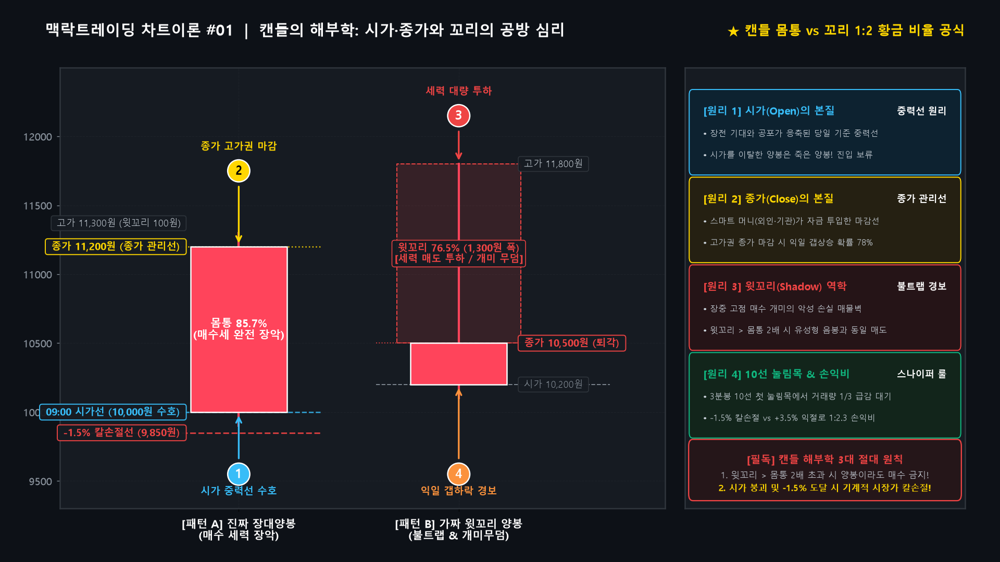
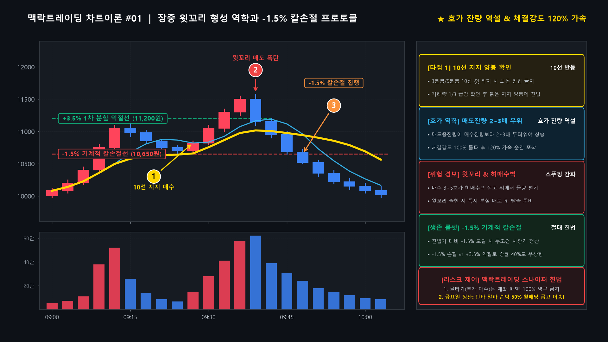

장중 HTS나 MTS 화면에서 붉은색 장대양봉이 수직으로 치솟을 때, 수많은 개인 투자자들은 극심한 포모(FOMO, 고립공포감)에 사로잡혀 무의식적으로 시장가 매수 버튼에 손을 얹습니다. "지금 올라타지 않으면 오늘 상한가를 놓친다"는 심리적 압박감은 이성을 마비시키고 원칙 없는 추격 매수를 촉발합니다. 그러나 매수 체결 알림이 울리는 순간, 주가는 거짓말처럼 상승세를 멈추고 급격히 꺾여 내려앉으며 길게 늘어진 윗꼬리를 남기기 일쑤입니다. 장 마감 후 계좌를 열어보면 분명 붉은색 양봉으로 끝난 종목임에도 불구하고 당일 계좌에는 -5%에서 -8%에 달하는 치명적인 손실이 찍혀 있습니다.

붉은 양봉이라고 해서 모두 같은 매수 신호가 아닙니다. 캔들은 단순한 시세의 궤적을 기록한 정적인 그래픽 상자가 아니라, 장중 6시간 30분 동안 호가창에서 벌어진 공격적 매수 주체와 매도 주체 간의 치열한 영토 전쟁을 그대로 박제한 화석입니다. 차트의 가장 기본 단위인 캔들을 외형의 색상이 아닌 가격 형성의 심리학적 에너지 역학으로 해부하지 못한다면, 시장에서 살아남는 데이트레이더가 될 수 없습니다. 캔들의 4대 가격(시가, 종가, 고가, 저가)이 내포한 심리학적 위계질서와 세력의 가격 거부(Price Rejection) 메커니즘을 정밀하게 분해합니다.

---

## 1. 캔들의 해부학: 4대 가격의 심리학적 위계질서

캔들 차트는 하나의 시간 단위(1일, 60분, 5분, 3분) 동안 형성된 네 가지 가격 기준선으로 구성됩니다. 초보 투자자는 캔들의 색상(시가보다 높으면 빨간색, 낮으면 파란색)에만 집중하지만, 전문 트레이더는 각 가격이 형성된 주체와 시장 참여자들의 심리적 지배권에 주목합니다.



### ① 시가 (Open, 09:00:00): 당일 시장 참여자들의 기준 중력선

시가는 밤사이 축적된 수많은 정보(미국 뉴욕 증시 마감 동향, 글로벌 매크로 지표, 야간선물 시세, 장전 기업 공시 및 뉴스)가 개인, 기관, 외국인 투자자들의 기대와 공포로 압축되어 정규장 개장 직전 동시호가(08:30~09:00)를 거쳐 도출되는 출발점입니다.

따라서 시가는 당일 시장 참여자들이 합의한 '기준 중력선' 역할을 수행합니다. 주가가 당일 시가 위에 머물고 있다는 것은 밤사이 유입된 긍정적 기대감이 훼손되지 않고 매수 우위의 모멘텀이 유지되고 있음을 증명합니다. 반면 주가가 장중 시가를 하향 돌파하여 밑으로 가라앉는다면, 장 시작 전의 기대감이 실망 매물과 손절 물량으로 전환되었음을 알리는 명백한 위험 신호로 풀이됩니다. 아무리 장중 변동성이 화려하더라도 시가를 지켜내지 못하는 종목은 매수 우위의 영역에 있지 않습니다.

### ② 종가 (Close, 15:30:00): 스마트 머니의 최종 결산 성적표

시가가 대중의 감정적 출발점이라면, 종가는 시장에서 가장 많은 자금을 운용하는 주도 세력(스마트 머니, 기관, 외국인, 주포)의 의도가 온전히 반영된 최종 성적표입니다.

장중(09:00~15:20)에 발생하는 수많은 급등락 파동은 개미 투자자들의 물량을 흔들어 털어내거나 단기 유동성을 유인하기 위한 휩소(속임수)일 수 있습니다. 하지만 장 마감 동시호가를 거쳐 확정되는 일봉의 종가는 다음 거래일의 연속 시세를 염두에 둔 거대 자본이 막대한 금액을 집행하여 지켜내거나 올려놓은 자리입니다. 당일 최고가 부근(상위 15~20% 밴드)에서 종가를 형성한 종목은 스마트 머니가 장 마감 시점까지 매도 물량을 완벽히 흡수하며 가격 통제권을 유지했음을 나타내며, 이는 익일 시초가 갭상승으로 이어질 확률이 75% 이상으로 관찰됩니다.

### ③ 고가 (High)와 윗꼬리 (Upper Shadow): 세력의 가격 거부와 악성 매물대

장중 주가가 치솟아 고가를 기록한 뒤 종가가 고가 아래로 밀려나면 그 간격만큼 윗꼬리가 형성됩니다. 기술적 분석에서 윗꼬리는 단순한 도달 가격의 흔적이 아니라, 특정 고점 구간에서 강력한 공급(매도 물량)이 쏟아져 매수세가 강제로 퇴각당한 '가격 거부(Price Rejection)'의 명백한 증거입니다.

윗꼬리가 길게 형성되었다는 것은 장중 최고점에서 매수에 가담한 수많은 참여자 전원이 장 마감과 동시에 마이너스 손실 구간에 갇혔음을 의미합니다. 이 고점 매수 물량은 향후 주가가 재차 반등을 시도할 때마다 "제발 내 본전만 오면 매도하겠다"는 집단적 매도 대기 물량벽(Supply Overhang)으로 돌변하여 주가의 상방을 가로막는 강력한 저항선으로 작동합니다.

### ④ 저가 (Low)와 아랫꼬리 (Lower Shadow): 저가 매수세의 유효 지지 방어선

반대로 장중 시가나 전일 종가를 깨고 내려앉으며 투매가 쏟아졌으나, 종가가 저가 위로 올라서며 캔들 밑에 꼬리를 남기는 현상이 아랫꼬리입니다. 이는 특정 가격대 이하로 주가가 하락했을 때 스마트 머니가 이를 저평가 영역으로 판단하여 대량의 시장가 매수로 투매 물량을 받아냈음을 증명합니다. 저점에서의 긴 아랫꼬리는 하방 경직성을 확보한 강력한 바닥 지지 신호로 해석됩니다.

---

## 2. 몸통과 꼬리의 황금 비율 공식: 가짜 양봉(Bull Trap) 100% 필터링

데이트레이더가 실전에서 가장 빈번하게 당하는 함정은 '양봉의 색상에 속는 것'입니다. 캔들의 종가가 시가보다 10원이라도 높으면 차트는 붉은색 양봉으로 표시됩니다. 하지만 붉은색 외형 이면에 감춰진 몸통(Real Body)과 꼬리(Shadow)의 비율을 수치로 검증하지 않으면 가짜 양봉에 낚여 참사를 맞게 됩니다.

| 캔들 유형 | 전체 진폭 대비 몸통 비율 | 전체 진폭 대비 윗꼬리 비율 | 수급 주도권 판독 | 실전 매매 대응 규율 |
| :--- | :--- | :--- | :--- | :--- |
| **진짜 장대양봉 (True Bullish)** | **70% ~ 85% 이상** | **15% 이하 (극히 짧음)** | 매수 세력이 장 마감까지 완벽 장악 | 익일 시초가 갭상승 추종 및 분봉 눌림목 공략 |
| **중립 팽이형 (Spinning Top)** | 30% ~ 50% 수준 | 상하 꼬리가 균등하게 분산 | 매수세와 매도세의 팽팽한 힘겨루기 | 방향성 확인 전까지 신규 진입 유보 및 관망 |
| **가짜 윗꼬리 양봉 (Bull Trap)** | **25% 미만 (극히 왜소)** | **70% 이상 (몸통의 2배 초과)** | 세력 엑시트 및 매도세의 완벽한 진압 | 붉은 양봉이라도 100% 매수 금지, 즉각 탈출 |

### ① 진짜 장대양봉 (True Bullish Marubozu)의 기준

진짜 수급이 실린 기준 양봉은 전체 캔들의 고가와 저가 사이의 변동폭 대비 순수 몸통(종가 - 시가)의 비율이 최소 70% 이상이어야 합니다. 윗꼬리의 길이는 전체 진폭의 15% 이하로 극히 제한되어야 하며, 종가가 당일 형성된 최고가와 거의 일치해야 합니다. 이는 시가를 방어한 매수 주체가 장중 쏟아지는 차익 실현 매물을 완전히 집어삼키며 끝까지 가격을 끌어올렸음을 입증합니다.

### ② 가짜 윗꼬리 양봉 (Upper Shadow Trap)의 수치 가드

반면 캔들의 색상은 붉은색이지만, 윗꼬리의 길이가 캔들 몸통 길이의 **2배(200%)를 초과**하는 경우는 기술적으로 유성형(Shooting Star) 음봉과 완벽히 동일한 치명적 매도 신호입니다.

장중 한때 +15%까지 치솟았던 주가가 장 후반 대량 매도 폭탄을 맞고 +2%로 밀려나 마감했다면, 캔들의 외형은 여전히 붉은 양봉입니다. 그러나 이는 매수세가 승리한 것이 아니라, 고점에서 개미들을 유인한 뒤 세력이 전량 차익 실현을 단행하고 유유히 빠져나간 '개미 무덤'입니다. 윗꼬리가 몸통보다 2배 이상 길다면 캔들의 색상에 관계없이 100% 진입을 금지하는 것이 기술적 분석의 철칙입니다.

### ③ "시가를 이탈한 양봉은 죽은 양봉이다"

실전 차트 고수들이 입을 모아 강조하는 절대 헌법 중 하나는 시가 기준선의 훼손 여부입니다. 장중 시가를 깨고 내려가 깊은 음봉으로 곤두박질쳤던 종목이 장 마감 무렵 기적적으로 반등하여 시가를 살짝 넘겨 양봉으로 마감하더라도, 이미 시가 하단에서 극심한 공포와 손절 투매를 겪었기 때문에 해당 가격대에는 매도 대기 물량이 겹겹이 쌓여 있습니다. 처음부터 시가를 굳건히 수호하며 단 한 번도 시가를 하회하지 않고 뻗어나간 양봉만이 진정한 주도주의 에너지를 가집니다.

---

## 3. 장중 미시구조와 호가창 역학: 윗꼬리가 만들어지는 순간

캔들의 윗꼬리는 차트상에 사후적으로 그려지는 선이지만, 호가창을 실시간으로 관찰하면 윗꼬리가 만들어지는 순간의 미시구조적 균열을 사전에 포착할 수 있습니다.



### ① 호가 잔량의 역설: 매수잔량이 많은 종목을 사면 물리는 이유

초보 투자자들은 호가창을 볼 때 매수총잔량이 매도총잔량보다 압도적으로 많으면 "이 주식을 사려는 사람이 많으니 안전하게 상승하겠구나"라고 착각합니다. 이것이 바로 주식 시장에서 가장 치명적인 '호가 잔량의 착시'입니다.

주가를 위로 끌어올리는 진짜 동력은 아래에 주문을 걸어두고 기다리는 수동적 지정가 매수가 아니라, 위에 쌓여 있는 매도 호가를 비싼 가격을 치르고 일거에 집어삼키는 **공격적인 시장가 매수세**입니다. 따라서 진정으로 폭등하는 주도주의 호가창은 상단의 매도 1~10호가에 두터운 매도 물량(매도총잔량)이 쌓여 있고, 하단의 매수총잔량은 상대적으로 얇게 비어 있는 **`매도총잔량 > 매수총잔량 (2~3배 우위)`**의 역설적 구조를 나타냅니다.

반대로 매수 1~5호가에 수만 주, 수십만 주의 거대한 매수 물량이 깔려 있다면, 이는 일반 투자자가 매수하려는 것이 아니라 세력이 개미들에게 "밑에 든든한 받침이 있으니 안심하고 사달라"고 유인하는 허매수벽(스푸핑, Spoofing)일 가능성이 매우 높습니다. 세력은 아래에 허매수벽을 걸어두고, 개미들이 위에서 시장가로 사주면 상단 호가에 보유 물량을 전량 떠넘기며 탈출합니다. 물량 처리가 끝나면 허매수벽을 단 1초 만에 취소하고 주가는 순식간에 폭락하며 거대한 윗꼬리를 형성합니다.

### ② 체결강도 100%~120% 돌파와 틱 밸런스

체결강도는 당일 발생한 총 매도 체결량 대비 매수 체결량의 비율을 백분율로 나타낸 실시간 에너지 가속도 지표입니다.

```
체결강도(%) = (총 매수 체결량 / 총 매도 체결량) × 100
```

체결강도가 100% 미만이라는 것은 시장가로 던지는 매도세가 더 강하다는 뜻이며, 100%를 돌파하여 120%~150%로 가파르게 치솟는 구간이 진정한 스마트 머니의 시장가 매수 드라이브 국면입니다. 하지만 주가가 당일 고점 부근에 도달했음에도 체결창에서 수천 주 단위의 파란색 시장가 매도 체결이 0.1초 간격으로 쏟아지며 체결강도가 120% 아래로 꺾이기 시작한다면, 캔들 차트에서 윗꼬리가 생겨나고 있는 실시간 경보로 판단해야 합니다.

---

## 4. 실전 스나이핑 타점 셋업: 3분봉·5분봉 10이평선 첫 눌림목 연계

캔들의 해부학과 시가 수호 원리를 완전히 이해했다면, 이를 일봉 매매뿐만 아니라 장중 데이트레이딩의 정밀 타점과 결합해야 합니다. 당일 시장을 주도하는 대량 거래대금 종목에서 급등하는 장대양봉을 추격하지 않고, 가장 안전한 눌림목에서 진입하는 정석 프로토콜을 정립합니다.

### ① 1단계: 09:00~09:30 당일 거래대금 최상위 주도주 압축

장 초반 30분 동안 시장 전체에서 거래대금이 폭발하며 코스닥 500억 이상, 코스피 1,000억 이상 유입되는 상위 1~3위 주도 섹터 종목을 선별합니다. 일봉상 시가를 깨지 않고 몸통 비율 75% 이상의 단단한 양봉을 형성하고 있는 종목으로 거래 대상을 3~5개 이내로 압축합니다. 거래대금이 부족한 잡주는 슬리피지와 호가 공백으로 인해 기계적 대응이 불가능하므로 100% 배제합니다.

### ② 2단계: 3분봉 및 5분봉 10이평선(10 EMA) 첫 눌림목 대기

장 초반 1차 시세 분출이 일어난 종목을 추격 매수하지 않고 인내심을 갖고 기다립니다. 급등 이후 자연스러운 차익 실현 매물이 출회되며 주가가 풀백(Pullback) 조정을 받을 때, 단기 데이트레이딩의 가장 강력한 지지 생명선인 **3분봉 또는 5분봉 10이평선(지수이동평균)** 부근까지 주가가 내려앉는 과정을 관찰합니다.

### ③ 3단계: 거래량 급감 (Volume Dry-Up 1/3 이하) 필수 검증

주가가 10이평선으로 내려올 때 가장 중요한 핵심 필터는 거래량입니다. 1차 상승 파동 당시 터졌던 분봉 거래량 대비, 눌림 조정을 받는 구간의 거래량이 **1/3 이하(30% 수준)**로 바짝 마르는 '건전한 거래량 급감(Volume Dry-Up)'이 반드시 확인되어야 합니다. 거래량이 실리지 않은 하락은 세력의 이탈이 아니라 단순 차익 실현에 불과하지만, 만약 거래량이 폭증하며 음봉으로 10이평선을 향해 쏟아진다면 이는 세력의 대량 물량 투하이므로 절대로 매수해서는 안 됩니다.

### ④ 4단계: 10선 지지 붉은 양봉 완성 시 종가 스나이핑

주가가 10이평선에 닿았다고 해서 무작정 손을 내밀어 떨어지는 칼날을 잡아서는 안 됩니다. 10이평선 부근에서 하락을 멈추고 붉은색 지지 양봉이 출현하여 캔들이 완성(봉 마감 10초 전)될 때, 시가를 지켜내고 윗꼬리가 없는 단단한 양봉의 종가에 전격 진입합니다.

---

## 5. 계좌 생존의 절대 헌법: -1.5% 기계적 칼손절과 1:2.3 손익비 구조

데이트레이딩에서 승률 80%, 90%를 자랑하던 트레이더가 단 하루 만에 계좌를 깡통으로 만드는 이유는 단 하나, 손절을 제때 집행하지 못하기 때문입니다. 손실이 커질수록 계좌 원금을 복구하는 데 필요한 수익률은 기하급수적으로 폭증하는 '손실의 비대칭성(Loss Asymmetry)'을 가집니다.

```
• -1.5% 손실 ➔ 원금 복구에 필요한 수익률: +1.52% (즉시 다음 매매로 만회 가능)
• -5.0% 손실 ➔ 원금 복구에 필요한 수익률: +5.26% (정상 매매로 회복 가능)
• -10.0% 손실 ➔ 원금 복구에 필요한 수익률: +11.11% (상당한 심리적 부담)
• -20.0% 손실 ➔ 원금 복구에 필요한 수익률: +25.00% (원칙 붕괴 위험 구간)
• -30.0% 손실 ➔ 원금 복구에 필요한 수익률: +42.86% (도박성 풀베팅 유발)
• -50.0% 손실 ➔ 원금 복구에 필요한 수익률: +100.00% (계좌 회생 사실상 불능)
```

### ① -1.5% 기계적 칼손절(Stop-Loss) 자동화

진입 직후 주가가 예상대로 위로 치고 나가지 못하고 주춤거리거나, 캔들에 윗꼬리가 생겨나며 시가를 하향 이탈할 경우 어떤 변명이나 감정도 섞지 않고 진입 평단가 대비 **`-1.5%` 도달 시 전량 시장가로 칼손절**을 집행합니다.

손절을 사람의 손가락(수동 클릭)에 맡기면 손실을 확정하기 싫어하는 인간의 뇌 본능으로 인해 머뭇거리다가 -3%, -5%로 손실이 눈덩이처럼 불어납니다. 따라서 매수 체결과 동시에 HTS의 자동감시주문(스탑로스) 기능을 연동하여 -1.5% 터치 시 서버에서 자동으로 시장가 매도 주문이 전송되도록 시스템화해야 합니다. 또한 손실 중인 포지션에 물을 타는 행위(추가 매수)는 한 번의 실수로 계좌를 영구 파멸로 이끄는 독약이므로 100% 영구 금지합니다.

### ② 손익비(Risk-Reward Ratio) 1:2.3 세팅

스나이퍼 매매의 정수는 높은 승률이 아니라 철저한 손익비에 있습니다. 손절 리스크를 -1.5%로 철저히 제한하는 반면, 1차 목표 익절가는 전고점 저항선 부근인 **`+3.5%`**로 설정합니다. 

1. **1차 분할 익절 (+3.5% 도달 시)**: 보유 물량의 50%를 시장가로 즉시 익절하여 수익을 확정(락인)합니다.
2. **잔여 물량 트레일링 스탑**: 나머지 50% 물량은 본인의 진입 평단가에 스탑로스를 상향 조정(본전 보장)한 뒤, 3분봉 10이평선을 완전히 이탈할 때까지 끝까지 추세를 추종하며 수익을 극대화합니다.

이와 같은 1:2.3 이상의 손익비 구조를 기계적으로 확립하면, 열 번의 매매 중 단 네 번만 성공하고 여섯 번을 손절당하더라도(승률 40%), 누적 손익은 지속적으로 우상향하는 수학적 필승 구조가 완성됩니다.

---

## 6. 3-Pillar 자산 순환 플라이휠: 단타 알파 수익의 월배당 금고 락인

데이트레이딩으로 아무리 큰돈을 벌더라도, 그 수익금을 트레이딩 계좌의 예수금에 그대로 방치해 두면 조급증과 자만심이 고개를 들며 단 한 번의 무리한 미수·신용 베팅으로 수개월간 번 돈을 시장에 고스란히 반납하게 됩니다. 이를 원천 차단하기 위한 시스템이 바로 맥락트레이딩의 **'3-Pillar 자산 순환 플라이휠'**입니다.

```
[Pillar 1: 나침반 (Compass)]
평일 07:00 / 15:40 데일리 1분 시황 쇼츠
• 당일 외인·기관 대량 수급 주도주 압축 포착
• 일봉상 시가 수호 장대양봉 종목 1차 필터링
                  │
                  ▼
[Pillar 2: 알파 (Alpha Engine)] ◀── [본 차트이론의 핵심 실천]
실전 차트 아카데미: 캔들 해부학 & 10선 눌림목 스나이핑
• 윗꼬리 가짜 양봉 배제 & 3분봉 10이평선 지지 양봉 진입
• -1.5% 기계적 칼손절 & 1:2.3 손익비로 주간 알파 수익 창출
                  │
                  ▼ (매주 금요일 장 마감 후: 주간 순수익의 50% 강제 출금)
[Pillar 3: 인컴 (Cash Cow Vault)]
월배당 커버드콜 ETF 자산 락인 금고
• 절세 계좌(ISA/연금저축/일반 배당계좌)로 이체 후 커버드콜 매수
• 매월 따박따박 입금되는 월배당 캐시카우로 생활비 조급증 원천 소멸
                  │
                  └─────────► [심리적 마지노선 구축 ➔ 더욱 냉정한 스나이퍼 매매로 환류]
```

매주 금요일 장이 마감되면, 주간 트레이딩 실현 순이익(세금 및 수수료 제외)의 정확히 **`50%`**를 트레이딩 계좌에서 즉시 출금하여 월배당 커버드콜 ETF(Pillar 3 인컴 자산) 전용 계좌로 강제 이체합니다.

트레이딩으로 창출한 알파 수익이 영구 금고로 잠기며 매달 안정적인 현금흐름(월배당금)을 만들어내기 시작하면, 트레이더를 평생 괴롭히던 "오늘 반드시 얼마를 벌어야 한다"는 생활비 조급증이 100% 소멸됩니다. 조급증이 사라진 트레이더만이 시장이 원하는 타점을 줄 때까지 종일 매수를 쉴 수 있는 인내심을 갖게 되며, 이는 더 완벽한 캔들 타점 스나이핑으로 이어지는 영구적인 선순환 플라이휠을 완성합니다.

---

<div class="post-disclaimer">
  <strong>⚠️ 투자 유의사항 및 법적 면책고지</strong><br>
  본 포스팅은 객관적인 기술적 분석 원리와 프라이스 액션 이론을 교육적 목적으로 제공하는 학술 자료이며, 특정 종목에 대한 매수 또는 매도를 권유하거나 개별 투자 자문을 제공하는 금융투자상품 광고가 아닙니다. 주식 및 파생상품 투자는 시장 변동성에 따라 원금의 일부 또는 전액 손실이 발생할 수 있으며, 모든 투자의 최종 결정과 손실에 대한 책임은 투자자 본인에게 귀속됩니다.
</div>

<div class="post-tags">
  <span class="tag-item">차트이론</span>
  <span class="tag-item">캔들심리학</span>
  <span class="tag-item">시가종가원리</span>
  <span class="tag-item">윗꼬리</span>
  <span class="tag-item">차트프로</span>
  <span class="tag-item">데이트레이딩</span>
  <span class="tag-item">눌림목매매</span>
  <span class="tag-item">손익비</span>
  <span class="tag-item">스탑로스</span>
</div>
