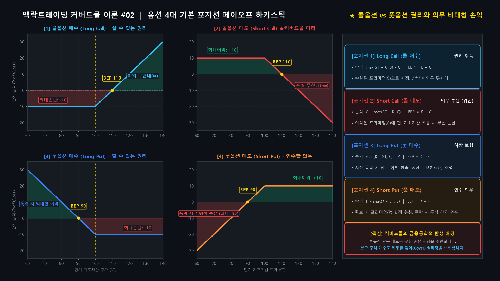
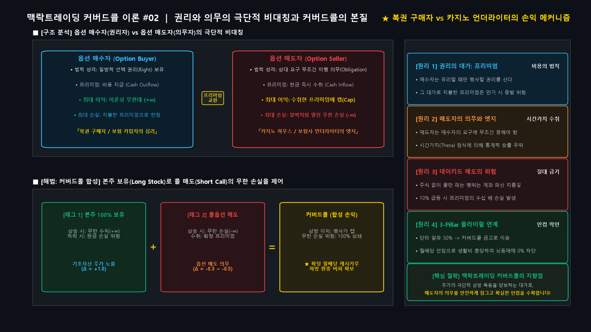

지난 1편에서 살펴본 선물(Futures) 계약의 핵심은 '쌍무적 의무(Bilateral Obligation)'에 있었습니다. 선물을 매수한 자는 만기에 기초자산 가격이 아무리 폭락하더라도 약정된 가격에 인수해야 하고, 선물을 매도한 자는 가격이 수직 상승하더라도 약정된 가격에 물건을 인도해야 합니다. 손익은 완벽한 1:1 대칭 선형(Linear) 구조이며, 단 한 푼의 오차도 없이 누군가의 이익은 상대방의 손실로 귀결되는 제로섬 게임이었습니다.

하지만 자본시장의 참여자들은 단순한 선형적 의무 이행에 만족하지 않았습니다. "가격이 나에게 유리하게 움직일 때만 권리를 행사하고, 불리하게 폭락하거나 폭등할 때는 계약을 깔끔하게 포기할 수 없을까?"라는 질문이 던져졌고, 이 질문에 대한 금융공학의 대답이 바로 **옵션(Options)**의 탄생이었습니다.

옵션은 일방에게는 '유리할 때만 행사할 수 있는 조건부 권리(Right)'를 부여하고, 상대방에게는 '대가(프리미엄)를 수취하는 대신 요구가 있을 때 무조건 응해야 하는 의무(Obligation)'를 부과합니다. 이로 인해 파생상품 역사상 가장 드라마틱한 **'비선형적 비대칭 손익(Non-linear Asymmetric Payoff)'**이 만들어집니다. 커버드콜(Covered Call) ETF의 매월 따박따박 꽂히는 분배금의 원천인 '콜옵션 매도'의 실체를 이해하기 위해, 옵션 4대 기본 포지션의 수학적 페이오프와 권리·의무의 비대칭 역학을 정밀하게 분해합니다.

---

## 1. 권리와 의무의 계약 구조: 선물의 구속에서 옵션의 자유로

옵션 계약의 본질은 미래의 특정 시점(만기일, Expiration Date $T$)에 미리 정해둔 가격(행사가격, Strike Price $K$)으로 기초자산(주식, 지수, 원자재 등)을 사거나 팔 수 있는 **'조건부 선택권'**을 사고파는 것입니다.

```
[파생상품 계약 구조의 근본적 진화]

1. 선물 (Futures) : [양방향 강제 의무]
   • 매수자: 유리하든 불리하든 무조건 인수해야 함 (의무)
   • 매도자: 유리하든 불리하든 무조건 인도해야 함 (의무)
   • 손익 구조: 대칭적 1:1 선형 직선 (Linear Slope = ±1.0)

2. 옵션 (Options) : [일방적 권리 vs 일방적 의무의 비대칭 교환]
   • 매수자 (Buyer) : 유리할 때만 행사하고 불리하면 포기 (조건부 권리)
   • 매도자 (Seller): 매수자가 행사하면 이유 불문 강제 응동 (무조건적 의무)
   • 손익 구조: 꺾이는 비선형 하키스틱 곡선 (Non-linear Kinked Payoff)
```

### ① 권리의 대가: 프리미엄(Premium)의 경제학

옵션 매수자가 "유리하면 행사하고, 불리하면 버린다"는 극단적인 자유를 누리기 위해서는 반드시 그에 상응하는 경제적 대가를 치러야 합니다. 세상에 공짜 권리는 존재하지 않기 때문입니다. 이 특권의 대가로 매수자가 계약 체결 시점에 매도자에게 현금으로 지불하는 비용이 바로 **옵션 프리미엄(Premium)**입니다.

일상생활의 부동산 분양권 시장을 떠올리면 직관적으로 이해할 수 있습니다. 10억 원에 분양되는 신축 아파트의 당첨권을 웃돈(프리미엄) 5,000만 원을 주고 매입한 매수자를 가정해 보겠습니다. 
* 2년 후 입주 시점에 주변 아파트 시세가 15억 원으로 폭등하면, 매수자는 약정된 10억 원에 잔금을 치르고 분양권을 행사하여 프리미엄 5,000만 원을 제외한 4억 5,000만 원의 순이익을 거머쥠니다.
* 반대로 부동산 경기가 극심하게 침체하여 아파트 시세가 8억 원으로 폭락한다면, 매수자는 10억 원에 살 이유가 없으므로 분양권을 포기(계약금 포기)하면 그만입니다. 이 경우 매수자의 손실은 처음에 치렀던 프리미엄 5,000만 원으로 완벽하게 한정됩니다.

이처럼 옵션 매수자는 **'이익은 열려 있고 손실은 지불한 프리미엄으로 닫혀 있는'** 비대칭적 지위를 획득합니다.

### ② 매도자의 의무: 시간가치와 리스크의 인수

그렇다면 반대편에 서 있는 옵션 매도자는 왜 이토록 불리해 보이는 계약을 체결할까요? 매도자는 매수자가 지불하는 프리미엄을 즉시 100% 현금으로 확정 수취합니다. 기초자산 가격이 행사 기준선을 넘지 못하고 횡보하거나 반대로 움직이면, 만기일에 옵션은 가치 없는 휴지조각으로 소멸하고 매도자는 아무런 일도 하지 않은 채 수취한 프리미엄을 순이익으로 확정합니다.

즉, 옵션 매도자는 **'화재보험사'**나 **'카지노 하우스'**와 동일한 포지션에 서게 됩니다. 평상시에는 가입자들로부터 꾸준히 보험료(프리미엄)를 거두어들여 통계적 엣지를 누리지만, 만에 하나 대형 화재(기초자산의 급격한 변동)가 발생하면 계약에 따라 막대한 보험금을 지급해야 하는 리스크를 온몸으로 떠안게 됩니다.

---

## 2. 옵션 4대 기본 포지션의 수학적 페이오프 함수

옵션 시장의 모든 복합 전략(커버드콜, 불콜스프레드, 아이언콘도르 등)은 오직 네 가지 원자적 기본 포지션의 조합으로 완성됩니다. 만기 시점 기초자산 가격을 $S_T$, 행사가격을 $K$, 수취 또는 지급한 프리미엄을 $C$(콜) 및 $P$(풋)라고 정의할 때, 각 포지션의 수학적 손익방정식은 다음과 같이 정밀하게 도출됩니다.



### ① 콜옵션 매수 (Long Call): 상방 돌파에 베팅하는 살 수 있는 권리

콜옵션(Call Option)은 약정된 행사가격 $K$에 기초자산을 '살 수 있는 권리'입니다.

$$\Pi_{\text{Long Call}}(S_T) = \max(S_T - K, 0) - C$$

* **구간별 손익 역학**:
  - $S_T \le K$ (외가격 및 등가격 구간): 기초자산 가격이 행사가격 이하에 머물면 시장에서 직접 사는 것이 유리하므로 권리를 포기합니다. 손익은 지급한 프리미엄 $-C$로 고정됩니다.
  - $S_T > K$ (내가격 구간): 권리를 행사하여 시장가보다 저렴한 $K$에 매수하므로 $(S_T - K)$의 내재가치가 발생하며, 순손익은 $(S_T - K - C)$가 됩니다.
* **손익분기점 (BEP, Break-Even Point)**:
  $$S_{\text{BEP}} = K + C$$
  주가가 단순히 행사가격 $K$를 넘는 것만으로는 부족하며, 사전에 지불했던 프리미엄 $C$까지 완전히 회수해야 비로소 순이익 구간으로 진입합니다.
* **리스크 프로파일**:
  - 최대 이익: 이론상 기초자산 상승에 따라 **무한대 ($+\infty$)**
  - 최대 손실: 진입 시 지불한 **프리미엄 ($-C$)으로 100% 한정**

### ② 콜옵션 매도 (Short Call): 커버드콜의 핵심 매도 다리(Leg)

콜옵션 매도는 상대방에게 약정된 가격 $K$에 기초자산을 '넘겨주어야 하는 의무'입니다.

$$\Pi_{\text{Short Call}}(S_T) = C - \max(S_T - K, 0) = \min(C, K - S_T + C)$$

* **구간별 손익 역학**:
  - $S_T \le K$: 매수자가 권리를 포기하므로, 사전에 수취한 프리미엄 $+C$ 전액이 매도자의 순수익으로 확정됩니다.
  - $S_T > K$: 매수자가 권리를 행사하므로 매도자는 시세가 아무리 폭등했더라도 $K$ 가격에 기초자산을 넘겨주어야 합니다. 손익은 $C - (S_T - K)$로 급격히 악화됩니다.
* **손익분기점 (BEP)**:
  $$S_{\text{BEP}} = K + C$$
* **리스크 프로파일**:
  - 최대 이익: 사전에 수취한 **프리미엄 ($+C$)으로 캡(Cap)**
  - 최대 손실: 주가가 수직 상승할수록 **무한대 ($-\infty$)로 절벽처럼 열림**

이 콜옵션 매도의 비대칭적 위험 곡선은 뒤에서 살펴볼 커버드콜 합성의 가장 결정적인 열쇠가 됩니다. 주식 없이 콜옵션만을 단독으로 매도하는 '네이키드 콜 매도(Naked Short Call)'는 주가 폭등 시 계좌를 한순간에 파산으로 몰고 가는 치명적 위험을 내포하고 있습니다.

### ③ 풋옵션 매수 (Long Put): 하방 붕괴에 대비하는 팔 수 있는 권리

풋옵션(Put Option)은 약정된 행사가격 $K$에 기초자산을 '팔 수 있는 권리'입니다. 투자자에게는 일종의 '주가 하락 화재보험' 역할을 수행합니다.

$$\Pi_{\text{Long Put}}(S_T) = \max(K - S_T, 0) - P$$

* **구간별 손익 역학**:
  - $S_T \ge K$: 주가가 행사가격 이상을 유지하면 시장에서 파는 것이 유리하므로 권리를 포기하며, 지불한 보험료 $-P$만 손실로 확정됩니다.
  - $S_T < K$: 시장 가격이 폭락하더라도 약정된 고가 $K$에 강제로 매도할 수 있으므로 $(K - S_T)$의 내재가치가 발생하며, 순손익은 $(K - S_T - P)$가 됩니다.
* **손익분기점 (BEP)**:
  $$S_{\text{BEP}} = K - P$$
* **리스크 프로파일**:
  - 최대 이익: 주가가 0원으로 파산할 때 달성되는 **$K - P$**
  - 최대 손실: 지불한 **프리미엄 ($-P$)으로 한정**

### ④ 풋옵션 매도 (Short Put): 주가 하락 시 인수해야 하는 의무

풋옵션 매도는 상대방이 주식을 팔겠다고 요구할 때 약정된 가격 $K$로 '반드시 인수해야 하는 의무'입니다.

$$\Pi_{\text{Short Put}}(S_T) = P - \max(K - S_T, 0) = \min(P, S_T - K + P)$$

* **구간별 손익 역학**:
  - $S_T \ge K$: 매수자가 권리를 행사하지 않으므로 수취한 프리미엄 $+P$가 확정 이익이 됩니다.
  - $S_T < K$: 매수자가 고가 $K$에 주식을 넘기므로, 매도자는 폭락한 주식을 비싼 값에 울며 겨자 먹기로 매입해야 합니다.
* **손익분기점 (BEP)**:
  $$S_{\text{BEP}} = K - P$$
* **리스크 프로파일**:
  - 최대 이익: 수취한 **프리미엄 ($+P$) 한정**
  - 최대 손실: 주가가 0원이 될 때 발생하는 **$-K + P$ (원금 전액에 준하는 손실)**

---

### [옵션 4대 기본 포지션 구조 비교 종합 매트릭스]

| 구분 | 포지션 | 계약상 법적 성격 | 프리미엄 현금흐름 | 최대 이익 | 최대 손실 | 손익분기점 (BEP) | 최적의 시장 레짐 |
| :--- | :--- | :--- | :--- | :--- | :--- | :--- | :--- |
| **콜옵션** | **Long Call (매수)** | 살 수 있는 **권리** | 지급 (Cash Out) | **무한대 (+∞)** | 프리미엄 ($-C$) 한정 | $K + C$ | 강력한 급등장 (모멘텀) |
| | **Short Call (매도)** | 넘겨줄 **의무** | **수취 (Cash In)** | **프리미엄 ($+C$) 캡** | **무한대 (-∞)** | $K + C$ | 횡보장 또는 완만한 하락장 |
| **풋옵션** | **Long Put (매수)** | 팔 수 있는 **권리** | 지급 (Cash Out) | 행사가 - $P$ ($K - P$) | 프리미엄 ($-P$) 한정 | $K - P$ | 강력한 폭락장 (블랙스완) |
| | **Short Put (매도)** | 인수할 **의무** | **수취 (Cash In)** | **프리미엄 ($+P$) 캡** | $-K + P$ (원금 전액) | $K - P$ | 횡보장 또는 완만한 상승장 |

---

## 3. 권리와 의무의 비대칭 역학과 통계적 엣지

옵션 4대 포지션의 손익 곡선을 면밀히 관찰하면, 매수자와 매도자 사이의 근본적인 심리학적·통계적 괴리가 드러납니다.



### ① 복권 구매자(매수자) vs 카지노 하우스(매도자)

옵션 매수자는 전형적인 **'복권 구매자'**의 심리를 가집니다. 지불하는 프리미엄은 소액이지만, 주가가 상방이나 하방으로 폭발적인 추세를 보일 경우 수백 퍼센트에서 수천 퍼센트에 달하는 비대칭적 레버리지 수익을 노립니다. 반면 손실은 이미 지불한 프리미엄에 묶여 있으므로 심리적으로 편안함을 느낍니다.

그러나 현실 통계 데이터는 냉혹합니다. 만기일까지 주가가 손익분기점($K+C$ 또는 $K-P$)을 강하게 돌파하지 못하면, 옵션의 가치는 매일매일 시간의 경과와 함께 녹아내립니다. 실제로 미국 CBOE(시카고옵션거래소)의 장기 통계에 따르면 만기 시점에 외가격(OTM)으로 가치 없이 만료되는 옵션의 비율은 전체 발행량의 **`70% ~ 80%`**에 육박하는 것으로 관찰됩니다.

반대로 옵션 매도자는 **'카지노 하우스'**나 **'보험사 언더라이터'**의 엣지를 누립니다. 매도자는 한 번에 큰돈을 벌 수는 없으며 이익은 수취한 프리미엄으로 엄격하게 제한됩니다. 하지만 매일 시장이 잠잠하게 흘러가는 것만으로도 시간가치(세타, Theta)의 감가상각을 프리미엄 인컴으로 수확할 수 있습니다. 

### ② 세타(Theta)의 일방적 흐름: 매도자의 편에 선 시간의 중력

옵션 가격은 **내재가치(Intrinsic Value)**와 **시간가치(Time Value)**의 합으로 구성됩니다.
$$\text{Option Price} = \text{Intrinsic Value} + \text{Time Value}$$

만기일이 다가올수록 옵션 매수자가 역전 홈런을 칠 수 있는 기회는 비선형적으로 줄어들며, 시간가치는 0을 향해 가속 페달을 밟고 소멸합니다. 이 시간가치 소멸분은 허공으로 사라지는 것이 아니라 계약 당시 프리미엄을 미리 주머니에 챙겨 넣은 옵션 매도자의 확정 마진으로 고스란히 전환됩니다. 

기관 투자자들과 퀀트 펀드들이 단순 옵션 매수 대신 옵션 매도 기반의 체계적 인컴 전략에 집중하는 이유가 바로 여기에 있습니다.

---

## 4. 커버드콜(Covered Call)의 탄생: Short Call의 '무한 손실'을 어떻게 제어할 것인가?

옵션 매도가 통계적으로 높은 승률과 시간가치 수취라는 압도적인 장점을 지니고 있음에도 불구하고, 개인 투자자가 단독으로 콜옵션 매도(Short Call)를 실행할 수 없는 이유는 단 하나, 바로 **'상방 무한 손실의 공포'** 때문입니다.

만약 기초자산이 예상치 못한 메가 호재로 인해 하루 만에 30% 폭등한다면, 콜옵션 매도자는 자신이 가지고 있지도 않은 주식을 폭등한 시장가로 비싸게 매수하여 매수자에게 헐값인 행사가격 $K$에 넘겨주어야 합니다. 이 과정에서 발생하는 손실액은 사전에 받았던 프리미엄의 수십 배, 수백 배를 초과하여 계좌를 단숨에 깡통으로 만들 수 있습니다.

### ① 금융공학의 마법: 본주 주식으로 의무를 덮다(Cover)

이 치명적인 무한 손실을 완벽하게 제어하기 위해 고안된 합성 포지션이 바로 **커버드콜(Covered Call)**입니다. 해법은 의외로 단순하고 직관적입니다. **콜옵션을 매도하기 전에, 넘겨주어야 할 본주 주식(Long Stock)을 미리 계좌에 100% 매수해 두는 것**입니다.

$$\Pi_{\text{Covered Call}}(S_T) = \underbrace{(S_T - S_0)}_{\text{본주 매수 (Long Stock)}} + \underbrace{[C - \max(S_T - K, 0)]}_{\text{콜옵션 매도 (Short Call)}}$$

* **주가가 폭등할 경우 ($S_T \gg K$)**:
  - 콜옵션 매도 포지션에서는 $C - (S_T - K)$라는 거대한 손실이 발생합니다.
  - 하지만 동시에 내가 보유하고 있던 본주 주식에서 $(S_T - S_0)$라는 동일한 크기의 주가 상승 이익이 발생합니다.
  - 두 포지션이 결합되면 $S_T$ 항이 서로 완벽하게 상쇄(Offset)되면서, 최종 순손익은 **$(K - S_0 + C)$**라는 확정된 최대 이익으로 안전하게 고정(Cap)됩니다.
  - 즉, 주식을 시장에서 새로 비싸게 사 올 필요 없이, 이미 금고에 들고 있던 본주 주식을 매수자에게 넘겨주면 그만이므로 무한 손실의 위험이 **`0%`**로 소멸합니다.

* **주가가 횡보할 경우 ($S_T \approx S_0$)**:
  - 본주 주가 변동은 거의 없지만, 콜옵션 매도로 수취한 프리미엄 $+C$가 고스란히 추가 알파 수익(배당 분배금)으로 누적됩니다.

* **주가가 하락할 경우 ($S_T < S_0$)**:
  - 본주 주가 하락에 따른 원금 손실을 피할 수는 없지만, 사전에 수취한 프리미엄 $+C$만큼 손실 폭이 완충(Buffer)되어 손익분기점이 $(S_0 - C)$로 낮아집니다.

### ② 등가 교환의 법칙: 무엇을 포기하고 무엇을 얻었는가?

커버드콜은 결코 마법의 공짜 수익이 아닙니다. 금융공학에서 모든 초과 이익은 반드시 무언가를 희생한 대가로 주어집니다.

커버드콜 투자자는 기초자산이 역사적 폭등 랠리를 펼칠 때 누릴 수 있는 **'상방 무한 수익권'을 과감하게 시장에 양보(포기)'**하는 대신, 매도자의 의무를 안전하게 잠그고 **'매월 통장에 입금되는 확정 프리미엄 현금흐름(월배당)'**을 교환한 것입니다.

이 원리를 정확히 이해하지 못하고 커버드콜 ETF를 매수하면, 강세장에서 나스닥 지수가 30% 폭등할 때 내 계좌는 8% 배당만 받고 주가는 제자리걸음을 걷는 모습에 극심한 박탈감과 회의감을 느끼게 됩니다. 커버드콜의 본질은 주가 상승 추종이 아니라 **'변동성을 현금흐름으로 치환하는 방어적 인컴 엔진'**임을 잊지 말아야 합니다.

---

## 5. 3-Pillar 자산 순환 플라이휠: 단타 알파의 월배당 금고 락인

맥락트레이딩 생태계에서 커버드콜 이론은 단순한 금융 지식이 아닙니다. 데이트레이더와 스윙 트레이더가 시장에서 살아남기 위해 반드시 가동해야 하는 **'3-Pillar 자산 순환 플라이휠'**의 핵심 수납 금고입니다.

```
[맥락트레이딩 3-Pillar 자산 순환 플라이휠 구조]

[Pillar 1: 나침반 (Compass)]
평일 07:00 / 15:40 데일리 1분 시황 쇼츠
• 글로벌 매크로 & 코스피/코스닥 외인·기관 대량 수급 포착
• 당일 변동성 레짐 감지 및 주도 섹터 압축
                  │
                  ▼
[Pillar 2: 알파 (Alpha Engine)]
화요 실전 차트 아카데미: 캔들 해부학 & 10선 눌림목 스나이핑
• -1.5% 기계적 칼손절과 1:2.3 손익비로 주간 알파 수익 창출
• 호가창 체결강도와 분봉 눌림목 타점으로 초과 수익 확보
                  │
                  ▼ (매주 금요일 장 마감 후: 주간 순실현이익의 50% 강제 출금)
[Pillar 3: 인컴 (Cash Cow Vault)] ◀── [본 커버드콜 마스터 아카데미]
토요 월배당 커버드콜 ETF 자산 락인 금고
• 콜옵션 매도의 의무를 본주로 방어하는 타깃 커버드콜 ETF 매수
• 절세 계좌(ISA/연금저축/IRP)를 통한 과세이연 및 비과세 복리 극대화
• 매월 꼬박꼬박 입금되는 캐시카우로 고정 생활비 100% 충당
                  │
                  └─────────► [생활비 조급증 0% ➔ 더욱 냉혹한 차트 스나이퍼 매매로 환류]
```

### ① 금요일 50% 강제 이송 규율 (Friday 50% Transfer Rule)

트레이더가 계좌를 파산시키는 가장 치명적인 원인은 기법의 부재가 아니라 '생활비 조급증'과 '수익금 재반납의 덫'입니다. 단타로 주중에 300만 원의 수익을 올렸더라도, 그 돈을 트레이딩 예수금에 그대로 방치해 두면 금요일 오후 뇌동매매 한 번으로 전액을 시장에 반납하고 맙니다.

맥락트레이딩은 매주 금요일 장 마감 직후, 당일 확정된 주간 순실현이익 중 정확히 **`50%`**를 트레이딩 계좌에서 즉시 출금하여 Pillar 3 커버드콜 전용 절세 계좌로 강제 이체하도록 규정합니다.

### ② 조급증의 원천 소멸과 스나이퍼 매매의 완성

커버드콜 금고로 이송된 자금은 매달 안정적인 월배당 현금흐름을 창출합니다. 이 월배당금이 트레이더의 1개월 최소 생활비(주거비, 통신비, 식비)를 넘어서는 순간, 트레이더는 "오늘 장에서 무조건 생활비를 벌어야 한다"는 공포와 압박감에서 완전히 해방됩니다.

조급증이 사라진 트레이더만이 원하는 타점이 올 때까지 며칠이고 뇌동매매를 멈추고 기다릴 수 있는 진정한 '스나이퍼'로 거듭나게 됩니다. 단타의 알파를 옵션의 비대칭 인컴으로 잠그는 선순환 플라이휠이야말로 트레이더의 계좌를 영구히 지키는 가장 견고한 방패입니다.

---

<div class="post-disclaimer">
  <strong>⚠️ 투자 유의사항 및 법적 면책고지</strong><br>
  본 포스팅은 파생상품 및 커버드콜의 금융공학적 메커니즘과 포트폴리오 자산 배분 이론을 객관적·학술적 목적으로 제공하는 교육 자료이며, 특정 금융투자상품에 대한 매수·매도를 권유하거나 개별 투자 자문을 제공하는 상업적 광고가 아닙니다. 주식, 선물, 옵션 및 커버드콜 ETF 투자는 시장 변동성과 기초자산 하락에 따라 원금의 일부 또는 전액 손실이 발생할 수 있으며, 과거의 운용 실적이나 통계적 수익률이 미래의 성과를 보장하지 않습니다. 모든 투자의 최종 결정과 손실에 대한 법적 책임은 투자자 본인에게 귀속됩니다.
</div>

<div class="post-tags">
  <span class="tag-item">커버드콜이론</span>
  <span class="tag-item">옵션기초</span>
  <span class="tag-item">콜옵션</span>
  <span class="tag-item">풋옵션</span>
  <span class="tag-item">비대칭손익</span>
  <span class="tag-item">하키스틱</span>
  <span class="tag-item">손익분기점</span>
  <span class="tag-item">옵션매도</span>
  <span class="tag-item">월배당</span>
  <span class="tag-item">파생생태계</span>
</div>
