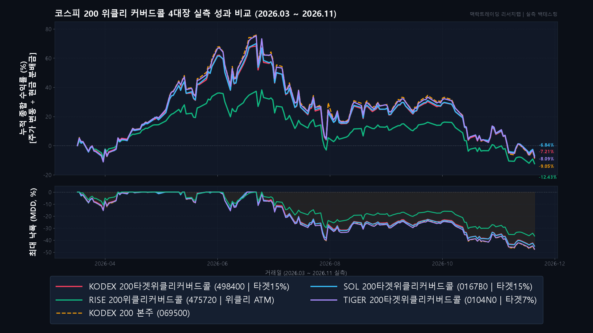
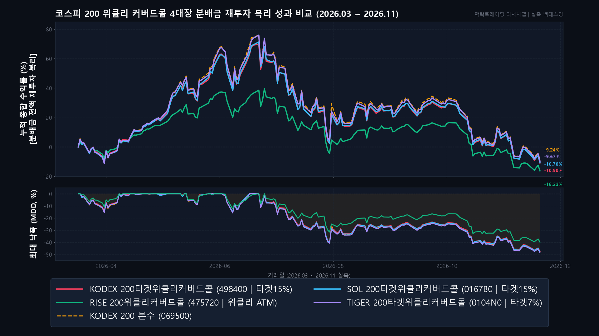

국내 상장 ETF 시장에서 단일 종목 순자산 5조 원을 돌파하며 선풍적인 인기를 끈 코스피 200 위클리 커버드콜 시장은, 2026년 들어 대형 운용사들의 격전지로 부상했습니다. 기존의 전통적인 월간 커버드콜이 지닌 극심한 상방 제한과 자본 잠식 문제를 극복하기 위해, 만기가 짧은 위클리(Weekly) 옵션을 활용하여 옵션 매도 비중을 10~30% 수준으로 낮추고 기초지수 상승 참여율을 안정적으로 도모한 '타겟 프리미엄' 구조가 시장의 대세로 자리 잡았습니다.

독주 체제를 구축한 삼성자산운용의 `KODEX 200타겟위클리커버드콜`에 맞서, KB자산운용의 `RISE 200위클리커버드콜`(ATM 구조), 신한자산운용의 `SOL 200타겟위클리커버드콜`(0.30% 보수), 그리고 미래에셋자산운용의 `TIGER 200타겟위클리커버드콜`(연 0.25% 최저보수 및 7% 타겟)이 연이어 상장하며 치열한 점유율 경쟁을 펼치고 있습니다. 

본 리서치에서는 4개 ETF가 동시 거래된 2026년 3월 17일부터 2026년 11월 20일까지의 실제 시장 데이터를 바탕으로, 초기 자본 1,000만 원 투자 시의 단순 보유(Hold) 및 분배금 전액 재투자(Reinvest TR) 실측 성과를 벤치마크 본주(`069500 KODEX 200`)와 1:1로 정밀 대조 분석합니다.

---

## 1. ETF 기본 정보 (스펙 비교)

> 출처: 한국거래소(KRX) 정보데이터시스템 및 금융감독원 전자공시시스템(DART) 투자설명서

국내 코스피 200을 기초자산으로 삼는 4대 메이저 위클리 커버드콜 ETF의 운용 구조 및 스펙은 다음과 같습니다.

| 항목 | KODEX 200타겟위클리커버드콜 | RISE 200위클리커버드콜 | SOL 200타겟위클리커버드콜 | TIGER 200타겟위클리커버드콜 |
| :--- | :--- | :--- | :--- | :--- |
| **종목코드(티커)** | `498400` | `475720` | `0167B0` | `0104N0` |
| **운용사** | 삼성자산운용 | KB자산운용 | 신한자산운용 | 미래에셋자산운용 |
| **순자산총액(AUM)** | 약 5조 1,529억 원 | 약 6,991억 원 | 약 5,210억 원 | 약 1,677억 원 |
| **총보수(연)** | 연 0.39% | 연 0.30% | 연 0.30% | **연 0.25%** |
| **기초지수** | 코스피 200 타겟 15% 위클리 커버드콜 지수 | 코스피 200 위클리 커버드콜 ATM 지수 | 코스피 200 타겟 15% 위클리 커버드콜 지수 | 코스피 200 타겟 7% 위클리 커버드콜 지수(PR) |
| **콜옵션 매도 전략** | 위클리 콜옵션 타겟 15% 매도 | 위클리 ATM(등가격) 전액 매도 | 위클리 콜옵션 타겟 15% 매도 | 위클리 콜옵션 타겟 7% 매도 |
| **지수 상승 참여율** | 약 80~85% 수준 | 제한적 (ATM 행사가 상단 캡) | 약 80~85% 수준 | **약 90~93% 수준** |
| **분배 주기 / 정책** | 월 1회 / 연 15% 목표 타겟 | 월 1회 / ATM 프리미엄 전액 | 월 1회 / 연 15% 목표 타겟 | 월 1회 / 연 7% 목표 타겟 |

---

## 2. 1년 실측 성과 비교 분석 (그래프 & 요약 테이블)

> 출처: 한국거래소(KRX) 일별 체결 데이터 및 각 운용사 공식 분배금 공시 (2026.03.17 ~ 2026.11.20)

동일한 시장 환경에서 각 ETF의 순수 자산 방어력과 토탈리턴을 측정하기 위해, 전 종목이 상장되어 거래된 2026년 3월 17일부터 2026년 11월 20일까지 1,000만 원의 초기 자본을 투자했을 때의 실측 성과를 2개 세트로 나누어 검증했습니다.

### ① [세트 1] 단순 보유(Hold) 실측 성과: 주가 변동 + 현금 분배금 수령

투자자가 매월 지급되는 현금 분배금을 인출하여 계좌 밖에서 소비하고, 계좌에 남은 원금 주식 가치와 수령한 분배금 총액을 합산하여 최종 총자산을 평가한 실측 결과입니다.

> 💡 **단순 보유 차트 포인트**: 실측 기간 코스피 200 지수가 급등락 후 완만한 조정을 거치며 본주가 -9.05%를 기록한 국면에서, 타겟형 커버드콜 3종(SOL -6.84%, KODEX -7.21%, TIGER -8.09%)은 모두 본주보다 우수한 성과를 기록하며 하방 쿠션 역할을 충실히 수행했습니다. 반면, ATM 매도 전략을 취한 RISE는 -12.43%로 본주 대비 저조한 하락률을 기록했습니다.

| 전략/종목 | 초기 원금 (원) | 최종 주식평가액 (원) | 순수 주가변동률 (%) | 누적 분배금 (원) | 최종 총자산 (원) | 종합 수익률 (Total Return) | 최대 낙폭 (MDD) | 샤프 지수 (Sharpe) |
| :--- | :---: | :---: | :---: | :---: | :---: | :---: | :---: | :---: |
| SOL 200타겟위클리 (`0167B0`) | 10,000,000 | 8,013,834 | -19.86% | 1,302,372 | 9,316,206 | **-6.84%** | -45.18% | 0.07 |
| KODEX 200타겟위클리 (`498400`) | 10,000,000 | 7,911,681 | -20.88% | 1,367,521 | 9,279,202 | **-7.21%** | -44.88% | 0.06 |
| TIGER 200타겟위클리 (`0104N0`) | 10,000,000 | 8,619,768 | -13.80% | 571,089 | 9,190,858 | **-8.09%** | -47.57% | 0.07 |
| RISE 200위클리 (`475720`) | 10,000,000 | 7,226,014 | -27.74% | 1,531,112 | 8,757,126 | **-12.43%** | -36.63% | -0.33 |
| <strong style="color: #F59E0B;">비교 대상 본주 (KODEX 200, 069500)</strong> | 10,000,000 | 9,004,549 | -9.95% | 90,388 | 9,094,937 | **-9.05%** | **-48.27%** | 0.09 |

---

### ② [세트 2] 분배금 전액 재투자(Reinvest TR) 실측 성과: 복리의 마법 vs 원금 잠식

매월 지급받은 분배금을 한 푼도 인출하지 않고 당일 종가로 전액 해당 ETF에 재투자(복리 롤링)했을 때의 결과입니다. 벤치마크 본주(`KODEX 200`) 역시 분기 분배금을 전액 본주 매수에 재투자한 동일한 TR(Total Return) 시계열을 1:1로 엄밀히 적용했습니다.

> 💡 **재투자 복리 차트 포인트**: 분배금을 전액 재투자했을 때, 모든 커버드콜 ETF에서 단순 보유 대비 성과가 1.58%p~3.86%p 악화되는 **역복리 드래그 현상(Reverse Compounding Drag)**이 뚜렷하게 관측되었습니다. 본주 TR(-9.24%)이 커버드콜 상품들 대비 상위권으로 올라섰으며, 지수 상승 참여율이 90% 이상으로 가장 높은 TIGER(-9.67%)가 커버드콜 군에서 가장 우수한 방어력을 보였습니다.

| 전략/종목 | 초기 원금 (원) | 최종 총자산 (원) | 복리 TR 수익률 (Total Return) | 단순보유 대비 격차(%p) | 최대 낙폭 (MDD) | 샤프 지수 (Sharpe) |
| :--- | :---: | :---: | :---: | :---: | :---: | :---: |
| TIGER 200타겟위클리 (`0104N0`) | 10,000,000 | 9,033,062 | **-9.67%** | **-1.58%p** (-157,796원) | -48.67% | 0.04 |
| SOL 200타겟위클리 (`0167B0`) | 10,000,000 | 8,930,317 | **-10.70%** | -3.86%p (-385,889원) | -47.88% | 0.00 |
| KODEX 200타겟위클리 (`498400`) | 10,000,000 | 8,910,146 | **-10.90%** | -3.69%p (-369,057원) | -47.55% | -0.01 |
| RISE 200위클리 (`475720`) | 10,000,000 | 8,377,243 | **-16.23%** | -3.80%p (-379,882원) | -39.95% | -0.41 |
| <strong style="color: #F59E0B;">비교 대상 본주 TR (KODEX 200, 069500)</strong> | 10,000,000 | 9,076,228 | **-9.24%** | -0.19%p (-18,709원) | **-48.45%** | 0.04 |

---

## 3. 핵심 관전 포인트 및 심층 분석

### ① 타겟 위클리 15%의 하방 쿠션 메커니즘: SOL(-6.84%) vs KODEX(-7.21%)

단순 보유 기준에서 `SOL 200타겟위클리`(-6.84%)와 `KODEX 200타겟위클리`(-7.21%)는 본주(-9.05%) 대비 각각 2.21%p, 1.84%p 초과 성과를 기록했습니다. 

이러한 하방 완충 효과는 위클리 콜옵션 매도를 통해 수취한 연 13~15% 수준의 현금 프리미엄에서 기인합니다. 지수가 하락하더라도 수취한 현금 분배금이 주가 하락분의 상당 부분을 상쇄해주었기 때문입니다. 특히 동일한 '타겟 15%' 전략 하에서 SOL이 KODEX 대비 미세한 우위를 보인 것은, 연간 0.09%p 저렴한 총보수(SOL 0.30% vs KODEX 0.39%)와 옵션 롤오버 시점의 체결 단가 차이가 실측 성과에 반영된 결과로 풀이됩니다.

### ② ATM 전액 매도의 구조적 한계: RISE 200위클리(-12.43%)의 부진 원인

반면 KB자산운용의 `RISE 200위클리`는 누적 분배금(153만 원) 측면에서는 4종목 중 가장 많은 현금을 지급했으나, 최종 종합 수익률은 -12.43%로 최하위를 기록했습니다. 

이는 ATM(등가격) 옵션 전액 매도 전략의 고질적인 '상방 캡(Cap)' 구조 때문입니다. 주간 단위로 지수가 급반등하는 구간(2026년 5~7월 랠리)에서 ATM 옵션 매도 포지션은 지수 상승분을 고스란히 옵션 매수자에게 넘겨주게 됩니다. 반면 지수가 하락할 때는 온전히 하락을 두들겨 맞으므로, **"하락은 참여하고 반등은 놓치는"** 전형적인 비대칭 손익 왜곡이 누적된 결과라는 분석입니다.

### ③ 보수적 타겟 7%의 선방: TIGER 200타겟위클리(-8.09%)

미래에셋의 `TIGER 200타겟위클리`는 연 7% 수준의 보수적인 목표 분배율을 설정한 대신, 옵션 매도 비중을 약 7~10%로 최소화하여 코스피 200 지수 상승 참여율을 90% 이상으로 유지했습니다. 

그 결과 순수 주가 변동률(-13.80%)에서 타겟 15% 상품군(-19.86%~-20.88%) 대비 원금 훼손을 현저히 방어했으며, 특히 재투자(TR) 환경에서 -9.67%를 기록하여 커버드콜 ETF 중 유일하게 한 자릿수 손실률로 선방했습니다.

### ④ AUM 5조 독주 vs 후발주자 보수 인하 경쟁: 0.39% vs 0.25~0.30% 보수 차이의 영향

코스피 200 위클리 시장의 또 다른 핵심 관전 포인트는 삼성자산운용의 선점 효과에 맞선 후발 운용사들의 총보수 인하 및 차별화 전략입니다.

* **KODEX (연 0.39% / AUM 5.1조 원)**: 압도적인 거래대금과 유동성을 바탕으로 기관과 개인 자금을 흡수하며 시장을 장악했습니다. 풍부한 호가 유동성 덕분에 대규모 매매 시 슬리피지를 최소화할 수 있는 강력한 강점이 있습니다.
* **SOL (연 0.30% / AUM 5,210억 원)**: 동일한 '타겟 15%' 운용 콘셉트를 채택하면서 총보수를 KODEX보다 연 0.09%p 낮게 책정했습니다. 실측 단순 보유 수익률에서 SOL(-6.84%)이 KODEX(-7.21%)를 0.37%p 앞선 배경에는 이러한 총보수 절감 효과와 주간 옵션 매도 시점의 미세한 체결 단가 관리가 복합적으로 기여했습니다.
* **TIGER (연 0.25% / AUM 1,677억 원)**: 비교 대상 4종 중 최저 보수(연 0.25%)를 내세우며 목표 분배율을 연 7%로 낮추어 지수 상승 참여율(90% 이상)을 대폭 높였습니다. 그 결과 원금 훼손 방어력과 재투자 복리 방어력에서 가장 안정적인 궤적을 입증했습니다.

결과적으로 풍부한 호가 유동성을 최우선시하는 단기·대형 투자자에게는 KODEX가, 장기 보유 시 복리 보수 누수를 줄이고 실질 분배 효율을 극대화하려는 투자자에게는 최저보수를 앞세운 SOL과 TIGER가 각각 합리적인 대안으로 기능하고 있다는 평가입니다.

---

### ⑤ 단순 보유 vs 분배금 재투자: 왜 재투자가 오히려 성과를 갉아먹었는가? (역복리 드래그 현상)

많은 투자자들이 "고배당 ETF의 분배금을 전액 재투자하면 복리 효과로 장기 성과가 극대화될 것"이라는 일반적인 투자 상식을 가집니다. 그러나 본 실측 백테스팅 데이터는 정반대의 결과를 여실히 보여줍니다.

* **KODEX 200타겟위클리**: 단순 보유 -7.21% ➡️ 재투자 TR -10.90% (**-3.69%p 역복리 손실**)
* **RISE 200위클리**: 단순 보유 -12.43% ➡️ 재투자 TR -16.23% (**-3.80%p 역복리 손실**)
* **SOL 200타겟위클리**: 단순 보유 -6.84% ➡️ 재투자 TR -10.70% (**-3.86%p 역복리 손실**)
* **TIGER 200타겟위클리**: 단순 보유 -8.09% ➡️ 재투자 TR -9.67% (**-1.58%p 역복리 손실**)

이러한 **'역복리 드래그(Reverse Compounding Drag)'**가 발생한 금융공학적 메커니즘은 다음과 같습니다:

1. **상방 캡이 씌워진 주식의 추가 매수**: 분배금을 재투자한다는 것은 '상방이 제한된 커버드콜 주식'을 계속해서 추가 매수하는 행위입니다. 
2. **하락장 재투자의 덫**: 지수가 하락 추세나 높은 변동성 박스권에 갇혀 있을 때, 옵션 프리미엄으로 지급된 현금을 주가 하락 중인 커버드콜 종목에 다시 투입하면, 새로 매수한 주식 역시 지수 추가 하락에 그대로 노출되어 추가적인 자본 손실(Capital Loss)을 입게 됩니다.
3. **현금의 위험 분산 기능 상실**: 단순 보유 전략에서는 지급받은 분배금이 무위험 자산인 현금(예금/CMA) 상태로 보존되어 계좌 전체의 변동성을 낮추는 '완충재' 역할을 수행합니다. 그러나 이를 전액 재투자하는 순간, 위험 자산에 대한 노출도가 100%로 유지되면서 커버드콜 고유의 비대칭 손익(상방 제한·하방 노출)이 복리로 가속화되는 부작용을 초래합니다.

따라서 커버드콜 ETF는 **"분배금을 인출하여 생활비나 현금 흐름으로 소비하는 인컴 중심 투자자"**에게 최적화된 상품이며, 자산 증식을 위해 전액 재투자를 목표로 하는 장기 적립식 투자자에게는 기초자산 본주(KODEX 200)에 직접 투자하는 것이 수학적으로 훨씬 우월하다는 결론에 도달합니다.

---

## 4. 결론 및 투자자 유형별 관점 가이드

1. **월 1% 이상의 안정적 생활비 인컴이 목적인 은퇴자**:
   * **해당 전략 부합 종목**: `SOL 200타겟위클리 (`0167B0`)` 또는 `KODEX 200타겟위클리 (`498400`)`
   * **분석 관점**: 실측 기간 단순 보유 종합 수익률(-6.84%~-7.21%)에서 본주(-9.05%) 대비 유의미한 방어력을 입증했으며, 월 1%를 상회하는 안정적인 현금 흐름을 제공합니다. 운용 보수와 슬리피지 관리 측면에서 두 상품 모두 경쟁력을 갖추고 있습니다.

2. **원금 방어력과 시장 상승 참여율을 동시에 중시하는 밸런스형 투자자**:
   * **해당 전략 부합 종목**: `TIGER 200타겟위클리 (`0104N0`)`
   * **분석 관점**: 0.25%의 최저 총보수와 7% 타겟 전략을 통해 원금 잠식률(-13.80%)을 타 커버드콜 대비 크게 억제했습니다. 재투자 드래그(-1.58%p)도 가장 작아 시장 반등 국면에서 본주를 가장 근접하게 추종할 수 있는 구조입니다.

3. **ATM 구조의 특성과 장기 보유 시 유의점**:
   * `RISE 200위클리`와 같은 ATM 커버드콜은 높은 표면 분배율에도 불구하고 반등장 상방 차단과 원금 훼손(-27.74%)이 심각하여, 장기 보유 시 토탈리턴이 훼손될 위험이 높다는 점을 명확히 인지할 필요가 있습니다.

---

## 참고 문헌 및 공인 실측 출처

> 출처: 한국거래소(KRX) 시장정보포털, 금융감독원 전자공시시스템(DART), 각 자산운용사 공식 공시

* [한국거래소(KRX) 정보데이터시스템](https://data.krx.co.kr): 코스피 200 위클리 옵션 거래제도, 일별 체결 데이터 및 상장 ETF 가격/분배금 공식 통계
* [금융감독원 전자공시시스템(DART)](https://dart.fss.or.kr): KODEX, RISE, SOL, TIGER 코스피 200 위클리 커버드콜 집합투자기구 투자설명서 및 운용보고서
* [삼성자산운용 KODEX](https://www.samsungfund.com): KODEX 200타겟위클리커버드콜 지수 구성 및 월별 분배금 지급 내역
* [KB자산운용 RISE](https://www.kbam.co.kr): RISE 200위클리커버드콜 옵션 롤오버 전략 및 펀드 공시
* [신한자산운용 SOL](https://www.shinhanfund.com): SOL 200타겟위클리커버드콜 기초지수 방법론 및 분배율 공시
* [미래에셋자산운용 TIGER](https://www.tigeretf.com): TIGER 200타겟위클리커버드콜 총보수 및 타겟 프리미엄 산출 내역

---

  <strong>⚠️ 투자 유의사항 및 법적 면책고지</strong> 
  본 리서치 보고서는 금융투자상품에 대한 이해를 돕기 위한 데이터 기반 분석 자료이며, 특정 상품에 대한 매수 또는 매도 추천이나 권유를 목적으로 작성되지 않았습니다. 과거의 운용 실적과 백테스팅 결과가 미래의 수익률을 보장하지 않으며, 옵션 매도 전략이 포함된 파생결합 ETF는 시장 급변 시 원금 손실이 발생할 수 있습니다. 모든 투자 판단과 최종 책임은 투자자 본인에게 귀속됩니다.

  커버드콜
  코스피200
  위클리옵션
  타겟커버드콜
  KODEX
  RISE
  SOL
  TIGER
  월배당
  백테스팅

