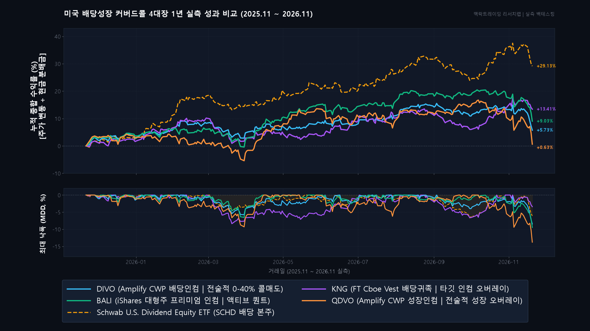
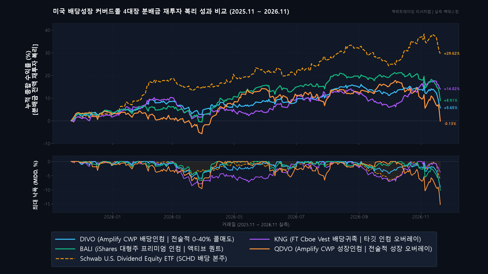

정기적인 인컴(현금흐름)을 목적으로 주식 시장에 진입하는 투자자들은 흔히 '주가 상승 탄력(자본 성장)'과 '높은 당장의 배당률' 사이에서 심각한 딜레마를 겪습니다. 나스닥 100이나 S&P 500 지수 전체에 기계적으로 100% 등가격(ATM) 옵션을 매도하는 전통적 커버드콜 ETF들은 강세장에서 주가 상승이 차단되는 상방 캡(Call Cap)으로 인해 장기적인 순자산가치(NAV) 잠식 문제를 겪기 쉽습니다. 이러한 구조적 한계를 보완하기 위해 월가에서 주목받는 대안이 바로 **배당성장 블루칩 실물 보유와 전술적·선별적 콜매도를 결합한 하이브리드 배당인컴 ETF**입니다.

2025년 11월 21일부터 2026년 11월 20일까지 최근 1년간 미국 증시는 빅테크 중심의 기술주가 높은 밸류에이션 부담 속에서 등락을 반복한 반면, 탄탄한 현금흐름과 주주환원 배당을 늘려온 배당성장주들은 강력한 하방 지지력과 차별화된 상대 강세를 나타냈습니다. 이 과정에서 각 운용사의 옵션 매도 전략(전술적 0~40% 개별주 매도, 배당귀족 타깃 인컴 오버레이, 퀀트 액티브 인덱스 매도, 성장주 선별 오버레이)에 따라 투자자가 실제로 수령한 현금 배당과 최종 자산 평가액은 상당한 차이를 기록했습니다. 미국 배당성장 커버드콜 시장을 대표하는 4대 종목과 미국 대표 배당 ETF인 **SCHD(Schwab U.S. Dividend Equity ETF)** 및 시장 지수 **SPY**의 1년 실측 데이터를 정밀 비교 분석합니다.

---

## 1. ETF 기본 정보 (스펙 비교)

미국 증시에 상장된 배당성장 및 전술적 액티브 커버드콜 4대 대표 ETF의 운용 구조 및 핵심 상품 스펙은 다음과 같습니다.

| 항목 | DIVO (Amplify CWP) | KNG (First Trust Cboe) | BALI (iShares BlackRock) | QDVO (Amplify CWP) |
| :--- | :--- | :--- | :--- | :--- |
| **티커(종목코드)** | `DIVO` (032108607) | `KNG` (33738K503) | `BALI` (46436E469) | `QDVO` (032108870) |
| **상장일** | 2016년 12월 14일 | 2018년 3월 26일 | 2023년 9월 26일 | 2024년 1월 30일 |
| **운용사** | Amplify ETFs (자문: CWP) | First Trust (자문: Cboe Vest) | BlackRock (iShares Active) | Amplify ETFs (자문: CWP) |
| **기초 주식 포트폴리오** | 20~25개 우량 배당성장주 | S&P 500 배당귀족주 (25년 연속 증액) | S&P 500 기반 액티브 퀀트 대형주 | 대형 기술 성장주 및 배당성장주 |
| **순자산총액(AUM)** | 약 82억 달러 (약 11.5조 원) | 약 35억 달러 (약 4.9조 원) | 약 16억 달러 (약 2.2조 원) | 약 9억 달러 (약 1.3조 원) |
| **총보수(연)** | 연 0.55% | 연 0.75% | 연 0.35% | 연 0.55% |
| **옵션 매도 전략** | 개별 종목 전술적 OTM 콜매도 (0~40%) | Cboe 타깃 인컴 콜옵션 오버레이 | S&P 500 지수 현금결제 옵션 오버레이 | 성장주 개별 OTM 콜매도 (0~40%) |
| **목표 분배율 / 정책** | 연 4.5% ~ 5.5% 수준 | 연 8.0% ~ 9.5% 수준 | 연 6.5% ~ 7.8% 수준 | 연 11.0% ~ 12.0% 수준 |
| **1년 실측 분배율(연환산)** | 6.81% (68.0만 원 / 1천만 원) | 9.43% (94.2만 원 / 1천만 원) | 8.58% (85.7만 원 / 1천만 원) | 11.05% (110.4만 원 / 1천만 원) |
| **분배 주기** | 월 1회 (월초) | 월 1회 (월하순) | 월 1회 (월초) | 월 1회 (월초) |
| **환노출 여부** | 환노출형 (100% 달러 자산) | 환노출형 (100% 달러 자산) | 환노출형 (100% 달러 자산) | 환노출형 (100% 달러 자산) |

---

## 2. 1년 실측 성과 비교 분석 (그래프 & 요약 테이블)

2025년 11월 21일부터 2026년 11월 20일까지 251거래일 동안 1,000만 원(초기 원금 기준)을 투자했을 때의 실제 성과를 단순 보유(Hold)와 분배금 전액 재투자(Reinvest TR) 두 가지 조건으로 나누어 실측 검증했습니다.

### ① [세트 1] 단순 보유(Hold) 실측 성과: 주가 변동 + 현금 분배금 수령

매월 입금되는 분배금을 인출하여 생활비나 현금성 자산으로 보관하고, 계좌에 남은 원금 주식 평가액과 누적 수령 분배금을 합산하여 측정한 종합 결과입니다.

> 💡 **단순 보유 차트 포인트**: 가치주와 배당주의 상대적 강세가 두드러졌던 국면에서, **KNG(+14.21%)**가 순수 주가 상승(+4.78%)과 풍부한 현금 배당(94.2만 원, 9.43%)을 앞세워 커버드콜 4종목 중 압도적 1위를 기록했습니다. **BALI(+9.03%)**와 **DIVO(+5.73%)** 역시 S&P 500 시장 지수(SPY, +5.82%)와 대등하거나 이를 상회하는 성과를 거두며 우수한 방어력을 입증했습니다. 한편, 옵션 매도 없이 순수 주식으로 복리 성장한 배당 벤치마크 **SCHD**는 **+29.13%**의 독보적인 수익률을 기록했습니다.

| 전략/종목 | 초기 원금 (원) | 최종 주식평가액 (원) | 순수 주가변동률 (%) | 누적 분배금 (원) | 최종 총자산 (원) | 종합 수익률 (Total Return) | 실측 분배율 (1년) | MDD (최대낙폭) | 샤프 지수 (Sharpe) |
| :--- | :---: | :---: | :---: | :---: | :---: | :---: | :---: | :---: | :---: | :---: |
| **KNG** (FT Cboe Vest 배당귀족) | 10,000,000 | 10,478,342 | +4.78% | 942,517 | 11,420,859 | **+14.21%** | 9.43% | **-8.38%** | 1.20 |
| **BALI** (iShares 대형주 인컴) | 10,000,000 | 10,045,132 | +0.45% | 857,511 | 10,902,643 | **+9.03%** | 8.58% | **-9.49%** | 0.81 |
| **DIVO** (Amplify CWP 배당인컴) | 10,000,000 | 9,892,038 | -1.08% | 680,612 | 10,572,650 | **+5.73%** | 6.81% | **-8.47%** | 0.61 |
| **QDVO** (Amplify CWP 성장인컴) | 10,000,000 | 8,957,825 | -10.42% | 1,104,915 | 10,062,740 | **+0.63%** | 11.05% | **-13.79%** | 0.12 |
| <strong style="color: #F59E0B;">비교 대상 배당 본주 (Schwab U.S. Dividend Equity ETF, SCHD)</strong> | 10,000,000 | 12,523,985 | +25.24% | 389,299 | 12,913,283 | **+29.13%** | 3.89% | **-6.70%** | 2.26 |

*참고: 동기간 미국 대표 시장 지수인 S&P 500 본주(SPY)는 종합 수익률 +5.82%(최종 자산 10,582,113원, 실측 분배율 1.15%, MDD -11.35%, 샤프 0.47)를 기록했습니다.*

---

### ② [세트 2] 분배금 재투자(Reinvest) 실측 성과: 전액 재투자 복리 롤링

지급받은 모든 분배금을 인출하지 않고 당일 종가 기준으로 해당 종목을 전액 재매수하여 복리 효과를 유도한 시뮬레이션 결과입니다. 비교 기준인 배당 본주(SCHD) 역시 지급된 분기 배당금을 당일 종가로 전액 재투자한 Total Return(TR) 시계열을 동일하게 산출하여 대칭 비교했습니다.

> 💡 **재투자 차트 포인트**: 분배금을 전액 재투자했을 때, 4개 커버드콜 ETF 모두 단순 보유 대비 최종 수익률이 0.07%p에서 0.76%p까지 훼손되는 역복리 드래그 현상이 실측되었습니다. 특히 성장주 변동성에 노출된 **QDVO**는 재투자 시 -0.13%로 총수익률이 마이너스 전환되었습니다. 반면 옵션 상방 캡이 없는 **SCHD TR**은 분배금 재투자를 통해 +29.62%로 성과가 확대(+0.48%p)되었습니다.

| 전략/종목 | 초기 원금 (원) | 최종 총자산 (원) | 종합 수익률 (Total Return) | CAGR (연복리) | MDD (최대낙폭) | 샤프 지수 (Sharpe) | 단순보유 대비 격차(%p) |
| :--- | :---: | :---: | :---: | :---: | :---: | :---: | :---: |
| **KNG** (FT Cboe Vest 배당귀족) | 10,000,000 | 11,402,031 | **+14.02%** | +14.02% | **-8.61%** | 1.19 | **-0.19%p** |
| **BALI** (iShares 대형주 인컴) | 10,000,000 | 10,890,541 | **+8.91%** | +8.91% | -10.20% | 0.77 | **-0.12%p** |
| **DIVO** (Amplify CWP 배당인컴) | 10,000,000 | 10,565,168 | **+5.65%** | +5.65% | -8.98% | 0.58 | **-0.07%p** |
| **QDVO** (Amplify CWP 성장인컴) | 10,000,000 | 9,987,026 | **-0.13%** | -0.13% | -15.20% | 0.07 | **-0.76%p** |
| <strong style="color: #F59E0B;">비교 대상 배당 본주 (Schwab U.S. Dividend Equity ETF TR)</strong> | 10,000,000 | 12,961,633 | **+29.62%** | +29.62% | **-6.87%** | 2.25 | **+0.48%p** |

*참고: S&P 500 본주 TR(SPY TR)은 종합 수익률 +5.80%(최종 총자산 10,579,801원, MDD -11.46%, 샤프 0.47, 단순보유 대비 -0.02%p)를 기록했습니다.*

---

## 3. 구조적 격차 분석: 4대 배당 커버드콜의 차별화 메커니즘

동일하게 배당과 옵션 인컴을 표방하면서도 종목별 실측 성과가 극명하게 갈린 이유는 상품 내부의 설계 구조에 있습니다.

1. **KNG (25년 연속 배당증액 기업 + 목표 인컴 오버레이)**: First Trust의 KNG는 기초자산으로 S&P 500 배당귀족주(Dividend Aristocrats)만을 엄선합니다. 2026년 시장에서 이익 가시성이 높은 배당귀족 기업들이 주가 우상향을 이끌었고, Cboe Vest의 옵션 오버레이는 100% 기계적 매도가 아닌 목표 분배율 달성에 필요한 수준만 선별 매도하므로 주가 상승을 4.78%나 확보할 수 있었습니다. 그 결과 배당(94.2만 원)과 주가 차익을 동시에 달성하며 압도적인 1위(+14.21%)에 올랐습니다.
2. **BALI (블랙록 퀀트 주식 포트폴리오 + 지수 옵션 덮어쓰기)**: 블랙록의 BALI는 대형주 퀀트 모델로 주식을 매수한 뒤 개별주가 아닌 S&P 500 지수 옵션을 매도합니다. 개별주 콜매도 시 발생하는 주식 강제 청산(Call Assignment) 위험을 원천 회피하여 핵심 우량주를 계속 보유할 수 있었고, 최저 수준의 수수료(연 0.35%)에 힘입어 종합 수익률 +9.03%를 기록했습니다.
3. **DIVO (전술적 0~40% 콜매도의 탁월한 하방 방어력)**: Amplify의 DIVO는 매니저(CWP)가 20~25개 핵심 배당주의 기술적 위치와 밸류에이션을 실시간 분석하여, 주가가 과열되었을 때만 부분적으로(0~40%) 콜옵션을 매도합니다. 상승 여력이 큰 종목에는 옵션을 매도하지 않고 그대로 두기 때문에 주가 하락폭(-1.08%)을 최소화하고 샤프 지수 0.61과 MDD -8.47%라는 탁월한 하방 지지력을 보여주었습니다.
4. **QDVO (고배당 수취 뒤에 가려진 성장주 변동성 덫)**: QDVO는 연 11.05%(110.4만 원)라는 가장 매력적인 현금 배당을 안겨주었습니다. 그러나 기초자산이 기술 성장주에 치우쳐 있어 기술주 조정기마다 주가가 급락(-10.42%)했고, 이후 급반등 구간에서는 매도해 둔 콜옵션에 상방이 막혀 원금을 온전히 회복하지 못했습니다. 결과적으로 높은 배당에도 불구하고 최종 총자산은 원금 수준(+0.63%)에 머물렀습니다.

---

## 4. 서학개미 직투 필수 세제 및 환율 가이드

국내 투자자가 미국에 상장된 배당 커버드콜 ETF를 직접 매매할 때 계좌 수익률을 지키기 위해 반드시 숙지해야 할 세무·외환 핵심 원칙입니다.

### ① 금융소득종합과세 2,000만 원 한도 리스크
미국 직투 ETF의 월배당금은 국내 계좌 입금 시 미국 세법상 15%의 배당소득세가 원천징수됩니다. 핵심은 **해외 주식 분배금 역시 국내 이자·배당소득과 합산되어 연간 2,000만 원을 초과할 경우 금융소득종합과세 대상자로 지정**된다는 점입니다. 종합소득세율은 최고 49.5%(지방소득세 포함)에 이르며, 건강보험료 지역가입자 전환 및 피부양자 자격 박탈 리스크가 뒤따르므로 고액 은퇴 투자자는 연간 수령 인컴 규모를 철저히 분산·관리해야 합니다.

### ② 배당소득세 vs 양도소득세(22%)와 ROC 세무 원리
* **매매차익**: 미국 주식 매매차익은 연간 250만 원 기본공제 후 단일세율 22%(양도소득세 20% + 지방소득세 2%)로 분류과세되어 금융소득종합과세에 합산되지 않습니다.
* **자본환급(ROC, Return of Capital)**: DIVO나 QDVO 등 액티브 옵션 매도 ETF는 연간 세무 보고(Form 1042-S) 시 분배금의 일부를 당해 연도 과세 대상에서 제외되는 **자본환급(ROC)**으로 분류하는 경우가 있습니다. ROC로 처리된 금액은 당장 세금이 원천징수되지 않는 대신 매수 단가(취득가액)를 낮추어 향후 매도 시 양도소득세로 이연되는 절세 효과가 있습니다. 다만 증권사별 해외 ETF ROC 반영 방식이 다르므로 사전 확인이 필요합니다.

### ③ 달러 환노출 익스포저 관리
미국 직투 상품은 100% 달러 환노출 자산입니다. 원/달러 환율이 1,400원 안팎의 고환율 구간에 머물러 있는 상황에서는 향후 달러 약세(원화 강세) 국면 진입 시 환차손으로 인해 원화 환산 실질 수익률이 축소될 수 있습니다. 달러를 직접 소비하는 유학 자금이나 해외 지출 목적이 아니라면 외환 리스크를 항상 종합 포트폴리오 관점에서 점검해야 합니다.

---

## 5. 단순 보유 vs 분배금 재투자: 왜 재투자가 오히려 성과를 갉아먹었는가? (역복리 드래그 현상)

실측 성과표에서 도출된 가장 중대한 정량적 결론은, **모든 배당 커버드콜 ETF에서 분배금을 재투자했을 때의 성과가 단순 보유보다 낮았다**는 점입니다.

- **QDVO**: 단순 보유 +0.63% ➔ 재투자 -0.13% (**-0.76%p 악화**)
- **KNG**: 단순 보유 +14.21% ➔ 재투자 +14.02% (**-0.19%p 악화**)
- **BALI**: 단순 보유 +9.03% ➔ 재투자 +8.91% (**-0.12%p 악화**)
- **DIVO**: 단순 보유 +5.73% ➔ 재투자 +5.65% (**-0.07%p 악화**)
- **비교 본주(SCHD)**: 단순 보유 +29.13% ➔ 재투자 +29.62% (**+0.48%p 복리 증대**)

### 역복리 드래그가 발생하는 수학적 원리

1. **현금 완충재(Cash Buffer) 소멸**: 시장이 단기 조정을 겪는 국면에서 매월 수취한 현금 분배금은 100%의 원금 가치를 온전히 지켜내는 든든한 방어막 역할을 합니다. 그러나 이 분배금을 곧바로 동일 종목에 재투자하면, 매수한 신규 주식이 다음 달의 추가 가격 하락에 다시 노출되며 계좌의 하방 변동성을 키우게 됩니다.
2. **콜옵션 상방 캡(Call Cap)의 비대칭 구조**: 일반 배당 성장주(SCHD)는 하락장에서 분배금으로 주식을 추가 매수(물타기)하면 향후 주가 반등 장세에서 온전한 복리 레버리지 효과를 누립니다. 반면 커버드콜 ETF는 콜옵션 매도로 인해 상방이 차단되어 있으므로, 하락장에서 싸게 산 주식이 이후 반등하더라도 원금 회복 속도가 구조적으로 제약을 받습니다. 이것이 바로 커버드콜 상품에 내재된 **역복리 드래그(Reverse Compounding Drag)** 메커니즘입니다.

---

## 6. 투자 목적별 최종 포트폴리오 가이드

1년간의 실측 데이터를 종합할 때, 투자자 성향별 최적의 대응 전략은 다음과 같습니다.

* **정기 현금흐름 수취 목적 (은퇴자 및 생활비 실수요자)**: 분배금을 재투자하지 않고 현금으로 수취하여 소비하거나 단기 안전자산에 예치하는 **[단순 보유(Hold)]** 전략이 총자본 보존과 실질 현금흐름 측면에서 가장 유리합니다. 우량 배당성장과 탄탄한 자본 차익을 동시에 추구한다면 **KNG**가 독보적인 선택지이며, 주가 변동성을 극도로 낮추고 싶다면 **DIVO**가 이상적인 대안입니다.
* **비용 효율적인 대형주 퀀트 인컴 선호**: 대형주 실물 포트폴리오를 유지하면서 연 0.35%의 저렴한 보수로 안정적인 8%대 인컴을 얻고자 한다면 **BALI**가 훌륭한 균형점을 제공합니다.
* **장기 자본 증식 목적 (자산 형성기 적립식 투자자)**: 아직 배당금을 소비할 필요가 없는 투자자라면 커버드콜 ETF에 분배금을 재투자하는 것은 수학적으로 비효율적입니다. KNG나 DIVO에서 수취한 분배금을 동일 종목에 재투자하기보다는, 상방이 온전히 열려 있는 **배당성장 본주(SCHD)나 광범위 시장 지수형 ETF(SPY/VOO)로 교차 매수하는 리밸런싱 전략**이 장기 복리 성장률을 극대화하는 현명한 접근법입니다.

---

## 투자 유의사항 및 법적 면책고지

> 본 포스팅은 객관적인 실측 데이터 분석 및 일반적인 정보 제공을 목적으로 작성되었으며, 특정 금융상품의 매수·매도를 추천하거나 투자 자문을 제공하지 않습니다. 과거의 운용 실적과 백테스팅 성과가 미래의 수익을 보장하지 않습니다. 모든 금융투자상품은 시장 변동성에 따라 원금 손실 위험이 따르며, 모든 투자에 대한 최종 결정과 책임은 투자자 본인에게 있습니다.
