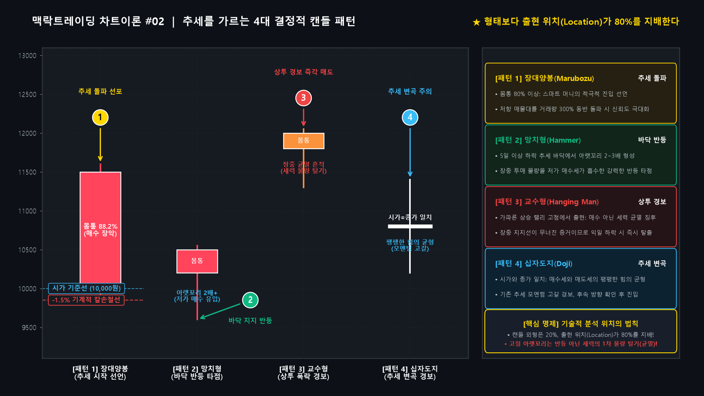
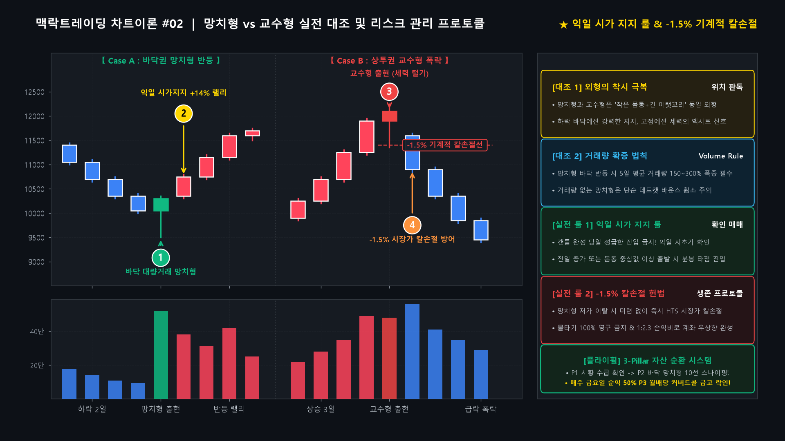

시중 주식 서적이나 기술적 분석 입문서를 읽은 초보 트레이더들이 실전 매매에서 가장 빈번하게 겪는 비극 중 하나는 "배운 대로 했는데 정반대의 결과가 나온다"는 좌절감입니다. 교과서에 적힌 대로 아래로 길게 꼬리를 달고 올라온 망치형(Hammer) 캔들을 확인한 뒤 "바닥에서 강력한 매수세가 유입되었다"고 확신하며 전 재산을 베팅했으나, 다음 날 장 시작과 동시에 주가가 거대한 갭하락으로 곤두박질치며 -10% 이상의 궤멸적인 손실을 입는 사례가 부지기수입니다. 반대로 가파르게 치솟던 종목에서 고점 십자도지(Doji)가 발생했음에도 "상승 추세의 에너지가 살아있다"며 포지션을 붙들고 있다가 하루아침에 수개월간의 누적 수익금을 전량 시장에 반납하기도 합니다.

이러한 참사가 반복되는 근본 원인은 캔들을 해석할 때 형태(Shape)에만 집착하고, 그 캔들이 놓여 있는 **'위치(Location)'와 '수급의 맥락'**을 배제했기 때문입니다. 기술적 분석의 거장 존 머피(John J. Murphy)가 강조했듯이, 캔들의 외형적 형태는 분석의 20%에 불과하며 캔들이 출현한 위치와 직전 추세의 성격이 전체 판독의 80%를 지배합니다. 작은 몸통과 긴 아랫꼬리를 가진 동일한 캔들이라도 하락 추세의 끝단 바닥에서 나타나면 세력의 저가 매집을 알리는 '망치형'이 되지만, 상승 랠리의 정점 상투권에서 나타나면 세력의 치명적인 균열과 1차 물량 털기를 폭로하는 '교수형(Hanging Man)'으로 정반대의 의미를 갖게 됩니다.

수백 가지에 달하는 복잡한 캔들 조합 중 실전 데이트레이딩과 스윙 매매에서 승률과 추세 전환 신뢰도가 가장 검증된 4대 핵심 패턴(장대양봉, 망치형, 교수형, 십자도지)의 내부 에너지 역학을 분해하고, 세력의 휩소(속임수)를 걸러내는 익일 시가 지지 룰과 -1.5% 기계적 칼손절 생존 원칙을 심층 분석합니다.

---

## 1. 형태는 20%, 위치(Location)가 80%를 지배한다: 존 머피의 기술적 분석 법칙

캔들은 개별적으로 고립되어 존재하는 정적 도형이 아니라, 시장 참여자들이 가격을 두고 벌이는 동적 힘겨루기의 연속선상에 놓여 있습니다. 따라서 캔들 하나만을 떼어놓고 "이 모양이 나왔으니 매수다"라고 단정하는 것은 시장의 맥락을 무시한 위험한 착각에 불과합니다.



### ① 존 머피의 기술적 분석 3대 전제와 캔들의 위치성

존 머피의 고전적 저작 『금융시장의 기술적 분석(Technical Analysis of the Financial Markets)』에서는 차트 분석의 3대 전제로 다음을 규정합니다:
1. **시장 행동은 모든 것을 반영한다 (Market action discounts everything)**: 경제 펀더멘털, 기업 실적, 매크로 수급뿐만 아니라 참여자들의 심리적 탐욕과 공포까지 현재 캔들의 가격에 온전히 투영됩니다.
2. **가격은 추세를 이루며 움직인다 (Prices move in trends)**: 캔들의 에너지는 직전 추세의 연장선상에서 가속되거나, 추세의 한계 국면에서 반전됩니다.
3. **역사는 스스로 반복된다 (History repeats itself)**: 인간의 심리적 편향(고점에서의 환희, 저점에서의 공포)은 과거와 동일한 캔들 구조를 반복해서 생산합니다.

여기서 가장 주목해야 할 대목은 두 번째 전제인 '추세의 맥락'입니다. 캔들의 파괴력은 해당 봉이 나타나기 직전까지 시장이 어떤 추세에 있었는지에 의해 결정됩니다. 5일 이상 수직 낙하하며 모든 참여자가 공포에 질려 패닉 투매를 던진 자리에서 형성된 캔들과, 3주 연속 급등하며 투자 경고를 받을 만큼 과열된 자리에서 형성된 캔들은 비록 픽셀 단위로 똑같은 모양을 띠고 있더라도 전혀 다른 내러티브를 내포합니다.

### ② '형태 맹신'이 초래하는 휩소(속임수) 메커니즘

초보 투자자들은 차트 서적에 나오는 패턴 도감의 외형만을 암기하여 기계적으로 대입하려는 경향이 강합니다. 그러나 스마트 머니(기관, 외인, 세력)는 대중이 어떤 캔들 형태를 보고 매수에 뛰어드는지 정확히 꿰뚫고 있습니다.

예를 들어 고점권에서 세력이 대량의 보유 물량을 정리하고 싶을 때, 장 시작부터 끝까지 무자비하게 던지면 주가가 하한가로 직행하여 자신들의 잔여 물량을 높은 가격에 처분할 수 없게 됩니다. 따라서 세력은 장 초반에 주가를 밑으로 밀어버리며 1차로 대량 물량을 털어낸 뒤, 장 마감 직전 적은 거래량으로 주가를 슬쩍 들어 올려 밑꼬리가 길게 달린 양봉처럼 꾸며놓습니다. 초보자들은 차트에 찍힌 '긴 아랫꼬리 양봉'만을 보고 "세력이 바닥을 지지해 주었구나"라고 착각하여 종가에 추격 매수하지만, 실상은 세력의 설거지(물량 분산) 트랩에 걸려든 것입니다. 이것이 바로 형태만을 보고 들어간 투자자가 맞이하는 전형적인 휩소의 구조입니다.

---

## 2. 4대 결정적 캔들 패턴의 해부학과 에너지 역학

실전 트레이딩에서 수십, 수백 가지의 잡다한 캔들 조합을 모두 외울 필요는 없습니다. 주식 시장의 모든 추세 형성과 반전은 결국 다음의 4대 결정적 패턴으로 귀결됩니다: **장대양봉(Marubozu)**, **망치형(Hammer)**, **교수형(Hanging Man)**, 그리고 **십자도지(Doji)**입니다.

| 캔들 패턴 | 핵심 외형 구조 | 주 출현 위치 | 수급 주도권 판독 | 실전 행동 강령 |
| :--- | :--- | :--- | :--- | :--- |
| **장대양봉 (Marubozu)** | 몸통 비율 80% 이상, 꼬리 극소화 | 박스권 상단, 장기 저항선 돌파 | 스마트 머니의 적극적 추세 시작 선언 | 당일 추격 대신 익일 분봉 10이평선 눌림목 공략 |
| **망치형 (Hammer)** | 작은 몸통 + 몸통의 2~3배 긴 아랫꼬리 | 5일 이상 지속된 하락 추세 바닥 | 장중 투매 물량을 저가 매수세가 완전 장악 | 익일 시가 지지 확인 후 손절가 -1.5% 잡고 스나이핑 |
| **교수형 (Hanging Man)** | 작은 몸통 + 긴 아랫꼬리 (망치형과 동일) | 가파른 급등 랠리의 최상투권 | 장중 지지선 붕괴 흔적 및 세력의 1차 물량 분산 | 보유 물량 즉시 분할 익절, 익일 음봉 시 전량 탈출 |
| **십자도지 (Doji)** | 시가와 종가 완전 일치 (수평선 몸통) | 지속 추세(상승 또는 하락)의 후반부 | 매수세와 매도세의 팽팽한 균형, 모멘텀 고갈 | 신규 진입 즉각 보류, 다음 날 방향성 확증 후 대응 |

### ① 장대양봉 (Long Bullish Candle / Marubozu): 추세 시작 선언문

장대양봉은 시가가 당일의 최저가(또는 최저가 부근)이며, 종가가 당일의 최고가 부근에서 마감하는 몸통 비율 80% 이상의 거대한 기준봉입니다.

장 시작부터 끝까지 매도 호가에 쌓여 있는 물량을 스마트 머니가 시장가로 집어삼키며 가격 통제권을 단 한 번도 놓지 않았음을 증명합니다. 특히 수개월간 돌파하지 못하던 박스권 상단이나 120일 이동평균선과 같은 장기 저항 매물대를 **'평소 거래량의 300% 이상'** 폭발적인 수급과 함께 뚫어내는 장대양봉은 가장 신뢰도 높은 추세 전환 시그널로 풀이됩니다.

단, 장대양봉이 발생한 당일 오후장에 추격 매수하는 것은 단기 고점에 물릴 위험이 큽니다. 장대양봉은 '관심종목 등록 및 추세 기준봉 설정'의 신호이며, 실제 진입은 다음 거래일에 발생하는 분봉 눌림목에서 진행하는 것이 기술적 분석의 정석입니다.

### ② 망치형 (Hammer): 바닥에서 터지는 저가 매수세의 방어선

망치형은 최소 3~5일 이상의 가파른 하락 추세 끝단에서 나타나는 강력한 반등 예고 캔들입니다.

장 초반과 중반에는 시장 참여자들의 극심한 공포로 인해 대량의 패닉 투매가 쏟아져 긴 음봉으로 무너져 내렸으나, 장 후반 특정 중요 가격대(예: 20일 이동평균선, 직전 전저점 지지선)에서 기관이나 세력의 막대한 저가 매수세가 유입되어 쏟아지는 매도 물량을 전량 흡수하고 종가를 시가 부근까지 끌어올린 형상입니다.

- **필수 기하학 조건**: 아랫꼬리의 길이가 몸통 길이의 **최소 2배 이상(권장 2.5~3배)**이어야 하며, 윗꼬리는 아예 없거나 전체 진폭의 5% 미만으로 극히 짧아야 합니다.
- **심리적 본질**: "이 가격대 밑으로는 더 이상 주가를 떨어뜨리지 않겠다"는 거대 매수 주체의 결연한 하방 방어 의지가 각인된 자리입니다.

### ③ 교수형 (Hanging Man): 고점권 세력의 치명적 균열

교수형은 교수대에 매달린 사람의 형상을 닮았다고 하여 붙여진 이름으로, 가파른 상승 랠리를 이어가던 주가의 최상투권에서 발생합니다.

충격적이게도 교수형의 외형은 망치형과 100% 동일합니다. 작은 몸통 아래로 몸통 길이의 2~3배에 달하는 긴 아랫꼬리가 달려 있습니다. 초보자들은 붉은색 아랫꼬리를 보고 "장중에 밀렸지만 결국 말아 올렸으니 상승 탄력이 살아있다"고 안도하지만, 이는 파멸로 향하는 착각입니다.

상승 추세가 완벽히 건강하다면 장중에 그토록 깊은 투매가 발생할 이유가 없습니다. 교수형의 긴 아랫꼬리는 주가가 올라가는 동안 단단하게 받쳐주던 **매수 지지 기반에 명백한 균열이 발생했음**을 폭로합니다. 세력이 보유 물량의 상당 부분을 시장가로 투하하여 장중 패닉을 유발한 뒤, 장 막판에 얕은 매수세로 종가만 올려놓은 형태이므로 교수형 출현 후 다음 날 시가가 음봉으로 떨어지면 주가는 즉시 대폭락 궤도에 진입합니다.

### ④ 십자도지 (Doji): 매수·매도 세력의 무승부와 변곡점

십자도지는 시가와 종가가 완전히 일치하거나 0.2% 이내로 초근접하여 차트상에 수평선 하나로 표시되는 캔들입니다.

장중 매수 주체와 매도 주체가 6시간 30분 동안 치열하게 공방을 주고받았으나, 장 마감 시점까지 어느 한쪽도 상대방을 제압하지 못하고 완벽한 무승부(Equilibrium)로 장을 마쳤음을 의미합니다.

- **상승 랠리 후 도지**: 이전까지 주가를 끌어올리던 매수 모멘텀이 한계에 도달하여 동력을 상실했음을 뜻합니다. 추가 상승을 견인할 새로운 매수 주체가 나타나지 않는다면 주가는 하락 반전될 확률이 75% 이상으로 관찰됩니다.
- **하락 추세 후 도지**: 시장을 지배하던 공포와 투매 압력이 일단락되었음을 뜻합니다. 매도세의 탄약이 소진되었으므로 작은 매수세만으로도 기술적 반등이 일어날 가능성이 큽니다.

---

## 3. 망치형 vs 교수형 실전 차트 대조: 똑같은 아랫꼬리의 비밀

데이트레이더가 실전에서 가장 명확하게 구별해야 할 과제는 하락 바닥의 망치형과 상승 상투의 교수형을 1초 만에 식별하는 선구안입니다.



### ① 외형 동일성의 함정과 세력의 심리 트릭

망치형과 교수형은 차트 프로그램 화면에서 똑같은 '작은 몸통 + 긴 아랫꼬리' 픽셀로 표시됩니다. 심지어 두 캔들 모두 붉은색 양봉으로 마감할 수 있습니다. 그러나 이 동일한 형태 이면에는 정반대의 자금 이동이 숨겨져 있습니다.

1. **바닥 망치형의 자금 이동**:
   - 주체: 공포에 질려 던지는 개인의 손절 물량 ➔ 스마트 머니의 저가 매집.
   - 거래 성격: 고통스러운 투매를 세력이 대량으로 받아내는 **'물량 흡수(Accumulation)'**.
2. **고점 교수형의 자금 이동**:
   - 주체: 차익 실현을 서두르는 스마트 머니의 시장가 매도 ➔ 포모(FOMO)에 사로잡혀 고점에 뛰어드는 개미의 추격 매수.
   - 거래 성격: 스마트 머니가 개미들에게 물량을 넘기고 퇴각하는 **'물량 분산(Distribution)'**.

따라서 고점에서 나타난 긴 아랫꼬리를 보고 "저가 매수가 들어왔다"고 해석하는 것은 세력의 설거지 파티에 마지막 설거지 담당자로 자진해서 들어가는 것과 같습니다.

### ② 거래량 확증 법칙 (Volume Precedes Price)

존 머피의 기술적 분석에서 가장 중요한 핵심 명제 중 하나는 **"거래량은 가격에 선행한다(Volume Precedes Price)"**입니다. 캔들의 형태가 아무리 그럴듯하더라도 거래량이 뒷받침되지 않은 패턴은 100% 모래성에 불과합니다.

- **진짜 망치형의 거래량 조건**:
  바닥권 망치형 캔들이 형성된 당일의 거래량은 직전 5일간의 평균 거래량 대비 **최소 150% 이상, 권장 200%~300% 이상 폭증**해야 합니다. 거래량이 터지지 않은 망치형은 세력의 진입이 아니라 개인들끼리의 소규모 저가 매수 공방에 불과하며, 이러한 봉은 다음 날 추가 하락을 방어할 힘이 없습니다.
- **교수형의 거래량 조건**:
  고점 교수형에서도 대량 거래량이 수반되는 경우가 많습니다. 주가는 제자리(작은 몸통)인데 거래량만 천문학적으로 터졌다면, 이는 전형적인 **'거래량 대비 가격 비효율성(Effort vs Result 다이버전스)'**으로 세력의 대규모 엑시트를 확증합니다.

### ③ 실전 사례 1:1 대조 복기

#### [Case A: 바닥권 대량거래 망치형 반등 성공 사례]
- **종목 상황**: 주도 섹터의 핵심 대장주가 4일 연속 음봉을 맞으며 -12%의 건전한 가격 조정을 거침.
- **차트 흐름**:
  - 5일째 되는 날 장중 20일 이동평균선 부근까지 -4.5% 밀려나며 개인들의 공포 손절이 쏟아짐.
  - 오후 14:00 이후 평소 거래량의 280%에 달하는 대규모 매수세가 유입되며 주가를 끌어올려 아랫꼬리가 몸통의 3배에 달하는 완벽한 망치형 완성.
  - 다음 거래일 시초가가 전일 종가 대비 +1.2% 갭상승으로 출발하며 시가를 굳건히 수호.
- **결과**: 진입 후 3일간 +14%에 달하는 강력한 V자 반등 랠리를 시현하며 전고점 탈환 성공.

#### [Case B: 상투권 교수형 출현 후 장대음봉 폭락 실패 사례]
- **종목 상황**: 단기 재료에 힘입어 3일 만에 +40% 이상 폭등하며 투자 경고가 예고된 테마주.
- **차트 흐름**:
  - 4일째 되는 날 장중 흔들기가 극에 달하며 장중 -6%까지 급락했다가 장 막판 얕은 매수세로 겨우 종가를 맞추며 고점 교수형 출현.
  - "장중 흔들기를 이겨냈으니 내일도 추가 급등할 것"이라는 막연한 기대감으로 종가에 무리하게 매수 가담.
  - 다음 거래일 개장과 동시에 -3.2% 갭하락으로 출발한 뒤, 시초가부터 기관과 외국인의 대량 시장가 매도 폭탄이 터지며 거대한 장대음봉으로 주저앉음.
- **손절 대응 복기**:
  - 진입 평단가 대비 -1.5% 터치 즉시 HTS 자동감시주문이 가동되어 전량 시장가 칼손절 집행.
  - 당일 해당 종목은 -18.5% 하한가 부근으로 마감하였으나, 기계적 -1.5% 칼손절로 계좌의 치명적 파산을 원천 방어함.

---

## 4. 세력의 휩소 원천 차단: '익일 시가 지지 룰'과 확인 매매

캔들 매매에서 초보자가 깡통을 차는 가장 큰 이유는 "캔들이 완성된 당일 성급하게 진입하기 때문"입니다. 캔들은 당일 장 마감 동시호가(15:30)가 끝날 때까지 완성된 것이 아니며, 완성된 캔들이라 할지라도 다음 날 시장 참여자들의 동의를 얻지 못하면 가짜 신호(Fake Signal)로 전락합니다.

```
[익일 시가 지지 룰 매매 프로토콜]
1. 1일차: 바닥권 망치형(또는 돌파 장대양봉) 출현 관찰 ➔ 당일 매수 절대 금지, 관심종목 등록
2. 2일차 08:30~09:00: 장전 동시호가 예상 체결가 확인
3. 2일차 09:00 개장:
   • 시초가가 전일 캔들의 종가 또는 몸통 중심값 이상에서 출발하는가? (YES ➔ 진입 대기)
   • 시초가가 전일 저가를 하회하는 갭하락으로 출발하는가? (NO ➔ 관심종목 즉시 삭제, 진입 취소)
4. 2일차 09:05~09:20:
   • 3분봉/5분봉 차트에서 09:00 시가를 깨지 않고 10이평선 지지 양봉 출현 시 스나이핑 진입!
```

### ① 가짜 망치형(Fake Hammer) 필터링

거래량 없이 형성된 망치형이나 역배열 하락 추세 한가운데서 나타난 망치형은 세력의 지지선이 결여되어 있습니다. 이러한 가짜 망치형은 다음 날 시초가부터 전일 망치형의 저가(아랫꼬리 끝단)를 깨고 내려앉으며 추가 폭락을 부릅니다.

따라서 트레이더는 **"전일 망치형의 저가를 단 1호가라도 이탈하면 시나리오 실패로 규정한다"**는 절대 원칙을 세워야 합니다.

### ② 익일 시초가 방어와 분봉 타점 연동

진정한 세력이 개입한 망치형이라면 다음 날 시초가는 전일 종가와 대등하거나 그 이상에서 형성되어야 합니다. 밤사이 악재가 없다면 전일 저가 매수에 성공한 스마트 머니가 시초가를 방어하기 때문입니다.

익일 시초가가 플러스권에서 출발하여 09:00 시가를 굳건히 지켜내는 것을 확인한 뒤, 장 초반 3분봉 또는 5분봉 10이평선으로 주가가 살짝 눌림을 주는 순간(거래량 1/3 급감 확인) 지지 양봉의 종가에 진입하는 것이 휩소를 100% 회피하는 가장 정교한 확인 매매(Confirmation Trading) 기법입니다.

---

## 5. 계좌 생존의 절대 헌법: -1.5% 기계적 칼손절과 1:2.3 손익비

기술적 분석은 미래를 100% 맞히는 마법의 수정구가 아닙니다. 아무리 완벽한 캔들 패턴과 거래량 확증을 거쳐 진입했더라도, 글로벌 돌발 악재나 세력의 변심으로 인해 타점이 실패할 확률은 언제나 20%~30% 존재합니다. 이 실패 확률이 발생했을 때 계좌를 지켜내는 유일한 방패가 바로 **-1.5% 기계적 칼손절**입니다.

### ① 손실의 비대칭성(Loss Asymmetry)과 스탑로스

손실이 커질수록 원금을 회복하기 위해 필요한 수익률은 기하급수적으로 폭증합니다:

```
• -1.5% 손실 발생 시 ➔ 원금 회복 필요 수익률: +1.52% (다음 1회 정상 매매로 즉각 복구)
• -5.0% 손실 발생 시 ➔ 원금 회복 필요 수익률: +5.26% (통상적인 스윙으로 복구 가능)
• -10.0% 손실 발생 시 ➔ 원금 회복 필요 수익률: +11.11% (심리적 압박감 시작)
• -20.0% 손실 발생 시 ➔ 원금 회복 필요 수익률: +25.00% (원칙 붕괴 위험 구간)
• -30.0% 손실 발생 시 ➔ 원금 회복 필요 수익률: +42.86% (도박성 무리한 베팅 유발)
• -50.0% 손실 발생 시 ➔ 원금 회복 필요 수익률: +100.00% (계좌 회생 사실상 불능)
```

손절을 트레이더 본인의 손가락 감정에 맡기면 인간 본연의 손실 회피 편향으로 인해 "조금만 기다리면 반등하겠지"라는 희망 고문에 빠져 손실을 키우게 됩니다. 따라서 매수 주문이 체결되는 즉시 HTS의 자동감시주문(키움증권 0621/0624 등)을 통해 **진입가 대비 -1.5% 도달 시 서버에서 자동으로 시장가 매도 주문이 전송**되도록 물리적으로 세팅해야 합니다.

또한 물타기(추가 매수)는 한 번의 실수로 계좌를 영구 파멸로 이끄는 독약이므로 맥락트레이딩 헌법상 100% 영구 금지합니다.

### ② 손익비(Risk-Reward Ratio) 1:2.3 구조의 수학적 위력

스나이퍼 매매의 승패는 승률이 아니라 손익비에 의해 결정됩니다.

- **손절 기준**: 진입 평단가 대비 **`-1.5%`** 고정.
- **1차 익절 기준**: 직전 전고점 저항선 부근인 **`+3.5%`** 도달 시 보유 물량의 50% 분할 익절.
- **잔여 물량 관리**: 나머지 50% 물량은 본전(진입가)에 스탑로스를 올려두고 5분봉 10이평선을 이탈할 때까지 추세 추종 익절.

이러한 손익비(1:2.3 이상)를 철저히 지키면 열 번의 매매 중 단 네 번만 성공하고 여섯 번을 손절당하더라도(승률 40%), 누적 손익은 지속적으로 우상향하는 수학적 필승 구조를 확립할 수 있습니다.

---

## 6. 3-Pillar 자산 순환 플라이휠: 단타 알파 수익의 월배당 금고 락인

데이트레이딩이나 단기 스윙으로 아무리 뛰어난 수익을 창출하더라도, 그 수익금을 트레이딩 계좌 예수금에 그대로 방치해 두면 언젠가 찾아오는 슬럼프나 뇌동매매 한 번으로 수개월간 쌓아 올린 수익금을 시장에 고스란히 반납하게 됩니다.

이를 원천 차단하고 영구적인 자산 증식을 완성하기 위한 체계가 맥락트레이딩의 **'3-Pillar 자산 순환 플라이휠'**입니다.

```
[Pillar 1: 나침반 (Compass)]
평일 07:00 / 15:40 데일리 1분 시황 쇼츠
• 당일 외인·기관 대량 수급 주도주 및 거시 맥락 압축 포착
• 일봉 바닥 망치형 및 돌파 장대양봉 주도 섹터 1차 선별
                  │
                  ▼
[Pillar 2: 알파 (Alpha Engine)] ◀── [본 차트이론의 핵심 실천]
실전 차트 아카데미: 4대 캔들 패턴 & 10선 눌림목 스나이핑
• 고점 교수형 상투 회피 & 바닥 망치형 익일 시가 지지 진입
• -1.5% 기계적 칼손절 & 1:2.3 손익비로 주간 알파 수익 창출
                  │
                  ▼ (매주 금요일 장 마감 후: 주간 순수익의 50% 강제 출금)
[Pillar 3: 인컴 (Cash Cow Vault)]
월배당 커버드콜 ETF 자산 락인 금고
• 절세 계좌(ISA/연금저축/일반 배당계좌)로 이체 후 커버드콜 ETF 매수
• 매월 따박따박 입금되는 월배당 캐시카우로 생활비 조급증 100% 소멸
                  │
                  └─────────► [심리적 마지노선 구축 ➔ 더욱 냉정한 스나이퍼 매매로 환류]
```

매주 금요일 장 마감 후, 주간 실현 순이익(세금 및 수수료 제외)의 정확히 **`50%`**를 트레이딩 계좌에서 즉시 출금하여 월배당 커버드콜 ETF(Pillar 3 인컴 자산) 계좌로 강제 이송합니다.

단타로 창출한 알파 수익이 영구 금고로 잠기며 매달 안정적인 월배당 현금흐름을 만들어내면, 트레이더를 괴롭히던 "매일 얼마를 벌어야 한다"는 생활비 조급증이 사라집니다. 조급증이 소멸된 트레이더만이 원하는 타점(바닥 망치형, 10선 지지)이 올 때까지 며칠이고 매수를 쉴 수 있는 최고의 심리적 우위를 확보하게 되며, 이는 더 완벽한 타점 스나이핑으로 이어지는 영구적인 플라이휠을 가동합니다.

---

<div class="post-disclaimer">
  <strong>⚠️ 투자 유의사항 및 법적 면책고지</strong><br>
  본 포스팅은 객관적인 기술적 분석 원리와 프라이스 액션 이론을 교육적 목적으로 제공하는 학술 자료이며, 특정 종목에 대한 매수 또는 매도를 권유하거나 개별 투자 자문을 제공하는 금융투자상품 광고가 아닙니다. 주식 및 파생상품 투자는 시장 변동성에 따라 원금의 일부 또는 전액 손실이 발생할 수 있으며, 모든 투자의 최종 결정과 손실에 대한 책임은 투자자 본인에게 귀속됩니다.
</div>

<div class="post-tags">
  <span class="tag-item">차트이론</span>
  <span class="tag-item">캔들패턴</span>
  <span class="tag-item">망치형캔들</span>
  <span class="tag-item">교수형캔들</span>
  <span class="tag-item">장대양봉</span>
  <span class="tag-item">십자도지</span>
  <span class="tag-item">존머피</span>
  <span class="tag-item">차트프로</span>
  <span class="tag-item">스탑로스</span>
  <span class="tag-item">손익비</span>
</div>
