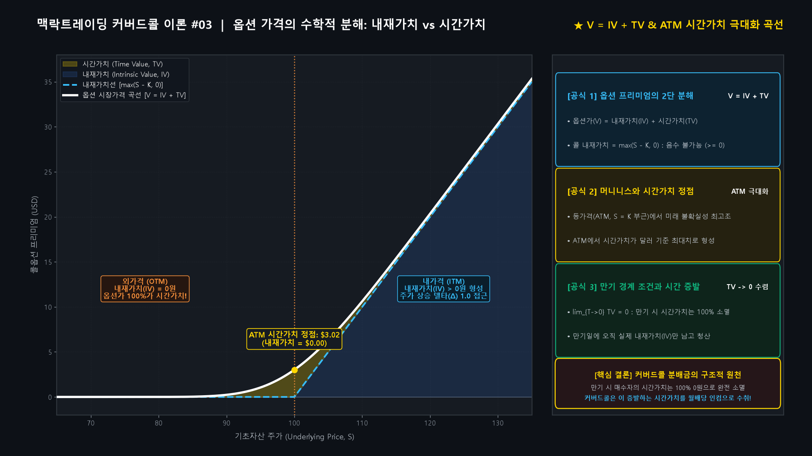
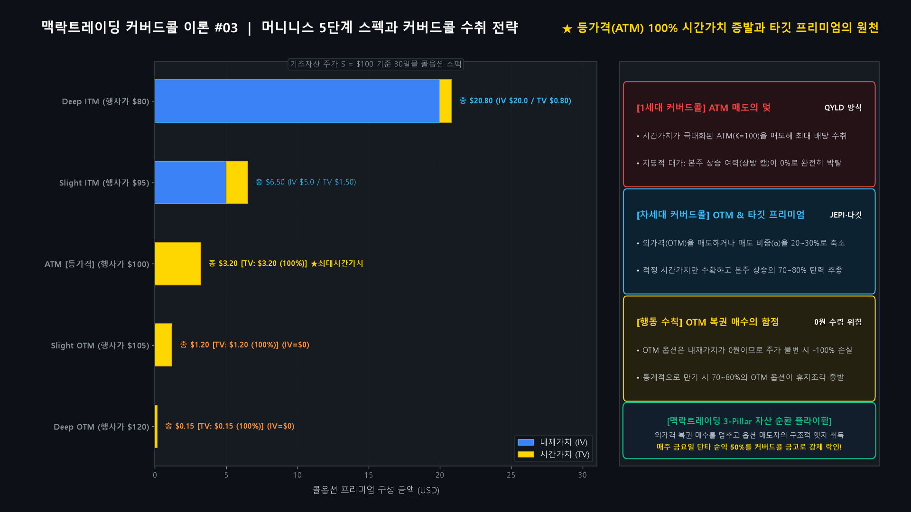

<div class="video-embed-banner" style="background: rgba(16, 185, 129, 0.1); border-left: 4px solid #10b981; padding: 16px; border-radius: 8px; margin-bottom: 24px;">
  <p style="margin: 0; font-weight: 600; color: #10b981;">📺 유튜브 심층 롱폼 영상으로 시청하기</p>
  <a href="https://www.youtube.com/@Alpha_Context" target="_blank" style="font-size: 1.05rem; font-weight: 700; color: #f8fafc; text-decoration: none;">
    ▶ [03회차] 옵션 가격의 비밀: 내재가치와 시간가치 분해 (14분 풀영상) ➔
  </a>
</div>

지난 2편에서 우리는 선물의 대칭적 의무에서 벗어나 비대칭적 권리를 거래하는 옵션의 탄생 배경과 콜옵션·풋옵션 4대 기본 포지션의 페이오프 곡선을 살펴보았습니다. 매수자는 권리를 획득하는 대가로 프리미엄을 지불하고, 매도자는 의무를 떠안는 대가로 프리미엄을 확정 수취한다는 사실을 확인했습니다.

그렇다면 여기서 한 단계 더 깊은 금융공학적 질문이 던져져야 합니다. **"HTS 화면에 찍혀 있는 옵션 프리미엄(가격)은 도대체 어떤 원리로 계산되며, 왜 어떤 옵션은 100원이고 어떤 옵션은 5,000원에 거래되는가?"** 그리고 **"왜 만기일이 다가올수록 외가격 옵션은 주가가 가만히 있어도 0원으로 휴지조각처럼 증발해 버리는가?"**

이 질문에 대한 해답을 찾지 못하면 커버드콜(Covered Call) ETF가 매달 지급하는 분배금의 실체를 결코 이해할 수 없습니다. 커버드콜의 월배당 분배금은 하늘에서 떨어지는 공짜 돈이 아니라, 바로 옵션 가격을 구성하는 핵심 성분 중 하나인 **'시간가치(Time Value)'**를 기계적으로 수확한 결과물이기 때문입니다. 옵션 프리미엄의 2단 분해 공식과 행사가격 대비 현재 주가의 상대적 위치인 **머니니스(Moneyness)**의 역학을 수학적 팩트에 기반하여 정밀 해부합니다.

---

## 1. 옵션 프리미엄의 이중 구조: 내재가치와 시간가치

주식 시장에서 삼성전자 주가가 70,000원이라면, 이는 해당 기업의 1주에 대한 현재의 교환 가치를 의미합니다. 하지만 옵션 시장의 가격표(프리미엄, $V$)는 전혀 다른 두 가지 성분이 물리적으로 결합된 **'합성 블록'**으로 이해해야 합니다.

```
┌────────────────────────────────────────────────────────────────────────┐
│                   옵션 프리미엄 (Total Option Premium, V)               │
├───────────────────────────────────┬────────────────────────────────────┤
│   내재가치 (Intrinsic Value, IV)   │     시간가치 (Time Value, TV)      │
│  "지금 당장 행사했을 때 얻는 실질 가치"  │ "만기까지 주가가 유리하게 변할 기대치"  │
│       [확정적·객관적 가치]        │       [확률적·소멸성 가치]         │
└───────────────────────────────────┴────────────────────────────────────┘
```

옵션 프리미엄 $V$는 다음과 같은 엄밀한 금융공학적 항등식으로 정의됩니다:

$$V(S, K, T, \sigma, r) = \text{Intrinsic Value}(IV) + \text{Time Value}(TV)$$

여기서 $S$는 기초자산의 현재가, $K$는 약정된 행사가격, $T$는 만기까지 남은 잔존 시간(DTE), $\sigma$는 변동성, $r$은 무위험 이자율입니다.

### ① 내재가치 (Intrinsic Value, IV): 즉시 행사의 실질 가치

내재가치는 **"만약 지금 당장 옵션 권리를 행사한다면 손에 쥘 수 있는 순수한 현금 가치"**를 의미합니다. 미래의 가능성이나 시간의 흐름을 완전히 배제하고, 현재 시점의 시장 가격($S$)과 계약된 행사가격($K$)의 차이만을 계산한 객관적 수치입니다.

* **콜옵션의 내재가치 공식**:
  $$IV_{\text{call}} = \max(S - K, 0)$$
  - 기초자산 가격 $S$가 행사가격 $K$보다 높으면($S > K$), 시장가보다 저렴한 $K$에 사서 시장에 즉시 팔 수 있으므로 $(S - K)$만큼의 확실한 내재가치가 존재합니다.
  - 반대로 주가가 행사가격보다 낮거나 같으면($S \le K$), 시장에서 직접 사는 것이 유리하므로 권리를 행사할 이유가 없습니다. 이때 내재가치는 마이너스가 되는 것이 아니라 정확히 **0원**으로 고정됩니다.

* **풋옵션의 내재가치 공식**:
  $$IV_{\text{put}} = \max(K - S, 0)$$
  - 주가가 행사가격보다 낮으면($S < K$), 시장에서 저렴하게 사서 약정된 고가 $K$에 팔 수 있으므로 $(K - S)$의 내재가치가 발생합니다. 주가가 행사가격 이상이면 내재가치는 0원이 됩니다.

금융공학에서 내재가치의 절대 불변 법칙은 **"내재가치는 절대로 음수($< 0$)가 될 수 없다"**는 점입니다 ($IV \ge 0$). 옵션 매수자는 손실이 나는 불리한 상황에서는 권리 행사를 포기할 자유가 있기 때문입니다.

### ② 시간가치 (Time Value / Extrinsic Value, TV): 미래 불확실성의 가격표

옵션 시장에서 거래되는 실제 가격 $V$에서 내재가치 $IV$를 차감하고 남은 나머지 프리미엄을 **시간가치(Time Value)** 혹은 **외재가치(Extrinsic Value)**라고 부릅니다:

$$TV = V - IV$$

시간가치는 **"만기일($T$)까지 남은 기간 동안 기초자산 가격이 유리한 방향으로 움직여 내재가치가 더 크게 발생할 수 있다는 확률적 기대감에 대해 지불하는 프리미엄"**입니다. 

예를 들어 행사가격이 100달러인 콜옵션이 있고, 현재 주가가 95달러라고 가정해 보겠습니다. 지금 당장 권리를 행사하면 0원이므로 내재가치는 0달러입니다. 하지만 HTS에서 이 옵션은 1.20달러에 거래되고 있습니다. 여기서 지불되는 1.20달러 전액이 바로 **시간가치**입니다. 매수자는 "비록 지금은 행사가격에 미치지 못하지만, 만기일까지 30일이라는 시간이 남아 있으므로 주가가 105달러나 110달러로 폭등할 수 있다"는 기대감에 베팅하며 기꺼이 1.20달러의 복권 비용을 지불하는 것입니다.

---

## 2. 옵션 가격 분해 곡선과 만기 경계 조건

이 두 성분의 결합 관계를 차트로 시각화하면, 옵션 시장의 가격 결정 메커니즘이 한눈에 드러납니다.



위 다이어그램에서 꺾은선으로 표시된 하늘색 점선은 내재가치선($IV = \max(S - K, 0)$)이며, 그 위로 완만하게 솟아오른 흰색 실선은 실제 옵션 시장가격 곡선($V$)입니다. 두 선 사이에 형성된 황금빛 음영 영역이 바로 **시간가치(TV)**의 실체입니다.

### ① 시간가치 밴드의 기하학적 특성

1. **외가격 구간 ($S < K$, OTM)**:
   - 내재가치는 바닥선인 0원에 완벽히 붙어 있습니다.
   - 따라서 이 구간에서 관찰되는 옵션 가격선은 100% 순수한 시간가치로만 지탱됩니다 ($V = TV$).
2. **등가격 구간 ($S = K$, ATM)**:
   - 내재가치는 여전히 0원이지만, 주가가 위로 튈지 아래로 꺼질지 알 수 없는 방향성 불확실성이 극대화되는 지점입니다.
   - 따라서 황금빛 시간가치 밴드의 수직 두께($TV$)가 캔버스 전체에서 **가장 거대한 정점(Peak)**을 형성합니다.
3. **내가격 구간 ($S > K$, ITM)**:
   - 주가가 행사가격을 뚫고 올라가면서 내재가치($S - K$)가 가파르게 상승합니다.
   - 주가가 깊은 내가격으로 들어갈수록 옵션은 사실상 주식 본주와 다름없이 움직이며(델타 $\Delta \to 1.0$), 추가적인 반등 기대감에 지불되는 시간가치의 비중은 점진적으로 축소됩니다.

### ② 만기 경계 조건 (Terminal Boundary Condition)

시간가치는 '시간'이라는 유한한 자원에 의존하는 가치입니다. 따라서 시간이 흘러 만기일($T \to 0$)에 도달하면 시간가치는 물리적으로 존재할 수 없게 됩니다. 이를 수학적으로 표현한 것이 **만기 경계 조건**입니다:

$$\lim_{T \to 0} TV = 0 \implies V_T = IV_T = \max(S_T - K, 0)$$

만기일 장 마감 종이 울리는 순간, 옵션 시장에 존재하던 모든 시간가치는 단 1원의 예외도 없이 **완전 소멸(0원 수렴)**합니다. 만기 시점에 옵션에 남는 것은 오직 차갑고 객관적인 '실제 내재가치($S_T - K$)'뿐입니다.

이것이 바로 커버드콜 ETF가 매달 막대한 현금흐름을 창출할 수 있는 금융공학적 비밀입니다. 옵션 매수자는 매일매일 허공으로 증발하는 시간가치를 지불하고 있고, 커버드콜 펀드는 콜옵션을 매도하여 그 증발하는 시간가치를 자신의 계좌로 고스란히 흡수하여 투자자에게 월배당으로 지급하기 때문입니다.

---

## 3. 머니니스(Moneyness)의 3대 상태와 5단계 정밀 스펙

옵션의 가격 역학을 정밀하게 분석하기 위해서는 현재 기초자산 주가($S$)와 옵션의 행사가격($K$)의 상대적 위치 관계를 나타내는 **머니니스(Moneyness)**의 개념을 명확히 정의해야 합니다.

```
[머니니스(Moneyness) 3대 상태 분류]

1. 내가격 (In-the-Money, ITM)  : S > K (콜옵션)  /  S < K (풋옵션)  ➔ 내재가치(IV) > 0
2. 등가격 (At-the-Money, ATM)  : S ≈ K (콜/풋 공통)                 ➔ 내재가치 ≈ 0, 시간가치(TV) 최대
3. 외가격 (Out-of-the-Money, OTM): S < K (콜옵션)  /  S > K (풋옵션)  ➔ 내재가치(IV) = 0 (100% 시간가치)
```

실제 시장에서 형성되는 구체적인 가격 수치를 통해 5단계 머니니스 스펙을 비교해 보겠습니다. 기초자산 주가가 $S = 100$달러이고, 잔존 만기가 30일 남은 콜옵션의 표준 가격 구성표입니다.



### [기초자산 주가 $S = 100$달러 기준 머니니스 5단계 정밀 대조표]

| 머니니스 구분 | 행사가격 ($K$) | 총 옵션가 ($V$) | 내재가치 ($IV$) | 시간가치 ($TV$) | 시간가치 비중 | 만기 주가 불변($S=100$) 시 최종 손익 |
| :--- | :---: | :---: | :---: | :---: | :---: | :--- |
| **깊은 내가격 (Deep ITM)** | $80 | $20.80 | $20.00 | $0.80 | 3.8% | $20.00 회수 (시간가치 $0.80만 감가) |
| **약내가격 (Slight ITM)** | $95 | $6.50 | $5.00 | $1.50 | 23.1% | $5.00 회수 (시간가치 $1.50 감가) |
| **등가격 (ATM)** | **$100** | **$3.20** | **$0.00** | **$3.20** | **100.0%** | **$0.00 전액 증발 (-100% 원금 손실)** |
| **약외가격 (Slight OTM)** | $105 | $1.20 | $0.00 | $1.20 | 100.0% | **$0.00 전액 증발 (-100% 원금 손실)** |
| **깊은 외가격 (Deep OTM)** | $120 | $0.15 | $0.00 | $0.15 | 100.0% | **$0.00 전액 증발 (-100% 원금 손실)** |

위 데이터 테이블을 면밀히 분석하면 투자자들이 흔히 저지르는 치명적 착각과 금융공학의 진실이 명확히 대비됩니다.

### ① 외가격(OTM) 복권 매수의 함정: 100% 시간가치의 공포

많은 초보 개인 투자자들은 가격이 0.15달러, 1.20달러에 불과한 외가격(OTM) 콜옵션을 선호합니다. "주가가 조금만 튀어 오르면 10배, 20배 대박이 난다"는 복권 심리 때문입니다.

하지만 위 표가 증명하듯, **외가격 옵션 가격의 100%는 순수한 시간가치**로만 이루어져 있습니다. 만기일까지 30일 동안 기초자산 주가가 100달러에 그대로 머물러 단 1센트도 오르지 않는다면 어떻게 될까요? 깊은 내가격($K=80$) 옵션은 내재가치 20.00달러가 든든하게 지켜주어 손실이 시간가치 0.80달러(-3.8%)에 불과합니다. 그러나 ATM과 OTM 옵션은 만기일에 **단 한 푼도 건지지 못하고 원금 100%가 허공으로 증발(-100% 전액 결손)**합니다.

실제 미국 금융통계에 따르면 만기 시점에 외가격 상태로 0원이 되어 만료되는 옵션의 비율은 전체 미결제약정의 **70%~80%**에 육박합니다. 매수자에게 외가격 옵션은 극도로 불리한 '마이너스 기대값의 카지노 베팅'인 셈입니다.

### ② 등가격(ATM)의 비밀: 왜 시간가치가 가장 거대한가?

그렇다면 왜 시간가치는 외가격이나 내가격이 아닌, 행사가격과 현재가가 일치하는 **등가격(ATM, $S \approx K$)**에서 절대 금액 기준으로 가장 거대하게 형성될까요?

금융공학적으로 시간가치는 **'확률 밀도의 분산(Variance)'**에 비례합니다. 주가가 행사가격에서 멀리 떨어져 있는 깊은 외가격이나 깊은 내가격 상태는 미래 만기 시점의 결과가 어느 정도 예측 가능합니다:
* 깊은 외가격($K=120$): 30일 안에 주가가 20% 이상 폭등하여 120달러를 넘길 확률은 통계적으로 매우 희박합니다. 따라서 시장 참여자들은 불가능에 가까운 사건에 많은 돈을 지불하지 않습니다 ($TV = \$0.15$).
* 깊은 내가격($K=80$): 주가가 80달러 위에서 끝날 확률이 95% 이상으로 거의 확실합니다. 불확실성이 거의 없으므로 추가적인 프리미엄(시간가치)은 $0.80에 불과합니다.

반면 현재 주가가 정확히 100달러인 등가격(ATM)은 주가가 101달러로 올라서 내가격이 될 확률과 99달러로 내려앉아 휴지조각이 될 확률이 **정확히 50:50의 동전 던지기 상태**에 놓여 있습니다. 양방향 불확실성이 최고조에 달하기 때문에, 시장 참여자들 간에 가장 치열한 베팅 공방이 벌어지고 그 결과 **시간가치($TV = \$3.20$)가 수학적으로 최대치**를 기록하게 됩니다.

---

## 4. 커버드콜의 진화: ATM 매도 vs OTM 매도의 전략적 선택

머니니스와 시간가치의 원리를 체득하고 나면, 시중에 출시되어 있는 다양한 커버드콜 ETF들의 설계 철학과 상품 간 성과 격차의 원인을 완벽하게 해석할 수 있습니다. 커버드콜 펀드매니저에게 옵션 매도는 곧 **"어느 지점의 시간가치를 수확할 것인가?"**의 선택 문제이기 때문입니다.

```
┌────────────────────────────────────────────────────────────────────────┐
│                   커버드콜 ETF의 머니니스별 운용 전략 대조             │
├───────────────────────────────────┬────────────────────────────────────┤
│   1세대 커버드콜 (ATM 콜 매도)     │   차세대 커버드콜 (OTM 콜 매도)     │
│   대표 상품: QYLD 등              │   대표 상품: JEPI, 타깃프리미엄 ETF  │
├───────────────────────────────────┼────────────────────────────────────┤
│ • 매도 타깃: 등가격 (K = 100)     │ • 매도 타깃: 2~3% 외가격 (K = 103) │
│ • 수취 프리미엄: $3.20 (최대치)   │ • 수취 프리미엄: $1.20 (적정 수준) │
│ • 연 분배율: 10% ~ 12% 극대화     │ • 연 분배율: 7% ~ 9% 수준          │
│ • 본주 상승 추종: 0% (완전 차단)  │ • 본주 상승 추종: 2~3% 버퍼 확보   │
│ • 장기 결과: NAV 우하향 원금 잠식 │ • 장기 결과: 주가 상승 + 인컴 복리 │
└───────────────────────────────────┴────────────────────────────────────┘
```

### ① 1세대 ATM 커버드콜의 덫: 최대 배당의 달콤한 독

1세대 커버드콜(QYLD 등)은 시간가치가 가장 거대한 **등가격(ATM, $K = 100$)** 콜옵션을 100% 비중으로 매도합니다. 
* **장점**: 매월 시간가치의 최대치($3.20달러)를 확정 수취하므로, 연 12%에 달하는 화려한 월배당 분배금을 지급할 수 있습니다. 은퇴자들의 시선을 단숨에 사로잡는 마케팅적 매력을 발휘합니다.
* **치명적 결함**: 행사가격이 현재가와 동일하므로, 만약 주가가 다음 달 5% 반등하더라도 펀드는 약정된 100달러에 주식을 넘겨주어야 합니다. 즉, **주가 상승에 따른 자본 이득(Capital Gain)이 0%로 완전히 박탈**됩니다. 반면 시장이 폭락할 때는 프리미엄 3.20달러만큼만 방어되고 나머지 하락폭을 고스란히 두들겨 맞습니다. 그 결과 반등장마다 계단식으로 원금이 깎여 나가는 '하향 래칫(Downward Ratchet) 원금 잠식'이 발생합니다.

### ② 차세대 OTM 및 타깃 프리미엄 커버드콜의 혁신

금융공학자들은 1세대 ATM 커버드콜의 구조적 결함을 극복하기 위해 머니니스를 뒤로 후퇴시킨 **외가격(OTM) 매도 방식**을 고안해 냈습니다.
* **JEPI/JEPQ의 외가격 매도**: 현재가보다 2%~3% 높은 외가격($K = 103$) 콜옵션을 매도합니다. 비록 수취하는 시간가치는 $1.20달러로 줄어들어 분배율은 연 7~9% 수준으로 낮아지지만, 기초자산이 월 2~3% 상승하는 구간까지는 본주의 자본 상승을 100% 온전히 누릴 수 있습니다.
* **타깃 프리미엄(Target Premium)의 비중 조절**: 콜옵션의 매도 비중($\alpha$)을 20%~30%로 제한하고, 나머지 70%~80%의 본주는 옵션을 걸지 않고 그대로 열어두어 나스닥이나 S&P 500의 장기 우상향 탄력을 70% 이상 추종하도록 설계합니다.

결국 커버드콜 투자란 **"시간가치 수취액(현금흐름)"과 "상방 주가 상승권(자본 방어력)" 사이의 정밀한 등가 교환**입니다. 무조건 배당률 숫자만 보고 ATM 커버드콜에 몰빵하는 행위는 시간가치의 수학적 구조를 모르는 위험한 무지에서 비롯됩니다.

---

## 5. 3-Pillar 자산 순환 플라이휠: 시간가치를 내 편으로 만드는 트레이딩 규율

맥락트레이딩 생태계에서 옵션 가격의 수학적 분해는 단순한 이론 시험 공부가 아닙니다. 데이트레이더가 시장에서 계좌를 깡통으로 만들지 않고 거대한 자산가로 성장하기 위해 반드시 실천해야 하는 **'3-Pillar 자산 순환 플라이휠'**의 핵심 작동 원리입니다.

```
┌────────────────────────────────────────────────────────────────────────┐
│              맥락트레이딩 3-Pillar 자산 순환 플라이휠 연계               │
├────────────────────────────────────────────────────────────────────────┤
│ [Pillar 1: 나침반 (Compass)]                                           │
│ 평일 07:00 / 15:40 데일리 1분 시황 쇼츠                                 │
│ • 글로벌 매크로 & 실적 발표 전후 옵션 내재변동성(IV) 팽창 감지         │
│ • ATM 옵션의 시간가치 버블 국면을 실시간 포착                          │
│                                │                                       │
│                                ▼                                       │
│ [Pillar 2: 알파 (Alpha Engine)]                                        │
│ 화요 실전 차트 아카데미: 캔들 해부학 & 10선 눌림목 스나이핑            │
│ • 만기 0원 수렴하는 외가격(OTM) 복권 매수 뇌동매매 100% 원천 차단      │
│ • 철저히 통계적 승률이 검증된 분봉 지지·저항 타점에서만 알파 창출     │
│                                │                                       │
│                                ▼ (매주 금요일 정산: 순실현익 50% 강제 출금)
│ [Pillar 3: 인컴 (Cash Cow Vault)] ◀── [본 커버드콜 마스터 아카데미]     │
│ 토요 월배당 커버드콜 ETF 자산 락인 금고                                │
│ • 만기일마다 0원으로 증발하는 옵션 매수자의 시간가치를 수확            │
│ • 차세대 OTM/타깃 프리미엄 ETF로 절세 계좌(ISA/연금) 복리 스노우볼     │
│ • 매월 입금되는 월배당금으로 고정 생활비 100% 방어선 돌파              │
│                                │                                       │
│                                └─────────► [생활비 조급증 0% ➔ 스나이퍼 매매 완성]
└────────────────────────────────────────────────────────────────────────┘
```

### ① 외가격 복권 매수의 유혹을 끊어내는 멘탈 방패

데이트레이더가 가장 쉽게 빠지는 파멸의 지름길은 당일 급등주를 쫓아가다 물렸을 때, 손실을 단번에 만회하겠다고 **만기가 며칠 남지 않은 외가격(OTM) 옵션이나 위클리 옵션을 풀베팅으로 매수하는 행위**입니다.

오늘 강의에서 확인했듯이, OTM 옵션의 가치는 100% 시간가치로만 채워져 있으며 매일매일 얼음처럼 녹아내려 결국 0원으로 수렴합니다. 매수자 입장에 서 있는 한, 시간은 내 편이 아니라 내 계좌를 갉아먹는 가장 잔혹한 적입니다. 트레이더는 이 헛된 복권 매수 충동을 철저히 억제하고, 확률적 우위가 검증된 차트 지지선 눌림목에서만 냉혹하게 방아쇠를 당겨야 합니다.

### ② 금요일 50% 락인: 시간의 중력을 매도자의 엣지로 전환하라

Pillar 2 단타 트레이딩을 통해 벌어들인 피 같은 알파 수익은 매주 금요일 장 마감 후 즉시 **`50%`**를 트레이딩 계좌에서 출금하여 Pillar 3 커버드콜 전용 금고(ISA, 연금저축펀드)로 강제 이송해야 합니다.

금고로 들어간 자금은 차세대 커버드콜 ETF에 장기 투자되어, 매달 만기일에 전 세계 옵션 매수자들이 흘리는 시간가치 증발분을 따박따박 배당 현금으로 거두어들입니다. 

시간이 흐를수록 내 계좌의 돈이 녹아내리는 매수자의 공포에서 벗어나, **"시간이 흐를수록 내 계좌로 현금이 쌓이는 옵션 매도자의 시간 중력"**을 소유하는 것. 이것이 바로 생활비 조급증을 원천 제거하고 트레이더로서의 완전한 경제적 자유를 완성하는 맥락트레이딩의 수학적 해법입니다.

---

<div class="flywheel-cta-dock" style="background: rgba(15, 23, 42, 0.8); border: 1px solid rgba(255,255,255,0.1); padding: 24px; border-radius: 12px; margin-top: 40px; text-align: center;">
  <h3 style="color: #38bdf8; margin-top: 0;">🧭 맥락트레이딩 3-Pillar 플라이휠 안내</h3>
  <p style="color: #94a3b8; font-size: 0.95rem;">
    시간가치의 마법을 활용하고, 단타의 알파를 월배당 커버드콜 금고로 안전하게 락인하세요.<br>
    매일 아침 07:00 / 15:40 정시 발행되는 <b>1분 증시 시황 쇼츠</b>와 <b>토요일 정규 백테스팅</b>을 함께 구독하세요.
  </p>
  <a href="https://www.youtube.com/@Alpha_Context?sub_confirmation=1" target="_blank" class="cta-button" style="display: inline-block; background: #10b981; color: #0b0f19; font-weight: 700; padding: 10px 24px; border-radius: 6px; text-decoration: none;">
    유튜브 채널 무료 구독하기 ➔
  </a>
</div>

<div class="post-disclaimer">
  <strong>⚠️ 투자 유의사항 및 법적 면책고지</strong><br>
  본 포스팅은 파생상품 및 커버드콜의 금융공학적 메커니즘과 포트폴리오 자산 배분 이론을 객관적·학술적 목적으로 제공하는 교육 자료이며, 특정 금융투자상품에 대한 매수·매도를 권유하거나 개별 투자 자문을 제공하는 상업적 광고가 아닙니다. 주식, 선물, 옵션 및 커버드콜 ETF 투자는 시장 변동성과 기초자산 하락에 따라 원금의 일부 또는 전액 손실이 발생할 수 있으며, 과거의 운용 실적이나 통계적 수익률이 미래의 성과를 보장하지 않습니다. 모든 투자의 최종 결정과 손실에 대한 법적 책임은 투자자 본인에게 귀속됩니다.
</div>

<div class="post-tags">
  <span class="tag-item">커버드콜이론</span>
  <span class="tag-item">옵션가격결정</span>
  <span class="tag-item">내재가치</span>
  <span class="tag-item">시간가치</span>
  <span class="tag-item">머니니스</span>
  <span class="tag-item">ITM</span>
  <span class="tag-item">ATM</span>
  <span class="tag-item">OTM</span>
  <span class="tag-item">세타소멸</span>
  <span class="tag-item">월배당</span>
  <span class="tag-item">파생생태계</span>
</div>
