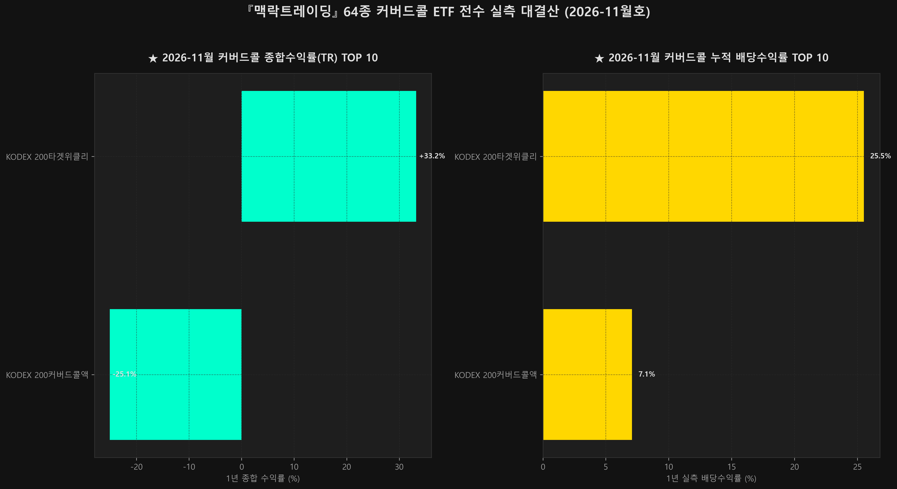

# [월간 대결산] 64종 커버드콜 ETF 전수 실측 성과 랭킹 & 종합 대차대조표 (2026-11월호)

안녕하세요, **『맥락트레이딩』(Alpha Context, [@Alpha_Context](https://www.youtube.com/@Alpha_Context))** 공식 리서치팀입니다.

국내 증시에 상장된 **총 64개 커버드콜 ETF**를 대상으로, 최근 1년간의 실측 데이터를 전수 시뮬레이션한 **2026-11월 월간 종합 대결산 리포트**를 발행합니다.
초기 1천만 원을 투자했을 때의 **최종 총자산 종합수익률(Total Return), 실제 계좌에 꽂힌 누적 현금 분배금, 그리고 계좌를 위협했던 최대 낙폭(MDD)**을 팩트 데이터로 투명하게 공개합니다.

---

## 🏆 1. 3대 부문별 명예의 전당 (TOP 10)

### 1-1. 최종 총자산 종합 수익률(Total Return) TOP 10
> *재투자(TR) 기준 1천만 원 원금의 최종 총자산 평가액 및 종합 수익률 순위입니다.*

| 순위 | 종목코드 | ETF 명칭 | 운용사 | 최종 총자산 | 종합 수익률(TR) | 누적 분배금 | MDD |
|:---:|:---:|---|---|:---:|:---:|:---:|:---:|
| **1위** | `498400` | **KODEX 200타겟위클리커버드콜** | 삼성자산운용(ETF) | 13,321,824원 | **+33.22%** | 2,550,820원 | -46.01% |
| **2위** | `0219E0` | **KODEX 200커버드콜액티브** | 삼성자산운용(ETF) | 7,492,362원 | **-25.08%** | 708,193원 | -34.29% |

### 1-2. 누적 현금 분배금(현금흐름) TOP 10
> *1천만 원 투자 시 1년 동안 계좌로 실제로 입금된 누적 현금 분배금 및 실측 배당수익률 순위입니다.*

| 순위 | 종목코드 | ETF 명칭 | 운용사 | 누적 수령 분배금 | 실측 배당률 | 최종 총자산 | 종합 수익률 |
|:---:|:---:|---|---|:---:|:---:|:---:|:---:|
| **1위** | `498400` | **KODEX 200타겟위클리커버드콜** | 삼성자산운용(ETF) | **2,550,820원** | **25.51%** | 13,321,824원 | +33.22% |
| **2위** | `0219E0` | **KODEX 200커버드콜액티브** | 삼성자산운용(ETF) | **708,193원** | **7.08%** | 7,492,362원 | -25.08% |

### 1-3. 최대 낙폭(MDD) 방어력 TOP 10
> *하락장에서 계좌 원금을 가장 단단하게 지켜낸 최소 낙폭 순위입니다.*

| 순위 | 종목코드 | ETF 명칭 | 자산군 | MDD (최대낙폭) | 종합 수익률 | 누적 분배금 |
|:---:|:---:|---|---|:---:|:---:|:---:|
| **1위** | `0219E0` | **KODEX 200커버드콜액티브** | 국내지수 | **-34.29%** | -25.08% | 708,193원 |
| **2위** | `498400` | **KODEX 200타겟위클리커버드콜** | 국내지수 | **-46.01%** | +33.22% | 2,550,820원 |

---

## 🏢 2. 운용사별 커버드콜 성과 대항전
> *국내 주요 운용사별 커버드콜 상품군의 평균 수익률과 배당률 비교입니다.*

| 운용사 | 상장 종목 수 | 평균 종합수익률(TR) | 평균 실측배당률 | 평균 MDD | 최고 성과 ETF |
|---|:---:|:---:|:---:|:---:|---|
| **삼성자산운용(ETF)** | 2개 | **+4.07%** | 16.30% | -40.15% | KODEX 200타겟위클리커버드콜 |

---

## 🌐 3. 5대 자산군/테마별 성과 해부
> *맥락트레이딩 요일별 5대 테마의 1년 실측 성과 종합 비교입니다.*

| 요일 테마 | 종목 수 | 평균 종합수익률 | 평균 배당률 | 평균 MDD | 핵심 분석 특징 |
|---|:---:|:---:|:---:|:---:|---|
| **국내지수** | 2개 | **+4.07%** | 16.30% | -40.15% | 코스피200·코스닥150 기초. 박스권 횡보장에서 월등한 인컴 방어력 입증. |

---

## 📊 4. 64종 전 종목 종합 대차대조표 (Full 64-ETF Registry)
> *초기 원금 1,000만 원 투자 기준 실측 결과 (종합수익률 순 정렬)*

| 순번 | 종목코드 | ETF 명칭 | 운용사 | 테마 | 최종 총자산 | 종합수익률 | 누적분배금 | MDD |
|:---:|:---:|---|---|---|:---:|:---:|:---:|:---:|
| 1 | `498400` | KODEX 200타겟위클리커버드콜 | 삼성자산운용(ETF) | 국내지수 | 13,321,824원 | +33.22% | 2,550,820원 | -46.01% |
| 2 | `0219E0` | KODEX 200커버드콜액티브 | 삼성자산운용(ETF) | 국내지수 | 7,492,362원 | -25.08% | 708,193원 | -34.29% |

### ℹ️ 상장일 데이터 축적 중 종목 (신규 상장 ETF)
| 종목코드 | ETF 명칭 | 운용사 | 비고 |
|:---:|---|---|---|
| `486290` | TIGER 미국나스닥100타겟데일리커버드콜 | 미래에셋자산운용 | 신규 상장 또는 데이터 축적 중 (No price history found in storage for ticker 486290) |
| `472150` | TIGER 배당커버드콜액티브 | 미래에셋자산운용 | 신규 상장 또는 데이터 축적 중 (No price history found in storage for ticker 472150) |
| `441640` | KODEX 미국배당커버드콜액티브 | 삼성자산운용(ETF) | 신규 상장 또는 데이터 축적 중 (No price history found in storage for ticker 441640) |
| `494300` | KODEX 미국나스닥100데일리커버드콜OTM | 삼성자산운용(ETF) | 신규 상장 또는 데이터 축적 중 (No price history found in storage for ticker 494300) |
| `498410` | KODEX 금융고배당TOP10타겟위클리커버드콜 | 삼성자산운용(ETF) | 신규 상장 또는 데이터 축적 중 (No price history found in storage for ticker 498410) |
| `476550` | TIGER 미국30년국채커버드콜액티브(H) | 미래에셋자산운용 | 신규 상장 또는 데이터 축적 중 (No price history found in storage for ticker 476550) |
| `458760` | TIGER 미국배당다우존스타겟커버드콜2호 | 미래에셋자산운용 | 신규 상장 또는 데이터 축적 중 (No price history found in storage for ticker 458760) |
| `475720` | RISE 200위클리커버드콜 | KB자산운용 | 신규 상장 또는 데이터 축적 중 (No price history found in storage for ticker 475720) |
| `482730` | TIGER 미국S&P500타겟데일리커버드콜 | 미래에셋자산운용 | 신규 상장 또는 데이터 축적 중 (No price history found in storage for ticker 482730) |
| `481060` | KODEX 미국30년국채타겟커버드콜(합성 H) | 삼성자산운용(ETF) | 신규 상장 또는 데이터 축적 중 (No price history found in storage for ticker 481060) |
| `0177R0` | TIGER 반도체TOP10커버드콜액티브 | 미래에셋자산운용 | 신규 상장 또는 데이터 축적 중 (No price history found in storage for ticker 0177R0) |
| `490590` | RISE 미국AI밸류체인데일리고정커버드콜 | KB자산운용 | 신규 상장 또는 데이터 축적 중 (No price history found in storage for ticker 490590) |
| `491620` | RISE 미국테크100데일리고정커버드콜 | KB자산운용 | 신규 상장 또는 데이터 축적 중 (No price history found in storage for ticker 491620) |
| `0262B0` | TIGER 200커버드콜액티브 | 미래에셋자산운용 | 신규 상장 또는 데이터 축적 중 (No price history found in storage for ticker 0262B0) |
| `0167B0` | SOL 200타겟위클리커버드콜 | 신한자산운용 | 신규 상장 또는 데이터 축적 중 (No price history found in storage for ticker 0167B0) |
| `0094M0` | RISE 코리아밸류업위클리고정커버드콜 | KB자산운용 | 신규 상장 또는 데이터 축적 중 (No price history found in storage for ticker 0094M0) |
| `483280` | KODEX 미국AI테크TOP10타겟커버드콜 | 삼성자산운용(ETF) | 신규 상장 또는 데이터 축적 중 (No price history found in storage for ticker 483280) |
| `474220` | TIGER 미국테크TOP10타겟커버드콜 | 미래에셋자산운용 | 신규 상장 또는 데이터 축적 중 (No price history found in storage for ticker 474220) |
| `0040Y0` | SOL 팔란티어커버드콜OTM채권혼합 | 신한자산운용 | 신규 상장 또는 데이터 축적 중 (No price history found in storage for ticker 0040Y0) |
| `0008S0` | TIGER 미국배당다우존스타겟데일리커버드콜 | 미래에셋자산운용 | 신규 상장 또는 데이터 축적 중 (No price history found in storage for ticker 0008S0) |
| `0144L0` | KODEX 미국성장커버드콜액티브 | 삼성자산운용(ETF) | 신규 상장 또는 데이터 축적 중 (No price history found in storage for ticker 0144L0) |
| `475080` | KODEX 테슬라커버드콜채권혼합액티브 | 삼성자산운용(ETF) | 신규 상장 또는 데이터 축적 중 (No price history found in storage for ticker 475080) |
| `473330` | SOL 미국30년국채커버드콜(합성) | 신한자산운용 | 신규 상장 또는 데이터 축적 중 (No price history found in storage for ticker 473330) |
| `489030` | PLUS 고배당주위클리커버드콜 | 한화자산운용 | 신규 상장 또는 데이터 축적 중 (No price history found in storage for ticker 489030) |
| `441680` | TIGER 미국나스닥100커버드콜(합성) | 미래에셋자산운용 | 신규 상장 또는 데이터 축적 중 (No price history found in storage for ticker 441680) |
| `493810` | TIGER 미국AI빅테크10타겟데일리커버드콜 | 미래에셋자산운용 | 신규 상장 또는 데이터 축적 중 (No price history found in storage for ticker 493810) |
| `0005A0` | KODEX 미국S&P500데일리커버드콜OTM | 삼성자산운용(ETF) | 신규 상장 또는 데이터 축적 중 (No price history found in storage for ticker 0005A0) |
| `483290` | KODEX 미국배당다우존스타겟커버드콜 | 삼성자산운용(ETF) | 신규 상장 또는 데이터 축적 중 (No price history found in storage for ticker 483290) |
| `480040` | ACE 미국반도체데일리타겟커버드콜(합성) | 한국투신운용(ETF) | 신규 상장 또는 데이터 축적 중 (No price history found in storage for ticker 480040) |
| `480020` | ACE 미국빅테크7+데일리타겟커버드콜(합성) | 한국투신운용(ETF) | 신규 상장 또는 데이터 축적 중 (No price history found in storage for ticker 480020) |
| `0104N0` | TIGER 200타겟위클리커버드콜 | 미래에셋자산운용 | 신규 상장 또는 데이터 축적 중 (No price history found in storage for ticker 0104N0) |
| `490600` | RISE 미국배당100데일리고정커버드콜 | KB자산운용 | 신규 상장 또는 데이터 축적 중 (No price history found in storage for ticker 490600) |
| `0040X0` | SOL 팔란티어미국채커버드콜혼합 | 신한자산운용 | 신규 상장 또는 데이터 축적 중 (No price history found in storage for ticker 0040X0) |
| `480030` | ACE 미국500데일리타겟커버드콜(합성) | 한국투신운용(ETF) | 신규 상장 또는 데이터 축적 중 (No price history found in storage for ticker 480030) |
| `0190G0` | KODEX 반도체타겟위클리커버드콜 | 삼성자산운용(ETF) | 신규 상장 또는 데이터 축적 중 (No price history found in storage for ticker 0190G0) |
| `0199C0` | ACE 고배당주Plus커버드콜액티브 | 한국투신운용(ETF) | 신규 상장 또는 데이터 축적 중 (No price history found in storage for ticker 0199C0) |
| `0198A0` | KIWOOM 코스닥150커버드콜액티브 | 키움투자자산운용 | 신규 상장 또는 데이터 축적 중 (No price history found in storage for ticker 0198A0) |
| `0132K0` | PLUS 테슬라위클리커버드콜채권혼합 | 한화자산운용 | 신규 상장 또는 데이터 축적 중 (No price history found in storage for ticker 0132K0) |
| `0018C0` | PLUS 고배당주위클리고정커버드콜 | 한화자산운용 | 신규 상장 또는 데이터 축적 중 (No price history found in storage for ticker 0018C0) |
| `0049M0` | ACE 미국배당퀄리티+커버드콜액티브 | 한국투신운용(ETF) | 신규 상장 또는 데이터 축적 중 (No price history found in storage for ticker 0049M0) |
| `458750` | TIGER 미국배당다우존스타겟커버드콜1호 | 미래에셋자산운용 | 신규 상장 또는 데이터 축적 중 (No price history found in storage for ticker 458750) |
| `0210E0` | PLUS 200커버드콜액티브 | 한화자산운용 | 신규 상장 또는 데이터 축적 중 (No price history found in storage for ticker 0210E0) |
| `0022T0` | SOL 국제금커버드콜액티브 | 신한자산운용 | 신규 상장 또는 데이터 축적 중 (No price history found in storage for ticker 0022T0) |
| `0000D0` | TIGER 엔비디아미국채커버드콜밸런스(합성) | 미래에셋자산운용 | 신규 상장 또는 데이터 축적 중 (No price history found in storage for ticker 0000D0) |
| `0262Y0` | SOL 200커버드콜액티브 | 신한자산운용 | 신규 상장 또는 데이터 축적 중 (No price history found in storage for ticker 0262Y0) |
| `472830` | RISE 미국30년국채커버드콜(합성) | KB자산운용 | 신규 상장 또는 데이터 축적 중 (No price history found in storage for ticker 472830) |
| `276970` | KODEX 미국S&P500배당귀족커버드콜(합성 H) | 삼성자산운용(ETF) | 신규 상장 또는 데이터 축적 중 (No price history found in storage for ticker 276970) |
| `0138T0` | RISE 미국S&P500데일리고정커버드콜 | KB자산운용 | 신규 상장 또는 데이터 축적 중 (No price history found in storage for ticker 0138T0) |
| `0223A0` | RISE 코스닥커버드콜액티브 | KB자산운용 | 신규 상장 또는 데이터 축적 중 (No price history found in storage for ticker 0223A0) |
| `0013R0` | RISE 테슬라미국채타겟커버드콜혼합(합성) | KB자산운용 | 신규 상장 또는 데이터 축적 중 (No price history found in storage for ticker 0013R0) |
| `289480` | TIGER 200커버드콜 | 미래에셋자산운용 | 신규 상장 또는 데이터 축적 중 (No price history found in storage for ticker 289480) |
| `0089C0` | KODEX 미국S&P500변동성확대시커버드콜 | 삼성자산운용(ETF) | 신규 상장 또는 데이터 축적 중 (No price history found in storage for ticker 0089C0) |
| `494420` | PLUS 미국배당증가성장주데일리커버드콜 | 한화자산운용 | 신규 상장 또는 데이터 축적 중 (No price history found in storage for ticker 494420) |
| `0104P0` | TIGER 코리아배당다우존스위클리커버드콜 | 미래에셋자산운용 | 신규 상장 또는 데이터 축적 중 (No price history found in storage for ticker 0104P0) |
| `290080` | RISE 200고배당커버드콜ATM | KB자산운용 | 신규 상장 또는 데이터 축적 중 (No price history found in storage for ticker 290080) |
| `0203D0` | PLUS 200위클리커버드콜채권혼합 | 한화자산운용 | 신규 상장 또는 데이터 축적 중 (No price history found in storage for ticker 0203D0) |
| `166400` | TIGER 200커버드콜OTM | 미래에셋자산운용 | 신규 상장 또는 데이터 축적 중 (No price history found in storage for ticker 166400) |
| `0094L0` | RISE 차이나테크TOP10위클리타겟커버드콜 | KB자산운용 | 신규 상장 또는 데이터 축적 중 (No price history found in storage for ticker 0094L0) |
| `494210` | SOL 미국500타겟데일리커버드콜액티브 | 신한자산운용 | 신규 상장 또는 데이터 축적 중 (No price history found in storage for ticker 494210) |
| `0176P0` | FOCUS AI반도체위클리고정커버드콜 | 브이아이자산운용 | 신규 상장 또는 데이터 축적 중 (No price history found in storage for ticker 0176P0) |
| `0073X0` | FOCUS 알리바바미국채커버드콜혼합 | 브이아이자산운용 | 신규 상장 또는 데이터 축적 중 (No price history found in storage for ticker 0073X0) |
| `0128D0` | PLUS 차이나항셍테크위클리타겟커버드콜 | 한화자산운용 | 신규 상장 또는 데이터 축적 중 (No price history found in storage for ticker 0128D0) |

---

## 🎯 5. 맥락트레이딩 총결산 결론 및 운용 전략

### 1. '고배당의 함정'을 피하고 '토탈리턴(Total Return)'을 보라
- 분배율이 15~20%로 아무리 높아도 기초자산 가격이 하락하여 원금이 잠식되면 최종 총자산(Total Return)은 마이너스를 기록할 수 있습니다.
- 순수 분배금 수령액뿐만 아니라 **'최종 총자산이 우상향하는가'**를 반드시 검증해야 합니다.

### 2. 단타 알파수익의 캐시카우 락인 (3-Pillar 플라이휠)
- 단타 매매(Pillar 2)로 거둔 단기 수익의 50%를 위 랭킹 상위권의 우량 커버드콜 ETF(Pillar 3)로 이송하여 확정 현금흐름으로 잠그는 시스템 투자를 구축하십시오.
- **ISA 및 연금저축/IRP** 절세 계좌를 활용할 경우 배당소득세(15.4%)가 비과세 또는 과세이연되어 복리 효과가 극대화됩니다.

---

### 📺 『맥락트레이딩』 공식 채널 안내
> **'시황으로 맥락을 읽고, 차트로 타점을 잡으며, 백테스팅으로 계좌를 지킨다.'**
> 유튜브 공식 채널 **『맥락트레이딩』([@Alpha_Context](https://www.youtube.com/@Alpha_Context))**에서 매일 실시간 매매 타점과 심층 백테스팅 강의를 확인하세요.
